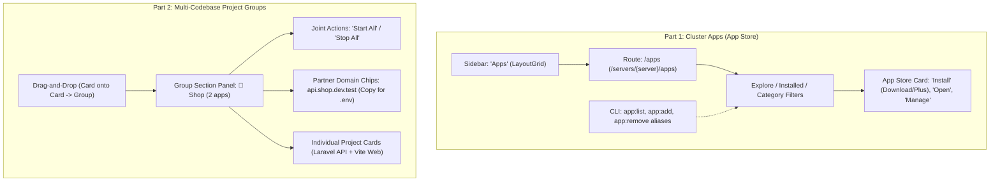

# Implementation Plan: App Store ("Tools" → "Apps") & Multi-Codebase Project Groups

This plan establishes two major architectural milestones in LaraKube:
1. **App Store Evolution**: Renaming **"Tools"** to **"Apps"** across Desktop and CLI, transforming the cluster tools catalog into a modern App Store experience (Explore, Categories, "Install" / "Get", "Open", "Manage", CLI aliases).
2. **Multi-Codebase Project Groups**: Supporting projects that consist of multiple separate codebases (e.g. a Vite frontend + Laravel API backend belonging to the same "Shop" product) via Desktop-only drag-and-drop grouping, joint lifecycle orchestration, and partner domain helper chips.

---

## Architecture Overview



---

## User Decisions Summary (from Interview)

| Decision Point | Agreed Approach |
| :--- | :--- |
| **App Store Renaming** | Rename "Tools" to **"Apps"** in sidebar (`LayoutGrid` icon) with description *"App store & services"*. |
| **Projects Separation** | Update `Projects` sidebar description to *"Deploy your code"* to eliminate confusion with "Apps". |
| **Multi-Codebase Model** | **Linked Projects**: Keep codebases as individual folders/repos (each with its own `.larakube.json`), grouped together under a shared project umbrella. |
| **Storage Location** | **Desktop-only**: Persisted in Desktop SQLite database (`projects.group` column), keeping `.larakube.json` completely untouched. |
| **Card & Group Organization** | **Drag-and-Drop**: Drag a card onto another card to create a group, drag into an existing group container, or drag out to ungroup (plus fallback menu option). |
| **Visual Presentation** | **Section Containers**: Grouped projects appear inside a dedicated panel (`📁 Shop · 2 apps`) with child cards side-by-side, with standalone projects below. |
| **Codebase Identification** | Keep existing project names and framework logos (`shop-api` + Laravel, `shop-web` + Vite). |
| **Cross-Codebase Config** | **Partner Domain Chips**: Display partner domains with 1-click copy badges (e.g. `api.shop.dev.test` [Copy for .env]) for easy pasting into frontend/backend `.env`. |
| **Group Lifecycle** | **Joint Controls**: "Start All" and "Stop All" buttons on the group container header. |

---

## Proposed Changes

### Part 1: Cluster Apps ("Tools" → "Apps" / App Store)

#### Component 1.1: Desktop Navigation & Routing
- **[MODIFY] `desktop/resources/js/layouts/app-layout.tsx`**:
  - Update `Tools` entry:
    - `label`: `'Apps'`
    - `description`: `'App store & services'`
    - `icon`: `LayoutGrid` (from `lucide-react`)
    - `href`: `/apps`
    - `active`: `/apps`, `/servers/{server}/apps`, `/tools`, `/servers/{server}/tools`
  - Update `Projects` entry:
    - `description`: `'Deploy your code'` (was `'Deploy your apps'`)
- **[MODIFY] `desktop/routes/web.php`**:
  - Register `/apps` and `/servers/{server}/apps/*` routes handled by `ClusterToolController`.
  - Maintain `/tools` and `/servers/{server}/tools/*` redirects for backward compatibility.
- **[MODIFY] `desktop/app/Http/Controllers/ClusterToolController.php`**:
  - Update `entry()` redirect target to `servers.apps.index`.

#### Component 1.2: App Store User Interface
- **[MODIFY] `desktop/resources/js/pages/tools/index.tsx`**:
  - Title: **Apps**
  - Subtitle: *"Turnkey server applications ready to install with one click. Automatic HTTPS, custom domains, and single sign-on."*
  - Tabs: **Explore** (Available to install), **Installed** (Active apps on this server), and **All Apps**.
  - Search Placeholder: *"Search 30+ apps (wiki, s3, chat, identity, analytics…)"*.
  - **AvailableCard**: Action button styled as App Store **"Install"** / **"Get"** with `Download` / `Plus` icon.
  - **InstalledCard**: Action buttons: **"Open"** with `ExternalLink` and **"Manage"** with `ArrowRight` / `Sliders`.
- **[MODIFY] `desktop/resources/js/pages/tools/show.tsx`**:
  - Update breadcrumb: `← Apps on {server.name}`.
  - Labels updated to "App Details", "Uninstall App".
- **[MODIFY] `desktop/resources/js/pages/servers/show.tsx`**:
  - Tab header updated from `Cluster Tools` to `Apps · {count}`.

#### Component 1.3: CLI Command Aliases
- **[MODIFY] `cli/app/Commands/Tool/ToolListCommand.php`**: Add `$aliases = ['app:list'];`
- **[MODIFY] `cli/app/Commands/Tool/ToolAddCommand.php`**: Add `$aliases = ['app:add'];`
- **[MODIFY] `cli/app/Commands/Tool/ToolRemoveCommand.php`**: Add `$aliases = ['app:remove'];`
- **[MODIFY] `cli/app/Commands/Tool/ToolShowCommand.php`**: Add `$aliases = ['app:show'];`
- **[MODIFY] `cli/app/Commands/Tool/ToolInitCommand.php`**: Add `$aliases = ['app:init'];`

---

### Part 2: Multi-Codebase Project Groups

#### Component 2.1: Database Migration & Model
- **[NEW] `desktop/database/migrations/2026_10_21_000001_add_group_to_projects_table.php`**:
  - Add `$table->string('group')->nullable()->after('name')->index();` to `projects` table.
- **[MODIFY] `desktop/app/Models/Project.php`**:
  - Add `'group'` to `$fillable`.
  - Add scope/helper for groups.
- **[MODIFY] `desktop/app/Http/Controllers/ProjectController.php`**:
  - Pass `'group'` in serialized project arrays.
  - Add `POST /projects/{project}/group` endpoint to assign, rename, or clear a project's group:
    ```php
    public function updateGroup(Request $request, Project $project): JsonResponse
    {
        $validated = $request->validate(['group' => 'nullable|string|max:100']);
        $project->update(['group' => $validated['group'] ?: null]);
        return response()->json(['success' => true, 'group' => $project->group]);
    }
    ```
  - Add `POST /projects/groups/{group}/start` and `POST /projects/groups/{group}/stop` endpoints for joint lifecycle execution across member projects.
- **[MODIFY] `desktop/routes/web.php`**:
  - Register `/projects/{project}/group` and `/projects/groups/{group}/(start|stop)`.

#### Component 2.2: Frontend Drag-and-Drop & Group Components
- **[NEW] `desktop/resources/js/components/project-group-section.tsx`**:
  - Panel container for a grouped set of projects:
    - **Header**:
      - Group title (`📁 {groupName}`) with inline rename input on click/edit.
      - App count badge (`2 apps`).
      - Joint Action Buttons:
        - **"Start All"** with `Play` icon (starts all member projects).
        - **"Stop All"** with `Square` icon (stops all member projects).
      - **Partner Domain Helper Chips**:
        - List each member's domain (e.g. `api.shop.dev.test`, `shop.dev.test`) with a 1-click **Copy for .env** button (`Copy` icon) that copies `https://{domain}` to clipboard with toast notification.
    - **Dropzone Area**:
      - Accepts dragged cards to add them to this group.
    - **Grid Area**:
      - Renders the member `<ProjectCard />` components side-by-side.
- **[MODIFY] `desktop/resources/js/pages/projects/index.tsx`**:
  - Enable HTML5 Drag-and-Drop:
    - Cards have `draggable` enabled (`onDragStart` sets dragged project ID).
    - Dropping a card onto another card prompts / creates a new group.
    - Dropping a card onto an existing group drops it into that group.
    - Dropping a card onto the "Ungroup" / standalone dropzone clears its group.
  - Render grouped projects in `<ProjectGroupSection />` panels first, followed by standalone projects in the grid below.
  - Add "Assign to group..." in project card action menus as an accessible alternative to drag-and-drop.

---

## Verification Plan

### Automated Tests
1. **Desktop Feature Tests**:
   - `cd desktop && ./vendor/bin/pest tests/Feature/ClusterToolsTest.php` (tests `/apps` and `/tools` redirects).
   - `cd desktop && ./vendor/bin/pest tests/Feature/ProjectGroupTest.php` (tests group assigning, joint start/stop, clearing group).
   - `cd desktop && ./vendor/bin/pest tests/Feature/ProjectsTest.php`.
2. **CLI Feature Tests**:
   - `cd cli && ./vendor/bin/pest tests/Feature/ToolListTest.php` (tests `app:list` and `tool:list` aliases).
3. **Static Analysis & Linters**:
   - `npm --prefix desktop run types:check`
   - `cd desktop && ./vendor/bin/phpstan analyse --memory-limit=1G`
   - `cd desktop && ./vendor/bin/pint --test`

### Manual Verification
1. **App Store Experience**:
   - Check Desktop navigation: Click **"Apps"** (with `LayoutGrid` icon).
   - Verify header shows **Apps** with App Store description.
   - Verify tabs **Explore** (Available) and **Installed**.
   - Verify action buttons: **Install** (`Download`/`Plus`), **Open** (`ExternalLink`), and **Manage** (`ArrowRight`).
   - Check CLI: Run `php larakube app:list` in terminal and verify it lists cluster apps identically to `tool:list`.
2. **Multi-Codebase Project Groups**:
   - Open `/projects`.
   - Drag a Vite project card onto a Laravel project card:
     - Verify a group section is created (e.g. `📁 Shop`).
     - Verify both cards are rendered side-by-side inside the group.
   - Click **"Copy for .env"** on the backend domain chip:
     - Verify `https://backend.dev.test` is copied to clipboard.
   - Click **"Start All"**:
     - Verify both the frontend and backend containers spin up together.
   - Drag a card out of the group:
     - Verify it returns to the standalone project grid.
