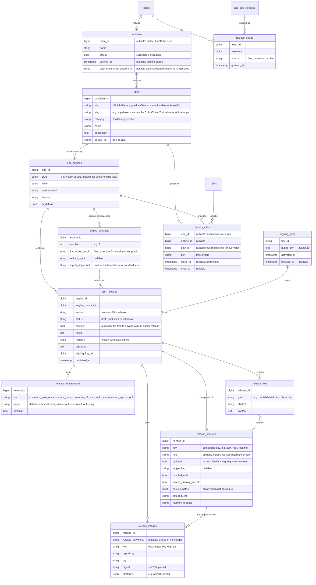

# LaraKube Cloud as the Catalog and Entitlement Source

**Status:** Design agreed in discussion; open questions below. Builds on `cluster-tool-marketplace.md`. Nothing here is built yet.

**Goal:** LaraKube Cloud becomes the one place that says which Cluster Tool images and versions are current, which provider regions and machine types exist, and which tools a customer is entitled to. The LaraKube CLI and LaraKube Desktop read that, and keep working offline.

**Audience first:** non-developers. Their path is create a server, install apps, and have updates, SSO and backups handled. Developer features such as project deploys come later.

## Where things are today

- Tool images and tags are hardcoded in the LaraKube CLI, mostly inside 107 of its 239 Blade templates under `resources/views/k8s`, plus a few enums.
- Updating an image means a CLI release. Stale pins have caused incidents before (the ESO one).
- Provider regions and machine types: Desktop and Cloud read them live with the customer's own credentials. Cloud now caches Google's for 12 hours per credential.
- `cloud:login` already exists, but it signs in to cloud **providers** (Google Cloud, DigitalOcean, Cloudflare), not to LaraKube Cloud.

## Proposed design

### 1. A signed catalog of images, versions and provider data

LaraKube Cloud publishes a catalog snapshot as JSON:
- **Each tool:** components, image repository, tag and digest, the template schema version it fits, and its tier (free or paid).
- **Provider data:** a public baseline of regions and machine types, for when no credential is connected yet.

How it's served and trusted:
- **Signing:** snapshots are immutable and versioned. Cloud signs each one with Ed25519 (libsodium), and the CLI and Desktop ship the public key.
- **Before use:** the client checks the signature first, and refuses a snapshot that fails.
- **Caching:** the client caches the snapshot in `~/.larakube/catalog.json` and refreshes it with ETags.
- **Offline:** without a network, the client uses its cached snapshot. Without a cache, it uses the values built into that release. A catalog can't point a template at an image it wasn't written for, because each entry names the template schema version it fits.
- **Admin:** staff edit the catalog in Filament (a new permission, `admin.catalog.manage`), publish a snapshot, and can roll back to an earlier one.

### 2. Templates are downloaded, signed and cached

This follows the decision already made in `cluster-tool-marketplace.md`: full template content lives in Cloud, signed when published, and the CLI verifies it before compiling. The signature matters because Blade compiles to PHP, so an unsigned template is code from an unknown source. The signing key stays in the release pipeline and never sits on the Cloud server, so a breached Cloud server can't sign anything.

**First use, for example `openbao:init`:**
1. The CLI looks in `~/.larakube/templates/<tool>/<engine>/<version>/`.
2. If the template isn't there, it downloads the release from Cloud, verifies the signature against the public key built into the CLI, and saves it there.
3. Later runs use the saved copy, so the tool keeps working offline.

**Tracking versions:** `~/.larakube/templates/lock.json` records each tool's engine, version, content hash, signature and download date. Two commands use it:
- `templates:outdated` lists tools with a newer release, marking security fixes.
- `templates:update` downloads the newer releases. A project keeps the version it was deployed with until it's updated on purpose, so re-running `*:init` never drifts.

**Sharing is allowed.** A signature covers the content, not the person. A template a friend copied over is still signed by Cloud and verifies, as long as it sits in the same folder pattern.

**Customizing is allowed, with explicit trust.** An edited template no longer matches its signature, so the CLI won't run it silently.
- `templates:trust <tool>` records the edited copy's hash, after a warning that the user now owns it.
- Every run of a trusted, edited template prints a short reminder. Updates never overwrite it.
- If the file changes again after trusting, the CLI asks again. A tampered file never runs without someone accepting it.

**Windows:** Cluster Tool commands run on the Windows host, so templates live in `%USERPROFILE%\.larakube\templates`. The LaraKube Linux (WSL) distro already shares `config.json` with Windows, so it reads the same folder through `/mnt/c/...` and keeps a single copy. Tool slugs and folder names stay lowercase ASCII, so case-insensitive Windows paths can't clash.

### 2b. Releases of compound tools, and how compatibility is stored

Supabase is the model case: 6 template files (1,544 lines) render 11 components. Its templates don't name images; they call back into the LaraKube CLI, for example `{{ $tool->vendor()->image('auth') }}`. So a template depends on CLI code, not only on a few variables.

**One release is the whole tool.** It contains every file in the tool's folder (for Supabase, `core`, `db`, `gateway`, `ingress`, `optional` and `partials/wait-for-db`) plus a signed `manifest.json`. Optional components such as Realtime or imgproxy are branches inside those templates, so they always ship together. `templates:import` refuses a template that includes a file outside its own folder, unless that file is copied into the release.

**Image versions move into the release.** The manifest pins every component's image by digest. A Supabase release pins all 11 together as one tested set, because Supabase's components must upgrade together. `$tool->vendor()->image('auth')` reads the active release's manifest and falls back to the CLI's built-in value. This is how Cloud becomes the source of image versions.

**Compatibility is a per-tool contract number, not a CLI version.**
- **What a contract is:** everything a tool's templates may use. That's the values its command passes in, such as `$names` and `$namespace`, and the CLI helpers templates call: `$tool->vendor()->image()`, `$tool->secret()`, `$tool->database()`, `$tool->defaultEnv()` and `$tool->vpnMiddleware()`.
- **Two sides:** each tool in the CLI declares the contract numbers it supports, for example Supabase supports `[3]`, or `[2, 3]` during a change. Each release states the one contract it was written for.
- **Matching:** the CLI only downloads and runs a release whose contract it supports. The download API takes the contract, so Cloud returns the newest compatible release.
- **Why not `min_cli_version`:** CLI releases change many tools at once, so a CLI version says nothing about whether this tool's templates still fit. A per-tool contract changes only when that tool's template inputs change.
- **The minimum CLI version is still shown:** Cloud records which CLI version first shipped each contract, so a user on an older CLI is told "update the LaraKube CLI to use this release".
- **Keeping it honest:** a CLI test fingerprints each tool's template inputs and the helpers its templates call. Changing them fails the test until that tool's contract number goes up. Cloud's release pipeline renders each new release with a CLI that supports its contract and compares the output, before signing.

**Example manifest:**

```json
{
  "tool": "supabase",
  "engine": "default",
  "version": "1.4.0",
  "contract": 3,
  "security": false,
  "images": {
    "db": "supabase/postgres:<tag>@sha256:<digest>",
    "auth": "supabase/gotrue:<tag>@sha256:<digest>"
  },
  "files": {
    "core.blade.php": "sha256:<hash>",
    "partials/wait-for-db.blade.php": "sha256:<hash>"
  }
}
```

The `images` and `files` lists are abbreviated here. The signature covers the whole manifest, and the manifest covers every file by hash, so changing any file or any image breaks the signature.

**Where it's stored:** see the database design below. On the user's machine, `~/.larakube/templates/<tool>/<engine>/<version>/` holds the files plus `manifest.json` and `manifest.sig`, and `lock.json` records which version each tool and engine is using.

### 3. Signing in from the CLI and Desktop

- **Browser sign-in:** an OAuth 2.0 device authorization grant, through Laravel Passport, which supports it. The CLI shows a code, you approve it in the browser, and the CLI gets a token. This matches the earlier Cloud plan's "CLI auth = Passport Device Grant".
- **Key for CI and servers:** a personal access token, created in Cloud and scoped (for example `catalog:read`).
- **Command name:** a new, separate command, since `cloud:login` is the provider sign-in. For example, `account:login`. To be decided.

### 4. Entitlements

Entitlements are data, not code, so prices and free tools change without a CLI release.
- **Default:** each tool has a default tier. **Free now:** OpenBao, PocketBase, n8n, WordPress and Supabase. Making everything free is just a setting.
- **Promotions:** a rule can make a tool or tier free for everyone in a date range, for example free for a month. Releases downloaded during a promotion stay usable afterwards.
- **Perpetual fallback:** once a team has a release, it keeps it, offline too. Only releases published after a subscription lapses need a paid plan again.
- **Security fixes are always free.** A release marked as a security fix is available to anyone who has an earlier release of that tool.
- **API:** `GET /api/v1/entitlements` returns the team's access. It's signed and expires, with a grace period. The CLI only consults it when downloading. It never blocks a template that's already saved.

### 5. Billing

- **Now:** PayMongo foundation is in Cloud: a Saloon connector, verified webhooks recorded once each, and `paymongo:check`.
- **When subscription approval arrives:** add plans and prices, subscriptions, invoices and dunning. The webhook handlers that act on events come at that point too.

## Database design

A feature is almost always several services, so the schema models them explicitly. It mirrors the layers the LaraKube CLI already has:
- **App:** anything installable from the store. Official apps match the CLI's `ClusterTool` values, for example `sso` or `supabase`.
- **Engine:** an implementation of an app, from `ClusterTool::engines()`, for example Matrix's Synapse + Element.
- **Component:** one service, from `ClusterToolComponentData`. It carries a key, a role (`primary`, `ingress`, `worker`, `database` or `auth`), backup paths, and whether it shares the main service's secret.
- **Image:** keyed separately, from `HasImages`, because one service can need several images, such as init containers and sidecars.
- **Requirement:** what an engine needs from the cluster, from `HasCommonsDatabases`, `HasCommonsBuckets`, `HasCommonsRedisKeys`, `HasOidcWiring`, `HasOpenbaoSync` and `HasDependencies`.

**The composition belongs to each release, not to the app.** A new Supabase release can add or drop a service, so its services, images, requirements and files are versioned together. A release is published once and never edited; a fix is a new release.



**Supabase as an example.** One `apps` row, `supabase`, and one engine row, `default`, because Supabase has a single implementation. Each Supabase release then has:
- 11 `release_services`: `db` (database), `auth` (auth), `gateway` (ingress), and `rest`, `realtime`, `storage`, `studio`, `meta`, `functions`, `imgproxy` and `supavisor`. Realtime, functions, imgproxy and the pooler are optional, each with its toggle flag.
- 11 `release_images`, each pinned by digest.
- 6 `release_files`, each mapped to the services it renders. For example, `optional.blade.php` renders Realtime, functions, imgproxy and the pooler.
- Its `release_requirements`: its Commons storage bucket, plus optional SMTP and VPN wiring.

**How the pieces work together:**
- **Compatibility:** a release points at one engine contract. The CLI declares which contract numbers each engine supports, and Cloud's download API returns the newest published release whose contract matches.
- **Signing key rotation:** each release records which key signed it. The CLI ships every non-revoked public key, so a key can be rotated, or revoked after a leak, without breaking older releases.
- **Pricing and promotions:** `access_rules` resolve from most to least specific: release-wide promotions, then engine, then app, then global. Making everything free is one global rule.
- **Perpetual fallback:** `release_grants` records each release a team has received, so a lapsed plan never takes it away. A security release is granted to any team that holds an earlier release of the same engine.
- **The signed manifest is the source of truth.** The `release_*` tables are its queryable form, written in the same transaction and never edited after publishing.

**Provider data, kept apart from apps:**
- **Tables:** `providers`, `provider_regions`, `provider_zones`, `provider_machine_types`, and `provider_zone_machine_types` for which zone offers which type.
- **Updating:** a scheduled sync fills them from LaraKube's own provider accounts and records when each was last synced.
- **Use:** this is the default list for every customer. A customer's own credential is only used to check what their project allows.

**Catalog snapshots:** `catalog_snapshots` holds the signed index that clients download. It lists apps, engines, each engine's latest release per contract, and provider data. Clients refresh it with ETags.

## Vocabulary: apps and projects

- **App:** anything installable from the store. Some are LaraKube's own, like OpenBao or Supabase. Others are a published release of someone's project.
- **Project:** something you build. It's a folder with a `.larakube.json`, deployed through your own CI/CD (ADR 0014).
- **Publish:** the step that turns a project release into an app other people can install.

Users see "Apps" and "Projects" in Cloud, Desktop, the docs and the store. The LaraKube CLI's code and commands keep their current names (`ClusterTool`, `{tool}:init`), because the commands are the public interface Desktop and people's scripts depend on. ADR 0036 records this.

## Publishing community apps

**Official apps** are Blade templates, signed in CI, as described above.

**Community apps are data, not code.** Blade runs as PHP on the installer's machine, and a stranger's code must never run there. So a community app is Kubernetes YAML with a small placeholder syntax, such as `${host}`, `${namespace}` or `${secret:DB_PASSWORD}`, that can only substitute values and never runs code.

**Publishing flow:**
1. A team becomes a publisher.
2. From one of its projects, it generates an app release from the manifests the project already deploys. Cloud never reads source code, only manifests and image references.
3. Cloud validates the release:
   - only allowed Kubernetes kinds
   - no host networking, privileged containers or host paths
   - images pinned by digest
   - requirements declared
4. Cloud signs the release with the store key once it passes review. Installers verify it the same way as official apps.
5. **Verified badge:** a publisher LaraKube has checked gets a badge. Unverified apps show a clear warning before install.

## Payments for apps

PayMongo forbids "aggregation of funds owed to third parties", and payment facilitation needs its written approval. So:
- **LaraKube's own paid apps** are sold through LaraKube's own PayMongo account. LaraKube is the merchant, so this is ordinary selling.
- **Third-party apps** start as free or bring-your-own-license. The seller charges through their own payment setup, and the store only lists the app. LaraKube never holds a seller's money.
- **Paid third-party apps later, through PayMongo Platforms.** Each seller becomes a verified child account, and payments split automatically: the seller's share to the seller, LaraKube's commission to LaraKube. `publishers.paymongo_child_account_id` stays empty until PayMongo approves this.
- **To ask PayMongo in writing:** can a software marketplace sell third-party apps through PayMongo Platforms with split payments, with LaraKube taking a commission? PayMongo also only processes Philippine transactions, so international sellers and buyers will eventually need another provider.

## Phases

1. **Catalog and template releases in Cloud:** models, the Filament editor, CI signing, and the public catalog and download API. Start with the five free tools.
2. **CLI download and cache:** `~/.larakube/templates`, `lock.json`, signature check, `templates:outdated`, `templates:update` and `templates:trust`. Built-in templates stay as the fallback until every tool has moved.
3. **Signing in:** Passport device grant and personal access tokens, plus the CLI and Desktop sign-in command.
4. **Entitlements and promotions:** plans, rules, the entitlements API, and paid-tool badges in Desktop.
5. **Installs and updates from Cloud:** the non-developer path. This is the agreed scope of Enable management.
6. **Billing:** subscriptions, once PayMongo approves them.

## Decided

- Templates are downloaded, signed and cached. Sharing and explicitly trusted customization are allowed.
- OpenBao, PocketBase, n8n, WordPress and Supabase are free. Free and paid are configurable, including time-limited promotions.
- A bought release keeps working forever. Security fixes are always free.
- Enable management starts as "Cloud installs and updates Cluster Tools".

- **No offline grace limit.** An entitlement is only checked when downloading. A saved release never expires, and Cloud never nags.
- **Cloud's own provider list is the default** for regions and machine types, so customers don't spend their own provider API calls on it. A customer's live list is only needed to check what their own project allows.
- **Bundled templates are removed tool by tool,** each after its downloaded version is proven.

## First test: OpenBao, Zitadel and oCIS

These three are self-contained: each tool's Blade files include only files from its own folder. OpenBao has 10 files, and Zitadel and oCIS have 4 each. Their values come from the CLI's commands, so each release records its tool's contract number (see 2b).

1. **Import into Cloud.** A Cloud command, `templates:import`, reads a tool's folder from a CLI checkout and creates a signed release. It takes one tool or a list. For local testing it signs with a development key. Release signing stays in CI.
2. **Trust in the CLI.** Release builds trust only the production public key. Development builds may also trust a development key from config, never the environment of a release build, so the override can't become an attack path.
3. **Remove from the CLI.** On a branch, delete `resources/views/k8s/openbao` and the other two folders.
4. **Prove the output is identical, without touching a cluster.** Run the existing manifest snapshot tests against the downloaded templates. The rendered YAML must match the current snapshots byte for byte.
5. **Run it live** on `hello-larakube-test`, the Google Cloud server created from Cloud, rather than a cluster with live data:
   - `openbao:init` downloads, verifies and caches the release, then works offline on a second run.
   - A tampered file is refused, and runs only after `templates:trust`.
6. **Test the paid path.** Zitadel and oCIS aren't on the free list, so they test sign-in and entitlements once phases 3 and 4 exist.

## Open questions

None for now.
