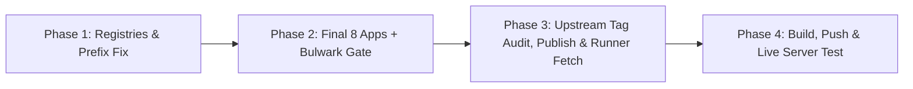

# Plan: Completing the LaraKube Cloud Template Catalog & Live App Installs

## Goal Description

Batches 1 & 2 (21 standalone apps), the removal of the LaraKube CLI unshipped gate (`ClusterTool::PLAUSIBLE` dropped), and Cloud's idempotent deploy-time catalog seeding (`AUTORUN_LARAVEL_MIGRATION_SEED="true"`) are committed in `cli` (`c0ff49d5`) and `cloud` (`454bfbf`), and the parallel backup work in `cli` has also landed (`032a055b`).

This finalized plan covers everything remaining to reach **100% template catalog coverage (all 35 `ClusterTool` apps + `plex` = 36 downloadable releases)**, enforce cross-app prerequisites (`bulwark` → `stalwart`), pin verified upstream image tags, publish locally, and verify stripped-runner downloads.



---

## Settled Decisions

> [!NOTE]
> **Aligned Decisions**
> 1. **Default Pricing Tiers (`AccessTier::Free`)**: Every seeded app stays `AccessTier::Free` by default in `cloud/database/seeders/CatalogAppSeeder.php`; `default_tier` is only written on initial row creation so any tier toggled later in the Cloud admin UI is preserved across deploys.
> 2. **Bulwark Requires Stalwart (`requires: ['stalwart']`)**: `bulwark` declares `'options' => ['requires' => ['stalwart']]`. Cloud enforces this both in `InstallServerAppRequest` and in the Server Apps UI (`resources/js/pages/servers/show.tsx`), disabling **Install** with a *"Requires Stalwart"* notice until `stalwart` has `status === 'installed'` on that server.
> 3. **Upstream Image Tag Verification & Pinning**: Any nonexistent or floating tags (`umami`'s `:postgresql-latest`, `kuma`'s `:1`, `directus`'s `:12`, `penpot`'s `:2.17`, etc.) surfaced during `templates:publish --dry-run` against live registries will be updated to their verified current upstream stable release tags across templates, vendors, and tests.

---

## Proposed Changes

### Phase 1: Unblock Container Registries & Fix `erpnext` Prefix

#### [MODIFY] `cli/app/Support/Templates/ImageDigestResolver.php`
Add the OCI v2 registries used by `forgejo` (`codeberg.org`, `code.forgejo.org`) and `matrix` (`oci.element.io`), plus unit tests in CLI's `ImageDigestResolverTest`:
```php
public const ALLOWED_REGISTRIES = [
    'docker.io' => 'registry-1.docker.io',
    'ghcr.io' => 'ghcr.io',
    'quay.io' => 'quay.io',
    'registry.k8s.io' => 'registry.k8s.io',
    'gcr.io' => 'gcr.io',
    'oci.external-secrets.io' => 'oci.external-secrets.io',
    'docker.elastic.co' => 'docker.elastic.co',
    'codeberg.org' => 'codeberg.org',
    'code.forgejo.org' => 'code.forgejo.org',
    'oci.element.io' => 'oci.element.io',
];
```

#### [MODIFY] `cloud/app/Services/Catalog/ImageDigestResolver.php`
Mirror `'codeberg.org'`, `'code.forgejo.org'`, and `'oci.element.io'` in `self::REGISTRIES` on LaraKube Cloud and update Cloud's `ImageDigestResolver` tests.

#### [MODIFY] `cloud/database/seeders/CatalogAppSeeder.php`
Change `'erpnext'`'s `'prefix'` from `'erp'` to `'erpnext'` so `ErpnextInitCommand` resolves `erpnext.<domain>` cleanly instead of `erpnext.erp.<domain>`.

---

### Phase 2: Onboard the Final 8 Apps & Wire `requires: ['stalwart']`

#### [MODIFY] CLI Vendors, Config, Installer & Tests
- Add `HasImages` + `PinsImages` + `images()` to `SsoTool`, `MailTool`, `WebmailTool`, `VpnTool`, `DashboardTool`, `MeetTool`, `OcisTool`, and `ChatTool`.
- Add `zitadel`, `stalwart`, `bulwark`, `netbird`, `headlamp`, `livekit`, `ocis`, `matrix` to `downloadable` in `cli/config/templates.php` and `APPS` in `cli/app/Commands/Cloud/CloudAppsInstallCommand.php`.
- Add literal-template apps (`stalwart`, `bulwark`, `netbird`, `headlamp`, `livekit`) to `cli/tests/Feature/AppImagePinsTest.php`.

#### [MODIFY] `cloud/database/seeders/CatalogAppSeeder.php`
Add the 8 remaining apps (all defaulting to `AccessTier::Free` on creation), with `bulwark` carrying `'options' => ['requires' => ['stalwart']]`:
```php
'zitadel' => ['name' => 'Zitadel', 'category' => 'security', 'description' => 'Identity provider with single sign-on, OIDC, SAML and passkeys.', 'installable' => true, 'prefix' => 'auth', 'options' => null],
'stalwart' => ['name' => 'Stalwart', 'category' => 'communication', 'description' => 'All-in-one mail server with JMAP, IMAP, SMTP and spam filtering.', 'installable' => true, 'prefix' => 'mail', 'options' => null],
'bulwark' => ['name' => 'Bulwark', 'category' => 'communication', 'description' => 'Fast webmail client for Stalwart.', 'installable' => true, 'prefix' => 'webmail', 'options' => ['requires' => ['stalwart']]],
'netbird' => ['name' => 'NetBird', 'category' => 'security', 'description' => 'Zero-trust WireGuard VPN mesh for private server and app access.', 'installable' => true, 'prefix' => 'vpn', 'options' => null],
'headlamp' => ['name' => 'Headlamp', 'category' => 'infrastructure', 'description' => 'Kubernetes web dashboard for inspecting workloads and logs.', 'installable' => true, 'prefix' => 'dashboard', 'options' => null],
'livekit' => ['name' => 'LiveKit', 'category' => 'communication', 'description' => 'Real-time WebRTC video, voice and data rooms.', 'installable' => true, 'prefix' => 'meet', 'options' => null],
'ocis' => ['name' => 'oCIS', 'category' => 'productivity', 'description' => 'Private cloud file storage, sharing and desktop sync.', 'installable' => true, 'prefix' => 'drive', 'options' => null],
'matrix' => ['name' => 'Matrix', 'category' => 'communication', 'description' => 'Federated team chat with Synapse, Element Web and TURN voice/video.', 'installable' => true, 'prefix' => 'chat', 'options' => null],
```

#### [MODIFY] `InstallableApps.php`, `InstallServerAppRequest.php`, `ServerController.php` & `show.tsx`
1. **Expose `requires`**: Include `'requires' => $app->install_options['requires'] ?? []` in `InstallableApps::all()` and pass `'requires' => $app['requires']` in `ServerController::show()`.
2. **Backend Validation (`InstallServerAppRequest::after()`)**: Verify every slug in `$app['requires']` exists on `$server->apps()` with `status === ServerAppStatus::Installed`; if any prerequisite is missing, add a clear validation error on `app` (*"Install Stalwart on this server before installing Bulwark."*).
3. **Frontend UI (`ServerAppsSection` in `show.tsx`)**: Compute `missingRequires` against `apps.installed` (`status === 'installed'`), display a helper note (*"Requires Stalwart to be installed on this server first."*), and disable the form inputs and Install `<Button>` until satisfied.
4. **Feature Tests**: Add Pest coverage in Cloud verifying `bulwark` install is rejected until `stalwart` is `Installed` on that server, and accepted once `stalwart` is `Installed`.

---

### Phase 3: Upstream Tag Audit, Local Publish & Stripped-Runner Fetch Test

1. **Dry-Run Digest Audit (`templates:publish --dry-run`)**:
   - Run `php larakube templates:publish <all-29-apps> --dry-run` against live registries.
   - Replace floating tags (`umami` `:postgresql-latest`, `kuma` `:1`, `directus` `:12`, `penpot` `:2.17`, `forgejo` `node:24-trixie`, etc.) and any nonexistent tags with verified current upstream stable release tags across templates, vendors, and `AppImagePinsTest`.
2. **Seed & Publish to Local Cloud**:
   - Run `php artisan db:seed --class=CatalogAppSeeder` in `cloud-local`.
   - Run `php larakube templates:publish <all-29-apps>` with the dev signing key so all 36 catalog apps have signed `1.0.0` releases in local Cloud.
3. **Stripped-Runner Verification**:
   - Build stripped dev runner image(s) via `runner/scripts/dev.sh` (`--without=...`) and run `dev.sh test-fetch <app>` in `larakube-jobs` to verify signature validation and caching without bundled templates.

---

### Phase 4: Final Quality Gates, Commits & Operational Handoff

1. Run full formatting, static analysis, and test suites in both `cli` (`composer format && composer analyse && composer test`) and `cloud` (`./vendor/bin/pint`, `vp check`, `tsc --noEmit`, `composer test`).
2. Commit through the pre-commit hooks using Conventional Commits.
3. Hand off operational steps requiring your action:
   - Run `./build` in `cli/` (after checking atomic temp-file swap in `./build`).
   - Raise OrbStack memory to `6–8 GB`, push `runner` + `cloud` `develop`, configure GitHub Environments for `templates.yml`, and spin up a fresh server from `cloud.test` for live install testing.

---

## Verification Plan

### Automated Tests
```bash
# CLI full suite + static analysis + Pint/Rector
cd /Users/jsluchavez/Codes/Ideas/laravel-k8s/cli
composer format && composer analyse && composer test

# Cloud frontend checks + Pint + PHPStan + Pest
cd /Users/jsluchavez/Codes/Ideas/laravel-k8s/cloud
kubectl --context orbstack exec -n cloud-local deploy/node -c node -- npm run check
kubectl --context orbstack exec -n cloud-local deploy/node -c node -- npm run types:check
composer test
```

### Local Publish & Runner Verification
```bash
# Seed Cloud catalog + publish all 29 newly added apps + test-fetch in runner pod
kubectl --context orbstack exec -n cloud-local deploy/web -c php -- php artisan db:seed --class=CatalogAppSeeder --force
cd /Users/jsluchavez/Codes/Ideas/laravel-k8s/cli && php larakube templates:publish kuma vaultwarden outline umami yopass planka kutt teable documenso resume supabase directus windmill twenty grafana forgejo metabase glitchtip penpot chatwoot sendrec zitadel stalwart bulwark netbird headlamp livekit ocis matrix
cd /Users/jsluchavez/Codes/Ideas/laravel-k8s/runner && ./scripts/dev.sh build --without=forgejo,bulwark,matrix,ocis,zitadel && ./scripts/dev.sh test-fetch forgejo --image=larakube-runner:dev-no-forgejo-bulwark-matrix-ocis-zitadel
```
