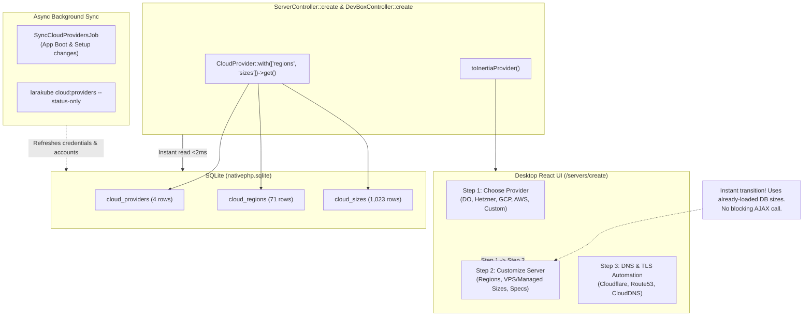

# Architectural Plan: Database-First Cloud Catalog & Instant Server Creation

## 1. Context & Problem Diagnosis

When clicking **"Create server"** or progressing through the creation wizard:
1. **Page Load Freeze**: `ServerController::create` was calling `ReadinessCheck::providers(statusOnly: true)` which shelled out to `larakube cloud:providers --status-only --json`, waiting on live network checks (`gcloud auth print-access-token`, `aws sts get-caller-identity`).
2. **Mismatched Skeleton Flash**: The temporary deferred skeleton didn't match the actual Step 1 ("Choose Provider") UI layout.
3. **Slow Step 2 Size Loading ("Refreshing types...")**: When moving from Step 1 to Step 2, `servers/create.tsx` automatically triggered an AJAX call `GET /servers/provider-catalog/{slug}` which executed `larakube cloud:providers --provider={slug}` without `--status-only`, taking 10–30 seconds querying live cloud APIs for instance types and pricing.
4. **Existing SQLite Assets Untapped**: The desktop SQLite database **already contains**:
   - **4 Cloud Providers** (`cloud_providers`)
   - **71 Regions** (`cloud_regions`)
   - **1,023 Instance Sizes** (`cloud_sizes`)
   Yet the frontend and controller were bypassing these stored records in favor of blocking CLI process spawns.

---

## 2. Architecture: Database-First + Background-Sync (Approved Decisions)

- **Database-First Rendering**: `ServerController::create` and `DevBoxController::create` query `CloudProvider::with(['regions', 'sizes'])->get()` directly from SQLite. Response returns in **< 2ms**, completely eliminating the need for `Inertia::defer` and the skeleton. The full Step 1 UI mounts instantaneously.
- **Instant Step 2 Sizes**: The instance sizes and pricing stored in SQLite are used immediately without blocking or auto-fetching on step change. An optional, non-blocking "Refresh live rates" button is provided for users who explicitly want to re-query cloud APIs.
- **Background Sync (`SyncCloudProvidersJob`)**: Dispatched on app boot and whenever cloud credentials change in Setup to update `credentials_ready`, `active_account`, and `accounts` in SQLite without ever blocking user navigation.

---

## 3. Implementation Plan

### Step 1: Database-First in `ServerController` and `DevBoxController`
- Query `CloudProvider::with(['regions', 'sizes'])->get()`.
- If database rows exist, map them using `CloudProvider::toInertiaProvider()`.
- If database is empty (first install before sync), fallback to `$readiness->providers(statusOnly: true)` to bootstrap SQLite.
- Remove `Inertia::defer` and remove `<Deferred>` / skeleton from [servers/create.tsx](file:///Users/jsluchavez/Codes/Ideas/laravel-k8s/desktop/resources/js/pages/servers/create.tsx). The authentic Step 1 mounts instantly.

### Step 2: Remove Step 2 Blocking AJAX Hook in `servers/create.tsx`
- Remove the automatic `if (step === 2 ... void refreshCatalog(provider.slug))` trigger.
- Sizes and pricing display immediately from memory (`provider.vpsSizes` / `provider.managedSizes`).
- Retain `refreshCatalog` only as an explicit, user-initiated action button if they desire to pull live rates.

### Step 3: Implement `SyncCloudProvidersJob`
- Create `desktop/app/Jobs/Sync/SyncCloudProvidersJob.php` to run `cloud:providers --status-only --json` in the background and update `credentials_ready`, `active_account`, and `accounts` in SQLite.
- Hook into app boot and Setup credential changes.

### Step 4: Verification & Automated Tests
- Update `ServerCreateTest.php` and `DevBoxesTest.php` for database-first behavior.
- Run `composer format`, `composer test`, and `npm run types:check`.
