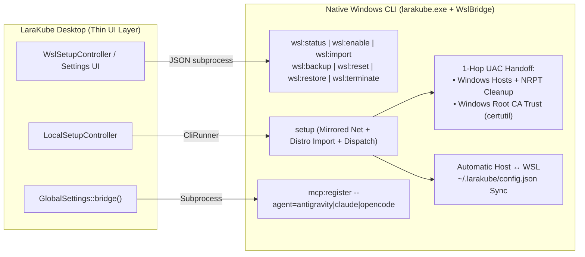

# Delegating Windows & Cross-Platform Desktop Responsibilities to `larakube` CLI

**Status:** Proposed  
**Related ADRs:**  
- `desktop/docs/decisions/0001-drive-the-cli-as-a-subprocess.md`  
- `desktop/docs/decisions/0007-windows-via-a-bundled-wsl-distro.md`

---

## Goal Description

LaraKube Desktop's core architectural principle (ADR 0001) is: *"Drive the LaraKube CLI as a subprocess; never embed its code."*  
Historically, because the CLI had no native Windows entry point (`larakube.exe`), Desktop accumulated ~900 lines of Windows- and WSL-specific orchestration logic across [`desktop/app/Services/Wsl.php`](file:///Users/jsluchavez/Codes/Ideas/laravel-k8s/desktop/app/Services/Wsl.php), [`LocalSetupController.php`](file:///Users/jsluchavez/Codes/Ideas/laravel-k8s/desktop/app/Http/Controllers/LocalSetupController.php), [`GlobalSettings.php`](file:///Users/jsluchavez/Codes/Ideas/laravel-k8s/desktop/app/Services/LaraKube/GlobalSettings.php), and [`DesktopUninstaller.php`](file:///Users/jsluchavez/Codes/Ideas/laravel-k8s/desktop/app/Services/LaraKube/DesktopUninstaller.php).

Now that `larakube.exe` runs natively on Windows and dispatches into WSL2 via [`WslBridge`](file:///Users/jsluchavez/Codes/Ideas/laravel-k8s/cli/app/Services/WslBridge.php), we can move these platform responsibilities into `cli/` so that:
1. **Desktop becomes thinner and simpler**, delegating WSL lifecycle, setup pre-flight, config syncing, SSL trust elevation, and MCP bridging to `larakube.exe`.
2. **CLI-only Windows users become 100% self-sufficient** — running `larakube.exe setup` in PowerShell can install/import `larakube-ubuntu`, configure `.wslconfig`, trust SSL certificates via 1-hop UAC, and register AI agents without needing LaraKube Desktop installed first.



---

## User Review Required

> [!IMPORTANT]
> **6 Areas Identified for Delegation from Desktop to CLI**
> Please review the 6 areas below and let us know if you want all 6 executed together or in phases:
> 1. **WSL2 Distro Lifecycle (`Wsl.php` → `WslBridge` + `larakube wsl:* --json`)**: Move distro readiness/staleness checks, WSL enablement, rootfs download/import, home directory backup/restore, distro reset, and distro termination into `WslBridge` + `wsl:*` CLI commands. Also remove dead `Wsl::ensureDnsmasq()` from Desktop.
> 2. **1-Hop Native Windows Root CA Trust (`certutil.exe`) + Combined UAC Prompt**: Currently, `InteractsWithTrust::installCaToKeychain()` inside WSL uses a fragile 2-hop WSL→PowerShell→elevated `certutil.exe` call reading from a `/tmp` path. Moving this to the `WslBridge` post-dispatch handoff lets `larakube.exe up` apply **both** the Windows Root CA certificate AND the Windows `hosts` file update in a **single native UAC prompt**!
> 3. **Deduplicating Pre-Setup Mirrored Networking in `LocalSetupController`**: Remove the manual `.wslconfig` / `restartForNetworkingChange()` block from Desktop's `LocalSetupController::store()`, since `larakube.exe setup` (`SetupCommand::handleWindowsSetup()`) now runs natively on Windows and already handles `.wslconfig` and safe WSL restarts.
> 4. **Automatic Host ↔ WSL `config.json` Sync & Default `.test` TLD Parity**: Have `WslBridge::dispatchToWsl()` automatically keep `%USERPROFILE%\.larakube\config.json` and `\\wsl.localhost\larakube-ubuntu\home\larakube\.larakube\config.json` in sync before and after every dispatched command, and update Desktop's fallback default TLD from `'kube'` to `'test'`.
> 5. **AI Agent MCP Registration (`GlobalSettings::bridge()` → `larakube mcp:register`)**: Upgrade `larakube mcp:register` to run natively on Windows and support `--agent=antigravity|claude|opencode|all`, then have Desktop's `GlobalSettings::bridge()` call it.
> 6. **Windows Uninstall (`uninstall` on Windows Host)**: Keep `larakube.exe uninstall` on the Windows host in `WslBridge::shouldDispatchToWsl()` so it cleans `%USERPROFILE%\.larakube`, Windows User `PATH`, and optionally `--remove-wsl`.

---

## Proposed Changes

### Component 1: 1-Hop Native Windows Root CA Trust & Combined UAC Handoff (`cli`)

Today, when `larakube.exe trust` or `larakube.exe up` runs on Windows, [`InteractsWithTrust::installCaToKeychain()`](file:///Users/jsluchavez/Codes/Ideas/laravel-k8s/cli/app/Traits/InteractsWithTrust.php#L276-L315) executes inside WSL2 and attempts a 2-hop elevation (`WSL` → `powershell.exe` → `Start-Process certutil.exe -Verb RunAs`) pointing at a `/tmp/larakube-ca.crt` path translated via `wslpath -w`. Just like the old 2-hop `hosts` and NRPT bridges:
- Spawning `Start-Process -Verb RunAs` from inside WSL interop can silently drop the UAC prompt or fail when the elevated Administrator token tries to read a `\\wsl.localhost\...` UNC path.
- Worse, during `larakube.exe up` on a fresh project, the user gets hit with **two separate UAC prompts** (one for `certutil.exe` inside WSL, and a second one for `hosts` after WSL exits).

#### [MODIFY] [InteractsWithTrust.php](file:///Users/jsluchavez/Codes/Ideas/laravel-k8s/cli/app/Traits/InteractsWithTrust.php)
- In `installCaToKeychain(string $caFile)` and `removeCaFromKeychain()` on WSL (`$this->isWsl()`):
  - When `getenv('LARAKUBE_NATIVE_DISPATCH') === '1'`, stage the CA certificate into `~/.larakube/pending-windows-ca.crt` (for install) or `~/.larakube/pending-windows-ca-remove` (for uninstall) instead of running a 2-hop `Start-Process certutil.exe -Verb RunAs` from inside WSL.
  - Keep the existing `wslpath -w` + Windows `%TEMP%` staging as the fallback when invoked directly from a WSL bash shell without `larakube.exe`.

#### [MODIFY] [WslBridge.php](file:///Users/jsluchavez/Codes/Ideas/laravel-k8s/cli/app/Services/WslBridge.php)
- Add `applyPendingWindowsCaTrust()` and combine it with `applyPendingWindowsHostsSync()` into a unified post-dispatch native elevation step (`applyPendingWindowsElevations()`):
  - After `dispatchToWsl()` finishes, inspect both `pending-windows-ca.crt` (or `pending-windows-ca-remove`) and `pending-windows-hosts` via their `\\wsl.localhost\...` UNC paths.
  - If **either or both** are queued, generate **one** temporary PowerShell script in Windows `%TEMP%` that:
    1. Runs `certutil.exe -addstore -f "Root" "<temp-ca.crt>"` (if CA trust was queued),
    2. Copies the staged `hosts` file to `C:\Windows\System32\drivers\\etc\hosts`, removes any stale `127.0.0.1` NRPT rules, and runs `Clear-DnsClientCache` (if hosts sync was queued).
  - Execute that script via a **single** `Start-Process powershell -Verb RunAs -Wait` hop!

---

### Component 2: WSL2 Distro Lifecycle in `WslBridge` & `larakube wsl:*` Commands (`cli` + `desktop`)

#### [MODIFY] [WslBridge.php](file:///Users/jsluchavez/Codes/Ideas/laravel-k8s/cli/app/Services/WslBridge.php)
Port the battle-tested distro lifecycle methods from [`desktop/app/Services/Wsl.php`](file:///Users/jsluchavez/Codes/Ideas/laravel-k8s/desktop/app/Services/Wsl.php) into `WslBridge`:
- `check(): array` — returns `{state: 'ready'|'missing'|'no-distro'|'old-version'|'broken'|'stale', distro: ?string, version: ?int, message: string, command: ?string, mirroredRequested: bool, mirroredActive: bool, restartPending: bool, runningDistros: list<string>}`.
- `enable(): bool` — elevates `wsl.exe --install --no-distribution` via 1-hop `Start-Process -Verb RunAs -Wait`.
- `download(?callable $onProgress = null): array` — downloads `larakube-ubuntu-amd64.tar.gz` to `%LOCALAPPDATA%\LaraKube\wsl\larakube-ubuntu.tar.gz` and verifies its SHA-256 against `.sha256`.
- `import(): array` — imports `larakube-ubuntu` into `%LOCALAPPDATA%\LaraKube\wsl\disk`, enables mirrored networking in `.wslconfig`, injects cached `larakube-linux-x64` into `/usr/local/bin/larakube`, terminates the distro to apply `wsl.conf`, and records `imported.sha256`.
- `terminate(?string $distro = null): bool` — runs `wsl.exe --terminate <distro>`.
- `backupUserHome(): array` — archives `/home/larakube/projects` to `%LOCALAPPDATA%\LaraKube\backups\home-backup-<timestamp>.tar.gz`.
- `reset(): array` — backs up user home, terminates, and runs `wsl.exe --unregister larakube-ubuntu`.
- `restoreUserHome(string $windowsBackupPath): array` — validates and extracts the backup archive back into `/home/larakube`.

#### [MODIFY] [WslStatusCommand.php](file:///Users/jsluchavez/Codes/Ideas/laravel-k8s/cli/app/Commands/Wsl/WslStatusCommand.php) & [WslShutdownCommand.php](file:///Users/jsluchavez/Codes/Ideas/laravel-k8s/cli/app/Commands/Wsl/WslShutdownCommand.php)
- Add `{--json : Output status as JSON}` to `wsl:status`, returning `$bridge->check()`.
- Add `{--terminate : Terminate only the LaraKube distro instead of shutting down all of WSL}` and `{--json}` to `wsl:shutdown`.

#### [NEW] `cli/app/Commands/Wsl/WslInstallCommand.php` (`wsl:install` / `wsl:enable` / `wsl:reset` / `wsl:backup` / `wsl:restore`)
- Add native Windows CLI commands under `cli/app/Commands/Wsl/` (all matched by `str_starts_with($command, 'wsl:')` in `WslBridge::shouldDispatchToWsl()` so they always run natively on Windows):
  - `wsl:enable {--json}`
  - `wsl:install {--step=all : all|download|import} {--json}`
  - `wsl:backup {--json}`
  - `wsl:reset {--force} {--json}`
  - `wsl:restore {--path= : Path to backup archive} {--json}`
- In [`SetupCommand::handleWindowsSetup()`](file:///Users/jsluchavez/Codes/Ideas/laravel-k8s/cli/app/Commands/SetupCommand.php#L771-L780), if `! $bridge->distroExists()`, offer to download and import `larakube-ubuntu` right there on the spot via `$this->call('wsl:install')` instead of telling the user they need LaraKube Desktop!

#### [MODIFY] [Wsl.php](file:///Users/jsluchavez/Codes/Ideas/laravel-k8s/desktop/app/Services/Wsl.php)
- Remove dead `ensureDnsmasq()` (WSL2 no longer uses `dnsmasq`).
- Update `Wsl::update()` to invoke the native `larakube.exe update [--canary] --yes` via `ToolLocator` when present (updating both host `larakube.exe` and WSL `/usr/local/bin/larakube` in lockstep).
- Remove duplicate `.wslconfig` writer methods that are no longer called outside `import()`.

---

### Component 3: Deduplicate Pre-Setup Mirrored Networking in `LocalSetupController` (`desktop` + `cli`)

#### [MODIFY] [SetupCommand.php](file:///Users/jsluchavez/Codes/Ideas/laravel-k8s/cli/app/Commands/SetupCommand.php)
- In `handleWindowsSetup()`: when running non-interactively (`! $this->input->isInteractive()`, such as when launched by Desktop's `CliRunner`), automatically enable mirrored networking in `.wslconfig` without prompting and restart WSL if `otherRunningDistros()` is empty.

#### [MODIFY] [LocalSetupController.php](file:///Users/jsluchavez/Codes/Ideas/laravel-k8s/desktop/app/Http/Controllers/LocalSetupController.php)
- Remove lines 17–31 (`$wsl->mirroredNetworkingRequested()`, `$wsl->ensureMirroredNetworking()`, `$wsl->restartForNetworkingChange()`), since `larakube.exe setup --profile=local --runtime=podman` now handles this natively on the Windows host and logs each step directly into the Desktop `Run` output!

---

### Component 4: Host ↔ WSL `config.json` Sync & Default `.test` TLD Parity (`cli` + `desktop`)

#### [MODIFY] [WslBridge.php](file:///Users/jsluchavez/Codes/Ideas/laravel-k8s/cli/app/Services/WslBridge.php)
- Add `syncGlobalConfigWithWsl()`:
  - Called at the start of `dispatchToWsl()` (after `ensureWslBinarySynced()`) and at the end of `dispatchToWsl()` (after the WSL command finishes).
  - Compares `%USERPROFILE%\.larakube\config.json` and `\\wsl.localhost\<distro>\home\larakube\.larakube\config.json`:
    - If only one exists, copies it to the other side.
    - If both exist and their contents differ, copies the newer one (`filemtime()`) to the older one.
  - This guarantees that running `larakube.exe config:tld test` in PowerShell updates the Windows host `config.json`, and changing settings in Desktop updates the WSL `config.json`.

#### [MODIFY] [GlobalSettings.php](file:///Users/jsluchavez/Codes/Ideas/laravel-k8s/desktop/app/Services/LaraKube/GlobalSettings.php) & [ProjectInspector.php](file:///Users/jsluchavez/Codes/Ideas/laravel-k8s/desktop/app/Services/LaraKube/ProjectInspector.php)
- Change fallback default `localTld` from `'kube'` to `'test'` in `GlobalSettings::get()` (line 70), `GlobalSettings::getLocalTld()` (line 230), and `ProjectInspector::inspectBlueprint()` (line 151) to match `GlobalConfigData::DEFAULT_TLD = 'test'`.

---

### Component 5: Native AI Agent MCP Registration (`cli` + `desktop`)

#### [MODIFY] [McpRegisterCommand.php](file:///Users/jsluchavez/Codes/Ideas/laravel-k8s/cli/app/Commands/McpRegisterCommand.php) & [WslBridge.php](file:///Users/jsluchavez/Codes/Ideas/laravel-k8s/cli/app/Services/WslBridge.php)
- Add `mcp:register` to the native host command list in `WslBridge::shouldDispatchToWsl()` so on Windows it configures the Windows host AI tools (`%USERPROFILE%\.gemini\antigravity.json`, `%APPDATA%\Claude\claude_desktop_config.json`, `%USERPROFILE%\.config\opencode\mcp.json`) pointing `command` to `%USERPROFILE%\.larakube\bin\larakube.exe`.
- Expand `McpRegisterCommand` signature to support:
  - `{--agent= : AI agent to register (antigravity, claude, opencode, all)}`
  - `{--antigravity : Register with Antigravity CLI}`
  - `{--claude : Register with Claude Desktop / Claude Code}`
  - `{--opencode : Register with OpenCode}`
  - `{--all : Register with all supported AI tools}`

#### [MODIFY] [GlobalSettings.php](file:///Users/jsluchavez/Codes/Ideas/laravel-k8s/desktop/app/Services/LaraKube/GlobalSettings.php)
- In `GlobalSettings::bridge(string $agent)`: delegate to `larakube mcp:register --agent={$agent}` when the CLI binary is available (falling back to `writeMcpFile()` if the CLI is not yet installed).

---

### Component 6: Native Windows `uninstall` Support (`cli`)

#### [MODIFY] [WslBridge.php](file:///Users/jsluchavez/Codes/Ideas/laravel-k8s/cli/app/Services/WslBridge.php) & [UninstallCommand.php](file:///Users/jsluchavez/Codes/Ideas/laravel-k8s/cli/app/Commands/UninstallCommand.php)
- Keep `uninstall` / `self-uninstall` on the Windows host in `WslBridge::shouldDispatchToWsl()`.
- When `UninstallCommand` runs natively on Windows (`WslBridge::isNativeWindows()`):
  - Add `{--remove-wsl : Unregister the larakube-ubuntu WSL2 distribution (Windows only)}`.
  - If the WSL distro is running and `--all` or `--purge` is passed, first dispatch `uninstall --force` inside WSL to clean `/usr/local/bin/larakube` and `/home/larakube/.larakube`.
  - If `--remove-wsl` is passed, call `$bridge->reset()` to back up projects and unregister `larakube-ubuntu`.
  - Clean `%USERPROFILE%\.larakube\bin` from the Windows User `PATH` and remove `%USERPROFILE%\.larakube`.

---

## Verification Plan

### Automated Tests
1. **CLI (`cli/`)**:
   ```bash
   composer format
   composer analyse
   composer test
   ```
   - `WslBridgeTest`: test combined 1-hop UAC script for CA trust + hosts sync (`applyPendingWindowsElevations()`), bidirectional `syncGlobalConfigWithWsl()`, and `check()` / `enable()` / `import()` / `backupUserHome()` / `reset()` / `restoreUserHome()`.
   - `McpRegisterCommandTest`: test `--agent=antigravity`, `--agent=claude`, `--agent=opencode`, and `--all` across macOS, Linux, and Windows paths.
   - `WslCommandsTest`: test `wsl:status --json`, `wsl:enable --json`, `wsl:backup --json`, `wsl:reset --json`, and `wsl:restore --json`.
2. **Desktop (`desktop/`)**:
   ```bash
   composer lint
   composer types:check
   php artisan test --parallel
   ```
   - `LocalSetupTest`: verify `LocalSetupController` delegates directly to `larakube setup --profile=local --runtime=podman`.
   - `WslTest` / `SettingsTest` / `ProjectsTest`: verify default TLD `'test'` and updated `Wsl::update()` behavior.
