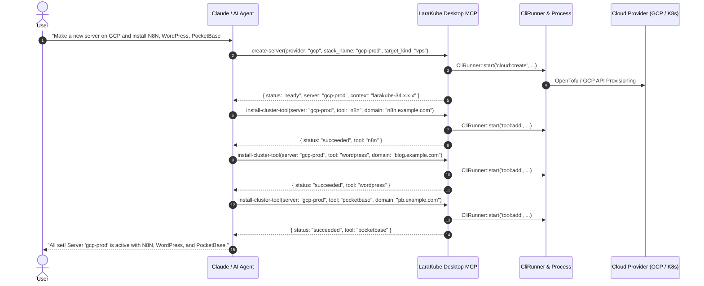

# LaraKube Desktop MCP: Cloud Server Lifecycle & Cluster Tool Chaining

## Goal Description
Enable AI agents (such as Claude Code, Claude Desktop, Antigravity, or Cursor) to autonomously fulfill requests like:
> *"Hey Claude! Can you make me a new server on GCP, and install N8N, Wordpress, and Pocketbase in there?"*

Currently, LaraKube Desktop's MCP server (`larakube-desktop`) has read-only server tools (`list-servers`, `show-server`) and app install tools (`install-cluster-tool`), but lacks a `create-server` tool and requires explicit Kubernetes context strings. This plan adds `create-server` with smart provider defaults, adds `delete-server` with strict confirmation safety, enhances `install-cluster-tool` with automatic context resolution, and registers new write actions with `McpHttpServer` edit-gating.

---

## User Review Required

> [!IMPORTANT]
> **Execution Strategy Aligned During Interview**:
> 1. **Composable Primitives**: We expose single-purpose MCP tools (`create-server`, `install-cluster-tool`) so agents can chain them naturally instead of forcing all actions into a rigid monolithic command.
> 2. **Polling with Safe In-Progress Fallback**: `create-server` polls the underlying CLI run for up to 120 seconds. If GCP/cloud creation takes longer, it returns a clean `status: "provisioning"` JSON response with the `run_id` and server name, directing Claude to check `get-run-status` until ready.
> 3. **Smart Defaults**: If Claude omits `region`, `size`, or `target_kind`, `create-server` resolves defaults from the provider catalog (e.g. standard machine size, default region, `vps` or `managed` depending on provider).
> 4. **Context Auto-Resolution**: When Claude calls `install-cluster-tool(server: "my-gcp-server", tool: "n8n", domain: "n8n.example.com")`, the tool resolves the Kubernetes context automatically from the server name without forcing the agent to look up the internal cluster context string first.
> 5. **Destructive Guard**: `delete-server` requires an explicit `confirm: true` parameter, matching `remove-cluster-tool` and `project-down`.

---

## Architecture & Interaction Flow



---

## Proposed Changes

### 1. New MCP Tool: `CreateServerTool`
**File**: `desktop/app/Mcp/Tools/CreateServerTool.php`

- Signature:
  - `provider` (required: `gcp`, `do`, `hetzner`, `aws`, `custom`, `existing`)
  - `stack_name` (required string, matching `^[a-z0-9]([a-z0-9-]*[a-z0-9])?$`)
  - `target_kind` (optional: `vps` | `managed`, default resolved from provider catalog)
  - `region` (optional: defaults to provider's default region from `ReadinessCheck::providerCatalog`)
  - `size` (optional: defaults to provider's default size from `ReadinessCheck::providerCatalog`)
  - `node_count` (optional integer: for managed clusters, default 1)
  - `ha` (optional boolean: for managed clusters)
  - `account` (optional string: cloud account name or profile)
  - `dns_provider` (optional: `cloudflare`, `google`, `route53`)
  - `ip`, `ssh_user`, `ssh_key`, `ssh_port` (optional for custom VPS)
- Execution:
  - Validates inputs matching `StoreServerRequest`.
  - Dispatches `CliRunner::start(kind: RunKind::CreateServer, ...)`.
  - Seeds the `Server` model as `provisioning`.
  - Polls for up to 120s using `PollsRun`.
  - If complete: returns `{ status: "ready", server: stack_name, context: server.context, ip: server.ip }`.
  - If still running at 120s: returns `{ status: "provisioning", run_id: run.id, server: stack_name, message: "Server provisioning is in progress. Use get-run-status with run_id to check when it finishes." }`.

---

### 2. New MCP Tool: `DeleteServerTool`
**File**: `desktop/app/Mcp/Tools/DeleteServerTool.php`

- Signature:
  - `name` (required string: server name from `list-servers`)
  - `confirm` (required boolean: must be `true` to proceed)
- Execution:
  - Finds the server model.
  - Aborts with error if `confirm !== true`.
  - Dispatches `CliRunner::start(kind: RunKind::DeleteServer, arguments: ['cloud:destroy', name, '--force'])`.
  - Polls run and updates `Server` record.

---

### 3. Update Existing MCP Tool: `InstallClusterToolTool`
**File**: `desktop/app/Mcp/Tools/InstallClusterToolTool.php`

- Enhancements:
  - Make `context` optional in JSON schema.
  - If `context` is omitted but `server` is provided, automatically lookup `$server = Server::where('name', $server)->first() ?? StackCatalog::find($server)` and use `$server->context`.
  - Add optional `wire_sso: bool = false` and `wire_mail: bool = false` flags to allow agents to configure integrations.
  - Retain `domain` as required string (so Claude explicitly confirms or provides the domain per our decision).

---

### 4. Update Server Class: `LaraKubeDesktopServer`
**File**: `desktop/app/Mcp/Servers/LaraKubeDesktopServer.php`

- Register `CreateServerTool::class` and `DeleteServerTool::class` in `$tools`.

---

### 5. Update HTTP MCP Server: `McpHttpServer`
**File**: `desktop/app/Services/Mcp/McpHttpServer.php`

- Add `create-server` and `delete-server` to `McpHttpServer::WRITE_TOOLS`:
  ```php
  private const array WRITE_TOOLS = [
      'project-up',
      'project-down',
      'project-heal',
      'install-cluster-tool',
      'remove-cluster-tool',
      'create-server',
      'delete-server',
  ];
  ```

---

## Verification Plan

### Automated Tests
1. **`tests/Feature/Mcp/CreateServerToolTest.php`**:
   - Tests successful `create-server` dispatch with provider defaults.
   - Tests 120s timeout in-progress status return with `run_id`.
   - Tests validation failure on invalid stack name or missing provider.
2. **`tests/Feature/Mcp/DeleteServerToolTest.php`**:
   - Tests rejection when `confirm: false`.
   - Tests successful deletion run when `confirm: true`.
3. **`tests/Feature/Mcp/InstallClusterToolToolTest.php`**:
   - Tests installing a tool when `context` is omitted (auto-resolved from `server`).
4. **`tests/Feature/McpHttpTest.php`**:
   - Tests that `create-server` and `delete-server` are blocked when `allowEdits = false`.
5. **Full Suite**:
   ```bash
   cd desktop && php -d memory_limit=2G ./vendor/bin/pest --parallel
   cd desktop && npx tsc --noEmit && npm run check
   ```

### Manual Verification
1. Start desktop MCP server or use stdio bridge.
2. Call `create-server` with `{ "provider": "gcp", "stack_name": "test-box" }`.
3. Inspect `list-servers` and `get-run-status`.
4. Call `install-cluster-tool` with `{ "server": "test-box", "tool": "pocketbase", "domain": "pb.test" }`.
