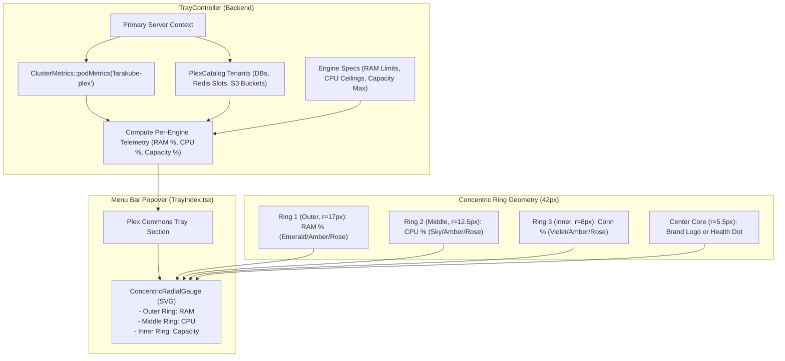

# Implementation Plan: Concentric Radial Gauges for Menu Bar Plex Commons

**Status:** Completed  
**Author:** Antigravity  
**Date:** 2026-10-16  

This plan details the design and implementation of nested multi-ring radial gauges ("radial over radial over radial" — Apple Watch Activity Ring style) for the active Plex Commons engines inside the LaraKube **Menu Bar Popover** (`/tray`).

---

## User Review Required

> [!IMPORTANT]
> **Concentric Multi-Ring Metric Triad**:
> Each active Commons engine (PostgreSQL, Redis, SeaweedFS, Headless Chrome, Meilisearch) will display a single 3-in-1 concentric radial gauge showing:
> 1. **Outer Ring (RAM)**: Memory usage vs. allocated limit (e.g. 73% of 512MiB). Color: Emerald `<70%`, Amber `70–84%`, Rose `≥85%`.
> 2. **Middle Ring (CPU)**: CPU load vs. millicore ceiling (e.g. 14% of 500m). Color: Sky/Cyan `<70%`, Amber `70–84%`, Rose `≥85%`.
> 3. **Inner Ring (Connections / Capacity)**: Connection pool or slot saturation (e.g. 12% of 100 DB connections or 16 Redis DB slots). Color: Violet/Purple `<70%`, Amber `70–84%`, Rose `≥85%`.

### Key UX Decisions for User Review:

1. **Card Layout in Menu Bar (360px Popover)**:
   - **Option A (Recommended: 2-Column Balanced Deck)**:
     - 2 cards per row (`grid-cols-2`, ~158px width each).
     - Left: 42px 3-ring Concentric Radial Gauge with brand logo or health dot in center.
     - Right: Engine name + 3-line micro telemetry indicators (RAM, CPU, Conn) with instant hover tooltips.
     - Best readability and detail without crowding.
   - **Option B (3-Column Minimalist Icon Tiles)**:
     - 3 cards per row (`grid-cols-3`, ~106px width each).
     - Centered 44px Concentric Radial Gauge with the engine icon embedded in the center core.
     - Bottom: Engine name + primary load percentage. Full breakdown on hover tooltip.
     - Maximizes vertical compactness if 4–6 engines are active.

---

## Architectural & Design Overview

---

## Technical Specifications

### 1. Concentric Radial Gauge SVG Geometry
- **Overall Dimension**: 42px × 42px SVG (viewBox `0 0 42 42`), rotated `-90deg` so rings start at 12 o'clock.
- **Center**: `cx = 21`, `cy = 21`.
- **Ring 1 (Outer - RAM)**:
  - Radius $r_1 = 17$px. Circumference $C_1 = 2 \times \pi \times 17 \approx 106.81$px.
  - Stroke: `2.8px`, `strokeLinecap="round"`.
  - Stroke offset: $C_1 - (\text{ramPercent} / 100) \times C_1$.
- **Ring 2 (Middle - CPU)**:
  - Radius $r_2 = 12.5$px. Circumference $C_2 = 2 \times \pi \times 12.5 \approx 78.54$px.
  - Stroke: `2.8px`, `strokeLinecap="round"`.
  - Stroke offset: $C_2 - (\text{cpuPercent} / 100) \times C_2$.
- **Ring 3 (Inner - Connections/Slots)**:
  - Radius $r_3 = 8$px. Circumference $C_3 = 2 \times \pi \times 8 \approx 50.27$px.
  - Stroke: `2.6px`, `strokeLinecap="round"`.
  - Stroke offset: $C_3 - (\text{capPercent} / 100) \times C_3$.
- **Center Core**:
  - Inner clear diameter $\approx 10.8$px.
  - Accommodates either a brand icon or an animated health dot (`size-1.5 bg-emerald-500 animate-pulse`).

### 2. Backend Telemetry Computation (`TrayController.php`)
- Query `ClusterMetrics::podMetrics($context, 'larakube-plex')`.
- Match components (`postgresql`, `redis`, `seaweedfs`, `headless-shell`, `meilisearch`).
- Calculate:
  - `ramPercent`: `min(100, round((usedMiB / limitMiB) * 100))`
  - `cpuPercent`: `min(100, round((usedMilli / limitMilli) * 100))`
  - `capacityPercent`: `min(100, round((activeTenants / maxCapacity) * 100))`
- Format user-friendly tooltips: `374MiB / 512MiB`, `70m / 500m`, `12 / 100 connections`.
- Graceful degradation: If metrics-server is warming up or unavailable, `ramPercent` and `cpuPercent` are `null` (dimmed background tracks), while `capacityPercent` is still rendered.

### 3. Engine Specifications
- **Postgres / MySQL**: 512 MiB limit, 500m CPU limit, 100 max connections.
- **Redis / Valkey**: 256 MiB limit, 250m CPU limit, 16 max DB index slots.
- **SeaweedFS / MinIO / Garage**: 512 MiB limit, 500m CPU limit, 100 max buckets.
- **Headless Chrome**: 512 MiB limit, 500m CPU limit, 5 max concurrent worker tabs.
- **Meilisearch / Typesense**: 512 MiB limit, 500m CPU limit, 50 max indices.

---

## File Changes Breakdown

1. **`desktop/resources/js/components/metrics/concentric-radial-gauge.tsx`** (New):
   - Reusable 3-ring concentric SVG gauge component supporting RAM, CPU, and Capacity rings with smooth transitions, tooltips, and customizable center slot.

2. **`desktop/app/Http/Controllers/TrayController.php`** (Modify):
   - Enhance `$activeEngines` payload in `payload()` to include calculated `telemetry` (percentages, usage strings, limits, and unit labels) for each active engine.

3. **`desktop/resources/js/pages/tray/index.tsx`** (Modify):
   - Update `PlexEngine` type definition with `telemetry`.
   - Upgrade the Plex Commons section to render the new engine cards with the 3-ring concentric radial gauge, metric legend, and detailed tooltips.

4. **Tests & Static Analysis**:
   - `desktop/tests/Feature/Http/Controllers/TrayControllerTest.php` (Verify payload includes engine telemetry).
   - Run `composer analyse` (PHPStan 0 errors), `composer format` (Pint), `composer test` (Pest), and `tsc --noEmit` (TypeScript 0 errors).

---

## Safety & Invariant Guarantees
- **Claude Workspace Isolation**: No modifications to `cli/` codebase.
- **No `./build`**: Agent will not run `./build`.
- **Idempotency**: All metric calculations are purely read-only and cached via `ClusterMetrics`.
