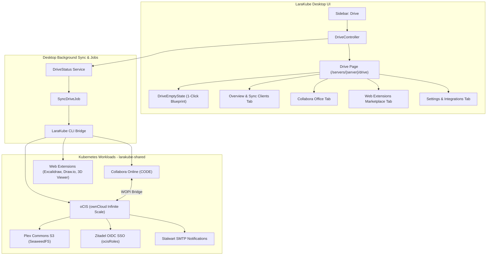

# Architectural & Implementation Plan: Dedicated Drive (oCIS & Office) Feature Page

**Status:** Completed  
**Author:** Antigravity  
**Date:** 2026-10-15  
**Target Version:** LaraKube Desktop v1.0.0+ / LaraKube CLI  

---

## 🎯 Goal Description

Following the successful implementation of dedicated, high-impact sections for **Mail** (Stalwart) and **Plex Commons** (Shared Databases, Valkey, and S3), LaraKube will introduce a dedicated top-level **"Drive"** page in LaraKube Desktop.

Powered by **ownCloud Infinite Scale (oCIS)**, **Collabora Online (CODE)**, and the CLI's `drive:*` and `ocis:*` commands, the **Drive** feature delivers private, enterprise-grade cloud storage, file synchronization, and real-time office document collaboration (replacing Google Drive, Nextcloud, and Microsoft 365) with native Plex Commons S3 storage, Zitadel OIDC SSO, and Stalwart notification wiring.



---

## 👥 User Review Required

> [!IMPORTANT]
> **Sidebar Placement & Navigation Hierarchy**:
> - The new **Drive** section will be positioned immediately below **Mail** and **Plex Commons** in `app-layout.tsx`.
> - Route structure: `/drive` (entry route redirecting to active server) and `/servers/{server}/drive` (server-scoped management).
> - Sidebar icon: `HardDrive` (from `lucide-react`) with `bg-sky-600` accent.

> [!NOTE]
> **Data Safety Guarantee on Teardown**:
> - Deleting/uninstalling Drive through Desktop will run `ocis:remove --force` (or `drive:remove`), which strictly preserves the underlying S3 bucket data in SeaweedFS and the metadata encryption keys in Kubernetes secrets. User files are never accidentally purged.

---

## ✅ Resolved Design Decisions

1. **Collabora Online (Opt-in by Default)**:
   - **Decision**: Unchecked by default. Collabora Online is an additional workload that users should actively choose to enable rather than having it enabled automatically.
2. **Optional Web Extensions (Pre-checked, Uncheckable)**:
   - **Decision**: Popular web extensions (Draw.io, Excalidraw) will be presented as optional pre-checked checkboxes in the UI, allowing the user to uncheck them before clicking Deploy if they prefer a minimal setup.

---

## 📐 Architecture & CLI Inventory

### 1. Existing CLI Commands & Capabilities

| Command | Signature / Options | Purpose & Role |
| :--- | :--- | :--- |
| `tool:init --tool=ocis` | `[env] {--domain=} {--no-plex} {--vpn-only} {--extensions=} {--force} {--proxied}` | Deploys oCIS with SeaweedFS S3, OpenBao secrets sync, and initial extensions |
| `drive:office:init` | `[env] {--domain=} {--vpn-only} {--force}` | Deploys Collabora Online (CODE) and connects the WOPI collaboration bridge sidecar |
| `drive:ext:show` | `[env] {--context=}` | Lists available marketplace extensions and installed status |
| `drive:ext:add` | `[env] {--extension=} {--context=}` | Downloads, verifies, and installs an oCIS web extension from catalog or URL |
| `drive:ext:remove` | `[env] {--extension=} {--context=}` | Removes an extension and restarts oCIS |
| `ocis:show` | `[env] {--json} {--domain=}` | Emits connection host, credentials, components, and supported wirings |
| `ocis:logs` | `[env] {--lines=}` | Streams pod container logs |
| `ocis:remove` | `[env] {--force}` | Teardown workloads while strictly preserving S3 bucket blobs & encryption keys |
| `sso:wire --tool=ocis` | `[env]` | Wires Zitadel OIDC with flat `ocisRoles` claims (`ocisAdmin`, `ocisSpaceAdmin`, `ocisUser`) |
| `mail:wire --tool=ocis` | `[env]` | Wires Stalwart SMTP for file sharing invitations and activity notifications |

---

## 🛠️ Proposed Changes

### Layer 1: CLI Enhancements (`cli/`)

#### [MODIFY] `app/Commands/Drive/DriveExtShowCommand.php`
- Add `{--json : Emit JSON output}` to signature.
- Output JSON format when `--json` flag is provided:
  ```json
  {
    "extensions": [
      {
        "id": "com.github.lukashirt.excalidraw",
        "name": "Excalidraw",
        "description": "Whiteboard & diagramming tool",
        "version": "v0.1.0",
        "installed": true
      }
    ]
  }
  ```

---

### Layer 2: Desktop Backend & State (`desktop/`)

#### [MODIFY] `app/Enums/RunKind.php`
Add RunKind cases and update `changesDrive()`:
```php
case DriveDeploy = 'drive-deploy';
case DriveOfficeDeploy = 'drive-office-deploy';
case DriveInstallExtension = 'drive-install-extension';
case DriveUninstallExtension = 'drive-uninstall-extension';
case DriveRemove = 'drive-remove';

public function changesDrive(): bool
{
    return in_array($this, [
        self::DriveDeploy,
        self::DriveOfficeDeploy,
        self::DriveInstallExtension,
        self::DriveUninstallExtension,
        self::DriveRemove,
    ], true);
}
```

#### [NEW] `app/Services/LaraKube/DriveStatus.php`
Service modeling Drive status on a server:
- `isInstalled(string $context): bool`
- `serverInfo(string $context): ?array` (Host, web URL, admin credentials, storage driver, S3 bucket, Collabora Office status, WOPI bridge, SSO status, Mail status, VPN status)
- `extensions(string $context): array` (List of marketplace catalog apps with installed flag)
- `syncState(string $context): array` (`status`, `lastSyncedAt`, `error`)

#### [NEW] `app/Jobs/Sync/SyncDriveJob.php`
Background job:
- Executes `['ocis:show', 'production', "--context={$server->context}", '--json']`
- Executes `['drive:ext:show', 'production', "--context={$server->context}", '--json']`
- Updates `ClusterTool` model data (`data['driveInfo']`, `data['extensions']`)

#### [MODIFY] `app/Listeners/RecordRunOutput.php`
- Handle run completion for `changesDrive()`: invalidate cache and dispatch `SyncDriveJob::dispatch($server->id)`.

#### [NEW] `app/Http/Controllers/DriveController.php`
Routes and actions:
- `entry(CurrentServer $current): RedirectResponse` (Redirects to active server or first ready server)
- `index(string $server, DriveStatus $status, CurrentServer $current): Response` (Renders `drive/index`)
- `deploy(Request $request, string $server, CliRunner $runner): RedirectResponse` (`tool:init --tool=ocis`)
- `deployOffice(Request $request, string $server, CliRunner $runner): RedirectResponse` (`drive:office:init`)
- `installExtension(Request $request, string $server, CliRunner $runner): RedirectResponse` (`drive:ext:add`)
- `uninstallExtension(Request $request, string $server, CliRunner $runner): RedirectResponse` (`drive:ext:remove`)
- `restart(Request $request, string $server, CliRunner $runner): RedirectResponse` (`rollout restart deploy/drive-ocis`)
- `destroy(Request $request, string $server, CliRunner $runner): RedirectResponse` (`ocis:remove --force`)

#### [MODIFY] `routes/web.php`
Register Drive routes:
```php
Route::get('/drive', [DriveController::class, 'entry'])->name('drive');
Route::get('/servers/{server}/drive', [DriveController::class, 'index'])->name('servers.drive.index');
Route::post('/servers/{server}/drive/deploy', [DriveController::class, 'deploy'])->name('servers.drive.deploy');
Route::post('/servers/{server}/drive/office/deploy', [DriveController::class, 'deployOffice'])->name('servers.drive.office.deploy');
Route::post('/servers/{server}/drive/extensions/install', [DriveController::class, 'installExtension'])->name('servers.drive.extensions.install');
Route::post('/servers/{server}/drive/extensions/uninstall', [DriveController::class, 'uninstallExtension'])->name('servers.drive.extensions.uninstall');
Route::post('/servers/{server}/drive/restart', [DriveController::class, 'restart'])->name('servers.drive.restart');
Route::delete('/servers/{server}/drive', [DriveController::class, 'destroy'])->name('servers.drive.destroy');
```

---

### Layer 3: Desktop Frontend & UI (`desktop/resources/js/`)

#### [MODIFY] `layouts/app-layout.tsx`
Add Drive item to `NAV_ITEMS`:
```tsx
{
    label: 'Drive',
    description: 'Cloud files & office',
    href: drive().url,
    active: (url) =>
        url.startsWith('/drive') || /^\/servers\/[^/]+\/drive/.test(url),
    accent: 'bg-sky-600',
    icon: HardDrive,
},
```
Exclude `/drive` in `Servers` active check.

#### [MODIFY] `components/tool-logo.tsx`
Support `'drive'` in brand visuals:
```tsx
if (id === 'ocis' || id === 'drive') {
    return {
        containerClass: 'bg-[#041E42] ring-1 ring-[#041E42]/80 text-white shadow-xs',
        icon: <SiOwncloud size={px} color="#FFFFFF" />,
    };
}
```

#### [NEW] `pages/drive/index.tsx`
Main page shell containing:
- Server switcher header with `SyncStatusBadge`
- Action header:
  - `Open Drive` button (`ExternalLinkButton`)
  - `Open Office` button (`ExternalLinkButton`, when Collabora is active)
- Tab Bar:
  - `Overview` (`OverviewTab`)
  - `Office & Documents` (`OfficeTab`)
  - `Web Extensions` (`ExtensionsTab`)
  - `Settings & Integrations` (`SettingsTab`)

#### [NEW] `pages/drive/drive-empty-state.tsx`
Pre-install blueprint state:
- Feature highlights: Infinite Scale storage, Collabora Online integration, S3 durability, Zero-trust SSO.
- Configuration form:
  - Domain input (`drive.yourdomain.com`)
  - Checkbox: "Enable Collabora Online document editor (`office.drive.yourdomain.com`)" (unchecked by default; user opt-in)
  - Extensions selector: Optional pre-checked checkboxes for Draw.io and Excalidraw (user can uncheck before deploying)
  - NetBird VPN-only toggle
  - Submit button with spinner: `<Button><HardDrive className="size-4" /><span>Deploy Drive</span></Button>`

#### [NEW] `pages/drive/overview-tab.tsx`
- **KPI Metrics Cards**:
  - Storage Backend: `SeaweedFS S3` with bucket badge
  - Collabora Office: `Active` / `Not Installed`
  - Active Extensions: count & badge
  - Security Wirings: SSO (Zitadel), SMTP (Stalwart), VPN (NetBird)
- **Workload Status Cards**:
  - `drive-ocis` (Primary Go server, pod status, restart button)
  - `drive-code` (Collabora Online container)
- **Credentials & Access**:
  - Admin login: `admin` + Reveal/Copy password
  - Sync Client Endpoints (ownCloud Desktop / Mobile client configuration)

#### [NEW] `pages/drive/office-tab.tsx`
- Collabora Online suite details:
  - WOPI integration status (`drive-ocis-collaboration` bridge)
  - Public editor URL (`https://office.<drive-host>`)
  - Supported formats badges: `.docx`, `.xlsx`, `.pptx`, `.odt`, `.ods`, `.odp`, `.csv`
  - Single-click "Deploy Collabora Online" button if not currently installed.

#### [NEW] `pages/drive/extensions-tab.tsx`
- Interactive App Marketplace grid:
  - Cards for:
    - **Excalidraw**: Collaborative whiteboard & sketch tool
    - **Draw.io**: Technical architecture & diagram editor
    - **3D Model Viewer**: STL, OBJ, glTF 3D model inspector
    - **DICOM Viewer**: Medical radiology scanner/viewer
    - **PDF Viewer**: Document viewer
  - Each card features: Icon, Version, Description, Status Pill (`Installed` / `Available`), and Action Button (`Install` / `Uninstall`).

#### [NEW] `pages/drive/settings-tab.tsx`
- **Desktop & Mobile Sync Guides**:
  - Server URL for ownCloud Sync Client (macOS, Windows, Linux, iOS, Android)
  - WebDAV Endpoint: `https://drive.<host>/dav/files/<user>`
- **SSO & Security Wirings**:
  - Zitadel OIDC status and `ocisRoles` claims
  - Stalwart SMTP notifications status
  - NetBird VPN-only restriction status
- **Storage & Backup Info**:
  - S3 bucket details (`seaweedfs`)
  - Metadata PVC backup path (`/var/lib/ocis`)
- **Danger Zone**:
  - Restart Drive pod
  - Uninstall Drive (with clear reassurance that files and encryption keys are preserved in S3)

---

## 🧪 Verification Plan

### Automated Tests
1. **CLI Tests**:
   - `composer test -- --filter=DriveExtShowCommandTest`
   - Test `drive:ext:show --json` structured response.
2. **Desktop Tests**:
   - `composer test -- --filter=DriveControllerTest`
   - Verify `entry()` redirects to active server.
   - Verify `index()` renders empty state when uninstalled, and full tabs when installed.
   - Verify `deploy()`, `deployOffice()`, `installExtension()`, and `destroy()` actions.
3. **Format & Type Checks**:
   - `npm run check` (Vite Prettier & Biome lint)
   - `npm run types:check` (TypeScript strict compiler)
   - `./vendor/bin/pint --test` (PHP code style)
   - `./vendor/bin/phpstan analyse` (PHPStan static analysis)

### Manual Verification
1. Navigate to the new **Drive** item on the Desktop sidebar.
2. Verify the Empty State renders cleanly with domain, Collabora Office checkbox, and extensions options.
3. Deploy Drive and verify the transition to the 4-tab dashboard (`Overview`, `Office`, `Extensions`, `Settings`).
4. Test clicking "Install Extension" on Excalidraw / Draw.io and verify real-time status update.
5. Verify copy buttons for admin credentials and sync client endpoints.
