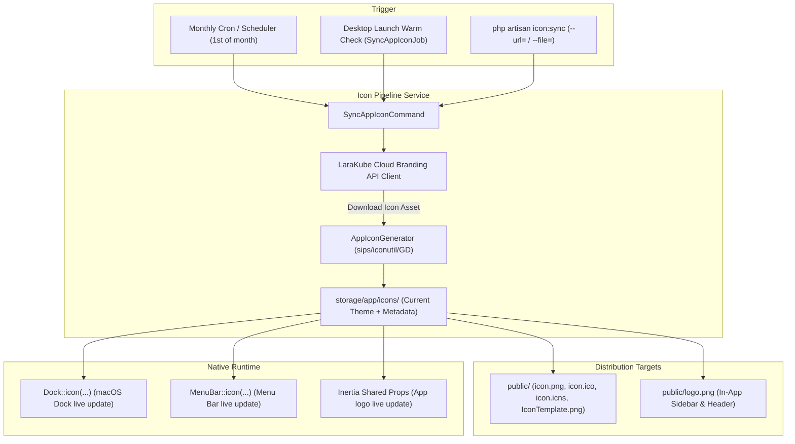

# Implementation Plan: Dynamic & Seasonal App Icon Pipeline (Duolingo-Style)

> **Status:** Implemented & Verified (Commit `9b5e7ac`)

## Goal Description
1. Allows LaraKube to dynamically update its app icon (Dock, Taskbar, MenuBar Tray, and in-app UI) dynamically from a remote source (such as LaraKube Cloud / CDN) or local assets on a monthly/seasonal cadence—just like Duolingo changes their app icon.
2. Provides an Artisan CLI command (`php artisan icon:sync`) that downloads, validates, resizes, and distributes the icon into all required platform formats (`icon.png`, `IconTemplate.png`, `IconTemplate@2x.png`, `icon.icns`, `icon.ico`, and `logo.png`).
3. Updates the live desktop app at runtime via NativePHP's `Dock::icon()` and `MenuBar::icon()` without requiring a re-install or build, with a monthly background scheduler and cloud endpoint fallback.

---

## Architecture Overview



---

## User Review Required

> [!IMPORTANT]
> **Zero External Binary Dependencies**: The resizing engine uses native macOS tools (`sips` and `iconutil`) when available, and standard PHP GD as universal cross-platform fallback for Windows and Linux.
>
> **Offline Graceful Fallback**: If the computer is offline or LaraKube Cloud is unreachable, `icon:sync` silently keeps the active icon and never crashes or interrupts application boot.

---

## Proposed Changes

### Component 1: CLI & Services (`desktop/app/`)

#### [NEW] `desktop/app/Services/Branding/AppIconGenerator.php`
- Core service responsible for taking an input image (local file or stream) and generating all platform icons:
  - `icon.png` (1024x1024 RGBA PNG with alpha transparency)
  - `IconTemplate.png` (16x16 RGBA PNG with alpha for macOS MenuBar)
  - `IconTemplate@2x.png` (32x32 RGBA PNG with alpha for macOS MenuBar Retina)
  - `icon.icns` (multi-resolution macOS bundle)
  - `icon.ico` (multi-resolution Windows ICO: 16, 32, 48, 64, 128, 256)
  - `logo.png` (in-app UI logo)
- Handles background alpha detection and canvas padding so icons never stretch or touch window edges.

#### [NEW] `desktop/app/Services/Branding/CloudBrandingClient.php`
- Fetches monthly icon metadata from `config('larakube.cloud_url') . '/api/v1/branding/icon'`:
  - Returns `theme`, `month`, `icon_url`, `sha256`.
  - Supports configurable URL via `.env` (`LARAKUBE_ICON_URL`).

#### [NEW] `desktop/app/Console/Commands/SyncAppIconCommand.php`
- Artisan command `icon:sync`:
  ```bash
  php artisan icon:sync {--url=} {--file=} {--theme=} {--force}
  ```
  - Downloads / processes the icon.
  - Distributes to `public/` and `storage/app/icons/current/`.
  - Notifies live running desktop session via NativePHP facades.

#### [NEW] `desktop/app/Jobs/Sync/SyncAppIconJob.php`
- Background queued job triggered on boot if the monthly icon is stale (>30 days).

#### [MODIFY] `desktop/app/Providers/NativeAppServiceProvider.php`
- On boot, checks `storage/app/icons/current/`:
  - If a dynamic seasonal icon exists, applies `Dock::icon()` and `MenuBar::icon(public_path('IconTemplate.png'))`.
  - Dispatches `SyncAppIconJob::dispatch()` in the background to check for new monthly icons without blocking app launch.

#### [MODIFY] `desktop/routes/console.php`
- Register monthly schedule:
  ```php
  Schedule::command('icon:sync')->monthlyOn(1, '09:00');
  ```

---

## Verification Plan

### Automated Tests
1. **Unit Tests (`desktop/tests/Unit/AppIconGeneratorTest.php`)**:
   - Verify generation of `icon.png`, `IconTemplate.png`, `IconTemplate@2x.png`, `icon.ico`, and `icon.icns` from a sample PNG.
   - Verify dimensions and transparency headers for each output format.
2. **Feature Tests (`desktop/tests/Feature/SyncAppIconCommandTest.php`)**:
   - Test `php artisan icon:sync --file=sample.png` processes and distributes files.
   - Test `php artisan icon:sync --url=...` with HTTP fake downloads and caches new seasonal icon.
   - Test offline graceful handling when HTTP fails.
3. **Pest & Static Analysis**:
   - Run `composer lint` and `composer types:check`.
   - Run `./vendor/bin/pest`.

### Manual Verification
1. Run `php artisan icon:sync --file=public/logo.png`.
2. Inspect `public/` and verify all icon files are cleanly generated.
3. Verify the Dock icon updates live and the MenuBar icon is a sharp 16x16 template that doesn't stretch across the menu bar.
