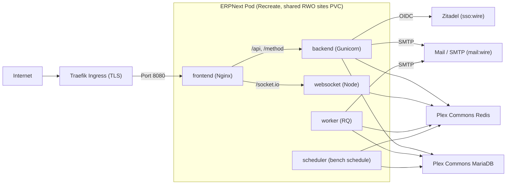

# ERPNext Accounting Companion Service (`erpnext:init`)

## Goal Description

Add **ERPNext** (`frappe/erpnext`, GPL-3.0) to LaraKube as a first-class self-hosted open-source accounting & business operations companion (`larakube erpnext:init`, `ClusterTool::ERPNEXT`), giving startups a zero-paywall alternative to Xero/QuickBooks.

### Why ERPNext (Research Summary)
- **Zero feature paywalls (GPL-3.0):** Full double-entry general ledger, multi-currency, invoicing, bills, expenses, bank reconciliation, asset depreciation, inventory, and financial statements (P&L, Balance Sheet, Cash Flow) with no paid App Store gates (unlike Akaunting) and no per-user fees.
- **100% Plex Commons native:** Reuses **MariaDB** and **Redis** from `larakube-plex` — avoiding Bigcapital's 5-datastore stack (MariaDB + Redis + MongoDB for Agenda.js + ClickHouse + Gotenberg).
- **Native OIDC & SMTP:** Supports Zitadel OIDC via Frappe's built-in **Social Login Key** (`/api/method/frappe.integrations.oauth2_logins.custom/zitadel`) and outgoing SMTP via Frappe Email Accounts (`mail:wire`).

---

## Architecture Decisions (Locked via `/grill-me`)

1. **Tool identity:** `erpnext:init` (`ClusterTool::ERPNEXT`), `erpnext:remove`, `erpnext:show`, `erpnext:logs`.
2. **Pod topology & RWO storage safety:** A **single multi-container Pod** (`strategy: Recreate`, 1 replica) containing `frontend` (Nginx), `backend` (Gunicorn), `websocket` (Node/Socket.IO), `worker` (RQ), and `scheduler` sharing a single `ReadWriteOnce` (`sites`) PVC. This works reliably on single-node k3s (`local-path`) and multi-node managed clusters (`do-block-storage`, `standard-rwo`) without requiring `ReadWriteMany` NFS.
3. **Apps & companion wiring:** Installs core `frappe` + `erpnext` on `bench new-site` with optional `--currency` / `--country` flags, plus full `sso:wire` (Zitadel OIDC Social Login Key) and `mail:wire` (outgoing SMTP) integration.



---

## Proposed Changes

### CLI (`cli/`)

#### [NEW] `cli/app/Vendors/ErpnextTool.php`
- Implements `ClusterToolVendor`, `HasCommonsDatabases` (`mariadb`), `HasCommonsRedisKeys`, `HasOpenbaoSync`, `HasOidcWiring` (Zitadel Social Login Key), `HasSmtpWiring`, `HasVpnWiring`.

#### [MODIFY] `cli/app/Enums/ClusterTool.php`
- Add `case ERPNEXT = 'erpnext';`
- Wire `vendor()`, `getLabel()` (`'ERPNext'`), `namespace()` (`larakube-shared`), `multiInstance()`, and `ToolFootprint` / `ToolInitCommands` mappings.

#### [MODIFY] `cli/app/Services/Tools/ToolInitCommands.php`, `ToolInitSpec.php`, `ToolFootprint.php`, `SupportedDriversTrait.php`
- Register `ClusterTool::ERPNEXT => ErpnextInitCommand::class`.
- Add `ToolInitSpec` options (`--domain`, `--admin-email`, `--currency`, `--country`, `--vpn-only`, `--no-plex`).
- Register `k8s.erpnext.erpnext` in `ToolFootprint` so `tool:list`, `doctor`, and Desktop `Apps` inspect all containers cleanly.

#### [NEW] `cli/app/Commands/Erpnext/`
- `ErpnextInitCommand.php`: Ensures Plex Commons (`mariadb`, `redis`), generates/reuses idempotent Secrets (admin password, DB password, encryption key), runs idempotent `bench new-site` / `install-app erpnext` init-container or post-rollout setup, syncs secrets to OpenBao when available, and registers the deployed instance.
- `ErpnextRemoveCommand.php`: Extends `AbstractToolRemoveCommand` to remove Deployment, Service, Ingress, ConfigMaps, Secrets, and (on `--purge`) PVC + Commons MariaDB DB/user + OpenBao/Zitadel client.
- `ErpnextShowCommand.php` & `ErpnextLogsCommand.php`: Standard `tool:show` / `tool:logs` subclasses.

#### [NEW] `cli/resources/views/k8s/erpnext/erpnext.blade.php`
- Renders Secret, ConfigMap (`common_site_config.json` / nginx config), PVC (`sites`, RWO, e.g. `10Gi`), Service (`8080`), Ingress (Traefik), and Deployment (`strategy: Recreate`) with:
  - Init container: waits for MariaDB + Redis, initializes `sites/common_site_config.json`, creates site + installs `erpnext` idempotently if site does not yet exist.
  - Containers: `frontend` (`nginx`), `backend` (`gunicorn`), `websocket`, `worker`, `scheduler` mounting the shared `sites` PVC.

---

### Desktop (`desktop/`)

#### [MODIFY] `desktop/resources/js/components/tool-logo.tsx` & `desktop/resources/js/types/larakube.ts`
- Add ERPNext icon/branding and metadata so the **Apps** catalog and server detail views render ERPNext cleanly alongside existing tools.

---

## Verification Plan

### Automated Tests
- **CLI (`cli/`):**
  - Add feature tests in `cli/tests/Feature/ErpnextInitCommandTest.php` and `cli/tests/Feature/ErpnextRemoveCommandTest.php` covering manifest rendering, idempotent secret reuse, `sso:wire` / `mail:wire`, and `--purge` cleanup.
  - Run `cd cli && composer format && composer analyse && ./vendor/bin/pest --parallel`.
- **Desktop (`desktop/`):**
  - Run `cd desktop && npm run types:check && npm run check:fix && ./vendor/bin/pest --parallel`.

### Manual Verification
1. Run `./build` in `cli/`.
2. Provision or target a test cluster with `>= 4 GB` RAM and run:
   ```bash
   larakube erpnext:init production --domain=books.example.com --admin-email=admin@example.com --currency=USD --country="United States"
   ```
3. Verify login, Chart of Accounts, creating an invoice, P&L / Balance Sheet rendering, `sso:wire`, and `erpnext:remove --purge`.
