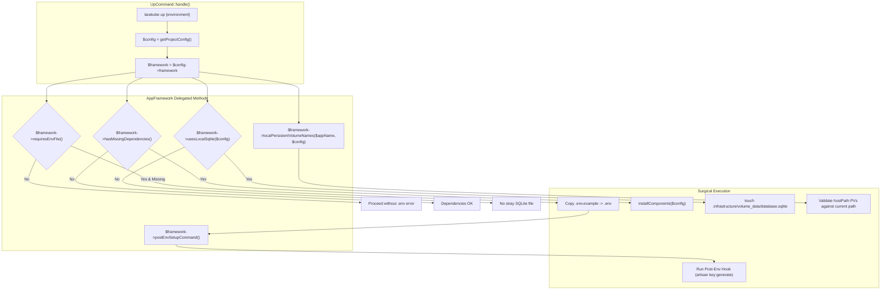

# Implementation Plan: Extract Framework-Specific Steps from UpCommand into AppFramework

Delegate framework-specific lifecycle steps, heuristics, commands, and manifest expectations currently hardcoded in `UpCommand.php` and its traits (`EnsuresHostDependencies`, `InteractsWithDocker`) into first-class methods on [`AppFramework`](file:///Users/jsluchavez/Codes/Ideas/laravel-k8s/cli/app/Enums/AppFramework.php).

---

## User Review Required

> [!IMPORTANT]
> **Separation of Powers & Multi-Framework Purity**:
> `UpCommand.php` is the central local orchestration verb. Over time, checks for `artisan`, hardcoded `php artisan key:generate`, blind `composer install` runs, unconditional `database.sqlite` touches, and hardcoded `{$appName}-laravel-storage-pv` persistent volume checks were added.
>
> Moving these to `AppFramework` ensures non-PHP server applications (Go, Rust, Python, Java, .NET, Node/Next.js) and static sites (Astro, Vite, Docusaurus) don't trigger spurious Composer/Artisan runs, generate orphan SQLite files, or emit inaccurate "root of your Laravel project" error messages.

---

## Proposed Architectural Flow



---

## Identified Framework Couplings in `UpCommand.php`

1. **Missing `.env` File Check & Key Generation Hook** (Lines 321–333):
   - Currently gated on `! $isStaticSite`.
   - Hardcodes `if (file_exists($projectPath.'/artisan')) { $this->runStreaming('php artisan key:generate --no-interaction'); }`.
   - Server-side frameworks like Go, Rust, or Python don't need Artisan key generation, while Laravel and Statamic do.
2. **Local Dependency Presence Heuristic** (Lines 336–339):
   - Checks `if (! is_dir($projectPath.'/vendor') || ! is_dir($projectPath.'/node_modules'))`.
   - Non-PHP server apps (Go, Rust, Python, Java, .NET) or PHP backend-only apps without a frontend ALWAYS fail this check, falsely triggering `installComponents()`.
3. **Framework Brand Label in Error Messaging** (Line 349):
   - Hardcoded `info('Make sure you are in the root of your Laravel project and the environment exists.');` regardless of whether the project is Astro, Next.js, Django, Go, etc.
4. **Local SQLite File Initialization** (Lines 358–367):
   - Touches `$projectPath.'/.infrastructure/volume_data/database.sqlite'` for any project where `! $isStaticSite`.
   - Leaves stray, never-used SQLite files in projects running PostgreSQL, MySQL, MariaDB, or non-database workloads.
5. **Host Dependencies Trait Coupling** (`EnsuresHostDependencies::ensureHostDependencies`):
   - Line 421 calls `$this->ensureHostDependencies($config, $environment)`.
   - Trait checks `if (! is_dir("$projectPath/vendor"))` and blindly runs `composer install` inside a container for non-PHP stacks.
6. **Immutable PV Path Validation** (Lines 514–517):
   - Hardcodes `"{$appName}-laravel-storage-pv"` and `"{$appName}-laravel-data-pv"`.
   - These PVs only exist for PHP workloads (from `laravel-volumes.blade.php`); non-PHP server apps or static sites have no such PVs.
7. **Docker Image Build Dockerfile Selection** (`InteractsWithDocker::buildImage`):
   - Hardcodes `$config->framework === AppFramework::NEXTJS ? "$path/Dockerfile.nextjs" : "$path/Dockerfile.php"`, bypassing `AppFramework::dockerfile()`.

---

## Proposed Changes

### Component 1: `AppFramework` Enum Extensions

#### [MODIFY] [`cli/app/Enums/AppFramework.php`](file:///Users/jsluchavez/Codes/Ideas/laravel-k8s/cli/app/Enums/AppFramework.php)

Add the following methods:

1. **`requiresEnvFile(): bool`**:
   - `false` for `isStaticSpa()` (`VITE`, `ASTRO`, `DOCUSAURUS`).
   - `true` for all server/backend frameworks (`LARAVEL`, `STATAMIC`, `WORDPRESS`, `NEXTJS`, `DJANGO`, `FASTAPI`, `SPRINGBOOT`, `DOTNET`, `GIN`, `AXUM`, `NESTJS`, `ADONISJS`).

2. **`postEnvSetupCommand(): ?string`**:
   - `'php artisan key:generate --no-interaction'` for `LARAVEL` and `STATAMIC`.
   - `null` for all other frameworks.

3. **`hasMissingDependencies(string $projectPath, ConfigData $config): bool`**:
   - For `isPhp()`:
     - Returns `true` if `! is_dir("$projectPath/vendor")`.
     - Returns `true` if `($config->getFrontend()?->requiresNodePod() || $config->hasFeature(LaravelFeature::SSR)) && ! is_dir("$projectPath/node_modules")`.
     - Otherwise `false`.
   - For Node server frameworks (`NEXTJS`, `NESTJS`, `ADONISJS`):
     - Returns `true` if `! is_dir("$projectPath/node_modules")`.
     - Otherwise `false`.
   - For `isStaticSpa()` (`VITE`, `ASTRO`, `DOCUSAURUS`):
     - Returns `false` (handled by container PVC init container in local mode).
   - For compiled / containerized server apps (`GIN`, `AXUM`, `DJANGO`, `FASTAPI`, `SPRINGBOOT`, `DOTNET`):
     - Returns `false`.

4. **`usesLocalSqlite(ConfigData $config): bool`**:
   - Returns `true` if `$config->hasDatabase(DatabaseDriver::SQLITE)` and `$this->supportedDatabaseDrivers()` supports SQLite.
   - Otherwise `false`.

5. **`localPersistentVolumeNames(string $appName, ConfigData $config): array`**:
   - For `isPhp()`:
     ```php
     $names = ["{$appName}-laravel-storage-pv"];
     if ($config->hasDatabase(DatabaseDriver::SQLITE)) {
         $names[] = "{$appName}-laravel-data-pv";
     }
     return $names;
     ```
   - For non-PHP frameworks: returns `[]`.

---

### Component 2: Refactor `UpCommand.php`

#### [MODIFY] [`cli/app/Commands/UpCommand.php`](file:///Users/jsluchavez/Codes/Ideas/laravel-k8s/cli/app/Commands/UpCommand.php)

1. Replace `$isStaticSite = $config->framework?->isStaticSpa() ?? false;` with direct `$framework = $config->framework ?? AppFramework::LARAVEL;`.
2. **Missing `.env` & Post-Setup**:
   - Guard missing `.env` creation with `if ($environment === 'local' && $framework->requiresEnvFile())`.
   - Replace `if (file_exists($projectPath.'/artisan')) { $this->runStreaming('php artisan key:generate --no-interaction'); }` with:
     ```php
     if ($cmd = $framework->postEnvSetupCommand()) {
         $this->runStreaming($cmd);
     }
     ```
3. **Missing Dependencies**:
   - Replace `if (! is_dir($projectPath.'/vendor') || ! is_dir($projectPath.'/node_modules'))` with:
     ```php
     if ($framework->hasMissingDependencies($projectPath, $config)) {
         $this->laraKubeInfo('Missing local dependencies. Orchestrating installation...');
         $this->installComponents($config);
     }
     ```
4. **Environment Check Error Message**:
   - Replace hardcoded `'root of your Laravel project'` with:
     ```php
     info("Make sure you are in the root of your {$framework->getLabel()} project and the environment exists.");
     ```
5. **Local SQLite File Initialization**:
   - Create `.infrastructure/volume_data` directory unconditionally for local volume storage.
   - Only `touch($dbFile)` and `chmod($dbFile, 0666)` if `$framework->usesLocalSqlite($config)`.
6. **Pre-Manifest Environment File Validation**:
   - Replace `elseif (! $isStaticSite)` with `elseif ($framework->requiresEnvFile())`.
7. **Local Persistent Volume Validation**:
   - Replace hardcoded `$pvNames = ["{$appName}-laravel-storage-pv", "{$appName}-laravel-data-pv"];` with:
     ```php
     $pvNames = $framework->localPersistentVolumeNames($appName, $config);
     ```
   - Skip loop if `$pvNames` is empty.
8. **Hot-Reload Phrasing**:
   - Update tip message to: `run larakube watch in another terminal to auto-reload ... on code changes.`

---

### Component 3: Refactor Supporting Traits

#### [MODIFY] [`cli/app/Traits/EnsuresHostDependencies.php`](file:///Users/jsluchavez/Codes/Ideas/laravel-k8s/cli/app/Traits/EnsuresHostDependencies.php)
- Guard `composer install` behind `$framework->isPhp()`:
  ```php
  $framework = $config->framework ?? AppFramework::LARAVEL;
  if ($framework->isPhp() && ! is_dir("$projectPath/vendor")) {
      $this->laraKubeInfo('vendor/ not found — running composer install (first-time setup)...');
      $this->runInContainer('composer install --no-interaction --prefer-dist', $projectPath);
  }
  ```

#### [MODIFY] [`cli/app/Traits/InteractsWithDocker.php`](file:///Users/jsluchavez/Codes/Ideas/laravel-k8s/cli/app/Traits/InteractsWithDocker.php)
- In `buildImage()`:
  ```php
  $framework = $config->framework ?? AppFramework::LARAVEL;
  $dockerfile = "{$path}/{$framework->dockerfile()}";
  ```

---

## Verification Plan

### Automated Tests
1. **Unit Tests for New AppFramework Methods**:
   Create `cli/tests/Unit/AppFrameworkUpLifecycleTest.php` covering:
   - `requiresEnvFile()`: returns `false` for Vite/Astro/Docusaurus, `true` for Laravel/Statamic/Next.js/Django/etc.
   - `postEnvSetupCommand()`: returns `php artisan key:generate --no-interaction` for Laravel & Statamic, `null` for others.
   - `hasMissingDependencies()`: returns correct booleans for PHP (with/without node), Node servers, Static SPAs, and compiled stacks.
   - `usesLocalSqlite()`: returns `true` only when SQLite database is configured on a supporting framework.
   - `localPersistentVolumeNames()`: returns `laravel-storage-pv` and conditional `laravel-data-pv` for PHP, empty array for non-PHP.
2. **Run Full Pest Test Suite**:
   ```bash
   cd cli && ./vendor/bin/pest
   ```
3. **Static Analysis & Formatting**:
   ```bash
   cd cli && composer format && composer analyse
   ```

### Manual / Integration Verification
- Verify that `ShareCommandTest`'s assertion on `UpCommand` (`-l 'larakube-preview!=true,larakube.dev/role!=share'` occurrences and `scale deployment/larakube-share --replicas=1`) remains 100% intact.
- Verify `NewCommandPlexDelegationTest` assertions remain satisfied.
