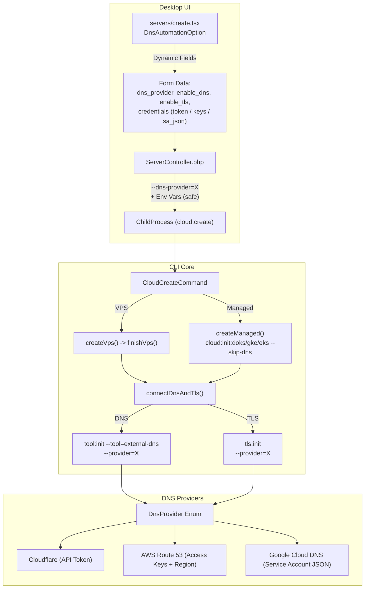

# Generic Multi-Provider DNS & TLS Automation with Managed Kubernetes Parity

## Goal Description
Harmonize DNS (ExternalDNS) and TLS (Let's Encrypt DNS-01 Challenge) across **VPS** and **Managed Kubernetes (EKS, GKE, DOKS)** clusters in both LaraKube CLI and LaraKube Desktop. Transition from hardcoded Cloudflare-only flows to a fully generic multi-provider DNS architecture supporting **Cloudflare**, **AWS Route 53**, and **Google Cloud DNS**, with complete credential security, prompt deduplication, and full TDD test coverage.

---

## User Review Required

> [!IMPORTANT]
> **Extending Beyond Cloudflare**: In addition to resuming Claude's interrupted task (wiring post-provisioning DNS/TLS into `createManaged()` in CLI and removing `!isManaged` in Desktop), this plan implements generic multi-provider DNS (`DnsProvider::GOOGLE`), introduces `--dns-provider=` on `cloud:create`, and adapts Desktop's UI and controller to handle any supported DNS provider with independent toggles for DNS and TLS.

> [!WARNING]
> **Build Execution Rule**: Per repository rules, the AI agent will not run `./build`. After CLI changes are tested and formatted, the user will be prompted to run `./build`.

---

## Proposed Architecture



---

## Component Changes

### 1. LaraKube CLI: Core Abstractions & Manifests

#### [MODIFY] `cli/app/Enums/DnsProvider.php`
- Add `case GOOGLE = 'google';` to `DnsProvider`.
- Map `label()` -> `'Google Cloud DNS'`.
- Map `externalDnsProviderFlag()` -> `'google'`.
- Map `legoProviderFlag()` -> `'gcloud'` (Traefik lego uses `gcloud` while ExternalDNS uses `google`).
- Map `credentialSecretPrefix()` -> `'google-dns-credential-'`.
- Map `credentialSecretKeys()` -> `['credentials.json', 'project_id']`.
- Map `traefikAcmeSecretName()` -> `'traefik-acme-google'`.
- Map `onboardingSteps()` with clear GCP IAM service account creation instructions (`roles/dns.admin`).

#### [NEW] `cli/app/Traits/InteractsWithGoogleCloudDnsApi.php`
- Implement zone discovery and permissions verification for GCP Cloud DNS using the GCP CLI (`gcloud dns managed-zones list --format=json`) or authenticated REST endpoints, matching the existing `InteractsWithRoute53Api` and `InteractsWithCloudflareApi`.

#### [MODIFY] `cli/resources/views/k8s/dns/zone.blade.php`
- Add the `--google-project={{ $googleProject }}` flag when `provider === 'google'`.
- Add volume and volumeMount for `credentials.json` secret when `provider === 'google'`, setting `GOOGLE_APPLICATION_CREDENTIALS=/etc/google-cloud-dns/credentials.json`.

#### [MODIFY] `cli/resources/views/k8s/traefik-cloud.blade.php` & `cli/resources/views/k8s/traefik-managed.blade.php`
- When lego provider is `gcloud`, inject `GCE_PROJECT` and `GCE_SERVICE_ACCOUNT_FILE=/etc/traefik-acme/credentials.json` and mount the secret.

#### [MODIFY] `cli/app/Commands/Dns/DnsInitCommand.php` & `cli/app/Commands/Tls/TlsInitCommand.php`
- Update options and validation to handle `--provider=google`, `--gcp-project=`, `--gcp-credentials=`.
- Read stored credentials or prompt interactively; sync to OpenBao when bootstrapped.

---

### 2. LaraKube CLI: Orchestration & Parity

#### [MODIFY] `cli/app/Commands/Cloud/CloudCreateCommand.php`
- Rename/generalize `connectCloudflare()` into `connectDnsAndTls(string $environment, string $context, ?DnsProvider $provider = null)`:
  - Add signature options:
    - `{--dns-provider= : DNS backend for automated records and SSL (cloudflare, route53, google)}`
    - `{--without-dns : Skip automated external-dns record configuration}`
    - `{--without-tls : Skip automated TLS DNS-01 certificate configuration}`
  - Retain `{--cloudflare}` as an alias for `{--dns-provider=cloudflare}` for full backward compatibility.
  - In `createManaged()`:
    - Pass `--skip-dns` and `--skip-tls` when delegating to `cloud:init:doks` / `cloud:init:gke` / `cloud:init:eks`.
    - Invoke `$this->connectDnsAndTls($environment ?: 'production', $context)` after cluster provisioning, exactly matching `finishVps()`.
  - In `finishVps()`:
    - Update to invoke `$this->connectDnsAndTls($environment ?: 'production', $context)`.

#### [MODIFY] `cli/app/Commands/Cloud/CloudProvisionDoksCommand.php`, `CloudProvisionGkeCommand.php`, `CloudProvisionEksCommand.php`
- Add `--skip-dns` and `--skip-tls` options to signatures.
- In standalone interactive execution, harmonize with `CloudProvisionCommand` by offering both DNS automation and TLS DNS-01 challenge.
- Skip prompting if `--skip-dns` / `--skip-tls` or `--no-interaction` are provided.

---

### 3. LaraKube Desktop: UI & Controller

#### [MODIFY] `desktop/resources/js/components/aws-policy-helper.tsx`
- Per **ADR 0027 (Least Privilege Cloud IAM Policies)**, operators must never be forced into broad administrative permissions when using AWS.
- Add `ROUTE53_STATEMENT`:
  ```json
  {
    "Sid": "LaraKubeRoute53LeastPrivilege",
    "Effect": "Allow",
    "Action": [
      "route53:ListHostedZones",
      "route53:ListResourceRecordSets",
      "route53:ChangeResourceRecordSets",
      "route53:GetChange"
    ],
    "Resource": [
      "arn:aws:route53:::hostedzone/*",
      "arn:aws:route53:::change/*",
      "*"
    ]
  }
  ```
- Add `includeRoute53?: boolean` prop to `<AwsPolicyHelper>`.
- Dynamically compose and copy the exact minimal policy JSON across all 4 combinations:
  - `EC2 Only`
  - `EC2 + Route 53`
  - `EC2 + EKS`
  - `EC2 + EKS + Route 53`

#### [MODIFY] `desktop/resources/js/pages/servers/create.tsx`
- Connect `<AwsPolicyHelper includeEks={isManaged} includeRoute53={form.data.dns_provider === 'route53'} />`.
- Replace `<CloudflareOption>` with an extensible `<DnsAutomationOption>` component:
  - Available for all servers (`!devBox`, including managed k8s).
  - Provider Selector: `None`, `Cloudflare`, `AWS Route 53`, `Google Cloud DNS`.
  - Independent Checkboxes:
    - `[x] Automate tool and app DNS records (ExternalDNS)`
    - `[x] Enable DNS-01 wildcard/proxied SSL (Traefik Let's Encrypt)`
  - Contextual Credential Inputs:
    - **Cloudflare**: API Token input.
    - **AWS Route 53**: Access Key ID, Secret Access Key, Region (with option to prefill from server creation AWS credentials if AWS is selected). Shows dedicated Route 53 least-privilege hint and copy button.
    - **Google Cloud DNS**: Service Account Key JSON / file picker, Project ID (with option to prefill from server creation GCP credentials if GCP is selected).

#### [MODIFY] `desktop/app/Http/Requests/StoreServerRequest.php`
- Add validation rules for:
  - `dns_provider` (`nullable|in:cloudflare,route53,google`)
  - `enable_dns` (`nullable|boolean`)
  - `enable_tls` (`nullable|boolean`)
  - `cloudflare_token` (`nullable|string|required_if:dns_provider,cloudflare`)
  - `aws_access_key_id`, `aws_secret_access_key`, `aws_region` (`required_if:dns_provider,route53`)
  - `gcp_project_id`, `gcp_credentials` (`required_if:dns_provider,google`)

#### [MODIFY] `desktop/app/Http/Controllers/ServerController.php`
- In `store()`:
  - Read `dns_provider`, `enable_dns`, and `enable_tls`.
  - When a DNS provider is configured:
    - Append `--dns-provider={$request->dns_provider}` to the command.
    - If `!$request->enable_dns`, append `--without-dns`.
    - If `!$request->enable_tls`, append `--without-tls`.
  - Inject credentials securely through environment variables in `ChildProcess::start()`:
    - `LARAKUBE_CLOUDFLARE_TOKEN` for Cloudflare.
    - `AWS_ACCESS_KEY_ID`, `AWS_SECRET_ACCESS_KEY`, `AWS_DEFAULT_REGION` for Route 53.
    - `GOOGLE_APPLICATION_CREDENTIALS` / `GCP_PROJECT_ID` for Google Cloud DNS.
  - Zero raw secrets in command arguments.


---

## Verification Plan

### Automated Tests
1. **Desktop Feature Tests**:
   - `desktop/tests/Feature/CreateServerTest.php`:
     - Test creating managed cluster with Cloudflare DNS & TLS.
     - Test creating managed cluster with AWS Route 53.
     - Test creating server with Google Cloud DNS.
     - Assert credentials travel through environment only and flags match expected arguments.
   - Run via: `cd desktop && composer test tests/Feature/CreateServerTest.php`

2. **CLI Feature & Unit Tests**:
   - `cli/tests/Unit/DnsProviderTest.php`: Test Google Cloud DNS enum mappings (`label`, `flags`, `secretKeys`, etc.).
   - `cli/tests/Feature/CloudCreateCloudflareTest.php` (expand to `CloudCreateDnsTest.php`): Test `connectDnsAndTls()` behavior on managed and VPS runs across providers and flags.
   - `cli/tests/Feature/DnsInitCommandTest.php` & `TlsInitCommandTest.php`: Test `--provider=google` flow and manifest generation.
   - Run via: `cd cli && composer test`

3. **Linters & Static Analysis**:
   - `cd cli && composer format && composer analyse`
   - `cd desktop && composer format && composer analyse`

### Manual Verification
- Review generated manifests for ExternalDNS and Traefik DNS-01 across Cloudflare, Route 53, and Google Cloud DNS.
- Verify Desktop's Create Server form renders cleanly with icons and reactive provider fields.
