# Plan: Inertia v3 Optimistic Updates, FormRequest Sanitation & Precognition

## Goal

Maximize `@inertiajs/react` `^3.0.0` and `inertiajs/inertia-laravel` `^3.4.0` capabilities already installed in `desktop/` to eliminate post-action "waiting for Sync" lag, centralize input sanitization and validation in `FormRequest` classes, and enable real-time Precognition feedback inside `<Form>` modals — starting with **Mail** as the reference implementation, followed by high-value Desktop workflows.

---

## Architecture Overview

```mermaid
sequenceDiagram
    actor User
    participant Form as React <Form> (Inertia v3)
    participant Precog as HandlePrecognitiveRequests
    participant Req as FormRequest (prepareForValidation + rules)
    participant Ctrl as MailController
    participant DB as SQLite Cache (MailAccount / MailDomain)
    participant CLI as CliRunner + SyncMailJob

    User->>Form: Types / blurs email or domain
    Form->>Precog: Precognition: true (debounced/onBlur)
    Precog->>Req: Sanitize & validate only
    Req-->>Form: 204 Valid or 422 Field Errors (CLI skipped)

    User->>Form: Confirms Delete Mailbox
    Note over Form: optimistic() immediately filters row out of props
    Form->>Ctrl: DELETE /servers/{server}/mail/accounts
    Ctrl->>DB: Delete mirrored MailAccount row optimistically
    Ctrl->>CLI: Start async `mail:delete` Run
    Ctrl-->>Form: 303 back() with updated props (row stays removed)

    CLI-->>DB: RecordRunOutput -> SyncMailJob reconciles live cluster truth
```

### Why Both Client `optimistic()` AND Server Mirrored Cache Update Are Needed for Async Runs

In Inertia v3, `<Form optimistic={(props, data) => ...}>` (and `router.optimistic(...)`) applies the callback **while the HTTP visit is in flight** and automatically restores/replaces props once the server's Inertia response arrives.

- **Synchronous DB routes** (e.g. toggling visibility, notification dismissal, DB-backed settings) only need client-side `optimistic` because the returned `back()` response already carries the mutated DB state.
- **Async CLI routes** (`MailController::deleteAccount`, `MailController::removeDomain`) return `back()` immediately after launching `CliRunner`, before the background cluster command + `SyncMailJob` finish. Updating both the **client prop** (`<Form optimistic={...}>`) and the **mirrored SQLite cache** (`MailAccount` / `MailDomain`) guarantees the item vanishes in 0ms and stays gone across `back()` / `usePoll()`, while `RecordRunOutput` → `SyncMailJob` automatically reconciles (or restores on failure) when the run completes.

---

## Phase 1: Mail End-to-End Reference Upgrade (Validation + Sanitation + Precognition + Optimistic Delete)

### 1.1 Dedicated `FormRequest` Classes with `prepareForValidation()` Sanitation

Replace inline `$request->validate(...)` in [`MailController`](file:///Users/jsluchavez/Codes/Ideas/laravel-k8s/desktop/app/Http/Controllers/MailController.php) (and raw `abort_unless` confirmation checks) with cohesive `FormRequest` classes under `desktop/app/Http/Requests/Mail/`:

| Request Class | Endpoint | Input Sanitation (`prepareForValidation`) | Validation Rules |
| :--- | :--- | :--- | :--- |
| `DeployMailRequest` | `POST /mail/deploy` | Trim/lowercase `domain`; trim/lowercase `admin_email` | `domain` optional hostname regex; `admin_email` optional RFC email |
| `StoreMailAccountRequest` | `POST /mail/accounts` | Trim/lowercase `email`; trim `name`; normalize `sso` boolean | `email` required email; `password` nullable min:8; `name` max:255; `quota` integer min:1 |
| `ResetMailPasswordRequest` | `POST /mail/accounts/password` | Trim/lowercase `email` | `email` required email; `password` nullable min:8; `sso` nullable boolean |
| `DeleteMailAccountRequest` | `DELETE /mail/accounts` | Trim/lowercase `email` | `email` required email |
| `StoreMailDomainRequest` | `POST /mail/domains` | Trim/lowercase `domain`, strip `https://` & trailing `.`; trim token/email | `domain` required strict hostname regex; `acme_email` optional email; `cloudflare_token` nullable string |
| `DestroyMailDomainRequest` | `DELETE /mail/domains` | Trim/lowercase `domain` and `confirm` | `domain` required hostname regex; `confirm` required + `same:domain`; `with_sso` boolean |
| `ConfigureMailRelayRequest` | `POST /mail/relay` | Trim/lowercase `provider`; trim `username`, `api_key`, `region` | `provider` required `in:brevo,ses,remove`; credentials/region nullable strings; `port` integer `1..65535` |
| `SendTestMailRequest` | `POST /mail/test` | Trim/lowercase `to` & `from` | `to` required email; `from` nullable email; `password` nullable string |

Also consider a small shared `SanitizesHostname` / `SanitizesEmail` helper/trait in `app/Http/Requests/Concerns/` so domain and email cleaning aren't duplicated across classes.

### 1.2 Enable Precognition Middleware on Mail Routes

In [`desktop/routes/web.php`](file:///Users/jsluchavez/Codes/Ideas/laravel-k8s/desktop/routes/web.php#L212-L224), apply `HandlePrecognitiveRequests::class` to mutating Mail routes (`deploy`, `accounts.store`, `accounts.password`, `accounts.destroy`, `domains.store`, `domains.destroy`, `relay.store`, `test`).
Because Precognition intercepts headers before controller execution, `CliRunner` processes are never spawned during live keystroke/blur validation.

### 1.3 Optimistic Delete/Remove in `MailController`

Update:
- [`MailController::deleteAccount`](file:///Users/jsluchavez/Codes/Ideas/laravel-k8s/desktop/app/Http/Controllers/MailController.php#L214-L239): delete matching `MailAccount` row on the resolved `Server` before starting `mail:delete` and returning `back()`.
- [`MailController::removeDomain`](file:///Users/jsluchavez/Codes/Ideas/laravel-k8s/desktop/app/Http/Controllers/MailController.php#L286-L320): delete matching `MailDomain` row (and its accounts under `@domain`) on the resolved `Server` before starting `mail:domain-delete` and returning `back()`.

Ensure failed runs continue invoking `SyncMailJob` via [`RecordRunOutput`](file:///Users/jsluchavez/Codes/Ideas/laravel-k8s/desktop/app/Listeners/RecordRunOutput.php#L263-L271) so accidental optimistic removals are restored if the CLI command fails.

### 1.4 Frontend `<Form>`, Precognition, Errors & `optimistic` Props (`mail/*.tsx`)

- **Shared component**: Create `desktop/resources/js/components/field-error.tsx` (tiny helper rendering accessible inline error text when `message` is truthy) so `<Form>` components stay DRY.
- **`mailboxes-tab.tsx`**:
  - Create Mailbox `<Form>`, Reset Password `<Form>`: switch to `{({ errors, invalid, validate, processing }) => ...}`, call `validate('email' | 'password' | 'quota')` on `onBlur`, highlight invalid borders, and show `<FieldError message={errors.email} />` etc.
  - Delete Mailbox `<Form>`: add `optimistic` callback filtering `deleteTarget.email` out of `accounts.accounts` immediately on submit (`options={{ preserveScroll: true }}`), closing the modal smoothly on click/success.
- **`domains-tab.tsx`**:
  - Add Domain `<Form>`: wire Precognition (`validate('domain')`, `validate('acme_email')`) and inline `<FieldError />`.
  - Remove Domain `<Form>`: add `optimistic` callback filtering `removingDomain` out of `domains` + accounts under `@${removingDomain}`, plus render `errors.confirm` / `errors.domain`.
- **`relay-tab.tsx` & `mail-empty-state.tsx`**:
  - Wire `{({ errors, invalid, validate }) => ...}` for Relay settings (`port`, `provider`), Send Test Email (`to`, `from`), and Deploy Mail (`domain`, `admin_email`).

---

## Phase 2: High-Value Rollout Across Other Desktop Areas

1. **Synchronous DB Optimistic Updates (`router.optimistic` / `<Form optimistic>`)**:
   - Project list visibility toggles / group updates in `ProjectsController` & `projects/index.tsx`.
   - Notification dismissal / mark-all-read in `NotificationsController`.
2. **Existing `FormRequest` Routes + Precognition**:
   - Add `prepareForValidation()` input sanitation (slugs, domains, emails) to existing requests (`StoreServerRequest`, `InstallClusterToolRequest`, `RebindClusterToolRequest`, `QuickLaunchAppRequest`).
   - Attach `HandlePrecognitiveRequests::class` to `POST /servers` and `POST /servers/{server}/tools` and wire Precognition feedback into `tools/index.tsx` (`InstallDialog` domain/email) & `servers/create.tsx`.

---

## Verification Plan

1. **Feature Tests (`desktop/tests/Feature/MailTest.php` + Precognition tests)**:
   - Test `FormRequest` sanitation (`  Alice@EXAMPLE.COM ` → `alice@example.com`, `https://Example.Com/` → `example.com`) and strict validation failures (`invalid domain`, `mismatched confirm`, `port > 65535`).
   - Test Precognition requests (`withHeaders(['Precognition' => 'true', 'Precognition-Validate-Only' => 'domain'])`) return `204` / `422` **without** starting a `ChildProcess` / creating a `Run`.
   - Test `DELETE /servers/{server}/mail/accounts` and `DELETE /servers/{server}/mail/domains` immediately remove the mirrored `MailAccount` / `MailDomain` rows in SQLite while queuing the `CliRunner` job, and verify `SyncMailJob` restores cluster state if synced later.
2. **Full Zero-Regression Gate (`desktop/`)**:
   - `npm run check:fix && npm run types:check`
   - `./vendor/bin/pint`
   - `./vendor/bin/phpstan analyse --memory-limit=2G`
   - Full `./vendor/bin/pest --parallel` (100% pass required).
