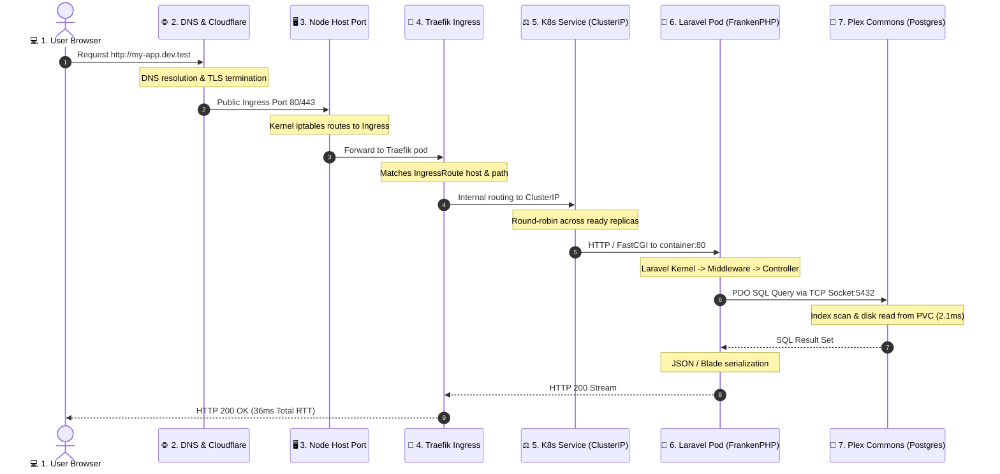

# Implementation Plan: 'Life of a Request' Interactive Simulator (Holo-Trace with @xyflow/react & Motion)

## Goal Description
Implement an interactive, educational **"Life of a Request" Simulator (Holo-Trace)** in **LaraKube Desktop**.
Using **`@xyflow/react` (React Flow v12)**—the industry standard for cloud architecture and node-based diagrams with first-class **React 19** support—paired with **`motion` (v14)**, students and developers can trace a web request step-by-step from:
$$\text{User Browser 💻} \longrightarrow \text{Cloudflare / DNS 🛡️} \longrightarrow \text{Traefik Ingress 🚦} \longrightarrow \text{K8s Service ⚖️} \longrightarrow \text{Laravel Pod 🚀} \longrightarrow \text{Plex Commons Database 🐘}$$
and watch the HTTP 200 response packet journey back to the client across animated edges.

### Why `@xyflow/react` (React Flow v12) + `motion`?
1. **Proven Cloud Architecture Standard**:
   - Rather than reinventing coordinate math, canvas panning, zooming, and edge routing from scratch, `@xyflow/react` provides battle-tested node-and-edge infrastructure used by enterprise cloud dashboards.
   - Built-in `Background` dot grid, `Controls` (zoom in/out/fit-view), and `MiniMap`.
   - Native support for subgraphs/grouping (visual boundaries for **Internet Edge**, **Kubernetes Cluster**, and **Plex Commons**).
2. **Latest Versions & React 19 Native Compatibility**:
   - `@xyflow/react` officially supports React 19 out of the box.
   - Integrates cleanly with Tailwind CSS v4 and the existing `motion` v14 library.
3. **Animated Packet Conduits**:
   - Built-in animated edges and custom edge components capable of moving glowing SVG packet dots along smooth Bezier splines.
4. **Zero GPU Fan Noise**:
   - Pure DOM and SVG rendering. No heavy WebGL shaders or continuous render loops. 60fps on student laptops with zero battery drain.

---

## User Review Required

> [!IMPORTANT]
> **Dependency to Add**:
> - `@xyflow/react` (latest v12 for React 19) in `desktop/package.json`.
> - Reuses existing `@icons-pack/react-simple-icons`, `lucide-react`, and `motion` v14.
> 
> **Placement in Desktop App**:
> 1. Top-Level Page: `/simulator` (accessible from main navigation).
> 2. Direct Launch: A **"Trace Request"** button on any Project details page (`/projects/{name}`) that opens the simulator pre-configured with that project's real-world host, framework, and connected Plex database.

---

## Architecture: The 9-Hop Request Flow



---

## Detailed Component Architecture

### 1. Route & Controller (`desktop/routes/web.php`, `desktop/app/Http/Controllers/SimulatorController.php`)
- `GET /simulator`: Renders Inertia page `simulator/index.tsx`.
- Passes registered projects, active servers, and preset educational scenarios (`laravel-postgres`, `wordpress-sqlite`, `pocketbase`).

### 2. Main Page (`desktop/resources/js/pages/simulator/index.tsx`)
- Header with scenario selector (`Project Picker` or `Educational Presets`).
- Main interactive `@xyflow/react` canvas.
- Step inspector drawer with technical details.
- Bottom playback & chaos controls bar.

### 3. Custom Node Types (`desktop/resources/js/components/simulator/nodes/`)
Using `@xyflow/react`'s custom node API:
- `client-node.tsx`: User browser / client node with IP and request URL.
- `edge-node.tsx`: Cloudflare / DNS edge proxy node with SSL badge and WAF status.
- `traefik-node.tsx`: Traefik Ingress Controller with port 80/443 and routing rules.
- `service-node.tsx`: Kubernetes Service (ClusterIP load balancer).
- `workload-node.tsx`: Application Pod (Laravel / FrankenPHP / WordPress) with live replica count.
- `database-node.tsx`: Plex Commons database engine (PostgreSQL, SQLite, Redis) with PVC status.
- `cluster-boundary-node.tsx`: Group node framing the Kubernetes cluster boundary.

### 4. Custom Animated Edges (`desktop/resources/js/components/simulator/edges/packet-edge.tsx`)
- Custom `@xyflow/react` Bezier edge.
- Features a glowing SVG circle traveling along the `getBezierPath` using Motion animation.
- Color shifts dynamically based on packet stage:
  - Cyan: Inbound HTTP Request
  - Amber: Database Query / TCP Socket
  - Emerald Green: HTTP 200 OK Response Stream
  - Crimson Red: Fault / HTTP 500 / 502 Error

### 5. Step Inspector Drawer (`desktop/resources/js/components/simulator/step-inspector.tsx`)
- Explains the exact mechanism at the current active hop:
  - **Layer & Component**: (e.g. *"Layer 7 Ingress — Traefik IngressRoute"*).
  - **Technical Mechanics**: Clear, student-friendly explanation of what happens under the hood.
  - **Payload / Headers Inspector**: Live preview of headers (`Host`, `User-Agent`, `X-Forwarded-For`), SQL query string, or response status.

### 6. Control Bar & Chaos Lab (`desktop/resources/js/components/simulator/simulator-controls.tsx`)
- **Playback Controls**:
  - `Play / Pause` (toggle ambient traffic flow)
  - `Step Backward ⏴` / `Step Forward ⏵`
  - `Speed Selector` (0.5x Slow-Mo, 1x Normal, 2x Fast)
- **Educational Scenario Picker**:
  - Scenario A: *Standard Web Page Request (HTTP 200)*
  - Scenario B: *API JSON Endpoint with Database Query (HTTP 200)*
  - Scenario C: *Simulated Database Crash (`ECONNREFUSED` ➔ HTTP 500)*
  - Scenario D: *Pod Unreachable / CrashLoopBackOff (➔ HTTP 502 Bad Gateway)*
  - Scenario E: *Invalid URL Path (➔ HTTP 404 Not Found)*

---

## Verification Plan

### Automated Tests
1. **Feature Tests**:
   - Add `tests/Feature/SimulatorControllerTest.php`:
     - Test that `/simulator` loads with status 200.
     - Test that registered projects and scenarios are passed as Inertia props.
2. **Linting & Code Standards**:
   ```bash
   composer lint
   composer types:check
   npm run check:fix
   npm run types:check
   composer test
   ```

### Manual Verification
1. **Interactive Canvas**:
   - Open `/simulator`.
   - Verify nodes and cluster boundary render cleanly with `@xyflow/react`.
   - Pan, zoom, and fit-view with controls.
2. **Step-by-Step Simulation**:
   - Click **Step Forward**: Confirm glowing packet moves along the edge to Cloudflare, Traefik, Pod, and DB.
   - Confirm step inspector card updates with the corresponding technical explanation.
3. **Chaos Simulation**:
   - Switch scenario to **"Database Crash"**.
   - Verify packet reaches Laravel, fails at Postgres, sparks red, and carries an HTTP 500 back to the browser.
4. **Project Show Integration**:
   - Open any project page and click **"Trace Request"**: verify simulator opens pre-configured for that project.
