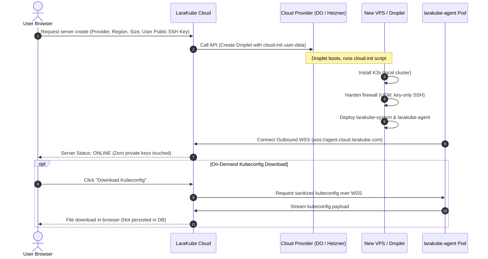

# LaraKube Cloud Architecture: Zero-Trust In-Cluster Agent & Sovereign Platform

## Goal Description
LaraKube Desktop and the LaraKube CLI provide a high-performance, developer-friendly orchestration experience for Kubernetes. However, desktop users must install and run local tooling (Docker, OrbStack, or NativePHP).

The objective of **LaraKube Cloud** is to deliver the full LaraKube experience in the browser: users log in, provision cloud servers across major cloud providers (DigitalOcean, Hetzner, AWS, GCP), install companion tools (OpenBao, SeaweedFS, PostgreSQL, Authentik, Uptime Kuma), and deploy Laravel applications with zero local installation required.

Crucially, LaraKube Cloud avoids the security vulnerabilities and architectural traps of traditional server panels (e.g. Laravel Forge, Ploi, RunCloud):
1. **Zero Root Credential Custody**: LaraKube Cloud does **not** store cluster-admin `kubeconfig` files or private SSH keys.
2. **Zero Inbound Attack Surface**: Clusters and servers keep their management ports (SSH port 22 and K8s API port 6443) firewalled from the public internet. All communication is initiated **outbound** from the customer's cluster via a persistent secure WebSocket (WSS) agent.
3. **Zero Lock-In & Total Sovereignty**: Customer clusters are 100% self-contained and declarative. If LaraKube Cloud goes offline or the customer cancels their subscription, their applications and companion services continue running without interruption.

---

## Architecture Overview

```mermaid
flowchart TD
    subgraph Browser ["User Browser"]
        WebUI["LaraKube Cloud Web UI\n(Inertia v3 + React 19)"]
        Terminal["Live Terminal / Log Stream\n(Laravel Echo)"]
    end

    subgraph Cloud ["LaraKube Cloud Platform (Laravel 13 + FrankenPHP)"]
        API["Cloud Web & API\n(Controllers & Auth)"]
        Reverb["Laravel Reverb\n(WSS Gateway)"]
        Worker["Provisioning Queue\n(Ephemeral OpenTofu Jobs)"]
        OpenBao["Cloud Vault\n(Encrypted Cloud Provider Tokens)"]
    end

    subgraph CustomerCloud ["Customer Infrastructure (DigitalOcean / Hetzner / AWS / GCP)"]
        subgraph Cluster ["Customer Kubernetes Cluster (K3s / Managed K8s)"]
            AgentPod["larakube-agent daemon\n(larakube-system namespace)"]
            K8sJob["Disposable Execution Pod\n(ghcr.io/larakube/cli <verb>)"]
            Workloads["App Pods & Companion Tools\n(OpenBao, Postgres, Uptime Kuma)"]
        end
    end

    WebUI -->|HTTPS / Actions| API
    API -->|Dispatch Job / Event| Reverb
    Reverb -->|Realtime Output Stream| Terminal
    API -->|Store/Retrieve API Token| OpenBao
    API -->|Queue VM Provisioning| Worker

    Worker -.->|1. cloud-init boots VM + Agent| CustomerCloud
    AgentPod ===>|2. Outbound Persistent WSS (mTLS/JWT)| Reverb
    Reverb ===>|3. Signed Task Payload| AgentPod
    AgentPod -->|4. Spawn batch/v1 Job| K8sJob
    K8sJob -->|5. Apply Manifests & Wiring| Workloads
    K8sJob -.->|6. Stdout/Stderr Log Stream| AgentPod
    AgentPod ===>|7. Stream Output Messages| Reverb
```

---

## 1. Threat Model & Security Comparison

| Dimension | Traditional Server SaaS (Forge, Ploi) | LaraKube Cloud (Zero-Trust Agent) |
| :--- | :--- | :--- |
| **Inbound Access** | Requires public SSH port 22 open to SaaS IPs. | **Zero inbound access required**. Port 22 and 6443 can be firewalled completely. |
| **Credential Storage** | SaaS database stores root SSH private keys for every user VM. | **Zero root SSH keys stored**. Cloud never touches private SSH keys. User supplies their own public key. |
| **Cluster Access** | SaaS stores root `cluster-admin` kubeconfig in central DB. | **Zero root kubeconfigs stored**. Cloud dispatches tasks to an in-cluster agent via signed tokens. |
| **Impact of SaaS Breach** | Catastrophic: Attackers get instant root SSH into every customer server worldwide. | **Contained**: No SSH keys or kubeconfig databases to leak. Agent connections can be revoked instantly. |
| **Vendor Dependency** | High: Servers rely on custom proprietary bash scripts and mutable state. | **Zero Lock-In**: Clusters are standard Kubernetes declarative workloads. Removing the agent leaves workloads intact. |

---

## 2. In-Cluster Agent Design (`cli/`)

The agent is implemented natively inside the LaraKube CLI application as a persistent sub-command: `larakube agent:daemon`.

### 2.1 The Agent Lifecycle
1. **Startup & Registration**:
   - The agent pod starts inside the `larakube-system` namespace.
   - Reads environment variables / secret:
     - `LARAKUBE_SERVER_URL` (e.g. `wss://agent.cloud.larakube.com`)
     - `LARAKUBE_CLUSTER_ID` (ULID)
     - `LARAKUBE_CLUSTER_TOKEN` (Ed25519 signed JWT or opaque cluster token)
   - Opens an outbound TLS WebSocket connection to LaraKube Cloud.
2. **Heartbeat & Telemetry**:
   - Every 30 seconds, sends a lightweight status ping (cluster node health, memory usage, CPU load, active pods count).
3. **Task Reception & Verification**:
   - Cloud pushes a task envelope:
     ```json
     {
       "id": "op_01j8x9k2v...",
       "action": "tool:install",
       "arguments": ["uptime-kuma", "--domain=status.example.com"],
       "environment": {
         "OPENBAO_TOKEN": "..."
       },
       "signature": "..."
     }
     ```
4. **Disposable Job Spawning (Zero Crash Risk)**:
   - Instead of running user commands inside the long-lived daemon process, the agent uses the in-cluster Kubernetes API to spawn a disposable `batch/v1` Job:
     - Image: `ghcr.io/larakube/cli:latest`
     - Command: `['larakube', 'tool:install', 'uptime-kuma', '--domain=status.example.com', '--no-interaction', '--json']`
     - `ttlSecondsAfterFinished: 600` (automatically reaped by Kubernetes)
5. **Real-Time Streaming**:
   - The agent watches the job pod's logs (`kubectl logs -f ...`) and streams chunks back over the WebSocket:
     ```json
     {
       "event": "output",
       "task_id": "op_01j8x9k2v...",
       "stream": "stdout",
       "data": "Provisioning Uptime Kuma manifests...\n"
     }
     ```
   - Cloud routes these chunks directly into Laravel Reverb, which delivers them to the user's browser in real-time.
6. **Task Completion**:
   - When the container exits, the agent reports exit code, status, and metadata, then closes the task stream.

### 2.2 Agent Deployment Manifest (`larakube agent:manifest`)
The CLI will provide a generator for the agent's deployment YAML:
- Namespace: `larakube-system`
- ServiceAccount: `larakube-agent`
- ClusterRole & ClusterRoleBinding: Scoped permissions for namespaces, pods, jobs, services, deployments, persistentvolumes, persistentvolumeclaims, and ingress/gateway resources.
- Secret: `larakube-agent-credentials`
- Deployment: 1 replica, memory limit 64Mi, CPU limit 100m.

---

## 3. Server Provisioning & Credential Custody Flow

When a user provisions a new server on DigitalOcean, Hetzner, AWS, or GCP through LaraKube Cloud:



---

## 4. Product Differentiation: Why LaraKube Cloud is Not a Generic SaaS

| Generic Server SaaS | LaraKube Cloud |
| :--- | :--- |
| **Mutable Snowflake VMs**: Installs PHP/MySQL directly onto the host OS via fragile Bash scripts. | **Containerized & Declarative**: Every tool, database, and application is a containerized Kubernetes manifest. |
| **Hostile Custody**: Holds your root SSH keys hostage. Migrating away requires rebuilding servers. | **Sovereign by Design**: You own the hardware and cluster. Disconnecting LaraKube Cloud does not disrupt running apps. |
| **Single-Node Lock-in**: Hard to scale beyond a single VPS without complex custom infrastructure. | **Kubernetes-Native Scaling**: Upgrade from a $4 VPS to multi-node high availability (DOKS/GKE/EKS) using the same manifests. |
| **Plaintext Secrets**: Environment variables stored as plaintext files on VM disk. | **Zero-Leak Secrets**: Fully integrated with OpenBao / HashiCorp Vault with dynamic namespace syncing. |
| **Manual Tooling Setup**: Installing S3, Redis, Vault, SSO, or monitoring requires separate services. | **Companion Ecosystem**: One-click install and automatic wiring for SeaweedFS, Forgejo, Authentik, Uptime Kuma, GlitchTip. |

---

## 5. Implementation Roadmap & Phasing

### Phase 1: Core Agent, Infrastructure & Companion Tools (MVP)
1. **LaraKube CLI Updates (`cli/`)**:
   - Implement `App\Commands\AgentDaemonCommand` (`larakube agent:daemon`).
   - Implement `App\Commands\AgentManifestCommand` (`larakube agent:manifest`).
   - Add unit and feature tests in `cli/tests/Feature/AgentCommandTest.php`.
   - Update Dockerfile / build specs for `ghcr.io/larakube/cli` to include daemon entrypoints.
2. **Clean-Slate LaraKube Cloud Web Application**:
   - Fresh Laravel 13, Octane (FrankenPHP), Inertia v3, React 19, Tailwind v4.
   - Team tenancy, authentication via Laravel Fortify + Passkeys (Section 11.1) — enterprise SSO (Zitadel/Keycloak) explicitly deferred past the MVP.
   - Cloud Credentials Vault (OpenBao encrypted integration for DO, Hetzner, AWS, GCP tokens), scoped per-tenant via wrapped single-use AppRole SecretIDs (see Section 6.1) — never a shared/static token across tenants.
   - Server Provisioning engine (background workers running OpenTofu / cloud APIs), with a Postgres advisory lock per tenant+environment guarding each job (Section 6.2) and state encrypted via OpenBao Transit-derived keys (Section 6.3).
   - Connect Existing Server via one-line curl / kubectl command.
   - WSS Agent Gateway & Laravel Reverb integration for real-time terminal output.
   - Companion Tools catalog (1-click install for OpenBao, SeaweedFS, Postgres, MySQL, Redis, Uptime Kuma).
   - On-demand Kubeconfig download proxy.
   - OpenTofu remote state backed by SeaweedFS's S3-compatible API, with state encryption (`encryption {}` block, AES-GCM) keyed via OpenBao Transit (Section 6.3).
   - `AuditLog` model for job dispatch metadata + OpenBao audit device enabled cluster-wide (Section 6.4).

### Phase 2: Git Project Deployments & Webhooks
1. Connect GitHub / GitLab accounts via OAuth.
2. Project creation flow mirroring LaraKube Desktop (Repository, Branch, Environment).
3. Secret management with OpenBao integration.
4. Deployment pipeline: Agent dispatches `larakube deploy` with rolling updates, zero downtime, and health checks.
5. Automated webhooks for push-to-deploy.

### Phase 3: Advanced Cloud Networking & Multi-Node
1. Automated Cloudflare DNS & SSL provisioning.
2. NetBird VPN mesh integration for private cluster access.
3. Managed Kubernetes clusters (DigitalOcean DOKS, AWS EKS, Google GKE).
4. Multi-node cluster scaling and volume replication.

---

## 6. OpenTofu Credential Custody, State & Audit Trail (Provisioning Workers)

Section 3 covers server provisioning against a cloud provider's own API
(DigitalOcean/Hetzner droplet create via cloud-init). This section covers
the narrower, security-critical path underneath that: the OpenTofu
`apply`/`destroy` runs a provisioning worker actually executes, and how
tenant cloud-provider credentials and OpenTofu state are custodied during
that run. This consolidates a zero-trust review of that specific sub-path
(credential scoping, state locking, encryption-key management, audit
logging) into the architecture above — it does not change the agent design
in Sections 2–3, it hardens the "Worker" node in the diagram in Section 0.

### 6.1 Tenant Credential Scoping & Blast Radius

- Tenant cloud-provider credentials (AWS IAM keys, DO/Hetzner tokens) live
  in OpenBao KV v2 at `secret/data/tenants/{tenant_id}/providers/{provider}`,
  one policy per tenant scoping access to only that path.
- Provisioning queue jobs run in short-lived, single-purpose worker
  containers/pods (one job = one `tofu apply`/`destroy`, not a long-lived
  pool worker reused across tenants) — this bounds a container compromise
  to one tenant's job, not a shared process holding multiple tenants'
  secrets in memory over time.
- Each job authenticates to OpenBao via a **wrapped, single-use AppRole
  SecretID** (`wrap_ttl` response-wrapping, `secret_id_num_uses=1`,
  `token_num_uses` capped, `token_ttl` ≈ expected job duration + grace):
  Laravel generates the wrapped SecretID at job-dispatch time (never the
  raw AppRole credentials) and passes only the wrapping token to the job;
  the job unwraps it once to get a token scoped to exactly one tenant's
  policy. A stolen worker environment yields a token that is already
  consumed-or-expiring and scoped to one tenant.
- The job's `finally`/shutdown path explicitly calls `vault token revoke`
  (or `-self`) on its own token before exiting, in addition to natural TTL
  expiry — mirrors the existing `Elevation::revoke()` "revoke what you
  granted, don't just wait for TTL" pattern already used for local sudo
  grants in Desktop.
- Kubernetes `NetworkPolicy` restricts worker pods to only OpenBao's and
  SeaweedFS's cluster-internal endpoints plus the specific cloud provider's
  public API — no lateral pod-to-pod reachability to other tenants'
  workloads.

### 6.2 OpenTofu State Locking

SeaweedFS's S3-compatible API does **not** implement DynamoDB-style
conditional-write locking, so OpenTofu's native S3 backend `lock_table`
mechanism (which requires an actual DynamoDB endpoint) is not usable as-is.
Mitigation: Laravel acquires a **Postgres advisory lock** keyed on
`tenant_id` + `environment` (`pg_advisory_lock(hashtext(...))`) immediately
before dispatching the provisioning job, held on a dedicated persistent
connection for the job's lifetime, and released in the job's completion
handler (success, failure, or timeout alike — same "always release" shape
as the `TaskStop`/`Elevation::revoke()` finally-pattern elsewhere in this
codebase). A second request for the same tenant+environment while a job is
in flight is rejected at the HTTP layer with a clear "a deployment is
already running" response rather than being queued to fight over state —
this is an app-level mutex, not a reimplementation of Tofu's own lock
protocol, and is enforced *before* the job is ever queued (not inside the
worker), so the queue itself never holds two conflicting jobs for one
tenant+environment.

### 6.3 OpenTofu Native State Encryption — Key Management

The master key for OpenTofu's `encryption {}` block (AES-GCM) must never
sit in a plaintext config file or committed repo. Use OpenBao's **Transit**
secrets engine for envelope encryption instead of a single static key:
- A per-tenant named Transit key (`transit/keys/tenant-{tenant_id}`) is
  created on tenant onboarding.
- At job runtime, the worker's scoped OpenBao token (see 6.1) calls
  Transit's `encrypt`/`decrypt` endpoints — OpenTofu's `key_provider`
  config for the `encryption {}` block is driven by a short-lived data key
  fetched from Transit and injected as a subprocess environment variable
  (never written to disk), matching the existing "inject secrets via
  Symfony `Process` env, never a file" execution model.
- Because the key material never leaves OpenBao except as a short-lived
  in-memory value scoped to one job, rotating a tenant's Transit key
  immediately invalidates future encrypt/decrypt calls for that tenant
  without needing to touch already-written state files (OpenTofu
  re-wraps state keys on each read/write under the then-current key).

### 6.4 Audit Logging & Non-Repudiation

Two complementary trails, kept deliberately separate so neither one alone
has to carry both "what secret was touched" and "what command ran":
- **OpenBao audit device** (file or socket backend, enabled cluster-wide):
  the system-of-record for every secret *read*, hashed per OpenBao's own
  audit log convention (HMAC'd paths/values) — not something Laravel needs
  to reproduce.
- **Laravel `AuditLog` model**: records job metadata only — tenant ID,
  acting user ID, action/command, arguments, timestamps, and exit status.
  It deliberately never stores resolved secret *values*, only secret
  *paths/references* (e.g. `tenants/{id}/providers/aws`, not the key
  itself). Captured job stdout/stderr that gets persisted for the live
  terminal/log stream must be scrubbed of secret-shaped substrings (same
  redaction concern already present wherever this codebase captures
  command output) before it is written to durable storage, so a worker
  that accidentally echoes an injected env var during a failure doesn't
  leak it into a log table that itself isn't access-scoped per tenant.

---

## 7. OpenBao Operational Checklist (Carrying Real Tenant Secrets)

OpenBao (the Linux Foundation fork of HashiCorp Vault) is a mature,
well-audited secrets engine — the risk in Section 6 is never "can it hold
the data," it's whether the platform *operates* it correctly from day one.
This checklist must be satisfied before any real tenant credential ever
touches it, not retrofitted after launch:

1. **Auto-unseal via cloud KMS** — never manual Shamir unseal keys sitting
   in a doc or someone's notes. Use the control-plane cloud provider's own
   KMS (AWS KMS / GCP Cloud KMS / Azure Key Vault, matching whichever
   provider hosts the LaraKube Cloud control plane itself) so a pod
   restart doesn't require a human to re-enter unseal shares.
2. **Integrated Raft storage + automated, *offsite* snapshots** — Raft
   storage (not a single-node dev mode), with scheduled snapshots shipped
   to storage **outside** the same cluster/account that OpenBao itself
   protects (a separate bucket/account, not the same SeaweedFS instance
   Vault's own data might end up encrypting) — otherwise a single
   platform-level incident can take out both the vault and its backups
   together.
3. **Multi-node HA** — Raft HA cluster (not one pod), consistent with the
   "Kubernetes-Native Scaling" pitch made to customers in Section 4; a
   single-pod OpenBao becomes the one SPOF for the entire platform's
   secrets if it isn't HA.
4. **Network isolation** — no public ingress, ever; reachable only from
   inside the control-plane cluster, over mTLS from Laravel workers and
   the agent gateway. Confirmed via the same "Zero Inbound Attack Surface"
   principle already applied to customer clusters in Section 1.
5. **Root token discipline** — generate once at init, use it only to bootstrap
   the first policies/AppRoles, then follow Vault/OpenBao's documented
   root-token revoke-and-regenerate procedure; day-to-day platform code
   never runs as root. The initial root token is a break-glass artifact,
   not something that lives in `.env`.
6. **Per-tenant least privilege** — the policy/AppRole scoping from Section
   6.1, applied without exception: no shared "all tenants" policy, ever,
   even for platform-internal tooling.
7. **Audit device shipped off-box** — the audit log from Section 6.4 must
   be forwarded to storage the OpenBao pod itself cannot delete (so a
   compromised pod can't also erase its own trail), and alertable (spike
   in reads for one tenant's path, unexpected policy/AppRole creation).
8. **Disaster-recovery restore drills** — periodically prove a Raft
   snapshot actually restores, not just that snapshots exist. This mirrors
   the exact standard this codebase already holds its own backup system
   to (`project_backup_restore_state`: "PROVEN restorable," not merely
   scheduled) — the same bar applies to the vault protecting every
   tenant's cloud credentials.
9. **Version discipline** — check OpenBao's actual current release before
   pinning any version in the deployment manifest (per this repo's
   existing stale-pin hard rule) — do not assume a version pinned during
   initial build is still current by the time this ships.

---

## 8. Team / Tenancy Model (DigitalOcean-Style)

Signup auto-creates one personal **Team** the user can rename later; users
can additionally create or be invited into other Teams, and switch between
them (DO/GitHub-org-style). This is the right default — it gives every
user a working account with zero setup friction while still supporting
shared/workshop-style multi-user teams later.

**Decision this forces on Sections 6–7 above**: every tenant-scoped thing
— OpenBao policy path, AppRole, Postgres advisory lock key, Transit key,
provisioned server/agent connection, `AuditLog` row — must be keyed by
**`team_id`**, not `user_id`. A user is just a member of one or more teams;
the isolation boundary the rest of this document calls "tenant" is always
the team. This needs to be made explicit now, before any of Section 6's
OpenBao paths get built against the wrong key.

### Gaps this model introduces, not yet covered above

1. **Active-team context must be enforced server-side, not just in the UI
   switcher.** A user who belongs to two teams must never have an action
   resolve against the wrong team's OpenBao policy/AppRole because of a
   stale session's "current team" — every job dispatch must re-verify
   team membership + resolve credentials from the request's authenticated
   team, not a cached client-side selection.
2. **Role model inside a team.** At minimum Owner (billing, delete team,
   remove members) / Admin (manage servers & projects) / Member
   (deploy/view). Without this, every teammate gets equivalent access to
   every server the team owns — fine as an explicit v1 choice, but it
   must be a decision, not a default nobody chose.
3. **Server/agent ownership transfer.** The `LARAKUBE_CLUSTER_ID` +
   AppRole policy from Section 2 is registered against a team at
   provision time. Team deletion or a server being transferred to another
   team needs an explicit decommission/re-key flow — per the "Zero
   Lock-In" pitch in Section 4, a deleted team's *running cluster* must
   keep working even if its LaraKube Cloud registration goes away; only
   the agent's ability to reach the platform should be revoked.
4. **Invitation abuse surface.** Invite-by-email needs expiring tokens,
   accept/decline, and must not leak whether an email already has an
   account (enumeration) or allow unlimited invite-send spam.
5. **Provider rate-limiting is a generic concern, not a workshop-specific
   one — correction from an earlier draft of this section.** LaraKube
   Cloud's whole premise (Section 8 above) is that teams don't know each
   other and each brings its own cloud-provider credentials via the
   Vault, so "30 students sharing one sponsor token" isn't really the
   platform's default path — it's an edge case a workshop organizer would
   have to opt into. The actually-useful, always-applicable fix belongs
   at the API-call layer itself: the provisioning worker's call to the
   cloud provider (Section 3) must catch 429s / rate-limit response
   headers with bounded exponential backoff, surfacing "provider is
   rate-limiting, retrying" status to the user rather than failing the
   job outright. This benefits every team under normal use (a single
   team can get rate-limited on its own account), and incidentally
   absorbs the shared-sponsor-token workshop case too, with no
   workshop-specific queue/mode required.
6. **Team slug/name collisions.** The auto-generated default name
   (`"{username}'s Team"`) is fine, but if team slugs end up in URLs,
   kubeconfig labels, or OpenBao paths, uniqueness and renaming must not
   be able to collide with another team's slug — scope by `team_id`
   internally, never by the user-editable display name.

---

## 9. CLI Changes Required (`cli/`)

Beyond the already-roadmapped `agent:daemon` / `agent:manifest` commands
(Section 5, Phase 1), this consolidation surfaces concrete new work on the
CLI itself:

1. **In-cluster ("self-cluster") execution mode.** Today's CLI commands
   assume they run *outside* the target cluster, selecting it via
   `--context=`/kubeconfig. The disposable `batch/v1` Jobs the agent spawns
   (Section 2.1 step 4) run **inside** the very cluster they're operating
   on — they need a mode that detects in-cluster config
   (`KUBERNETES_SERVICE_HOST`) and skips context selection entirely rather
   than being handed a `--context=` flag that doesn't apply to itself.
2. **Non-interactive compliance audit, not new code.** Every command the
   agent will dispatch (`tool:install`, `cloud:init`, `cloud:provision`,
   etc.) already must honor `RequiresFlagsWhenNonInteractive` per this
   repo's existing hard rule — confirm this holds for every command on the
   actual dispatch allow-list before Phase 1 ships, rather than assuming it
   does.
3. **OpenTofu backend parameterization for SeaweedFS remote state.**
   Whatever command currently drives `tofu apply`/`destroy` (`cloud:provision`
   et al.) needs its backend config generated per-tenant (`-backend-config`
   pointed at the team's SeaweedFS S3-compatible path) instead of a fixed
   local/static backend, plus the `encryption {}` block's key provider
   wired to the Transit-derived key injected via env (Section 6.3) —
   this is new plumbing, not a copy of today's local-state path.
4. **Postgres-advisory-lock-aware dispatch.** The CLI command itself
   doesn't need to know about the lock (Laravel acquires/releases it
   around the job, per Section 6.2) — but the job's env should carry the
   lock-key context so a failure mid-apply can be attributed to the
   correct team+environment in logs/audit rather than needing to be
   cross-referenced after the fact.
5. **Secret-safe stdout/stderr.** Audit (don't assume) that no command on
   the agent's dispatch allow-list ever echoes an injected credential/token
   value to stdout on a failure path — this output is what gets streamed
   live to Reverb and persisted for the `AuditLog` trail (Section 6.4), so
   a leak here bypasses OpenBao's own access scoping entirely.
6. **Outbound WSS client.** `agent:daemon` needs a persistent outbound
   WebSocket client (Reverb/Pusher-protocol compatible) as a new PHP
   dependency — doesn't exist in the CLI today.
7. **Deferred**: a Zitadel-or-Keycloak client for the Cloud app only
   becomes necessary once Section 11.1's enterprise-SSO decision is
   actually made. If Zitadel is eventually chosen, `cli`'s existing
   `app/Http/Integrations/Zitadel/*` (Saloon connector + ~35 request
   classes) and `app/Traits/InteractsWithZitadelApi.php` — and in
   particular how `sso:org`/`sso:org-grant` already use a Zitadel
   Organization as a real multi-tenant boundary — is the pattern to
   follow rather than reinvent; if Keycloak, this would be new
   integration work with no existing precedent in this codebase.

---

## 10. Docker Images Required

1. **`ghcr.io/larakube/cli`** (already roadmapped, Section 5 Phase 1) — the
   disposable per-task Job image. Must bundle every cloud-provider CLI and
   `tofu` as **static binaries baked into the image**, not installed
   on-demand via Homebrew the way Desktop/local setup does today — an
   ephemeral Job has no persistent disk and no Homebrew to self-heal.
2. **`larakube-agent`** — the long-lived in-cluster daemon
   (`agent:daemon`). Decide explicitly whether this reuses the `cli` image
   (invoked with a different entrypoint/command) or ships as a separate,
   leaner image — the daemon needs the in-cluster Kubernetes API client and
   a WSS client but none of the heavy provider CLIs the disposable Jobs
   need, so a separate slim image is likely the better call for attack
   surface and pull time, but this must be a stated decision, not a
   default.
3. **LaraKube Cloud web app image** — new; the Laravel 13 + Octane
   (FrankenPHP) control-plane application itself (Section 5 Phase 1), a
   clean-slate build distinct from both of the above.
4. **OpenBao** — use the official upstream OpenBao image; no custom build
   needed here, only configuration (Section 7).

---

## 11. Control-Plane Identity & Database Schema

Sections 1–10 cover the agent, credential custody for provisioning, and
the Team/tenancy model's *shape* — this section settles how a human
actually authenticates into LaraKube Cloud, and how Teams are represented
in the database.

### 11.1 Decision: plain Laravel auth (Fortify + Passkeys) for the MVP — enterprise SSO explicitly deferred

**Enterprise SSO (letting a customer company bring its own Okta/Azure
AD/SAML or OIDC IdP) is deliberately deferred, not built in Phase 1.**
That was the *only* reason an external IAM broker (Zitadel or Keycloak)
was being considered — without it, there's no reason to run a separate
IAM service at all for the MVP. Use **Laravel Fortify + Passkeys**
directly, the same as the architecture plan's original Phase 1 intent,
before this consolidation introduced Zitadel.

This was a deliberate choice, not an oversight: a live comparison was run
between self-hosted Zitadel (free self-hosted tier caps external-IdP
federation at 3 connections per instance before requiring a paid tier,
but has a proven, tested integration pattern already in `cli` —
`app/Http/Integrations/Zitadel/*`, `sso:org`'s Organization-per-tenant
shape) and self-hosted Keycloak (Apache 2.0, CNCF-governed, **no
commercial cap** on external-IdP connections, with a native
**Organizations** feature in v26 giving the same per-tenant SSO isolation
— but zero existing integration code in this codebase, so it would mean
building a REST client from scratch). Rather than pick between those two
trade-offs now, for a feature with zero confirmed customer demand, the
simpler call is to **not build the feature yet** — remove the whole
decision from the MVP's critical path.

**When enterprise SSO is actually needed** (a specific, real company
asks, not a hypothetical one): revisit Zitadel vs. Keycloak then, with
real requirements in hand (how many companies, what protocols they
actually use) rather than guessing now. Nothing in Sections 1–10 depends
on which broker gets picked — Teams, OpenBao credential scoping, and the
agent design are all unaffected by this choice either way.

### 11.2 Decision: Team model (no external IAM dependency)

Signup creates one local `teams` row with `personal_team = true`,
matching the DO-style default from Section 8 — no external Organization
object needs to exist alongside it now that there's no IAM broker in the
loop. Creating/joining another Team just creates/joins another `teams`
row + `team_user` pivot entry. If/when enterprise SSO is built later
(11.1), each Team can be mapped onto that broker's own tenant/org
primitive at that point — deferring this now costs nothing, since the
local schema doesn't need to reference an external org ID to function.

### 11.3 Database Schema (new LaraKube Cloud Laravel app)

All tenant-scoped tables key off `team_id` — the same key already
required by Sections 6–8, never `user_id`.

- **`users`**: `id`, `name`, `email`, Fortify's standard password/
  2FA columns, passkey credentials (via `laravel/fortify`'s WebAuthn
  support), `current_team_id` (FK), `avatar_url`, timestamps.
- **`teams`**: `id`, `name`, `slug` (unique, internal — never derived
  from the user-editable `name`, per Section 8 item 6), `personal_team`
  (bool), `owner_id` (FK users), timestamps.
- **`team_user`** (pivot): `team_id`, `user_id`, `role` (owner/admin/
  member), timestamps.
- **`team_invitations`**: `id`, `team_id`, `email`, `role`, `token`
  (unique), `expires_at`, timestamps.
- **`cloud_credentials`**: `team_id` (FK), `provider`, `openbao_path`
  (pointer only — never the raw secret), `label`, `created_by` (FK
  users), timestamps (Section 6.1).
- **`servers`**: `team_id` (FK), `cluster_id` (ULID), `provider`,
  `region`, `status`, `agent_connected_at` (nullable), timestamps
  (Sections 2–3).
- **`audit_logs`**: `team_id` (FK), `user_id` (FK, nullable), `action`,
  `arguments` (JSON, redacted before write), `exit_status`,
  `created_at` (Section 6.4/7).

Same overall shape as Laravel Jetstream's official Teams schema — no
`team_sso_connections` table for now; add it only when 11.1's deferred
decision actually gets made.

### 11.4 Open risks to revisit (deferred, not forgotten)

- The Zitadel-vs-Keycloak choice itself is unresolved, by design — park
  it until a real company asks for bring-your-own-SSO.
- If/when that happens, re-verify Zitadel's free-tier cap and Keycloak's
  licensing/version currency live again rather than trusting this
  conversation's snapshot — both move over time.
- Revisiting this later will likely touch the `users` table (adding an
  external-subject-ID column) and may need a one-time backfill for
  existing Fortify accounts if any of them later want to switch to
  SSO-based login — a known, accepted future migration cost of deferring
  now rather than building the broker upfront.

---

## 12. Verification & Validation Strategy

1. **CLI Tests**:
   - `composer test`: Ensure all existing CLI commands and newly added `agent:daemon` and `agent:manifest` tests pass.
   - `composer analyse`: Verify PHPStan level remains 0 errors.
   - `composer format`: Apply Pint and Rector rules.
2. **WebSocket & Agent Mock Verification**:
   - Feature test spinning up an in-memory WebSocket server to verify agent authentication, heartbeat intervals, and task execution lifecycle.
3. **Manifest Validation**:
   - Run `larakube agent:manifest` and validate generated YAML with `kubectl --dry-run=client`.
4. **End-to-End Simulation**:
   - Spin up a local K3d cluster.
   - Apply the agent manifest pointing to a local test Reverb endpoint.
   - Dispatch a test task (`tool:install redis` or `status`) and verify realtime log delivery.
5. **Control-Plane Identity Verification (Section 11)**:
   - Prove the Fortify + Passkeys signup/login flow creates a `users` row and a `personal_team = true` `teams` row together, atomically.
   - No IAM-broker round trip to verify yet — enterprise SSO (Zitadel/Keycloak) is deferred past the MVP (Section 11.1); re-add this verification step once that decision is actually made.
