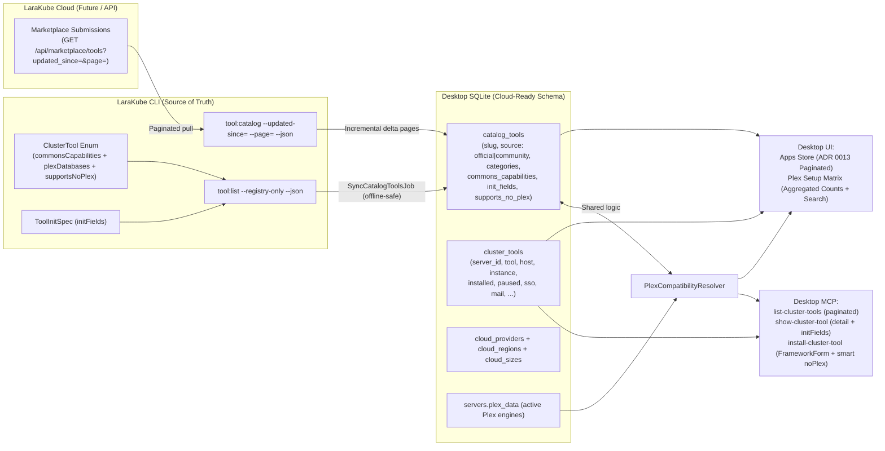

# Plan: Centralized PHP Enums, Paginated App Marketplace Catalog, Tool–DB Compatibility Matrix & Smart `--no-plex` Resolution

## Goal Description
Prepare LaraKube CLI, Desktop, MCP, and future LaraKube Cloud to scale cleanly from ~30 built-in Official Cluster Tools to **hundreds/thousands of community-submitted Cluster Apps** (as outlined in [`cluster-tool-marketplace.md`](file:///Users/jsluchavez/Codes/Ideas/laravel-k8s/cli/plans/active/cluster-tool-marketplace.md)), while resolving all enum drift and database/storage-mode gaps:

1. **Bounded Concepts → Backed PHP Enums; Unbounded Entities → Database-Driven Catalogs**:
   - Bounded protocol concepts (`CloudProviderSlug`, `ServerTargetKind`, `DnsProvider`, `DatabaseDriver`, `ToolCategory`, `ToolSource`) live in backed PHP Enums inside `desktop/app/Enums/` matching CLI enums — eliminating all hardcoded string arrays in MCP tools/prompts and `GlobalSettings`.
   - Unbounded/dynamic collections (Cluster Apps / Marketplace tools, Cloud regions/sizes, Project environments) are driven from SQLite tables synced from CLI/Cloud (`catalog_tools`, `cloud_providers`, `projects`), never hardcoded arrays or enums.
2. **Global `catalog_tools` Table + Incremental Paginated Cloud → CLI → Desktop Sync**:
   - Separate the shared browsable app catalog (`catalog_tools`) from per-server live install state (`cluster_tools`).
   - Seed Official ~30 tools offline directly from `larakube tool:list --registry-only --json`, and pull Cloud-submitted community apps incrementally in paginated batches (`?updated_since=...&page=...`) via CLI (`tool:catalog --json`) into SQLite so Desktop UI & MCP search/paginate locally in `< 15ms` with full offline resilience.
3. **Explicit DB Compatibility Matrix & Smart `--no-plex` Resolution**:
   - Extend CLI `tool:list --json` and `ClusterTool` enum to explicitly broadcast `supportsNoPlex`, `plexDatabases`, and `supportsSqlite`.
   - Build a shared `PlexCompatibilityResolver` in Desktop used by both MCP (`list-cluster-tools`, `show-cluster-tool`, `install-cluster-tool`) and UI (`PlexController`, `ClusterToolController`, `InstallDialog`, `PlexEmptyState`) to compute compatible Plex engines and smartly default `--no-plex` vs. Plex Commons reuse.
4. **Full Pagination & Context-Budget Control (Desktop ADR 0013 + LLM Token Safety)**:
   - Paginate `ClusterToolController::index()` (`LengthAwarePaginator`, 18 cards / 30 table rows per page) with server-side `?q=&category=&source=&scope=&page=` Inertia partial reloads, keeping the selected server's **Installed** apps cleanly accessible.
   - Paginate MCP `list-cluster-tools` (compact summaries + search/filter parameters) and introduce `show-cluster-tool` (for full `initFields` + `commonsCapabilities` + `storageRecommendation` on demand), while capping MCP `complete('tool')` to DB prefix/substring matches (`LIMIT 20`).

---

## Architecture Overview

---

## Proposed Changes

### 1. LaraKube CLI — Explicit Storage Capabilities & Paginated Catalog Feed (`cli/`)

#### [MODIFY] [`ClusterTool.php`](file:///Users/jsluchavez/Codes/Ideas/laravel-k8s/cli/app/Enums/ClusterTool.php)
- Add `plexDatabases(?string $engine = null): list<string>` filtering `commonsCapabilities()['databases']` to relational Plex engines (`postgresql`, `mysql`, `mariadb` — excluding `'sqlite'`).
- Add `supportsSqlite(?string $engine = null): bool` returning `in_array('sqlite', $this->commonsCapabilities($engine)['databases'], true)`.

#### [MODIFY] [`ToolListCommand.php`](file:///Users/jsluchavez/Codes/Ideas/laravel-k8s/cli/app/Commands/Tool/ToolListCommand.php)
- Include `'supportsNoPlex' => $tool->supportsNoPlex()` in each JSON entry.
- Extend `'commonsCapabilities'` with `'plexDatabases'` and `'supportsSqlite'` while keeping `'databases'` intact for backwards compatibility.
- Add `--installed-only` option so `SyncClusterToolsJob` can fast-probe only what is deployed on a cluster without re-fetching full catalog definitions every sync cycle.

#### [NEW] `cli/app/Commands/Tool/ToolCatalogCommand.php` (`larakube tool:catalog`)
- Emits a paginated, incremental catalog feed (`--page=`, `--per-page=`, `--updated-since=`, `--q=`, `--category=`, `--source=`, `--json`):
  - Merges Official tools (`ClusterTool::cases()` with `source: 'official'`) and cached/fetched Cloud Marketplace tools (`source: 'community'`, fetching paginated pages from Cloud API when configured, failing open offline to Official + cached entries).
  - Returns standard `{ data: [...], meta: { current_page, last_page, per_page, total, synced_at } }` envelope.

---

### 2. Desktop Schema, Models & Backed PHP Enums (`desktop/`)

#### [NEW] Migration: `desktop/database/migrations/2026_11_11_000001_create_catalog_tools_table.php`
Creates `catalog_tools` (global, shared across all servers):
- `id`, `slug` (unique string), `name`, `brand`, `tagline`, `logo`, `source` (`'official' | 'community'`), `paid` (bool), `upvotes_count` (int default 0), `stack` (json), `categories` (json), `commons_capabilities` (json nullable), `init_fields` (json nullable), `supports_no_plex` (bool default false), `multi_instance` (bool default true), `requires_admin_email` (bool default false), `remote_updated_at` (timestamp nullable), `synced_at` (timestamp nullable), `timestamps()`.
- Indexes on `slug`, `source`, `supports_no_plex`, `remote_updated_at`.
- *(Note per Desktop ADR 0017: run `cd desktop && php artisan native:migrate --force` after adding).*

#### [NEW] Model: `desktop/app/Models/CatalogTool.php`
- Casts `categories`, `stack`, `commons_capabilities`, `init_fields` as arrays, booleans for `paid`/`supports_no_plex`/`multi_instance`/`requires_admin_email`.
- Scopes: `scopeSearch(string $q)`, `scopeCategory(ToolCategory|string $cat)`, `scopeSource(ToolSource|string $source)`, `scopeCompatibleWithDatabase(DatabaseDriver|string $driver)`.

#### [NEW] Backed PHP Enums in `desktop/app/Enums/`
- `CloudProviderSlug.php` (`gcp`, `aws`, `do`, `hetzner`, `custom`) with `label()`, `values()`, `creatableValues()`.
- `ServerTargetKind.php` (`vps`, `managed`) with `label()`.
- `DnsProvider.php` (`cloudflare`, `route53`, `google`, `none`) matching CLI's [`DnsProvider`](file:///Users/jsluchavez/Codes/Ideas/laravel-k8s/cli/app/Enums/DnsProvider.php).
- `DatabaseDriver.php` (`postgresql`, `mysql`, `mariadb`, `sqlite`) with `plexServiceKey()` (`postgresql` → `'postgres'`, `mysql` → `'mysql'`, `mariadb` → `'mariadb'`) and `label()`.
- `ToolCategory.php` matching CLI's [`ToolCategory`](file:///Users/jsluchavez/Codes/Ideas/laravel-k8s/cli/app/Enums/ToolCategory.php) (`database`, `backend`, `auth`, `security`, `communication`, `observability`, `productivity`, `devops`, `analytics`, `storage`) with `label()`.
- `ToolSource.php` (`official`, `community`).

#### [MODIFY] [`GlobalSettings.php`](file:///Users/jsluchavez/Codes/Ideas/laravel-k8s/desktop/app/Services/LaraKube/GlobalSettings.php)
- Derive `CLOUD_PROVIDERS` / validation keys from `CloudProviderSlug` enum rather than duplicating arrays.

---

### 3. Catalog Sync, Compatibility Resolver & MCP Refactor (`desktop/`)

#### [NEW] `desktop/app/Jobs/Sync/SyncCatalogToolsJob.php` & [MODIFY] [`ToolCatalog.php`](file:///Users/jsluchavez/Codes/Ideas/laravel-k8s/desktop/app/Services/LaraKube/ToolCatalog.php)
- `SyncCatalogToolsJob`:
  1. Seeds/updates all Official tools in `catalog_tools` from `larakube tool:list --registry-only --json` (works 100% offline).
  2. Pulls incremental community pages from `larakube tool:catalog --updated-since=... --page=... --per-page=100 --json` until all updated pages are upserted into `catalog_tools`.
- `SyncClusterToolsJob` & `ToolCatalog`:
  - Keep per-server live install probes in `cluster_tools` (installed tools, live ingress URLs, paused state, wiring pills), while joining/reading heavy catalog specs (`initFields`, `commonsCapabilities`, `categories`, `tagline`) from `catalog_tools` so 500 community apps are never duplicated across every server row.
  - Keep `ToolCatalog::paginatedCatalog(...)` returning a Laravel `LengthAwarePaginator` merged with the selected server's installed state.

#### [NEW] `desktop/app/Services/LaraKube/PlexCompatibilityResolver.php`
- **`activeDatabasesForContext(string $context): list<string>`**: reads `PlexCatalog::forContext($context)` and normalizes via `DatabaseDriver`.
- **`analyzeTool(array|CatalogTool $tool, string $context): array`**: compares `plexDatabases`, `supportsSqlite`, and `supportsNoPlex` against the server's active Plex DBs; returns `recommendedMode` (`'plex'` | `'standalone'`), `recommendedOptions` (`['noPlex' => bool]`), `compatiblePlexDatabases`, `matchingActivePlexDatabases`, and `reason`.
- **`databaseSummaryMatrix(): array`** *(DB-query backed for scale!)*: queries `CatalogTool` counts + official highlights per DB (`postgres`, `mysql`, `mariadb`) rather than serializing 500 full objects to Inertia (`{ counts: { official, community, total }, highlights: [...] }`).
- **`searchToolsForDatabase(?string $query, ?string $db): list<array>`**: lightweight DB search endpoint/prop for the Plex planned-apps selector.

#### [MODIFY] Desktop MCP Tools & Prompts (`desktop/app/Mcp/`)
- [`ListClusterToolsTool.php`](file:///Users/jsluchavez/Codes/Ideas/laravel-k8s/desktop/app/Mcp/Tools/ListClusterToolsTool.php):
  - Accepts optional filters & pagination: `context` (or `server`), `query` (string), `category` (`ToolCategory`), `source` (`ToolSource`), `installed_only` (bool), `page` (int, default 1), `per_page` (int, default 15, max 30).
  - Returns standard paginated response (`data`, `meta`, `active_plex_databases`), keeping items compact (`tool`, `name`, `tagline`, `source`, `categories`, `installed`, `url`, `supports_no_plex`, `recommended_storage_mode`) to protect LLM context windows.
- **[NEW]** `ShowClusterToolTool.php` (`show-cluster-tool`):
  - Takes `tool` slug + `server`/`context` (optional), fetches the single `CatalogTool` + server install state + `PlexCompatibilityResolver::analyzeTool()`, returning full `initFields`, `commonsCapabilities`, `storageRecommendation`, `components`, and live instance URLs/credentials.
- [`InstallClusterToolTool.php`](file:///Users/jsluchavez/Codes/Ideas/laravel-k8s/desktop/app/Mcp/Tools/InstallClusterToolTool.php):
  - `complete('tool')`: queries `CatalogTool::search($value)->limit(20)->pluck('slug')` merged with installed `ClusterTool` slugs (never a hardcoded 16-item array, never 500 items).
  - Accepts `options` object validated via [`FrameworkForm::resolve()`](file:///Users/jsluchavez/Codes/Ideas/laravel-k8s/desktop/app/Services/LaraKube/FrameworkForm.php) against the tool's live `initFields` (**ADR 0010**).
  - If `options.noPlex` is omitted on dual-mode tools (`supportsNoPlex === true`), resolves dynamically via `PlexCompatibilityResolver` (reuse compatible active Plex DB if running; default `--no-plex` SQLite if missing/incompatible) and echoes the storage choice + reason in the output.
- [`CreateServerTool.php`](file:///Users/jsluchavez/Codes/Ideas/laravel-k8s/desktop/app/Mcp/Tools/CreateServerTool.php), [`ConnectDomainTool.php`](file:///Users/jsluchavez/Codes/Ideas/laravel-k8s/desktop/app/Mcp/Tools/ConnectDomainTool.php), [`NewServerWizardPrompt.php`](file:///Users/jsluchavez/Codes/Ideas/laravel-k8s/desktop/app/Mcp/Prompts/NewServerWizardPrompt.php):
  - Replace hardcoded arrays with `CloudProvider::pluck('slug')` (falling back to `CloudProviderSlug::values()`), `ServerTargetKind::cases()`, and `DnsProvider::cases()`.
- [`ProjectUpTool.php`](file:///Users/jsluchavez/Codes/Ideas/laravel-k8s/desktop/app/Mcp/Tools/ProjectUpTool.php), [`ProjectDownTool.php`](file:///Users/jsluchavez/Codes/Ideas/laravel-k8s/desktop/app/Mcp/Tools/ProjectDownTool.php), [`ShowProjectTool.php`](file:///Users/jsluchavez/Codes/Ideas/laravel-k8s/desktop/app/Mcp/Tools/ShowProjectTool.php):
  - Resolve `complete('environment')` dynamically from the target project's inspected environments (`ProjectInspector`) instead of hardcoded `['local', 'production', 'staging']`.

---

### 4. Desktop UI — Paginated Apps Store (ADR 0013) & Plex Compatibility Matrix (`desktop/`)

#### [MODIFY] [`ClusterToolController.php`](file:///Users/jsluchavez/Codes/Ideas/laravel-k8s/desktop/app/Http/Controllers/ClusterToolController.php) & [`resources/js/pages/tools/index.tsx`](file:///Users/jsluchavez/Codes/Ideas/laravel-k8s/desktop/resources/js/pages/tools/index.tsx)
- **Server-side Pagination & Filtering (ADR 0013):**
  - Separate `installedTools` (active/installed on the selected server) from paginated `catalog` (`LengthAwarePaginator` at 18 items per page for Cards view / 30 for Table view), scoped by `?q=&category=&source=&scope=&page=`.
  - Compute per-category counts & source counts (`Official`, `Community`) in SQLite so filter pills show live totals without loading all 500 objects into React.
  - Add Source filter pills (`All`, `Official`, `Community`) and debounced search + Pagination bar with Inertia partial reloads (`only: ['catalog', 'filters']`, `preserveState: true`, `preserveScroll: true`).
- **Smart `InstallDialog` Fix:**
  - Fix `activeMatches` so enabling `options.noPlex === true` suppresses the `"Active Commons detected"` Postgres/Redis badge.
  - Dynamically initialize `options.noPlex` using `commonsCapabilities` vs. `activeCommonsServices` (`false` if a compatible Plex DB is running; `true` with an explanatory banner if none is active, while staying toggleable).

#### [MODIFY] [`PlexController.php`](file:///Users/jsluchavez/Codes/Ideas/laravel-k8s/desktop/app/Http/Controllers/PlexController.php), [`plex-empty-state.tsx`](file:///Users/jsluchavez/Codes/Ideas/laravel-k8s/desktop/resources/js/pages/plex/plex-empty-state.tsx), [`plex-commons-services-card.tsx`](file:///Users/jsluchavez/Codes/Ideas/laravel-k8s/desktop/resources/js/components/plex-commons-services-card.tsx)
- Pass `databaseMatrix` (`counts`, `highlights`, and server-searchable compatible tools) from `PlexCompatibilityResolver::databaseSummaryMatrix()`.
- On `PostgreSQL 16`, `MySQL 8.4`, and `MariaDB` cards: display compatible tool counts (`"Supports N Official + M Community apps"`) + compact featured badges, plus a searchable `"Cluster Tools you plan to run"` selector that highlights the **Best Fit** database dynamically.

---

## Verification Plan

### Automated Tests
1. **CLI (`cli/`):**
   - Test `ClusterTool::plexDatabases()`, `supportsSqlite()`, `ToolListCommand` JSON compatibility fields + `--installed-only`, and `ToolCatalogCommand` pagination + `--updated-since=` + fail-open offline behavior.
   - Run `composer format`, `composer analyse`, and full `composer test`.
2. **Desktop (`desktop/`):**
   - Run `cd desktop && php artisan native:migrate --force` (mandatory per **ADR 0017** after adding `catalog_tools` migration).
   - Unit tests for backed enums (`CloudProviderSlug`, `ServerTargetKind`, `DnsProvider`, `DatabaseDriver`, `ToolCategory`, `ToolSource`) and `PlexCompatibilityResolver`.
   - Feature tests for:
     - `SyncCatalogToolsJob` seeding Official tools and incrementally paginating Cloud Community tools into `catalog_tools`.
     - `ClusterToolController::index()` server-side pagination, search, category, and source filtering (**ADR 0013**).
     - MCP `list-cluster-tools` pagination & compact payload, `show-cluster-tool` full `initFields`, DB-searched `complete('tool')` (`LIMIT 20`), smart `noPlex` resolution in `install-cluster-tool`, and enum/DB-backed completions in `CreateServerTool`, `ConnectDomainTool`, `NewServerWizardPrompt`, `ProjectUpTool`.
     - `PlexController::index` `databaseMatrix` summary payload.
   - Run `npm run check`, `npm run types:check`, `./vendor/bin/pint --test`, `./vendor/bin/phpstan analyse`, and full `./vendor/bin/pest --parallel`.

### Manual Verification
- Run **Apps** page with seeded Official + Community test entries: confirm paginated card/table grids (18/30 per page), instant debounced search/category/source filtering via Inertia partial reloads, and smart `noPlex` defaults when deploying `n8n`.
- Open **Plex Commons** setup on an empty server: use the searchable planned-apps selector (`n8n` + `Outline`), confirm **PostgreSQL 16** dynamically highlights as Best Fit with compatible tool summaries.
- Test Claude Code against Desktop MCP (`list-cluster-tools` paginated search, `show-cluster-tool`, and `install-cluster-tool` with `n8n`).
