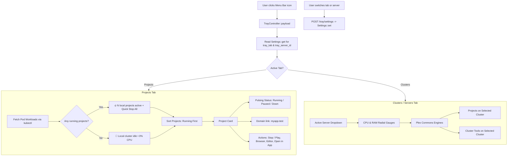

# Implementation Plan: Menubar Quick Projects List & Local Workload Manager

## Goal Description
Developers using LaraKube Desktop often need to quickly check which local projects are running (e.g. when laptop fans spin up from an unstopped container) and start or shut down projects directly from the macOS / Windows menu bar without having to open the main window or click through servers one by one.

Currently, the menu bar popover (`/tray`) is server-centric: it defaults to whichever cluster is marked primary or first (e.g. an AWS or GKE cloud cluster), hiding all local projects and displaying *"No projects deployed to this cluster yet"*. Furthermore, the existing project action only hardcodes `up --fast`, offering no way to stop or pause individual running workloads.

This plan introduces a top-level **Projects vs. Clusters** segmented view in the menubar tray, provides real-time Kubernetes pod workload detection for all local projects, elevates active workloads to the top with pulsing status indicators, equips developers with 1-click **Stop / Start / Up / Down / Open Browser / Open Editor** controls directly from the menu bar, and adheres to **ADR 0015** by replacing browser `localStorage` with NativePHP's `Settings` facade.

---

## User Review Required

> [!IMPORTANT]
> **NativePHP Settings (ADR 0015)**: Instead of volatile browser `localStorage`, user preferences (`tray_tab` and `tray_server_id`) are now persisted using `Native\Desktop\Facades\Settings`. The PHP backend reads these settings on initial load, guaranteeing **zero layout shift (FOUC)** and true multi-window persistence.

> [!NOTE]
> **Stop vs. Down Semantics**:
> - Clicking **Stop** (`Square` / `PowerOff` icon) on a running project executes `larakube stop local`, which scales deployment pods to 0. This immediately drops CPU/RAM usage to zero and stops cooling fans while keeping volumes and services intact.
> - Clicking **Resume** (`Play` icon) on a stopped/paused project executes `larakube start local`, bringing pods back up in seconds.
> - Clicking **Start** on an uninitialized/down project executes `larakube up local --fast`.
> - The global **Stop Local** button in the footer continues to run `larakube down --all` for a complete local teardown.

---

## Proposed Architecture & Workflow

---

## Proposed Changes

### Component 1: Architectural Decision Record (ADR 0015)

#### [NEW] `desktop/docs/decisions/0015-nativephp-settings-facade-over-browser-localstorage.md`
- Establishes the policy prohibiting browser `localStorage` in favor of `Native\Desktop\Facades\Settings`.
- Updates `desktop/docs/decisions/README.md` index.

---

### Component 2: Local Workload Status Service (`desktop/app/Services/LaraKube/`)

#### [NEW] `ProjectWorkloadStatus.php`
- Extracts and centralizes `localWorkloads(ToolLocator $locator)` and `resolve(Project $project, array $inspection, ?Run $activeRun = null, ?array $workloads = null)`.
- Inspects running Kubernetes deployments/statefulsets in namespaces ending with `-local` using a 2-second timeout guard.
- Maps status to standard state: `'running'`, `'paused'`, `'starting'`, `'stopping'`, `'down'`, `'uninitialized'`.
- Replaces duplicate private logic in `ProjectController` and powers `TrayController`.

#### [MODIFY] `ProjectController.php`
- Refactor `ProjectController` to inject `ProjectWorkloadStatus` and delegate `localWorkloadStatuses()` and `resolveLocalStatus()`.

---

### Component 3: Tray Controller (`desktop/app/Http/Controllers/TrayController.php`)

#### [MODIFY] `TrayController.php`
- Inject `ProjectWorkloadStatus` and `ToolLocator`.
- In `payload()`:
  - Read saved tab and server preference via `Settings::get('tray_tab', 'projects')` and `Settings::get('tray_server_id')`.
  - Query all registered `Project` models.
  - Query active runs for projects (`RunKind::UpProject`, `DownProject`, `StartProject`, `StopProject`).
  - Calculate real-time `localStatus` for every project via `ProjectWorkloadStatus`.
  - Provide `localProjects`: list of all projects with name, path, webHost, domain, framework, `status` (`'running'`, `'paused'`, `'down'`, etc.), `statusLabel`, `statusTone`, `exists`, `replicas`, `readyReplicas`.
  - Provide `hasRunningLocal`: boolean indicating if any local project has active running pods.
  - Return `activeTab` (`'projects'` or `'clusters'`).
  - Keep `projects` (scoped to selected server) for the Clusters tab.
- In `toggleProject(Request $request, Project $project, CliRunner $runner)`:
  - Accept optional `action` parameter (`'stop'`, `'start'`, `'up'`, `'down'`).
  - If omitted, perform intelligent toggle:
    - If project is `'running'`: dispatch `['stop', 'local']` (`RunKind::StopProject`).
    - If project is `'paused'`: dispatch `['start', 'local']` (`RunKind::StartProject`).
    - If project is `'down'` or `'uninitialized'`: dispatch `['up', 'local', '--fast', '--no-console', '--no-test']` (`RunKind::UpProject`).
  - Prevent launching concurrent tasks if project already has an active run.
- In `saveSettings(Request $request)` (`POST /tray/settings`):
  - Validate and persist `tab` (`Settings::set('tray_tab', ...)` and/or `server_id` (`Settings::set('tray_server_id', ...)`).

---

### Component 4: Tray UI (`desktop/resources/js/pages/tray/index.tsx`)

#### [MODIFY] `tray/index.tsx`
- **NativePHP Settings Integration (ADR 0015)**:
  - Replace `localStorage` with `initialProps.activeTab ?? 'projects'` and `initialProps.selectedServerId`.
  - Dispatch asynchronous `POST /tray/settings` when the user changes tabs or active cluster.
- **Segmented Control Header**:
  - Render high-contrast 2-column segmented tab bar:
    - **Projects** tab with `FolderGit2` icon and running indicator badge (e.g. `2 Running` with pulsing green dot when `hasRunningLocal` is true).
    - **Clusters** tab with `Server` icon and count `(${data.servers.length})`.
- **Projects Tab View**:
  - **Quick Status Bar**:
    - If `hasRunningLocal`: Display alert badge `🔥 {count} local project{s} active` with quick `Stop All` button.
    - If idle: Display `🍃 Local cluster idle • 0% CPU`.
  - **Project Cards List**:
    - Sorted with `running` projects at top, followed by `paused`, `starting`, `stopping`, `down`.
    - Left side:
      - Live status dot:
        - Running: Glowing green dot (`bg-ok shadow-[0_0_6px_rgba(34,197,94,0.6)]`).
        - Paused: Amber dot (`bg-warn`).
        - Starting / Stopping: Spinning accent dot (`text-accent animate-spin`).
        - Down: Muted gray dot (`bg-faint`).
      - Project Name (`font-semibold text-xs text-ink truncate`).
      - Host / Status label: Clickable domain (`myapp.test`) in mono font, or status subtitle (`Laravel 11 • stopped`).
    - Right side actions (strictly complying with UI & Button Icon Standard):
      - **Primary Lifecycle Button**:
        - If `running`: Stop button (`<Square className="size-3 fill-current text-accent" />`) with tooltip "Stop project (scale to zero)".
        - If `paused`: Resume button (`<Play className="size-3 text-ok" />`) with tooltip "Resume project".
        - If `down`: Start button (`<Play className="size-3 text-ok" />`) with tooltip "Start project (up --fast)".
        - If `busy`: Animated spinner (`<RefreshCw className="size-3 animate-spin text-accent" />`).
      - **Browser Link Button**:
        - If domain/webHost is available: `<ExternalLink className="size-3 text-soft hover:text-ink" />`.
      - **Editor Button**:
        - `<EditorLogo slug="vscode" size="xs" />` opening the project folder.
      - **Details / Open Project Button**:
        - Clicking project name or row opens the project details in main window (`/projects/{id}`).
  - **Empty State**:
    - If no projects imported: Display clear guidance with `<Plus className="size-3.5" /> Import Project` button.
- **Clusters Tab View**:
  - Preserve the complete cluster experience: Active server selector dropdown, CPU/RAM radial gauges, Plex Commons engines, deployed projects on that cluster, cluster tools.
- **Universal Footer**:
  - `Open App` (`Maximize2` icon).
  - `Stop Local` (`PowerOff` icon) - stops all local workloads.
  - `Settings` (`Settings` icon).

---

## Verification Plan

### Automated Tests
1. **New Tests in `desktop/tests/Feature/TrayControllerTest.php`**:
   - `get /tray/data returns localProjects with real-time status, hasRunningLocal, and activeTab`: Verify response contains `localProjects` array, `hasRunningLocal` flag, and `activeTab`.
   - `post /tray/settings persists activeTab and server_id`: Verify settings are stored.
   - `post /tray/projects/{project}/toggle with action=stop starts stop run`: Verify `['stop', 'local']` arguments and `RunKind::StopProject`.
   - `post /tray/projects/{project}/toggle with action=start starts start run`: Verify `['start', 'local']` arguments and `RunKind::StartProject`.
   - `post /tray/projects/{project}/toggle with action=up starts up run`: Verify `['up', 'local', '--fast', ...]` arguments and `RunKind::UpProject`.
   - `post /tray/projects/{project}/toggle without action smartly toggles running project to stop`: Verify smart toggle.
2. **Regression Tests**:
   - Run `tests/Feature/ProjectControllerTest.php` to verify project controller refactor has zero regressions.
   - Run all existing `tests/Feature/TrayControllerTest.php` tests.
3. **Linting & Type-Checking**:
   - `composer lint` (Pint)
   - `composer types:check` (PHPStan 2.2, strict rules)
   - `npm run types:check` (TypeScript `tsc --noEmit`)
   - `composer test` (Pest test suite)

### Manual Verification
1. Launch or check menubar popover in LaraKube Desktop.
2. Confirm the **Projects** tab is shown by default with the list of local projects.
3. Observe running projects with glowing green dots, domain links, and red Stop buttons.
4. Click the Stop button on a running project and verify it queues a stop task and scales pods to zero.
5. Switch to the **Clusters** tab and verify the server dropdown, telemetry gauges, and Plex Commons cards display correctly.
6. Verify switching tabs persists across popover close/open via NativePHP Settings.
