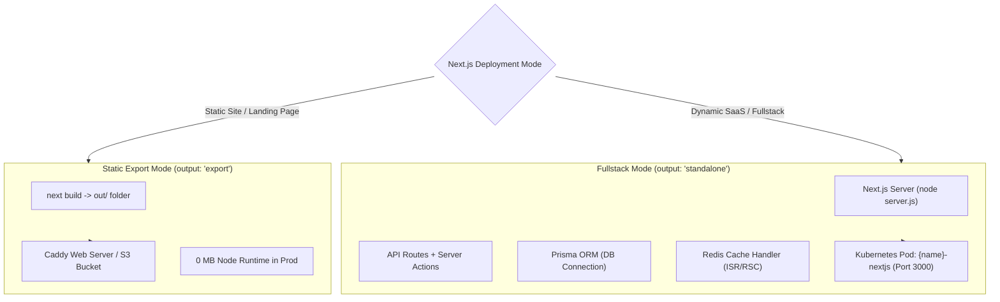

# NestJS & Next.js Ecosystem Evaluation and Implementation Plan

## Goal Description
Conduct an architectural evaluation of **NestJS** and **Next.js** within LaraKube across their entire lifecycle—from project creation and local development to Docker packaging, Kubernetes manifests, and CI/CD pipelines.

Align strictly with the **standard `npm run build` developer experience** so students and developers encounter zero surprising abstractions, while clarifying and expanding Next.js deployment modes (**Fullstack Standalone Node Server** vs. **Static HTML Export via Caddy**).

---

## 1. Next.js Deployment Modes: Fullstack vs. Static

There is often confusion around Next.js output modes. Here is how Next.js officially functions:

| Capability | **Mode A: Fullstack Server (`output: 'standalone'`)** *(LaraKube Default)* | **Mode B: Static Export (`output: 'export'`)** *(Like Vite/Astro/Docusaurus)* |
| :--- | :--- | :--- |
| **Is it Fullstack?** | **YES, 100% Fullstack Node.js Server**. | **No (Pure Static Assets)**. |
| **Runtime in Prod** | Runs a dedicated Node container: `node server.js`. | Static files served by **Caddy** web server (or S3/MinIO bucket). |
| **API Routes & Server Actions** | Supported (`/api/...`, `'use server'`). | Not supported (build error if dynamic routes exist). |
| **Dynamic SSR & Headers** | Supported (renders dynamic HTML per request). | Not supported (pre-rendered at build time only). |
| **Database Connections** | Connects to PostgreSQL, MySQL, or SQLite via Prisma. | No database connections at runtime (frontend only). |
| **Cookies & Sessions** | Reads/writes request cookies and auth sessions. | Client-side cookies only. |
| **Distributed Caching** | Redis Cache Handler for ISR & React Server Components. | Static assets cached at ingress/CDN. |
| **Best For** | Web applications, SaaS platforms, dashboards, dynamic portals. | Marketing sites, landing pages, documentation, blogs. |

> [!NOTE] Standalone Mode is Already Fullstack
> Next.js's `output: 'standalone'` is Vercel's official mechanism for running a fullstack Node.js server inside Docker. It traces all required imports, dependencies, and server-side code into a self-contained `server.js` file. LaraKube's existing `Dockerfile.nextjs` already runs this fullstack container!



---

## 2. Core Architectural Answers

### Q1: Is this the only configuration for NestJS?
**Currently in LaraKube:** Yes. NestJS is wired into `ServerStack` as a generic server application using:
- **Prisma ORM** as the default data layer.
- **Express HTTP server** (`@nestjs/platform-express`).
- **Plex Commons** for client-server databases (`PostgreSQL`, `MySQL`, `MariaDB`).
- **Redis / Memcached** for caching.

**How we can offer clean choices without overwhelming students:**
1. **Database**: Add **SQLite** as an option alongside PostgreSQL/MySQL.
2. **HTTP Adapter**: Offer a clean toggle:
   - **Express** (Default, 100% compatible with all tutorials, middlewares, and courses).
   - **Fastify** (`@nestjs/platform-fastify`, for high-throughput microservices).
3. **ORM**: Keep Prisma as the primary default (it is by far the most popular in the TypeScript/NestJS learning community today).

---

### Q2: Does NestJS have SQLite mode, and should we support it?
**Can NestJS run SQLite?**
Yes. In Prisma, changing the provider to SQLite is a single line:
```prisma
datasource db {
  provider = "sqlite"
  url      = "file:../data/dev.db"
}
```

#### The Kubernetes Consideration for SQLite:
- **Local Dev**: Fantastic. 0 RAM overhead, instant startup, no external database pod needed.
- **Production Kubernetes**: SQLite is stored as a file on disk. In Kubernetes, this requires a **PersistentVolumeClaim (PVC)**. Because SQLite does not support distributed concurrent writes across network storage, **the deployment must have `replicas: 1`**.
- **Implementation in LaraKube**:
  - Add `DatabaseDriver::SQLITE` to `ServerStack::databases(AppFramework::NESTJS)` and `FrameworkCatalog::nextjsFields()`.
  - When SQLite is chosen, the generated Deployment automatically pins `replicas: 1` and mounts a PVC at `/app/data`.

---

### Q3: How does Fastify work with NestJS?
NestJS is framework-agnostic. While Express is default, `@nestjs/platform-fastify` provides 2x-3x higher RPS throughput.

#### Student-Friendly Setup:
If the student chooses **Fastify**, LaraKube scaffolds `src/main.ts` with:
```typescript
import { NestFactory } from '@nestjs/core';
import { FastifyAdapter, NestFastifyApplication } from '@nestjs/platform-fastify';
import { AppModule } from './app.module';

async function bootstrap() {
  const app = await NestFactory.create<NestFastifyApplication>(
    AppModule,
    new FastifyAdapter()
  );
  app.enableShutdownHooks();
  // Essential for Kubernetes: Fastify must listen on 0.0.0.0, not localhost!
  await app.listen(Number(process.env.PORT) || 3000, '0.0.0.0');
}
bootstrap();
```

---

### Q4: Base Image Standardization (`node:24-bookworm-slim`)

To eliminate the fragile Alpine `musl` compilation issues and missing glibc hacks, we standardize on **`node:24-bookworm-slim`**:
- Includes native `glibc`. Native modules (`better-sqlite3`, `argon2`, `sharp`, Prisma engines) install and compile out of the box with zero compiler errors.
- Uses canonical, standard `npm ci` ➔ `npm run build` ➔ `node dist/main.js` (or `node server.js` for Next.js).
- Zero exotic bundlers (`ncc`, `esbuild`) that break reflection metadata (`reflect-metadata`) or dynamic entity loading.

---

## 3. Companion Workloads: Horizon & Reverb Equivalents

Just like Laravel has Horizon, Reverb, and Scheduler running as separate pods from the same image, NestJS can easily scale with companion pods:

1. **Queue Workers (The Horizon Equivalent)**:
   - **Engine**: **BullMQ** (`@nestjs/bullmq`) backed by Plex Commons Redis.
   - **Worker Pod**: Runs the same app image with `command: ["node", "dist/worker.js"]`.
   - **Visual Dashboard**: **Bull Board** (`@bull-board/nestjs`), providing a real-time queue UI just like Horizon.
2. **WebSockets (The Reverb Equivalent)**:
   - **Engine**: `@nestjs/websockets` with `@socket.io/redis-adapter` for multi-pod broadcasting.
3. **Task Scheduler (The Cron Equivalent)**:
   - Dedicated `{name}-scheduler` pod with `replicas: 1` running `@nestjs/schedule` to prevent duplicate cron executions.

---

## 4. Implementation Roadmap

### Phase 1: SQLite Support for NestJS & Next.js
- [ ] Add `DatabaseDriver::SQLITE` to `ServerStack::databases(AppFramework::NESTJS)` and `FrameworkCatalog::nextjsFields()`.
- [ ] Update `GeneratesProjectInfrastructure::generateServerAppManifests()`:
  - If SQLite is selected, attach a PersistentVolumeClaim (`1Gi`, RWO) mounted at `/app/data`.
  - Pin `replicas: 1` in Deployment specs for SQLite-backed workloads.
- [ ] Update `PreparesNestjsProject` to configure Prisma schema with `provider = "sqlite"` and `url = "file:../data/dev.db"` when SQLite is chosen.

### Phase 2: Next.js Static Export Detection & Support
- [ ] In `InitCommand.php` / `ConfigData.php`:
  - Check `next.config.*` for `output: 'export'`.
  - If `output: 'export'` is detected, route Next.js through the static site pipeline (`isStaticSpa()`), packaging it into Caddy instead of a Node server container.
  - If `output: 'standalone'` (or default), route through the fullstack Node container.

### Phase 3: Switch Base Images from Alpine to Bookworm-Slim
- [ ] Update `cli/resources/views/docker/nestjs.blade.php` to use `node:24-bookworm-slim`.
- [ ] Update `cli/resources/views/docker/nextjs.blade.php` to use `node:24-bookworm-slim`.
- [ ] Update `ScaffoldsInNode.php` and `NestjsNewCommand::NODE_IMAGE` to use `node:24-bookworm-slim`.

### Phase 4: HTTP Adapter Choice for NestJS (Express vs. Fastify)
- [ ] Add an `httpAdapter` option to `FrameworkCatalog` for NestJS (`express` [default], `fastify`).
- [ ] In `NestjsNewCommand`:
  - When Fastify is chosen, install `@nestjs/platform-fastify`.
  - Scaffold `src/main.ts` using `FastifyAdapter` binding to `0.0.0.0`.

### Phase 5: Graceful Shutdown
- [ ] Ensure `app.enableShutdownHooks()` is added to `src/main.ts` so Kubernetes rolling updates exit cleanly with zero dropped requests.

---

## Verification Plan

### Automated Tests
1. **Catalog Tests**: Verify `ServerStack::databases(AppFramework::NESTJS)` and `FrameworkCatalog` include SQLite.
   ```bash
   cd cli && vendor/bin/pest tests/Feature/FrameworkCatalogTest.php
   ```
2. **Manifest Generation Tests**: Verify SQLite produces a single replica deployment with PVC volume mount.
   ```bash
   cd cli && vendor/bin/pest tests/Feature/GeneratesManifestsTest.php
   ```
3. **Static vs Fullstack Next.js Tests**: Verify Next.js with `output: 'export'` generates Caddy manifests while `output: 'standalone'` generates Node server manifests.
   ```bash
   cd cli && vendor/bin/pest tests/Feature/NextjsManifestsTest.php
   ```
4. **Desktop Tests & Linters**:
   ```bash
   cd desktop && vendor/bin/pest && npm run types:check
   ```

### Manual Verification
1. Launch LaraKube Desktop -> Projects -> New Project -> select **NestJS**.
2. Verify that **SQLite** is available.
3. Scaffold a new NestJS project with SQLite and verify `larakube up` spins up cleanly without external database pods.
