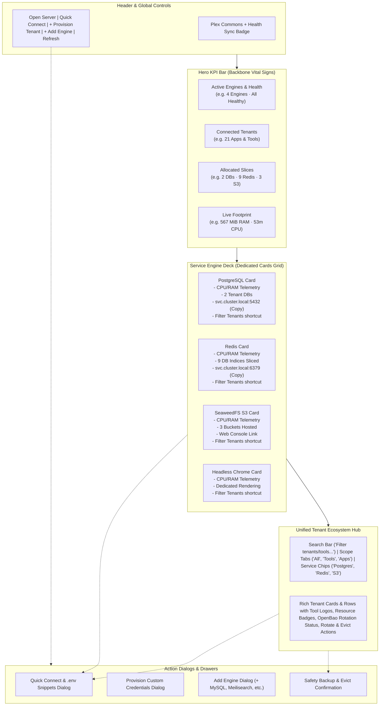

# Implementation Plan: Plex Commons Dashboard Redesign

**Status:** Completed  
**Author:** Antigravity  
**Date:** 2026-10-15  

Plex Commons is the central infrastructure backbone of a LaraKube cluster — powering shared database engines, Redis queues & cache slices, S3 object storage buckets, search engines, headless renderers, and OpenBao credential rotation for all tenant Laravel apps, cluster tools, and devboxes.

This plan details the complete redesign of the Plex Commons dashboard in **LaraKube Desktop** to transform it from a flat administrative checklist into a commanding, mission-critical infrastructure control center.

---

## User Review Required

> [!IMPORTANT]
> **Component Architecture & UX Evolution**:
> 1. **Hero KPI Bar ("Backbone Vital Signs")**: 4 top stat cards showcasing Active Engines & health status, Total Connected Tenants, Allocated Resource Slices (Databases, Redis DBs, S3 Buckets), and Total CPU/Memory telemetry footprint.
> 2. **Dedicated Service Engine Cards**: Prominent visual cards for each active engine (Postgres, Redis, SeaweedFS, Chrome, etc.) combining official brand logos, health status, live CPU & RAM metrics directly on the card, tenant allocation tallies, 1-click internal endpoint copy, and web console links.
> 3. **Unified Tenant Ecosystem Hub**: Replaces the three disconnected stacked lists (Project Tenants, Custom Tenants, Cluster Tools) with a single searchable, filterable tenant matrix featuring Scope Tabs (*All*, *Cluster Tools*, *Project Apps*, *Custom*) and interactive Service Filter chips (*PostgreSQL*, *Redis*, *S3*).
> 4. **Quick Connect & .env Snippets Modal**: Instant copyable Laravel `.env` blocks and connection configurations for any active engine or tenant.
> 5. **Provision Custom Credentials Modal**: Replaces the static right-hand sidebar card with an elegant modal triggered from the header or tenant hub.

---

## Architectural & Design Overview



---

## Proposed Changes

Grouped by component and dependency order:

### 1. Types & Data Helpers

#### [MODIFY] `desktop/resources/js/types/larakube.ts`
- Ensure `PlexStatus` and `PlexTenant` accurately type the `clusterTool` metadata (`tool`, `name`, `tagline`, `logo`, `icon`).
- Add helper types for tenant filtering (`TenantScopeFilter`, `TenantServiceFilter`) and connection snippets.

---

### 2. New UI Sub-Components for Plex Commons

#### [NEW] `desktop/resources/js/pages/plex/components/plex-hero-kpi-bar.tsx`
- Renders the 4 Backbone Vital Signs cards:
  1. **Active Engines**: Total active engines count with green pulsing status dot and mini brand icons.
  2. **Connected Tenants**: Total count split across Cluster Tools, Project Apps, and Custom Tenants with tool preview avatars.
  3. **Allocated Slices**: Breakdown of hosted databases, Redis DB index allocations, and S3 buckets.
  4. **Live Footprint**: Aggregated CPU (`53m`) and memory (`567 MiB`) computed from `podMetrics`.

#### [NEW] `desktop/resources/js/pages/plex/components/plex-service-engine-card.tsx`
- Renders a prominent, high-status card for an active engine:
  - Official brand logo via `ToolLogo` / `brandIcon`.
  - Engine name and category badge (e.g. `PostgreSQL · Database`, `Redis · Cache & Queues`, `SeaweedFS · Object Storage`).
  - Merged telemetry pill (CPU & RAM directly from `podMetrics[driver]`).
  - Allocation counter (e.g., `2 Databases`, `9 Redis DBs`, `3 S3 Buckets`).
  - Internal cluster service DNS (`postgres.larakube-plex.svc.cluster.local:5432`) with 1-click clipboard copy button (`Copy` icon).
  - Web console / public URL badge with `ExternalLink` icon (e.g. for SeaweedFS Master/Filer UI).
  - Quick actions: "Quick Connect" button and "Filter Tenants" shortcut that scrolls to and filters the tenant list.

#### [NEW] `desktop/resources/js/pages/plex/components/plex-tenant-hub.tsx`
- Replaces the three disconnected stacked lists with an intelligent, unified ecosystem matrix:
  - **Live Search Bar**: Real-time filtering by tenant name, tool name, or database name.
  - **Scope Tabs**: `All (${total})`, `Cluster Tools (${toolCount})`, `Project Apps (${appCount})`, `Custom (${customCount})`.
  - **Service Filter Chips**: `All Engines`, `PostgreSQL (${pgCount})`, `Redis (${redisCount})`, `SeaweedFS (${s3Count})`.
  - **Rich Tenant Rows**:
    - Tool/App Logo and brand name with category tagline.
    - Resource allocation badges (`Postgres: db_name`, `Redis: DB 8`, `S3: bucket_name`) with tooltips.
    - Rotation state badge with tone: `OpenBao-managed` (emerald), `Manual (.env)` (soft), `Unreachable` (amber).
    - Quick actions: Quick Connect `.env` snippet button (`Code2`), rotate credential button (`RotateCw`), evict button (`Trash2`).
  - Empty search/filter state when no tenants match current filters.

#### [NEW] `desktop/resources/js/pages/plex/components/plex-quick-connect-modal.tsx`
- Modal providing copy-paste `.env` snippets and connection strings:
  - Tab 1: **Laravel `.env`** (pre-formatted `DB_*`, `REDIS_*`, `AWS_*` variables matching cluster-internal addresses).
  - Tab 2: **Connection Strings / URLs** (URI format for PDO, Redis, S3).
  - Tab 3: **CLI Tunnel & Port-Forward** (guidance on port-forwarding for external GUI tools like TablePlus or DBeaver).
  - 1-click "Copy Snippet" button with feedback checkmark.

#### [NEW] `desktop/resources/js/pages/plex/components/plex-provision-modal.tsx`
- Replaces the static right-hand sidebar card with a modal:
  - Tenant identifier input with autofocus and validation.
  - Checkboxes for requested services (Database with active engine indicated, Redis, S3).
  - Informative callout explaining that credentials are displayed once upon creation and accessible internally by cluster pods.
  - "Provision Credentials" primary button with `KeyRound` icon.

#### [NEW] `desktop/resources/js/pages/plex/components/plex-add-engine-modal.tsx`
- Modal displaying uninstalled/available companion engines (MySQL, MariaDB, MongoDB, Meilisearch, Typesense, MinIO, Garage):
  - Category tags (Database, Cache, Storage, Search).
  - Resource usage considerations.
  - "Add Engine" button initiating `addService` run.

---

### 3. Page Assembly & Layout

#### [MODIFY] `desktop/resources/js/pages/plex/index.tsx`
- Refactor the main page layout:
  - Update `PlexPageHeader` to include "+ Provision Tenant" (`KeyRound`), "Quick Connect" (`Code2`), "+ Add Engine" (`Plus`), and "Refresh" (`RotateCw`) buttons with appropriate Lucide icons.
  - Add the `PlexHeroKpiBar` right below the header.
  - Replace the 2-column layout (with disjointed resource usage and provision cards) with:
    1. **Service Engines Deck**: 2-3 column responsive grid of `PlexServiceEngineCard` components.
    2. **Tenant Ecosystem Hub**: Full-width `PlexTenantHub` component.
  - Maintain the loading skeleton (`ADR 0009`) shaped like the new layout during initial sync.
  - Wire all modal states (`isQuickConnectOpen`, `isProvisionOpen`, `isAddEngineOpen`, `selectedTenantForConnect`).

---

### 4. Tests & Verification

#### [MODIFY] `desktop/tests/Feature/PlexTest.php`
- Add feature tests verifying:
  - Plex index returns expected deferred props (`services`, `podMetrics`, `plex`).
  - Provisioning custom credentials with valid data starts the expected `plex:provision` CLI run.
  - Adding a service driver starts the expected `plex:init --services=` CLI run.
  - Evicting a tenant initiates safety backup and eviction.

---

## Verification Plan

### Automated Tests
1. **Desktop Backend Feature Tests**:
   ```bash
   php artisan test tests/Feature/PlexTest.php
   ```
2. **TypeScript & Static Analysis**:
   ```bash
   npm run types:check
   ```
3. **CLI Quality Checks (Sanity)**:
   ```bash
   composer test
   ```

### Manual Verification
1. Open LaraKube Desktop and navigate to the **Plex Commons** page for an active server.
2. Verify the **Hero KPI Bar** shows accurate engine counts, tenant tallies, and aggregated CPU/RAM footprint.
3. Verify each **Service Engine Card** displays its brand icon, merged telemetry, internal endpoint, copy button, and correct tenant counts.
4. Verify the **Tenant Ecosystem Hub**:
   - Filter by `Cluster Tools` vs `Project Apps`.
   - Filter by backing service (e.g. click `PostgreSQL` and confirm only Outline and other DB tenants appear).
   - Search for a specific tenant or tool (e.g. "forgejo" or "outline").
5. Click **"Quick Connect"** and verify the copyable Laravel `.env` snippet matches the active cluster configuration.
6. Click **"+ Provision Tenant"** and verify the modal allows creating a custom tenant.
7. Click **"+ Add Engine"** and verify available uninstalled drivers are listed with add actions.
