# Portable Backups & Cloud Jump (Projects · Cluster Apps · Everything)

> **Status:** **APPROVED FOR EXECUTION (Phase 0+)** (Pass 5 sign-off complete; MinIO removal landed at `344ac3b8`; binding conditions V1–V6 recorded below).

## Goal

Make it possible to **move a project, a single cluster app, or a whole cluster from one cloud provider to another**, including when the source is gone (DR), by establishing **one portable, owner-tagged, authenticated-encrypted backup format** (the first production backup format for LaraKube CLI users — R0). `cloud:migrate` and its companion commands then become thin orchestrators: *quiesce → backup → replay → restore → verify → cutover*.

### Decisions locked in

| # | Decision | Choice |
|---|---|---|
| 0 | First backup format & S3 scope (R0, T0) | **First supported backup format** (`larakube-backups/clusters/{clusterId}/{runId}/`, `version: 1`, no compatibility layer for disposable pre-release `larakube/{stamp}/` runs; pre-release `backup:prune --apply` cannot reach it). Supported Commons S3 drivers are **SeaweedFS and Garage only** (MinIO is being removed separately; Phase 0 item 1 builds on that removal) |
| 1 | Foundation | **Backup-first.** Every jump is backup + restore, so it works with a dead source too |
| 2 | Run organisation | Cluster-wide **owner-tagged** run by default, plus **on-demand scoped runs** (`--project`, `--tool`/`--domain`) right before a jump |
| 3 | Object storage (S2, R17, T0, T4, T5, U2, U5) | **Portable tier (`backup:run`):** content-addressed per-bucket logical S3 archive with encrypted `metadata.json` sidecar + exact object-count/key verification (engine-agnostic across SeaweedFS and Garage; Garage CORS captured/restored via temporary `--owner` grant immediately revoked afterward). **Nightly `data` tier (`backup:schedule`):** per-driver strategy — SeaweedFS keeps raw `/data` tar; Garage uses a dedicated multi-stage pipeline (`s3-fetch` with read-only `backup-reader` key writing NDJSON → `s3-pack` assembling & validating `metadata.json` with `jq` + count/key guard + `tar` → `encrypt` → `upload`, never touching `plex-admin`, never granting `--owner` to `backup-reader`, recording `cors: "not_captured"` cleanly) |
| 4 | Secrets & Vault (R1, R6, S3, S6, T6) | **Logical:** recursive OpenBao KV export (full payloads) + custom KV policies + non-secret static-role wiring metadata + namespace-captured K8s Secrets (explicit Secret & ConfigMap denylists + fail-closed root-token/unseal-key guard). Never capture `secretsNames()->secret()`, `eso-openbao-token`, `*-openbao-auth`, `larakube-backup-config`, `larakube-backup-s3-reader`, source DB connection config, or source K8s auth CA. Selective rotation wiring (`secrets:wire --tool= --domain=` + SSO/Mail + extracted `wireTenantDbSecret()` trait, NEVER `--all`) followed by `secrets:prune` runs **after** tools are restored and healthy |
| 5 | Rebuild | **Replay:** declarative spec (registry + install-options + `plex-commons` + `plex-registry` + DB inventory + non-system ConfigMaps + wiring & static-role metadata), then the CLI's own `plex:init` / `tool:init` / `cloud:deploy`. **Not Velero** (see appendix) |
| 6 | Destination (H6, R11, S3) | Project/tool jumps **may merge** into an existing cluster (re-allocating cluster-local Redis/S3/Meilisearch bindings, refusing on DB-engine/pgvector mismatch or host/tenant collision, never overwriting destination `plex-admin`, `ToolRegistry::SECRET` (`larakube-tools-registry`), `plex-registry`, `plex-commons`, or `larakube-cluster`). `--all` requires an **empty** cluster |
| 7 | Volume capture & restore (R7, S1, S10, T7) | **Amend ADR 0010:** two explicit volume capture modes recorded in `index.json.enc`: (a) `portable` tier archives every PVC **from its root (`/pvc`)** via a helper pod (`mode: "pvc-root"`), and (b) nightly `data` tier archives **every PVC-backed mount** of live workloads (`mode: "live-mounts"`, recording `{pvc, subPath, mountPath}`, preflighting `tar` per container, skipping nested Secret/ConfigMap mounts like Stalwart's `config.json`, and reporting containers lacking `tar` as `not_covered`). Restore uses a PVC-root helper pod that unpacks both modes to the exact destination path under `/pvc` (automating fresh jump targets while preserving paused state; live in-place restores keep destructive confirmation). Multi-node project `emptyDir` storage is explicitly detected and reported as non-durable |
| 8 | Bucket layout & identity | One operator bucket, `larakube-backups/clusters/{clusterId}/{runId}/`, reusing existing `InteractsWithClusterIdentity` (`larakube-cluster`). Digits-only `runId` (`{YYYY-MM-DD-His}-{6digits}`) keeps Desktop compatible |
| 9 | Command surface (R10, S8, T8) | `backup:run`/`backup:restore` gain `--project`, `--tool=<slug> --domain=<host>`, `--all`, and `--object-bucket=<name>`. Passphrase and S3 secret key are never passed on CLI argv across **both** `backup:init` and `backup:restore` (`--recovery-file=`, env vars `LARAKUBE_BACKUP_PASSPHRASE` / `LARAKUBE_BACKUP_SECRET_KEY`, or interactive masked prompt). Migration uses **standalone commands**: `cloud:migrate`, `cloud:migrate:cutover`, and `cloud:migrate:rollback` (sharing logic via a trait; no hidden inverse/destructive flags) |
| 10 | CLI / Project boundary | **Strict CLI isolation (no `~/.larakube/projects.json`).** Backups discover & capture all project data from live cluster state. `cloud:migrate --all` restores the cluster layer + **stages** every project's Commons DB/bucket/secrets and emits `stagedProjects`. Each project finalizes from its own `cwd` via `cloud:migrate <env> --from-backup=<runId> --from-cluster=<id>` (chained by Desktop in a follow-up plan) |
| 11 | Ephemeral Commons | **Excluded:** Commons Redis (cache/queues) and Commons Meilisearch (rebuilt via reindex, reported on restore) |
| 12 | DNS & TLS (R14, S4, T3) | **Two-phase:** stage + verify (with **render-time** HTTP-01 `certresolver` deferral driven by the destination's `larakube-migration-*` marker across all 47 templates + kustomize project deploys), then explicit **`cloud:migrate:cutover`** using **distinct destination `txt-owner-id`**, pre-cutover DNS journaling, and targeted per-host (+ alias) TXT ownership handover |
| 13 | Writes, drift guard & rollback (R8, R13, S5, S7, T3) | Live jumps **quiesce by default** (Ingress backends patched to a per-namespace `larakube-maintenance` 503 Service + stop workers + suspend CronJobs & wait/stop active Jobs + snapshot/delete CPU-based HPAs; wait for pods to terminate). Migration markers live on each live cluster with `role: source|destination` (source blocks all writes; destination allows only the in-process migration flow), and quiesced state is re-verified immediately before capture and before cutover (aborting on drift). `--no-quiesce` opts out; `--quiesce` stays an accepted no-op; **`cloud:migrate:rollback`** handles `quiesced`, `staged`, `cutover-in-progress` (reverts journaled DNS), and refuses `cutover-complete` without `--force --accept-destination-loss` |
| 14 | Delivery | **CLI only**, phased (Phase 0 items 2–4 start immediately; item 1 builds on MinIO removal). Desktop UI (including 1-click multi-project jump) is a follow-up plan consuming additive `--json` fields |
| 15 | Nightly CronJob tier (R9, S1, S2, T4, T7, U1, U2, U5) | **Two-tier model (confirmed):** default `backup:schedule` stays narrow-RBAC (`tier: "data"`, `portable: false`, native-sidecar Lease holder requiring **Kubernetes >= 1.29**, `live-mounts` PVC capture with `tar` preflight + SeaweedFS raw tar or Garage `s3-fetch`/`s3-pack` pipeline with `cors: "not_captured"` + configurable timeouts/`emptyDir.sizeLimit` failing incomplete rather than truncating); operator-run `backup:run` produces `tier: "portable"` (`portable: true`). Unattended `backup:schedule --portable` is deferred to a post-Phase-6 follow-up. `backup:status` makes the tier and coverage explicit |

---

## Locked Phase 1 contracts (irreversible — agreed upfront, resolving H13, R0–R3, R10, R19, S8, S9, S11, T2, T3, T8, U1)

These six contracts are frozen before any Phase 1 code is written:

1. **Bucket root (B1, R0):**
   - Root: `larakube-backups/clusters/{clusterId}/{runId}/`
   - Sits completely outside `larakube/`, so a pre-release binary's `backup:prune --apply` cannot list or delete anything under it.
2. **Digits-only `runId` format (M2, R3):**
   - `{YYYY-MM-DD-His}-{6digits}` in UTC (e.g. `2026-11-23-183012-482901`, generated via `sprintf('%s-%06d', gmdate('Y-m-d-His'), random_int(0, 999999))`).
   - Matches Desktop's `^[0-9-]+$` validation (`desktop/app/Http/Controllers/BackupController.php:256,276`) and guarantees uniqueness for same-second scoped runs.
3. **Single cluster identity (B10):**
   - Reuse existing `cli/app/Traits/InteractsWithClusterIdentity.php` (`clusterIdentity()`, ConfigMap `larakube-cluster`, key `cluster-id` in `larakube-shared`). Never create a second identity ConfigMap, and deny `larakube-cluster` on restore (R11).
4. **Byte-exact chunked authenticated encryption envelope, authoritative `index.json.enc`, opaque object IDs, separate `pinned.json` (H11, R0, R2, S9, S11, T2):**
   - **Shared runtime & pinned image (S9):** Both the CLI (`BackupCrypto`) and the CronJob's `encrypt` init container run the **exact same PHP algorithm**. The CronJob replaces `alpine/openssl:3.5.4` with pinned official **`php:8.5.13-cli-alpine`** (verified on `php.net` and disposable container: PHP 8.5.13 ships built-in `hash` + `openssl`, reads `getenv('PASSPHRASE')` with zero secrets on argv). Cross-implementation test vectors verify byte-for-byte parity between CLI and CronJob.
   - **Encryption identifier:** `"encryption": "aes256cbc-hmacsha256-1"`.
   - **Byte-exact envelope layout:**
     ```
     Offset  Length  Field
     0       8       magic: ASCII "LKBKENC1" (4c 4b 42 4b 45 4e 43 31)
     8       16      salt: random bytes (per object)
     24      16      iv: random bytes (per object)
     40      N       ciphertext: AES-256-CBC (PKCS#7 padded on final block only)
     40+N    32      tag: HMAC-SHA256 over header + AD + ciphertext
     ```
   - **Key derivation (PBKDF2-HMAC-SHA256):**
     - `MK = hash_pbkdf2('sha256', PASSPHRASE, salt, 600000, 32, binary: true)`
     - `encKey = hash_hmac('sha256', 'larakube-backup-enc-1', MK, binary: true)` (32 bytes)
     - `macKey = hash_hmac('sha256', 'larakube-backup-mac-1', MK, binary: true)` (32 bytes)
   - **Chunked streaming rule with lookahead (S11, T2):**
     - Read ahead one 64 KiB (65,536-byte, 16-byte-aligned) chunk (`$next = fread($in, 65536)`) before encrypting `$chunk` so the encryptor always knows whether `$chunk` is the final chunk (`$next === '' && feof($in)`):
       - Every non-final full 64 KiB chunk: `openssl_encrypt($chunk, 'aes-256-cbc', $encKey, OPENSSL_RAW_DATA | OPENSSL_ZERO_PADDING, $iv)` with manual CBC IV chaining (`$iv = substr($ctChunk, -16)`).
       - Final chunk (including `''` on a 0-byte file, or a full 65,536-byte final chunk — which appends one 16-byte PKCS#7 padding block): `openssl_encrypt($chunk, 'aes-256-cbc', $encKey, OPENSSL_RAW_DATA, $iv)`.
     - Stream header + AD + every ciphertext chunk into **`hash_init('sha256', HASH_HMAC, $macKey)`** → `hash_update()` → `hash_final($ctx, binary: true)` (T2). Peak RAM stays bounded (~10 MB on 128 MB+ objects) while output is byte-identical to single-pass AES-256-CBC across sizes `0, 1, 15, 16, 65535, 65536, 131072, 131073`.
   - **Context-bound Associated Data (prevents cross-cluster, cross-run, or cross-slot object swapping):**
     - `AD = "aes256cbc-hmacsha256-1\0" . $clusterId . "\0" . $runId . "\0" . $objectName`
     - `tag = HMAC-SHA256(macKey, magic || salt || iv || uint32be(len(AD)) || AD || ciphertext)`
     - Decryptor MUST first stream-verify `tag` via `hash_equals()` **before** decrypting a single byte, then stream-decrypt in 64 KiB chunks.
     - Passphrase is **always** delivered via environment (`PASSPHRASE`), never CLI argv.
   - **Minimal write-once `manifest.json` vs authoritative `index.json.enc` (R2, S11):**
     - Unencrypted `manifest.json` (written LAST as commit marker; NO mutable `pinned` field) holds only listing/pruning metadata:
       ```jsonc
       {
         "version": 1,
         "run_id": "2026-11-23-183012-482901",
         "cluster_id": "a1b2c3d4",
         "taken_at": "2026-11-23T10:30:12Z",
         "scope_kind": "cluster|project|tool",
         "tier": "portable|data",
         "portable": true,
         "encryption": "aes256cbc-hmacsha256-1",
         "index_object": "index.json.enc",
         "objects": [
           { "object": "index.json.enc", "bytes": 4120 },
           { "object": "item-001.enc", "bytes": 40211 }
         ]
       }
       ```
     - **`index.json.enc` is authoritative (S11):** duplicates `version`, `run_id`, `cluster_id`, `taken_at`, `scope_kind`, `tier`, `portable`, and the complete item/object list under HMAC authentication. On restore, after verifying & decrypting `index.json.enc`, assert that `manifest.json` agrees with `index.json.enc` and **abort on any mismatch**; all restore decisions read exclusively from `index.json.enc`.
   - **Pin state lives exclusively in `pinned.json`** (optional sibling object created/deleted by migration commands; `manifest.json` is strictly write-once).
   - **Opaque object names:** All encrypted items use opaque IDs (`index.json.enc`, `item-001.enc`, `item-002.enc`, ...) so S3 key listings never leak namespaces, project names, or hostnames.
5. **Restore markers, dual-role migration markers & Lease semantics (M2, H10, H12, R19, T3, U1):**
   - Restore progress marker: ConfigMap `larakube-restore-{clusterId}-{runId}` in `larakube-shared` on the destination cluster.
   - **Dual-role migration state marker (T3):** ConfigMap `larakube-migration-{clusterId}-{runId}` in `larakube-shared`, written to **each live cluster** with an explicit **`role: source|destination`** field:
     - **`role: source`** (source cluster, live jumps only): holds `stage` (`quiesced|staged|cutover-in-progress|cutover-complete|rolled-back`), scope descriptor, original HPA manifests, Ingress specs, replica counts, CronJob states, and pre-cutover DNS journal. Blocks ALL `cloud:deploy` and `tool:*` mutations targeting the locked scope.
     - **`role: destination`** (destination cluster — sufficient on its own for DR when source is dead): holds `stage`, scope descriptor, **`staging_tls_deferred: true|false`**, and moved-host inventory. Allows mutations **only** from the active migration flow via an **in-process context** (`MigrationRuntimeContext::enterDestination($clusterId, $runId)`, never a public CLI flag) and blocks unrelated operator changes to the moved scope. **`StagingTls::isDeferred()` reads `staging_tls_deferred` from this destination marker**, so later commands in separate processes (e.g. per-project finalize after `--all`) automatically get the exact same answer.
     - **Emergency operator override:** `--force-ignore-migration-lock` (documented as a destructive escape hatch behind confirmation when interactive).
   - **Concurrency Lease (R19, U1):** `coordination.k8s.io/v1` `Lease` named `larakube-backup-lock` in `larakube-shared`:
     - **Scope:** held **ONLY during active capture or active restore** (minutes, never across a staged window — staged jumps rely on `pinned.json` + `larakube-migration-*`).
     - **Holder identity:** `{command}:{hostname}:{pid}:{rand6}` (or `{podName}` for the CronJob's `lease-holder` native sidecar).
     - **TTL & renewal:** `leaseDurationSeconds: 180`, renewed every `60s`. In the CronJob, a dedicated `lease-holder` native sidecar (`alpine/k8s:1.34.1`, `initContainers` with `restartPolicy: Always`, **requires Kubernetes >= 1.29**, verified on `kubernetes.io` — Beta enabled-by-default since v1.29, GA in v1.33) acquires the Lease before its `startupProbe` passes, renews every 60s across all stages (`dump` → `s3-fetch` → `s3-pack` → `encrypt` → `upload`), and traps `SIGTERM` to release cleanly when `upload` exits (U1).
     - **Stale-lock recovery:** if `renewTime + leaseDurationSeconds < now` (e.g. after a pod `SIGKILL` or CLI crash), a contender takes over via `resourceVersion` compare-and-swap and logs a stale-lock recovery notice; active contention fails fast naming the holder and expiry time.
6. **Canonical CLI commands & flag names (H1, M6, M8, R10, S8, T8):**
   - Standalone migration commands (sharing `OrchestratesCloudMigration` trait; no hidden flags):
     - `cloud:migrate` (`{environment?}` `--tool=<slug> --domain=<host>` `--all` `--to-context=` `--provision-managed` `--from-backup=<runId>` `--from-cluster=<id>` `--no-quiesce` `--quiesce` [accepted no-op] `--json`)
     - `cloud:migrate:cutover` (`--run-id=<runId>` `--from-cluster=<id>` `--to-context=` `--json`)
     - `cloud:migrate:rollback` (`--run-id=<runId>` `--from-cluster=<id>` `--force` `--accept-destination-loss` `--json`)
   - Backup & DR restore flags (**no secrets on argv anywhere**, S8, T8):
     - Non-secret destination flags: `--endpoint=`, `--bucket=`, `--region=` (auto-defaults to `us-east-1` for `*.amazonaws.com`, `auto` otherwise), `--access-key=`.
     - Secret credentials (`passphrase`, `secret-key`) on **both `backup:init` and `backup:restore`**: supplied ONLY via `--recovery-file=<path>` (defaults to `~/.larakube/backup-recovery.txt`, 0600), environment variables (`LARAKUBE_BACKUP_PASSPHRASE`, `LARAKUBE_BACKUP_SECRET_KEY` — Desktop already passes `LARAKUBE_BACKUP_SECRET_KEY` via env), or interactive masked `password()` prompt. Remove `--passphrase=` and `--secret-key=` from `backup:init`, `backup:restore`, and all internal subprocess/`Artisan::call` invocations so secrets never appear in `ps` output.
     - Single Commons/tenant S3 bucket restore: **`--object-bucket=<name>`** (never collides with `--bucket`).
     - Tool targeting: **`--tool=<slug> --domain=<host>`** (matches CLI convention; never `--tool=<host>` or `tool:init --host`).
     - Schedule resource/timeout flags (U5): `backup:schedule --work-limit=<size>` (sets `emptyDir.sizeLimit`, e.g. `4Gi`) and `--timeout=<seconds>` (sets Job `activeDeadlineSeconds`).

---

## Architecture

### Bundle contents (opaque encrypted objects indexed by authoritative `index.json.enc`)

```
s3://{bucket}/larakube-backups/clusters/{clusterId}/{runId}/
  manifest.json        ← minimal write-once commit marker (version 1), written LAST
  pinned.json          ← optional pin marker while a staged jump is active (deleted on cutover/rollback)
  index.json.enc       ← authoritative encrypted inventory: scope, tier, source, engines, items, external[], excludedPvcs[], nonDurableStorage[], notCovered[], bucketCorsCoverage, missing[]
  item-001.enc         ← spec-commons (plex:export + plex-registry ConfigMap)
  item-002.enc         ← spec-databases (live DBs, actual owner roles, extensions, schemas, charset/collation, non-owner grants)
  item-003.enc         ← spec-tools (ToolRegistry rows, install-options stamps, non-system ConfigMaps, wiring metadata, non-secret static-role list [S6], Zitadel grant counts, paused state)
  item-004.enc         ← spec-projects (cluster-discovered project metadata: name, env, namespace, hosts, tenant, own-storage/emptyDir flags, unclassified warnings)
  item-005.enc         ← secrets-openbao (recursive KV v2 full payloads + custom KV policies; NO DB config, NO K8s auth CA, NO static-role passwords)
  item-006.enc ..      ← secrets-k8s (namespace-captured Secrets minus denylist + ESO target specs, one opaque object per namespace)
  item-NNN.enc ..      ← logical DB dumps (Commons DBs, Supabase dedicated DB, bundled --no-plex DBs, project self-hosted DBs)
  item-NNN.enc ..      ← per-bucket logical S3 tar (content-addressed blobs/{sha256} + encrypted metadata.json with exact Keys, headers, CORS [or "not_captured" in data tier], policy, empty-bucket flag)
  item-NNN.enc ..      ← PVC archives (portable: mode="pvc-root"; nightly data: mode="live-mounts" with {pvc, subPath, mountPath})
  [item-NNN.enc]       ← data-tier SeaweedFS raw /data tar (nightly CronJob runs on SeaweedFS only; Garage uses per-bucket logical tars above)
```

### Restore ordering (`cloud:migrate --all` onto an empty cluster)

```mermaid
flowchart TD
    A["1. backup:init --from-recovery<br/>(preserves destination's own larakube-cluster ID)<br/>+ write destination larakube-migration-* (role=destination, staging_tls_deferred)"] --> B["2. Apply non-ESO K8s Secrets & non-system ConfigMaps<br/>(Secret + ConfigMap denylists enforced; omit plex-admin S3 keys if Garage target)"]
    B --> C["3. tool:init --tool=openbao (fresh vault + new bootstrap & eso-openbao-token)<br/>→ rebuild K8s auth with destination CA → secrets:import recursive KV + custom KV policies"]
    C --> D["4. plex:init --from spec-commons (T1/U3/U4: Garage uses generated Secret RPC secret,<br/>imports original key as -n commons-admin BEFORE bootstrap's name check)<br/>→ restore plex-registry → allocate all DBs, owner roles (R16) & extension schemas"]
    D --> E["5. Shadow-DB restore for every Commons DB (R4 Postgres / R5 MySQL-MariaDB)<br/>→ verify ownership/grants → atomic rename/swap<br/>+ restore per-bucket S3 archives + verify exact object counts/keys (R17)<br/>+ Garage CORS via temporary --owner grant revoked in finally (U2)"]
    E --> F["6. Replay Cluster Tools in dependency order (H2, R15)<br/>(foundation: zitadel, stalwart → dependent tools → external-dns/tls)<br/>with render-time HTTP-01 certresolver deferral reading dest marker (S4, T3)<br/>→ scale 0 → PVC helper restore (pvc-root or live-mounts→/pvc/subPath, S1) → preserve paused state (H5)"]
    F --> G["7. Replay tool customizations (tool:alias, tool:proxy, custom env)<br/>+ reuse restored Zitadel project IDs (no blind sso:wire on --all, R15)<br/>+ apply project-namespace K8s Secrets"]
    G --> H["8. AFTER tools are restored & healthy (R6, S6, T6):<br/>configure destination OpenBao DB engine with destination admin password<br/>→ run selective secrets:wire --tool= --domain= ONLY for captured static roles<br/>(+ SSO/Mail + extracted wireTenantDbSecret() after ensuring target Secret exists) → secrets:prune"]
    H --> I["9. Emit stagedProjects + Meilisearch reindex report (M4)<br/>Per project (in cwd, or chained by Desktop):<br/>cloud:migrate <env> --to-context=<dest> --from-backup=<runId> --from-cluster=<id><br/>→ enters in-process destination context → rebind .larakube.json → cloud:deploy (reads dest marker for TLS deferral) → restore own DB/SQLite/storage"]
    I --> J["10. Smoke checks + pre-cutover source drift check (S5) → explicit cloud:migrate:cutover (R10, R14)"]
```



### Partial & full merge rules (H6, R11, R15, S3)
- **Full cluster (`--all`):** destination must be empty (no Commons, no registered tools). Restores `plex-admin` (driver-adjusted per T1), `plex-registry`, OpenBao KV, and all tools.
- **Merge (`--project` or `--tool=<slug> --domain=<host>` into a cluster with an existing Commons):**
  - **NEVER** restore source `plex-admin`, `ToolRegistry::SECRET` (`larakube-tools-registry`, **Secret** — S3), `plex-registry`, `plex-commons`, or `larakube-cluster`.
  - Register ONLY the moved tool's row into the destination registry through `ToolRegistry::on($dest)->register(...)` so existing destination rows survive intact (S3).
  - Refuse if destination Commons DB engine ≠ source DB engine, or if a tenant requires `pgvector` (ADR 0035) missing on destination, or if tenant ID / tool host already exists (unless `--replace-existing` with destructive confirmation).
  - Re-allocate a fresh destination `redis_index`, and rewrite moved tenant/tool Secrets/ConfigMaps to bind destination's shared Commons `S3_ACCESS_KEY`/`S3_SECRET_KEY` and `MEILI_MASTER_KEY`.
  - **SSO on merge (R15):** when merging a tool into a cluster with a *different* Zitadel instance, report loudly that SSO grants must be recreated on the destination Zitadel, re-wire the OIDC app if requested, and compare pre- vs post-merge grant counts.

### Nightly `data`-tier CronJob pipeline (R9, S1, S2, T4, T5, T7, U1, U2, U5)

Requires **Kubernetes >= 1.29** (native sidecar `initContainers` with `restartPolicy: Always`, Beta enabled-by-default since v1.29, GA in v1.33 — verified in `backup:schedule` before applying). Job uses configurable `activeDeadlineSeconds` and `emptyDir.sizeLimit` (`--timeout=`, `--work-limit=`); exceeding either fails the Job as incomplete rather than truncating (U5):

1. **`lease-holder` native sidecar (`initContainers`, `restartPolicy: Always`, `alpine/k8s:1.34.1` — U1):**
   - Acquires `larakube-backup-lock` Lease (180s TTL, CAS stale-lock recovery) before its `startupProbe` succeeds (touching `/tmp/lease-acquired`), guaranteeing `dump` never starts until the Lease is held.
   - Renews the Lease every 60s across all downstream stages (`dump`, `s3-fetch`, `s3-pack`, `encrypt`, `upload`), regardless of how long any stage runs.
   - Traps `SIGTERM` (sent automatically by Kubernetes when `upload` finishes or fails) and releases `larakube-backup-lock` cleanly if this pod is still the holder. If the pod is `SIGKILL`'d/crashes, normal 180s TTL expiry recovers.
   - Only added RBAC: `coordination.k8s.io/leases` (`get`, `list`, `create`, `update`) on `larakube-shared`.
2. **`dump` initContainer (`alpine/k8s:1.34.1` — has `kubectl`, `bash`, `tar`, `gzip`, `jq`):**
   - Dumps Commons DBs.
   - Runs `mode: "live-mounts"` PVC capture across preflighted workload containers (skipping Commons S3 PVCs and logically dumped DB PVCs; skipping nested Secret/ConfigMap mounts like Stalwart's `config.json`; recording any workload container lacking `tar` as `not_covered` in `index.json.enc` and `backup:status`, T7).
   - On **SeaweedFS** clusters: archives `/data` directly via `kubectl exec deploy/seaweedfs -- tar`.
3. **`s3-fetch` initContainer (Garage clusters ONLY — `amazon/aws-cli:2.27.22` with `larakube-backup-s3-reader` Secret mounted as AWS creds — U2, U5):**
   - Lists all buckets readable by `backup-reader` via `aws s3api list-buckets` against `http://garage.larakube-plex.svc.cluster.local:3900`.
   - Downloads every bucket's objects into `/work/s3-stage/{bucket}/blobs/{sha256}` (using `sha256sum`) and writes raw S3 responses (`list-objects-v2`, per-object `head-object` responses, and `get-bucket-cors`/`get-bucket-policy` results) as **NDJSON** lines to `/work/s3-stage/{bucket}/raw-meta.ndjson` — zero `jq` needed in `aws-cli` (U5).
   - **Garage CORS handling (U2):** `backup-reader` stays strictly `--read` (NEVER `--owner`); `AccessDenied` on `GetBucketCors` / `GetBucketPolicy` is tolerated and recorded in the NDJSON stream as `cors: "not_captured"` (surfaced in `index.json.enc` and `backup:status`) without failing the object backup.
4. **`s3-pack` initContainer (Garage clusters ONLY — `alpine/k8s:1.34.1`, verified to contain `jq`, `tar`, `gzip` — T4, T5, U5):**
   - Parses `/work/s3-stage/{bucket}/raw-meta.ndjson` with `jq` to assemble and validate `/work/s3-stage/{bucket}/metadata.json`.
   - **Bucket count & key guard (T5):** compares downloaded sorted keys & object count against the `list-objects-v2` listing inside `jq`; on any mismatch or malformed NDJSON, removes the partial stage dir and appends the bucket to `MISSING` so the run is flagged incomplete and the Job fails after upload.
   - Packs `blobs/` + `metadata.json` into `/work/bucket-{id}.tar.gz` and deletes `/work/s3-stage/{bucket}/` immediately to bound `emptyDir` disk usage.
5. **`encrypt` initContainer (`php:8.5.13-cli-alpine`):**
   - Builds authoritative `index.json` (including `notCovered`, `bucketCorsCoverage`, `missing`), encrypts every artifact + `index.json` using the exact chunked lookahead `aes256cbc-hmacsha256-1` PHP script (`hash_init('sha256', HASH_HMAC, $macKey)`, `PASSPHRASE` from env, opaque `item-NNN.enc` names), deleting each plaintext file immediately after encrypting.
6. **`upload` container (`amazon/aws-cli:2.27.22`):**
   - Uploads opaque `.enc` objects to `larakube-backups/clusters/{clusterId}/{runId}/`, writes `manifest.json` LAST, runs age-based pruning scoped to `(clusterId, scope_kind, tier)` (skipping runs with `pinned.json`), and exits non-zero if `MISSING` is non-empty. (When `upload` exits, Kubernetes sends `SIGTERM` to `lease-holder`, which releases the Lease cleanly.)

### Per-workload quiesce, drift guard & capture model (B8, R7, R8, R13, S1, S5, S7, S10, T3)

1. **Per-namespace maintenance Service (R8, S7):**
   - Deploy a tiny **per-namespace** `larakube-maintenance` `Deployment` (1 replica, `10m` CPU / `32Mi` RAM), `Service` (port 80 → 8080), and `ConfigMap` (`index.php` returning HTTP `503 Service Unavailable` + `Retry-After: 60`) using pinned **`php:8.5.13-cli-alpine`** (`php -S 0.0.0.0:8080 /etc/maintenance/index.php`), labelled `luchtech.dev/migration-maintenance=true`.
   - Patch moved Ingresses' `spec.rules[*].http.paths[*].backend` to point at their own namespace's `larakube-maintenance` Service, recording the original Ingress spec **once** in the source `larakube-migration-{clusterId}-{runId}`. All Ingress annotations (`router.middlewares` for `--vpn-only`/SSO, `certresolver`, `cloudflare-proxied`) remain untouched on k3s, DOKS, EKS, and GKE.
   - Cleanup: `cloud:migrate:rollback` restores original Ingress backends and deletes the per-namespace `larakube-maintenance` Deployment, Service, and ConfigMap; `cloud:migrate:cutover` cleans them up on partial jumps when retiring moved source Ingresses.
2. **Stop background writers & wait for completion (R13):**
   - **HPAs:** NEVER set `minReplicas: 0` (rejected by Kubernetes for CPU-only HPAs rendered in `deployment-patch.blade.php:76` and `ssr/deployment.blade.php:103`). Snapshot each target HPA manifest once into the source `larakube-migration-*` and delete it during quiesce (re-applied on rollback).
   - **CronJobs (`scheduler`, etc.):** set `spec.suspend: true` AND inspect active Jobs owned by the CronJob, waiting for them to finish (up to `--quiesce-timeout`, default 120s) or stopping them under `--force-stop-jobs`, refusing capture if an active writer Job remains.
   - **Worker Deployments & writable-PVC workloads:** record original replica counts **once** (never overwriting with `0`, preserving paused tools at `0` per ADR 0030), scale to `0`, and **wait until all terminating pods are gone** (`pod count == 0`) before capture starts.
3. **Migration lock & drift guard (S5, T3):**
   - **CLI lock check (`ChecksMigrationLock`):** `cloud:deploy`, `tool:init`, `tool:update`, `tool:resume`, `tool:proxy`, and `tool:alias` inspect `larakube-migration-*` (`stage` in `quiesced|staged|cutover-in-progress`) on the target cluster:
     - `role: source` → always refuse (except explicit destructive `--force-ignore-migration-lock`).
     - `role: destination` → allow ONLY when `MigrationRuntimeContext::allowsDestination($clusterId, $runId)` is active in-process; block unrelated operator changes to the moved scope.
   - **CI / external-apply drift check:** immediately **before** final capture AND again **before** `cloud:migrate:cutover` flips DNS, re-verify the quiesced state on source (Ingress backends still point to `larakube-maintenance`, worker/tool replicas still `0`, CronJobs still suspended with 0 active Jobs, snapshotted HPAs still absent). **Abort loudly on any drift** and instruct the operator to pause CI and re-quiesce + re-snapshot before cutover.
4. **Capture cleanly (R7, S1, S10, U2):**
   - **DBs (Commons, Supabase `StatefulSet`, bundled `--no-plex`, project self-hosted):** DB pod stays up while all writers/Ingress are quiesced → consistent logical dump.
   - **Portable-tier Garage CORS (U2):** during `backup:run` on Garage, temporarily grant `--owner` on each bucket to `commons-admin` to read `GetBucketCors`, **immediately revoking `--owner` in a `finally` block** (`/garage bucket deny --owner <bucket> --key commons-admin`) so `commons-admin` stays `--read --write` at rest.
   - **Portable-tier PVCs (`mode: "pvc-root"`):** mount each PVC **from its root (`/pvc`)** in a read-only helper pod (preserving multi-`subPath` PVCs like Stalwart `data`+`etc`). For project `laravel-storage-pvc`, archive only durable root-relative subpaths (`app/public` or WordPress `uploads`) from `/pvc`. When a multi-node project uses `emptyDir` (`storage-emptydir.blade.php`), detect it and record it under `nonDurableStorage` instead of implying it was backed up (S10).

### Two-phase DNS cutover & rollback (B7, M1, R10, R14, S4, T3)
- **Render-time certificate deferral during staging (S4, T3):**
  - On HTTP-01 clusters (skipped when destination Traefik uses DNS-01 per `traefik-managed.blade.php:163`), `cloud:migrate` sets `staging_tls_deferred: true` on the **destination** `larakube-migration-*` ConfigMap:
    - **Cluster Tools (all 47 Blade templates):** every `traefik.ingress.kubernetes.io/router.tls.certresolver` site routes through `IngressTls::certResolverAnnotation()`, which checks `StagingTls::isDeferred()` (populated from the destination marker). When deferred, it renders `luchtech.dev/deferred-certresolver: letsencrypt` instead of `router.tls.certresolver`. A **static Pest audit test** scans all `cli/resources/views/k8s/**/*.blade.php` files and fails if any template hardcodes `router.tls.certresolver` directly.
    - **Kustomize-rendered projects (`InteractsWithRemoteDeploy.php:205-228`):** when `StagingTls::isDeferred()` is active (works in separate processes too, because it reads the destination marker!), a deterministic YAML filter in the kustomize→apply pipeline (`applyWithImageRewriteCommand()`, `applyWithImageRewriteUsingKubeconfig()`, and `CloudDeployCommand`) rewrites `router.tls.certresolver` → `luchtech.dev/deferred-certresolver` on every `kind: Ingress` document before `kubectl apply -f -` submits it.
- **Cutover (`cloud:migrate:cutover`):**
  - Destination always uses its own `larakube-{destClusterId}-{slug}` (`cli/resources/views/k8s/external-dns/zone.blade.php:120`).
  - **Step 0 — Drift check (S5):** re-verify source quiesced state (live jump); abort on any drift before touching DNS.
  - **Step 1 — Journal:** verify pinned `external-dns:v0.24.0` TXT format; record every moved host's AND every registered alias's pre-cutover A/AAAA/CNAME + TXT records (classic `{host}` and `a-`/`aaaa-`/`cname-` prefixed variants) into `larakube-migration-{clusterId}-{runId}` and `~/.larakube/migrations/`. Transition stage → `cutover-in-progress`.
  - **Step 2 — Ownership handover:**
    - For `--all`: pause source ExternalDNS (`replicas=0`) first.
    - For partial jumps (`--project` or `--tool`): keep source ExternalDNS **running** for unmoved hosts.
    - Rewrite **all** TXT registry variants (classic + `a-`/`aaaa-`/`cname-`) for every moved host and alias from `external-dns/owner={sourceOwnerId}` → `external-dns/owner={destOwnerId}` via provider API.
  - **Step 3 — Target flip & TLS:** update A/AAAA/CNAME records (or let destination ExternalDNS reconcile via `--events`), restore `traefik.ingress.kubernetes.io/router.tls.certresolver` from `luchtech.dev/deferred-certresolver`, wait for valid HTTPS/TLS on every moved host + alias, retire moved source Ingresses & clean up per-namespace `larakube-maintenance` (partial jump), delete `pinned.json`, transition both markers → `cutover-complete` (setting `staging_tls_deferred: false`).
  - **Per-provider support:** Cloudflare automated via existing Saloon requests; Route53 & Google Cloud DNS adapters in Phase 5 reading cluster-stored `route53-credential-*` / `google-dns-credential-*` Secrets (with deterministic CLI command fallback if read-only).
- **Rollback (`cloud:migrate:rollback`):**
  - `quiesced` / `staged`: restore source Ingress backends, delete per-namespace `larakube-maintenance` resources (S7), re-apply snapshotted HPAs, un-suspend CronJobs, restore original replicas (keeping originally paused tools at `0`), delete `pinned.json`, mark `rolled-back`.
  - `cutover-in-progress` (partial DNS flip): restore every journaled DNS record + TXT ownership back to source via provider API first (and resume source ExternalDNS if paused for `--all`), verify source DNS, then un-quiesce source and clean up `larakube-maintenance`.
  - `cutover-complete`: **refuse** unless `--force --accept-destination-loss` is explicitly passed; if forced, revert journaled DNS and un-quiesce source.

---

## Proposed changes (phased)

### Phase 0: Prerequisite fixes (items 2–4 start immediately; item 1 waits for the MinIO removal to land)

1. **Complete shell-less Garage bootstrap, generated RPC secret, key crash-repair & bucket lifecycle (S2, T0, T1, S12, U3, U4 — starts after MinIO removal lands):**
   - `cli/app/Commands/Plex/PlexInitCommand.php` (`ensureGarageBootstrap()` lines 351–394 & `ensureCommonsSecret()` lines 109, 452–458), `cli/app/Services/PlexService.php:620-625`, `cli/app/Enums/StorageDriver.php:473,487,497,508`, `cli/resources/views/k8s/plex/commons.blade.php:801`, and `cli/resources/views/k8s/garage/deployment.blade.php:54`:
     - Execute **every** Garage command via direct argv exec (NO `sh -c`!), covering layout bootstrap (`/garage bucket list`, `/garage status`, `/garage layout assign`, `/garage layout apply`, `/garage key list`, `/garage key create`, `/garage key info`, `/garage key import`) and all bucket/object operations.
     - **Replace hardcoded Garage `rpc_secret` (U3):** generate a random 32-byte hex secret per Garage deployment, persist it in a Kubernetes Secret (`GARAGE_RPC_SECRET` in `plex-admin` for Commons Garage; dedicated Secret for standalone/workspace Garage), preserve it idempotently across re-runs, remove `rpc_secret` from every ConfigMap template (`commons.blade.php`, `garage/deployment.blade.php`), and inject it via `GARAGE_RPC_SECRET` env var or `rpc_secret_file` mounted from the Secret (verified on `garagehq.deuxfleurs.fr` as supported on Garage v2.1.0; confirm on the pinned `dxflrs/garage:v2.1.0` container). Never copy any literal secret value into plans, logs, or docs.
     - Do **NOT** generate placeholder `S3_ACCESS_KEY='larakube'` / `S3_SECRET_KEY` in `ensureCommonsSecret()` when the Commons S3 driver is Garage (only for SeaweedFS); `ensureGarageBootstrap()` writes the real Garage admin key into `plex-admin`.
     - **Crash-repair for existing `commons-admin` (U4):** in `ensureGarageBootstrap()`, when `commons-admin` already exists in `/garage key list`, check whether `plex-admin` has valid non-empty `S3_ACCESS_KEY` and `S3_SECRET_KEY`; if either is missing, recover them via direct-argv `/garage key info commons-admin --show-secret` and patch them into `plex-admin`.
     - Add an optional pre-import hook in `ensureGarageBootstrap()` so a `Garage → Garage` restore imports the original key via `/garage key import --yes <ID> <SECRET> -n commons-admin` **before** checking `/garage key list` for `commons-admin` — guaranteeing only one `commons-admin` key ever exists (no `2 matching keys` error).
     - Make Garage bucket creation idempotent: check whether the bucket exists first (`/garage bucket info <bucket>` / `/garage bucket list`) before invoking `/garage bucket create <bucket>`, and always apply `/garage bucket allow --read --write <bucket> --key commons-admin` (plus `--read --key backup-reader` whenever `backup-reader` exists).
   - Real-Garage (`dxflrs/garage:v2.1.0`) container integration tests covering fresh `plex:init` with Secret-backed `GARAGE_RPC_SECRET`, crash-repair when `plex-admin` lacks keys (U4), restore with pre-imported `commons-admin`, idempotent re-run, and CORS round-trip (U2).
2. **Safe shadow-DB restores for Postgres & MySQL/MariaDB (B2, B3, R4, R5, M5):**
   - `cli/app/Enums/DatabaseDriver.php` + new `app/Services/Backup/DatabaseRestorer.php`:
     - **Postgres (R4):** restore into a fresh shadow DB (`"{$db}__lk_restore_{$suffix}"`), pre-create captured extension-hosting schemas (e.g. `public`, `extensions`) and extensions (`vector`, etc.) as superuser before `SET ROLE "{$ownerRole}"`, filter **only** the matching `CREATE EXTENSION` / `COMMENT ON EXTENSION` statements, verify table/sequence ownership (and replay non-owner grants per R16), then swap by `ALTER DATABASE ... RENAME TO` (dropping old only after swap succeeds). Failure drops only the shadow DB and leaves the original 100% intact.
     - **MySQL / MariaDB (R5, M5):** preserve captured charset & collation; restore into a fresh shadow DB (`USE` shadow DB explicitly), verify table counts, take & verify a safety dump when overwriting an existing DB, then swap tables via `RENAME TABLE` + replay views/routines/triggers before dropping old & shadow. Never drop the only copy before the replacement is proven.
   - Real-container integration tests (Postgres with pgvector + multi-schema + custom `extensions` schema; MySQL/MariaDB clean swap + failure rollback).
3. **Recursive OpenBao export/import & tenant wiring trait extraction (B4, R6, T6):**
   - `cli/app/Commands/Secrets/SecretsExportCommand.php` & `SecretsImportCommand.php`:
     - Walk KV v2 recursively (`metadata/{path}?list=true`, descending into trailing-`/` folders so `secret/{env}/{app}/{key}` from `dotenv:push` is captured).
     - Preserve full `data.data` maps (not just `$data['value']`).
     - Fail non-zero on any unreadable path.
     - Export & restore custom KV policies only — treat DB engine config, K8s auth CA/config, and static roles as **rebuilt state** (R6).
   - Extract `PlexJoinCommand::wireTenantDbSecret()` (`PlexJoinCommand.php:585`) into reusable `app/Traits/WiresTenantDbSecrets.php` so restore/migration can wire tenant DB rotation without a project `cwd`, ensuring the target `laravel-secrets` Secret exists before applying the `creationPolicy: Merge` `ExternalSecret` (T6).
   - Round-trip Pest test with nested `secret/{env}/{app}/{key}` + multi-key payloads.
4. **PVC-root helper, paused-replica preservation, region fix & no secret argv (H3, H4, H5, R7, S1, S8, T8, M6):**
   - `cli/app/Traits/InteractsWithBackup.php`: PVC discovery across both `Deployment` and `StatefulSet`; helper-pod mount from PVC root (`/pvc`) handling both `mode: "pvc-root"` and `mode: "live-mounts"` (`{pvc, subPath, mountPath}`).
   - `cli/app/Commands/Backup/BackupInitCommand.php` & `BackupRestoreCommand.php`:
     - Fix `currentReplicas()` so `0` replicas + `larakube.app/paused-replicas` stay paused (ADR 0030).
     - Fix `resolveRestoreConfig()` to accept `--region=` (auto-default `us-east-1` for `*.amazonaws.com`).
     - Remove `--passphrase=` and `--secret-key=` from CLI argv on **both** `backup:init` and `backup:restore` (S8, T8); read secrets exclusively from `--recovery-file=`, `LARAKUBE_BACKUP_PASSPHRASE` / `LARAKUBE_BACKUP_SECRET_KEY` env vars, or interactive masked prompt. Never pass `PASSPHRASE` in child-process argv.

---

### Phase 1: Backup format, chunked authenticated crypto, cluster identity reuse, destination portability

- **Reuse** `cli/app/Traits/InteractsWithClusterIdentity.php` (`larakube-cluster`, key `cluster-id`) — no new identity trait (B10).
- **[NEW] `app/Services/Backup/BackupCrypto.php` (R2, S9, S11, T2):** implements byte-exact lookahead-chunked `aes256cbc-hmacsha256-1` (PBKDF2 600k + domain-separated enc/mac keys + 64 KiB raw-CBC chaining with final-chunk PKCS#7 + `hash_init('sha256', HASH_HMAC, $macKey)` with context-bound AD + HMAC-before-decrypt) with cross-implementation test vectors shared with pinned **`php:8.5.13-cli-alpine`** across sizes `0, 1, 15, 16, 65535, 65536, 131072, 131073`.
- **[NEW] `app/Data/BackupManifest.php` & `BackupIndex.php` (R0, R2, S11):** single-format reader/writer (`version: 1`, opaque object IDs, separate `pinned.json` check, strict cross-check treating `index.json.enc` as authoritative over `manifest.json`).
- **[MODIFY] `app/Traits/InteractsWithBackup.php`:**
  - `backupRunPrefix($clusterId, $runId)` → `larakube-backups/clusters/{clusterId}/{runId}/` (B1, R0).
  - `generateRunId()` → `{YYYY-MM-DD-His}-{6digits}` UTC (R3).
  - `listBackupRuns()` lists `larakube-backups/clusters/`, tagging `cluster_id`, `scope_kind`, `tier`, `portable`, and whether `pinned.json` exists.
  - `backupAwsEnv()` auto-defaults region to `us-east-1` for `*.amazonaws.com`.
- **[NEW] `app/Traits/InteractsWithBackupLock.php` (H10, R19, U1):** `larakube-backup-lock` Lease (holder ID, 180s TTL, 60s renewal, CAS stale-lock recovery, capture/restore-only scope) + CronJob native-sidecar Lease script contract (Kubernetes >= 1.29).
- **[MODIFY] `BackupInitCommand.php`:** `--from-recovery[=path]` configures a destination non-interactively from `~/.larakube/backup-recovery.txt` without touching destination's `larakube-cluster`.
- **[MODIFY] `BackupListCommand.php`, `BackupPruneCommand.php`, `BackupStatusCommand.php` (R0, R3, M7, T7, U2):**
  - `--cluster=<id|all>`, `--scope=`, `--json` (**preserving Desktop's exact JSON keys `id`, `taken`, `bytes`, `items`, `stamp`, `takenAt`, `size`, `complete`, `action` as additive-only**, M7).
  - `stampTime()` parses `{YYYY-MM-DD-His}-{6digits}` (R3).
  - `backup:prune` skips runs with `pinned.json` and applies GFS retention per **`(clusterId, scope_kind, tier)`** so nightly `data` runs cannot evict `portable` runs (R3).
  - `backup:status` explicitly shows `tier` / `portable` status, any `not_covered` items (T7), and `cors: "not_captured"` notices on nightly Garage runs (U2).
- **Test gate (B1, R0, R2, R3, S9, S11, T2, U1):** proves pre-release `larakube/` parser + `backup:prune --apply` cannot match or delete any `larakube-backups/` key; proves Desktop `^[0-9-]+$` compatibility; proves chunked lookahead vectors (`0, 1, 15, 16, 65535, 65536, 131072, 131073` + 128 MB streaming) + CLI↔`php:8.5.13-cli-alpine` parity + `index.json.enc` mismatch abort; proves `(clusterId, scope_kind, tier)` retention isolation; proves Lease contention, renewal past 180s, clean `SIGTERM` release, and crash TTL recovery.

---

### Phase 2: Complete cluster capture (owner-tagged, fail-closed secrets, dual PVC modes, SeaweedFS & Garage S3)

- **[MODIFY] Production project metadata stamping (B6):**
  - Stamp `luchtech.dev/project` and `luchtech.dev/env` on production namespaces & workloads across all supported frameworks, and wire `cloud:deploy` to call `saveProjectConfig(..., $environment)` so `larakube-blueprint` is persisted on every deploy.
- **[NEW] `app/Traits/CapturesProjectData.php` (B6, S10):**
  - Multi-signal cluster discovery: `plex-registry` tenant namespaces + `larakube-blueprint` Secrets + `luchtech.dev/project` labels + non-system namespace workload inspection (`web` Deployment). **Reports any unclassified namespace loudly** instead of silently skipping it.
  - Captures project self-hosted DBs, SQLite files, and durable storage subpaths from PVC root.
  - Detects multi-node `emptyDir` storage (`storage-emptydir.blade.php`) and records it in `index.json.enc` (`nonDurableStorage`) + terminal output instead of claiming it was backed up (S10).
- **[NEW] `app/Services/Backup/BackupInventory.php`:**
  - **Databases (B2, H3, R16):** live Commons DBs (name, actual owner role from `pg_database`/`mysql.db`, extensions, extension schemas, charset/collation, non-owner grants) + Supabase dedicated Postgres (`StatefulSet`, ADR 0032) + bundled `--no-plex` DBs + project self-hosted DBs. Unattributed → `commons/unattributed`.
  - **Buckets (H8, R17, T0, U2):** live Commons S3 buckets (SeaweedFS or Garage, resolved at runtime per ADR 0015), captured into a **content-addressed tar** (`blobs/{sha256}` + `metadata.json` storing exact S3 `Key`, `ContentType`, `CacheControl`, `ContentDisposition`, `ContentEncoding`, `Metadata`, `Size`, `ETag`, `CORS`, `Policy`, `empty` flag — all inside the encrypted `item-NNN.enc` archive). On portable Garage runs, temporarily grants `--owner` to `commons-admin` to read CORS and revokes it in `finally` (U2). Handles `a` + `a/b` keys and directory-marker objects without collision; compares exact object count and sorted key list against `list-objects-v2` and fails loudly on mismatch; tolerates `NotImplemented` for CORS/policy per driver.
  - **Full PVC inventory (H3, R7, S1, T7):** enumerates **every PVC** across `larakube-*` and discovered project namespaces (`Deployment` + `StatefulSet`). In `portable` tier (`mode: "pvc-root"`), archives from PVC root via helper pod; in `data` tier (`mode: "live-mounts"`), preflights `tar` per container, excludes Commons S3 and logically dumped DB PVCs, archives every PVC-backed mount (recording `{pvc, subPath, mountPath}` and skipping nested Secret/ConfigMap mounts like Stalwart's `config.json`), and records any workload container lacking `tar` as `not_covered` in `index.json.enc` and `backup:status`. Every excluded PVC has an explicit recorded reason.
  - **Secrets, ConfigMaps & static-role metadata with fail-closed guard (B5, H2, R1, R11, S3, S6):**
    - **Secret denylist (always):** `kubernetes.io/service-account-token`, `helm.sh/release.*`, dynamic OpenBao bootstrap Secret (`secretsNames()->secret()`), `eso-openbao-token`, `*-openbao-auth`, `larakube-backup-config`, `larakube-backup-s3-reader`, any collector token Secret.
    - **Secret denylist (on merge, S3):** `plex-admin`, `ToolRegistry::SECRET` (`larakube-tools-registry`, referenced via class constant).
    - **Fail-closed guard (R1):** aborts capture immediately if any captured Secret/ConfigMap value equals or contains the live OpenBao `root-token` or `unseal-key`.
    - **ConfigMap denylist (R11):** `larakube-cluster`, `kube-root-ca.crt`, `larakube-restore-*`, `larakube-migration-*`, `larakube-backup-*` (plus `plex-registry` and `plex-commons` denied on merge).
    - **Static-role wiring metadata (S6):** records non-secret list of active OpenBao static roles (`roleName`, `dbName`, `username`, `rotationPeriod`, owning `{tool, domain}` or `{tenant}`) — never passwords — so Phase 3 re-enrolls ONLY previously wired tools/tenants.
    - Inspects live `ExternalSecret` / `VaultDynamicSecret` targets (`creationPolicy: Merge`) to separate static keys from ESO-managed keys; captures non-system ConfigMaps (incl. `tool:env:set`), `ToolRegistry` rows, `install-options`, paused annotations, Zitadel grant counts, and wiring metadata.
    - Audit test covering both Blade templates and imperative `Kubectl::putSecret()` call sites.
  - **Explicit exclusions:** Commons Redis (cache), Commons Meilisearch (reindex notice, M4), externally managed services (`index.external`).
- **[MODIFY] `BackupRunCommand.php` (H1, H9, H10):**
  - Acquires `larakube-backup-lock` Lease (capture-only).
  - Preflight disk free-space check (`df`) + chunked encrypt-then-delete per item immediately (bounded peak disk/RAM) + configurable timeouts.
  - Supports `--all` (default), `--project=<name/env>` (or cwd + `environment`), `--tool=<slug> --domain=<host>`. Produces `tier: "portable"`, `portable: true`.
- **[MODIFY] `cronjob.blade.php` & `BackupScheduleCommand.php` (B9, H9, H10, R2, R3, R9, S1, S2, S9, T4, T5, T7, U1, U2, U5):**
  - Verifies cluster **Kubernetes >= 1.29** (native sidecar requirement, U1).
  - Implements the 6-stage pipeline above (`lease-holder` native sidecar → `dump` → optional Garage `s3-fetch` writing NDJSON with `cors: "not_captured"` on `AccessDenied` → optional Garage `s3-pack` assembling & validating `metadata.json` with `jq` + T5 count/key guard → `php:8.5.13-cli-alpine` `encrypt` → `upload`), writes to `larakube-backups/clusters/{clusterId}/{runId}/`, sets configurable `activeDeadlineSeconds` & `emptyDir.sizeLimit` (`--timeout=`, `--work-limit=`, failing incomplete rather than truncating, U5), and adds **only** `coordination.k8s.io/leases` RBAC for `larakube-backup-lock`.
  - On Garage clusters, `backup:schedule` idempotently creates or reuses `backup-reader` (`--read` only, NEVER `--owner`), saves it to `larakube-backup-s3-reader` Secret (`larakube-shared`), and grants `--read` on **all existing buckets** (T4; `PlexService::createBucket()` keeps new buckets covered).
  - `backup:schedule --portable` is deferred to a post-Phase-6 follow-up (R9).

---

### Phase 3: Scoped restore, render-time TLS deferral, per-tool replay matrix, merge guards, selective rotation

- **[NEW] `app/Support/IngressTls.php` & `StagingTls.php` (S4, T3):**
  - `StagingTls::isDeferred($kubectl, $scope)` reads `staging_tls_deferred: true` from the **destination** cluster's active `larakube-migration-*` ConfigMap (`role: destination`) — works cleanly across separate CLI processes (T3).
  - Routes all 47 `traefik.ingress.kubernetes.io/router.tls.certresolver` Blade template sites through `IngressTls::certResolverAnnotation()`, rendering `luchtech.dev/deferred-certresolver: letsencrypt` whenever deferred.
  - Wires the kustomize→apply YAML filter into `InteractsWithRemoteDeploy.php` (`applyWithImageRewriteCommand()`, `applyWithImageRewriteUsingKubeconfig()`) and `CloudDeployCommand`.
  - Static Pest audit test fails if any Blade template under `cli/resources/views/k8s/` hardcodes `router.tls.certresolver`.
- **[NEW] `app/Services/Backup/ToolReplayMatrix.php` (H2, R6, R12, R15, S6, S12, T0, T1, T6, U2):**
  - Dependency-ordered replay specification for every `ClusterTool`:
    - **Tier 0 (Vault):** `tool:init --tool=openbao` (fresh bootstrap + `eso-openbao-token` + destination K8s auth CA) → `secrets:import` recursive KV + custom KV policies (NO static roles yet!).
    - **Tier 1 (Commons — SeaweedFS & Garage only, T0/T1/S12/U2):**
      - **SeaweedFS:** pre-restore `plex-admin` before `plex:init --from`.
      - **Garage → Garage (`--all`):** omit `S3_ACCESS_KEY`/`S3_SECRET_KEY` from pre-restored `plex-admin`, pass original `GK...` key into `plex:init`'s Garage bootstrap so it imports via `/garage key import --yes <ID> <SECRET> -n commons-admin` **before** the `commons-admin` name check (T1, S12) and writes it to `plex-admin`.
      - **SeaweedFS → Garage (cross-driver jump):** let `plex:init` mint a fresh Garage `commons-admin` key into `plex-admin` and rewrite consumer S3 Secrets during replay.
      - **Garage CORS restore (U2):** when a bucket's `metadata.json` contains a captured CORS config, temporarily grant `--owner` to `commons-admin` (`/garage bucket allow --owner <bucket> --key commons-admin`), apply `put-bucket-cors`, and **immediately revoke `--owner` in `finally`** (`/garage bucket deny --owner <bucket> --key commons-admin`).
    - **Tier 2 (Identity & Mail):** `zitadel`, `stalwart` (restoring `pvc-root` OR `live-mounts` `data`+`etc` to `/pvc/{subPath}`).
    - **Tier 3 (Cluster Apps):** all remaining tools (`forgejo`, `ocis`, `directus`, `outline`, `matrix`, `n8n`, `vaultwarden`, `supabase` [`StatefulSet` + `pgsodium` key], `pocketbase`, `netbird`, etc.).
    - **Tier 4 (Ingress/DNS):** `external-dns` (pre-stages provider token Secrets before `tool:init --tool=external-dns`, uses destination `clusterId` owner ID) and `tls`.
    - **Tier 5 (Customizations & Selective Post-Restore Rotation — R6, R15, S6, T6):** restore custom env ConfigMaps/Secrets (`tool:env:set`), `tool:alias`, `tool:proxy`, preserve `tool:pause` state (H5), skip `sso:wire` on `--all` (reuse restored Zitadel project IDs; on merge into another Zitadel report grant recreation & compare grant counts), then configure destination OpenBao DB engine with destination admin password and run **`secrets:wire --tool=<slug> --domain=<host>` ONLY for tools recorded in captured static-role metadata** + SSO/Mail paths + `WiresTenantDbSecrets::wireTenantDbSecret()` (after confirming target `laravel-secrets` exists, T6) — NEVER `--all` — ending with **`secrets:prune`**!
- **[NEW] `app/Services/Backup/RestorePlanner.php` (B2, H6, R11, R16, S1, S3, S11):**
  - Reads exclusively from verified, decrypted `index.json.enc` (asserting agreement with `manifest.json`, S11).
  - Enforces the restore ordering diagram above, including R16's explicit role credential hierarchy (1. captured app/tenant Secret → 2. captured OpenBao KV → 3. generate-and-rewrite fallback) + non-owner grant replay (or tested `--no-privileges` for single-role tenants, with multi-role support for Supabase).
  - Enforces merge guards (DB engine, pgvector, host/tenant collision, Secret + ConfigMap denylists incl. `ToolRegistry::SECRET`, additive `ToolRegistry::on($dest)->register()`, fresh `redis_index`, destination S3/Meilisearch rewrite).
  - Tracks idempotent step markers in `larakube-restore-{clusterId}-{runId}` (resuming cleanly on re-run and on `--all` → per-project handoff).
  - Emits Meilisearch reindex advisory (M4).
- **[MODIFY] `BackupRestoreCommand.php` (H1, H4, H5, H10, H11, M6, S1, S8, S11):**
  - Default run selection (without `--backup=`) picks only complete `scope_kind=cluster` runs (and `portable=true` for full restores).
  - Flags: `--all`, `--project=<name/env>`, `--tool=<slug> --domain=<host>`, `--object-bucket=<name>`, `--database=`, `--volume=`, `--region=`, `--recovery-file=`. No `--passphrase=` / `--secret-key=` argv flags (S8).
  - Verifies HMAC (`aes256cbc-hmacsha256-1`) before decrypting every object; verifies S3 object count & sorted key list after `--object-bucket` restore (R17).
  - Unpacks both `mode: "pvc-root"` (into `/pvc`) and `mode: "live-mounts"` (into `/pvc/{subPath}`) via helper pod (S1), automating freshly created jump targets while preserving paused state and keeping destructive confirmation for live in-place restores.
  - `--deep` drill verifies HMAC + decryption + `index.json.enc` agreement + archive integrity end-to-end.

---

### Phase 4: Standalone migration commands, dual-role lock, quiesce drift guards & rollback (`cloud:migrate`, `cloud:migrate:rollback`)

- **[MODIFY] `app/Traits/QuiescesAppDeployments.php` (B8, H5, H12, R8, R13, S5, S7):**
  - Deploys per-namespace `larakube-maintenance` Deployment/Service/ConfigMap (`php:8.5.13-cli-alpine`, HTTP 503 + `Retry-After: 60`, labelled `luchtech.dev/migration-maintenance=true`) and patches moved Ingress backends (preserving all VPN/SSO annotations).
  - Snapshots + deletes CPU-based HPAs (never `minReplicas: 0`), suspends CronJobs + waits/stops active Jobs, scales workers/tools to `0` + waits for pod termination (`pod count == 0`), records original state once in source `larakube-migration-{clusterId}-{runId}`.
  - Provides `verifyQuiescedState()` for pre-capture and pre-cutover drift checks (aborting loudly on drift, S5) and `cleanupMaintenanceService()`.
- **[NEW] `app/Support/MigrationRuntimeContext.php` & `app/Traits/ChecksMigrationLock.php` (S5, T3):**
  - Wired into `cloud:deploy`, `tool:init`, `tool:update`, `tool:resume`, `tool:proxy`, and `tool:alias`:
    - `role: source` active marker → refuse all mutations (escape hatch: `--force-ignore-migration-lock` behind confirmation).
    - `role: destination` active marker → allow **only** when `MigrationRuntimeContext::allowsDestination($clusterId, $runId)` is active in-process; block unrelated operator changes to the moved scope.
- **[NEW] `app/Traits/OrchestratesCloudMigration.php` (R10, T3):**
  - Shared dual-role marker management (`role: source|destination`, `staging_tls_deferred`), pin (`pinned.json`), drift-check, and verification helpers used by all three standalone commands.
- **[MODIFY] `app/Commands/Cloud/CloudMigrateCommand.php` (R10, M8, S5, S8, T3):**
  - Scopes: `<env>` (project `cwd`), `--tool=<slug> --domain=<host>`, `--all` (cluster layer + `stagedProjects`).
  - Enters `MigrationRuntimeContext::enterDestination(...)` in-process around destination replay/deploy calls so `ChecksMigrationLock` permits orchestration while blocking concurrent operator mutations (T3).
  - Default quiesce (`--no-quiesce` opts out; `--quiesce` kept as accepted no-op; prints CI-pause notice; runs `verifyQuiescedState()` immediately before capture).
  - Acquires `larakube-backup-lock` Lease during capture/restore ONLY (released once staged), pins `pinned.json`, removes live pod-to-pod `migrateOwnStorage()`.
  - `--json` contract: `{ success, stage: "staged", scope, clusterId, runId, quiesced, items: {restored, skipped, failed}, stagedProjects: [...], meilisearchReindex: [...], nonDurableStorage: [...] }`.
- **[NEW] `app/Commands/Cloud/CloudMigrateRollbackCommand.php` (R10, R14, H12, S7):**
  - Standalone `cloud:migrate:rollback`: un-quiesces `quiesced`/`staged` runs + cleans up per-namespace `larakube-maintenance`, reverts journaled DNS + un-quiesces `cutover-in-progress` partial flips, refuses `cutover-complete` unless `--force --accept-destination-loss`, deletes `pinned.json`, marks `rolled-back`, emits `--json` (`stage: "rolled-back"`).

---

### Phase 5: Standalone DNS cutover (`cloud:migrate:cutover`)

- **[NEW] `app/Services/Migration/DnsCutover.php` & `app/Commands/Cloud/CloudMigrateCutoverCommand.php` (B7, M1, R10, R14, S4, S5, S7, T3):**
  - Runs `verifyQuiescedState()` on source (live jump) and aborts on any drift before touching DNS (S5).
  - Journals all pre-cutover DNS + TXT records (all moved hosts + aliases, classic and `a-`/`aaaa-`/`cname-` TXT variants) before any edit.
  - Pauses source ExternalDNS **only** for `--all`; keeps it running on partial jumps.
  - Rewrites TXT ownership (`owner={sourceOwnerId}` → `owner={destOwnerId}`) first, flips target records, restores `traefik.ingress.kubernetes.io/router.tls.certresolver` from `luchtech.dev/deferred-certresolver`, verifies HTTPS/TLS on every moved host + alias, retires moved source Ingresses & cleans up per-namespace `larakube-maintenance` (partial jump), removes `pinned.json`, transitions both markers → `cutover-complete` (`staging_tls_deferred: false`), emits `--json` (`stage: "cutover-complete"`).
  - Cloudflare automated via Saloon; Route53 & Google Cloud DNS adapters (with CLI fallback).

---

### Phase 6: ADRs, plans, docs

- **[MODIFY]** `cli/docs/decisions/0010-backup-strategy.md`: amendment (bucket root `larakube-backups/`, chunked `aes256cbc-hmacsha256-1` + opaque IDs + authoritative `index.json.enc`, native-sidecar Lease holder [K8s >= 1.29], dual PVC capture modes + `tar` preflight, SeaweedFS & Garage `data`-tier S3 pipeline + CORS handling, logical secrets & selective post-restore rotation).
- **[NEW]** `cli/docs/decisions/0036-portable-backup-bundle-and-cloud-jump.md`: backup-first portability, strict CLI project isolation, replay-not-Velero, secrets/selective-rotation ordering, shadow-DB swap restores, merge rules, per-namespace maintenance Service + dual-role lock + drift guard, render-time TLS deferral, standalone cutover/rollback commands, per-host DNS ownership handover. Indexed in `cli/docs/decisions/README.md`.
- **[MODIFY]** `cli/plans/active/backup-per-tool-declaration.md` and `cli/plans/active/backup-volume-discovery.md` marked *superseded by* this plan.
- Update `docs/` backup + migration documentation.

---

## Binding implementation conditions (Pass 5 sign-off — V1–V6)

- **V1. Garage RPC secret (Phase 0 item 1):** Inject via `GARAGE_RPC_SECRET` using `secretKeyRef`. Do **not** use a default Secret file mount (Garage refuses mode `0644` with `File /run/rpc is world-readable`) and do **not** set `GARAGE_ALLOW_WORLD_READABLE_SECRETS`.
- **V2. Re-check line citations (all phases):** MinIO removal (`344ac3b8`) shifted line numbers (e.g., `ensureGarageBootstrap()` is now at `PlexInitCommand.php:345` and Garage commands at `StorageDriver.php:421,434,443,453`). Keep the remaining `minio` strings in `resources/views/k8s/forgejo/forgejo.blade.php` — those are **Forgejo's own S3 driver name and env vars**.
- **V3. `s3-fetch` metadata format (Phase 2):** `aws --output json` is pretty-printed (not NDJSON). Write a concatenated JSON stream and normalize it in `s3-pack` with `jq -c`, or strip raw newlines before appending.
- **V4. S3 key listing (Phase 2):** `--output text` splits keys containing newlines. Use `list-objects-v2 --encoding-type url` and URL-decode each key. Include tab, newline, space, and Unicode keys in the real-Garage test.
- **V5. Garage nightly capacity (Phase 2):** Serial per-object `aws` CLI calls take ~1.1s each (~37 min per 1,000 objects). Add bounded parallelism or a faster metadata path, measure it, and have `backup:status` report when a bucket cannot finish inside `--timeout=`.
- **V6. Lease-holder failure behavior (Phase 2):** Because a `restartPolicy: Always` sidecar restarts on exit, Lease contention must use a bounded wait under `activeDeadlineSeconds`. If renewal fails or ownership is lost, `lease-holder` writes a marker file to the shared `emptyDir`, and `upload` **must refuse to write `manifest.json`** when that marker exists.

---

## Separate issue tracked outside this plan

> [!WARNING]
> **Managed-cluster Traefik CRD provider gap:** `cli/resources/views/k8s/traefik-managed.blade.php:159-160` (DOKS, EKS, GKE) and `traefik-install.blade.php:132-134` do not pass `--providers.kubernetescrd`, while `--vpn-only` and ForwardAuth SSO rely on Traefik Middleware CRDs and `traefikMiddlewareCrdExists()` only checks whether the CRD is installed. This plan does not depend on Traefik Middleware (R8/S7 use per-namespace Ingress backend patching), but that managed-cluster access-control gap should be audited and fixed independently.

---

## Verification plan

### Automated tests (Pest, `Process::fake` / Kubectl fakes per ADR 0019 + real-container integration tests where noted)
- **Phase 0:** real-Garage (`dxflrs/garage:v2.1.0`) integration tests covering shell-less fresh `plex:init` with Secret-backed `GARAGE_RPC_SECRET` (zero `rpc_secret` in ConfigMaps, U3), crash-repair recovering `commons-admin` into `plex-admin` via `garage key info --show-secret` (U4), no placeholder `larakube` S3 keys, restore with pre-imported `commons-admin` (no `2 matching keys` error), idempotent re-run & bucket create (`allow` still applied), `backup-reader` `--read` grant (T1), and CORS bucket capture/restore with temporary `--owner` revoked afterward + `backup-reader` `cors: "not_captured"` (U2); real-Postgres shadow-DB restore tests (pgvector + multi-schema `eventstore` + custom `extensions` schema + ownership & non-owner grants + failure-leaves-original-intact, R4); real-MySQL/MariaDB shadow-DB swap & failure-safety test (R5); recursive `secrets:export`/`secrets:import` round-trip test with nested `secret/{env}/{app}/{key}` + multi-key payloads (B4); `WiresTenantDbSecrets::wireTenantDbSecret()` test ensuring `laravel-secrets` exists before `creationPolicy: Merge` apply (T6); PVC-root & `live-mounts` helper restore tests incl. nightly Stalwart `data`+`etc` skipping `config.json` (S1); paused-tool `replicas=0` test (H5); `--region=` AWS default test (M6); no `--passphrase=` / `--secret-key=` argv tests on both `backup:init` and `backup:restore` (S8, T8).
- **Phase 1:** pre-release `larakube/` parser + `backup:prune --apply` proved unable to match/delete `larakube-backups/` (B1, R0); `InteractsWithClusterIdentity` reuse test (B10); `BackupCrypto` lookahead chunking across sizes `0, 1, 15, 16, 65535, 65536, 131072, 131073` + 128 MB streaming + `hash_init('sha256', HASH_HMAC, $macKey)` + tamper/AD-swap rejection + CLI↔`php:8.5.13-cli-alpine` parity + `index.json.enc` authority mismatch abort (R2, S9, S11, T2); Desktop `^[0-9-]+$` + `stampTime()` + CronJob prune regex + `(clusterId, scope_kind, tier)` retention isolation tests (R3); Lease contention, renewal past 180s, clean `SIGTERM` release, and crash TTL recovery tests (R19, U1); pinned-run prune protection (H10); Desktop `--json` contract tests (M7).
- **Phase 2:** Blade + imperative `Kubectl::putSecret()` Secret audit; Secret & ConfigMap denylist tests (`secretsNames()->secret()`, `eso-openbao-token`, `*-openbao-auth`, `larakube-backup-config`, `larakube-backup-s3-reader`, `ToolRegistry::SECRET` on merge, `larakube-cluster`, `kube-root-ca.crt`) + fail-closed live root-token/unseal-key abort test (R1, R11, S3); full PVC inventory test incl. Supabase `StatefulSet`, `--no-plex` DBs, multi-node `emptyDir` detection, and `live-mounts` `tar` preflight `not_covered` reporting (H3, S10, T7); cluster-side project discovery + unclassified-namespace warning test (B6); content-addressed S3 archive test (`a` vs `a/b`, directory markers, empty buckets, `NotImplemented` tolerance, count/key mismatch fail-loud, R17); CronJob `data`-tier tests (Kubernetes >= 1.29 check, `lease-holder` native sidecar `restartPolicy: Always`, 6-stage Garage pipeline `lease-holder` + `dump` → `s3-fetch` NDJSON + `cors: "not_captured"` → `s3-pack` `jq` assembly & T5 count/key guard → `php:8.5.13-cli-alpine` `encrypt` → `upload`, `backup-reader` backfill across all existing buckets, SeaweedFS raw tar, `live-mounts`, Lease RBAC, configurable `--work-limit=` / `--timeout=` fail-incomplete behavior, R9, S1, T4, T5, T7, U1, U2, U5).
- **Phase 3:** static Blade audit test failing on any hardcoded `router.tls.certresolver` + cross-process `StagingTls::isDeferred()` reading destination marker + kustomize staging filter test (S4, T3); `RestorePlanner` ordering tests (DBs/roles/extensions before shadow-DB restore; tools restored & healthy BEFORE selective `secrets:wire --tool= --domain=` + `WiresTenantDbSecrets` + `secrets:prune`; verifying unwired tools are NOT enrolled; never restoring source DB config or K8s auth CA, R6, S6, T6); Garage `v2.1.0` pre-bootstrap `garage key import --yes ... -n commons-admin` + CORS restore temporary `--owner` + SeaweedFS→Garage cross-driver test (T1, S12, U2); `ToolReplayMatrix` dependency-order, SSO `--all` vs merge grant-count check (R15), and customization tests; merge test proving destination `ToolRegistry::SECRET` existing rows survive intact (S3); restore marker resume + `--all`→project handoff test; `--object-bucket` & `--tool --domain` flag tests.
- **Phase 4:** `QuiescesAppDeployments` tests (per-namespace `larakube-maintenance` `php:8.5.13-cli-alpine` Service/Deployment/ConfigMap + cleanup, Ingress backend patch preserving VPN/SSO annotations, HPA snapshot/delete/re-apply, CronJob suspend + active-Job wait/stop, pod-termination wait, write-once state guard, R8/R13/S7); dual-role `ChecksMigrationLock` tests (source blocks all; destination allows in-process `MigrationRuntimeContext` and blocks unrelated operator commands; DR works with destination marker alone; `--force-ignore-migration-lock` escape hatch) + `verifyQuiescedState()` drift-abort tests (S5, T3); `CloudMigrateCommand` & `CloudMigrateRollbackCommand` tests (`project`/`--tool --domain`/`--all`, `--quiesce` no-op, `--no-quiesce`, `--from-backup`, rollback across `quiesced`/`staged`/`cutover-in-progress`/`cutover-complete` refusal, `stagedProjects` + `meilisearchReindex` + `nonDurableStorage` JSON, R10/R14).
- **Phase 5:** `DnsCutover` & `CloudMigrateCutoverCommand` tests (pre-cutover drift-abort S5, `external-dns:v0.24.0` classic + `a-`/`aaaa-`/`cname-` TXT rewriting + aliases, pre-cutover journaling, partial jump keeps source ExternalDNS up & cleans up per-namespace maintenance Service, `--all` pauses source ExternalDNS, Cloudflare/Route53/Google paths, deferred certresolver restoration & TLS check, R14/S4/S5/S7/T3).

After **every phase**, run the full CLI gate (per `AGENTS.md`):
```bash
cd cli && composer format && composer analyse && composer test
```
100% pass with zero failures before moving to the next phase. You run `./build`, not me.

### Manual verification (after you run `./build`)
1. `larakube backup:run production` → lands under `larakube-backups/clusters/{clusterId}/{runId}/` with digits-only `runId`, opaque encrypted objects, authoritative `index.json.enc`, and `backup:restore --deep` passes; pgvector + multi-schema DBs restore via shadow DB; S3 bucket metadata (`Content-Type`, `Cache-Control`, `a`/`a/b`, Garage CORS) survives round-trip on SeaweedFS and Garage; nightly `backup:schedule` holds & renews Lease via native sidecar, captures Stalwart `data`+`etc` cleanly (`live-mounts`), and captures Garage via `s3-fetch` (NDJSON) → `s3-pack` (`jq`).
2. **Project jump:** `cd my-app && larakube cloud:migrate production --to-context=<other-provider>` → per-namespace `larakube-maintenance` 503 active, HPA snapshotted, `scheduler` CronJob suspended + active Jobs drained, staged without burning HTTP-01 certs, smoke OK; verify `cloud:deploy` refuses on source while staged; run `larakube cloud:migrate:rollback` on a trial run to confirm clean restore & maintenance cleanup; re-run and execute `larakube cloud:migrate:cutover` (source ExternalDNS stays up for other apps; only moved host + aliases flip and issue TLS).
3. **Tool jump (merge):** `larakube cloud:migrate --tool=ocis --domain=files.example.com --to-context=…` into an existing cluster with Commons (confirms merge guards, existing destination `ToolRegistry::SECRET` rows preserved, fresh Redis index, destination S3 creds, PVC-root restore, SSO merge grant report).
4. **Full cluster DR (`--all`):** empty cluster on another provider, source powered off → `larakube cloud:migrate --all --from-backup=<runId> --from-cluster=<id> --to-context=…` (secrets via `--recovery-file` / env, zero secrets on argv) → tools log in with old credentials, Stalwart `data`+`etc` intact, paused tools stay paused, selective `secrets:wire` + `WiresTenantDbSecrets` + `secrets:prune` enroll only previously wired tools/tenants, Meilisearch reindex list printed, `stagedProjects` emitted → finalize each project from its `cwd` (automatically inheriting destination `staging_tls_deferred: true`).

---

## Review resolution table

| ID | Finding summary | Resolved in section |
|---|---|---|
| **U1** | Nightly CronJob cannot renew or release its Lease across stages | Decision #15 + Locked Contract #5 + Architecture (CronJob stage 1 `lease-holder` native sidecar, `alpine/k8s:1.34.1`, `restartPolicy: Always`, K8s >= 1.29, acquires before `startupProbe`, renews every 60s, releases on `SIGTERM`, crash recovers via TTL) + Phase 1 & 2 tests |
| **U2** | Garage `backup-reader` (`--read`) & `commons-admin` (`--read --write`) get `AccessDenied` on CORS | Decision #3 + Architecture (CronJob stage 3 & Quiesce #4) + Phase 2 & 3 (`backup-reader` stays `--read`, records `cors: "not_captured"` in `index.json.enc`/`backup:status`; portable capture & restore temporarily grant `--owner` to `commons-admin` and revoke in `finally`; real-Garage CORS test) |
| **U3** | Hardcoded Garage `rpc_secret` in `commons.blade.php` & `garage/deployment.blade.php` | Phase 0 #1 (generate random 32-byte hex per deployment, store in Secret, preserve across re-runs, remove from ConfigMaps, inject via `GARAGE_RPC_SECRET` / `rpc_secret_file`) |
| **U4** | `ensureGarageBootstrap()` never repairs missing `plex-admin` keys after crash | Phase 0 #1 (if `commons-admin` exists in Garage while `plex-admin` lacks keys, recover via direct-argv `/garage key info commons-admin --show-secret` and patch `plex-admin`) |
| **U5** | `amazon/aws-cli` lacks `jq`; per-object process overhead & bounded window | Decision #15 + Locked Contract #6 + Architecture (CronJob stages 3–4: `s3-fetch` writes raw NDJSON, `s3-pack` in `alpine/k8s` assembles & validates `metadata.json` with `jq`; configurable `--timeout=` & `--work-limit=`, fail-incomplete rather than truncating) |
| **T0** | MinIO is dead — SeaweedFS & Garage only; build Phase 0 item 1 on MinIO removal | Decision #0/#3/#14 + Phase 0 + Phase 2 & 3 (all MinIO branches, tests, and separate-issue note removed) |
| **T1** | Garage shell-less bootstrap, no placeholder S3 keys, import before name check, idempotent bucket create | Phase 0 #1 + Phase 3 (extended by U3, U4) |
| **T2** | `hash_init('hmac', ...)` throws `ValueError` on PHP 8.5.13; lookahead chunking rule | Locked Contract #4 + Phase 1 (`hash_init('sha256', HASH_HMAC, $macKey)`, explicit lookahead, vectors for `0, 1, 15, 16, 65535, 65536, 131072, 131073`) |
| **T3** | Migration lock blocks own orchestration; marker cluster & `StagingTls` state source | Locked Contract #5 + Architecture + Phase 3 & 4 (dual `role: source|destination` markers; `MigrationRuntimeContext` in-process allow; `StagingTls::isDeferred()` reads destination marker across processes) |
| **T4** | Nightly Garage capture runnable stages + backfill existing buckets | Architecture (6-stage CronJob pipeline, extended by U1, U2, U5) + Phase 2 (`backup:schedule` `backup-reader` backfill across all existing buckets) |
| **T5** | Nightly Garage bucket count & key verification | Architecture (CronJob stage 4 `s3-pack` `jq` validation) + Phase 2 |
| **T6** | `wireTenantDbSecret()` extracted to trait + target Secret existence before `Merge` | Phase 0 #3 + Phase 3 (`WiresTenantDbSecrets`) |
| **T7** | `live-mounts` `tar` preflight & `not_covered` reporting | Decision #7/#15 + Architecture (CronJob stage 2) + Phase 2 |
| **T8** | `backup:init --secret-key` off argv | Decision #9 + Locked Contract #6 + Phase 0 #4 |
| **S1–S12, R0–R19, B1–B10, H1–H13, M1–M9** | Prior review passes | All resolved and carried forward above (M3 retired under R0) |

---

## Appendix: why not Velero (verified on velero.io, 2026-11-23)
Velero can move k3s → managed Kubernetes using **File System Backup** (a privileged node-agent DaemonSet with Kopia, since `local-path` has no CSI snapshots) plus **StorageClass mapping / Resource Modifiers**. It's Apache-2.0 with no paywall. It doesn't fit LaraKube because:
1. It works per namespace / per volume, but tenancy lives *inside* the shared Commons volumes, so it can't extract one project.
2. DB copies are crash-consistent file copies unless you add dump hooks, which is what LaraKube already does natively across engines.
3. It replays raw YAML (Traefik/k3s-specific fields) where the CLI already renders correct per-target manifests.
4. It can't switch engines at restore time.
5. It adds a privileged DaemonSet to small VPS nodes.

It could later be offered as an optional companion tool for raw whole-cluster DR.
