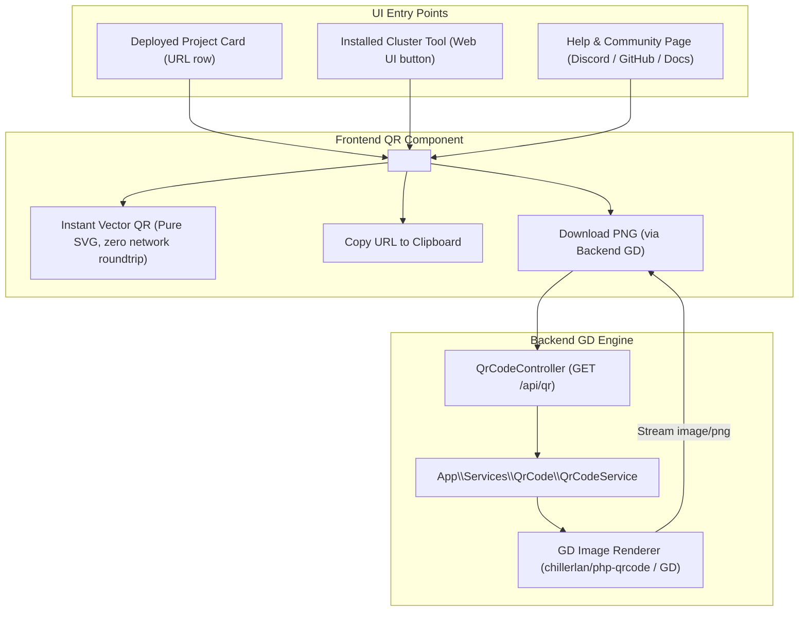

# Implementation Plan: Instant QR Code Scanner for Deployed Apps, Cluster Tools & Help Links

## Goal Description
Provide an instant mobile QR code scanning experience across LaraKube Desktop:
1. **Deployed Project Apps**: Allow operators to instantly scan a QR code for any deployed project URL (e.g. `https://hello-world-test.luchtech.dev` or custom domain) to preview and test their web app directly on their mobile phone.
2. **Installed Cluster Tools**: Allow operators to scan a QR code for any active companion tool web UI (Mailpit, Uptime Kuma, GlitchTip, Vaultwarden, Grafana, Portainer) to open the dashboard on their phone or tablet.
3. **Help & Community Links**: Display a sleek hover/click QR preview for community links (Discord, GitHub, Facebook Group, Documentation) so users can immediately join the community or read docs on mobile.
4. **Hybrid Engine (Frontend Vector SVG + Backend GD PNG)**:
   - **Instant UI**: Instantaneous, zero-latency vector SVG QR rendering in React for hover tooltips and popovers.
   - **Backend GD Engine**: A dedicated PHP GD QR generator service and `/api/qr` endpoint for generating downloadable, high-resolution PNG QR images with custom branding.

---

## Architecture Overview

---

## User Review Required

> [!IMPORTANT]
> **Zero Network Latency for Popovers**: Popovers and hover tooltips will render QR codes instantly using a pure client-side SVG renderer (`qrcode.react`), ensuring that hovering or clicking a QR icon opens in 0ms without waiting for an HTTP roundtrip to the local server.
>
> **GD PNG Downloads**: For saving or exporting QR codes to disk (e.g. to print, put in documentation, or share with a team), the backend GD engine (`GET /api/qr?url=...&download=1`) renders a high-res PNG with an embedded brand quiet zone.

---

## Proposed Changes

### Component 1: Backend PHP & GD QR Engine (`desktop/`)

#### [NEW] `desktop/app/Services/QrCode/QrCodeService.php`
- Uses `chillerlan/php-qrcode` (or built-in GD rasterizer).
- Methods:
  - `renderPng(string $text, int $size = 400, int $margin = 2): string`: Generates raw PNG bytes using the PHP `gd` extension.
  - `renderSvg(string $text, int $size = 200, int $margin = 2): string`: Generates vector SVG string.
  - `isSupported(): bool`: Verifies GD extension availability.

#### [NEW] `desktop/app/Http/Controllers/Api/QrCodeController.php`
- Endpoint `GET /api/qr`:
  - Query parameters:
    - `url` (required, validated as string/url)
    - `format` (optional: `png` [default] or `svg`)
    - `download` (optional boolean, sends `Content-Disposition: attachment`)
  - Returns `response($bytes)->header('Content-Type', 'image/png')`.

#### [MODIFY] `desktop/routes/web.php` or `desktop/routes/api.php`
- Register `Route::get('/api/qr', [QrCodeController::class, 'show'])->name('api.qr');`.

---

### Component 2: Frontend React UI (`desktop/resources/js/`)

#### [NEW] `desktop/resources/js/components/qr-code-popover.tsx`
- Sleek, reusable popover component:
  - Trigger: Sleek icon button with `QrCode` icon (Lucide) + tooltip ("Scan with phone").
  - Content Card:
    - Large high-contrast QR code (SVG, 160×160) with rounded corners and white quiet zone for effortless camera recognition.
    - Title / target name (e.g., "Scan to open on phone").
    - Full URL in monospace with one-click "Copy" feedback.
    - "Download PNG" button linking to `/api/qr?url=...&download=1`.
  - Accessible: click or hover trigger, closes on Escape or clicking outside.

#### [MODIFY] `desktop/resources/js/components/help-community-card.tsx`
- Add QR code scan button/hover to each community link (Discord, Facebook, GitHub, Email).

#### [MODIFY] `desktop/resources/js/pages/projects/index.tsx` & `project-actions.tsx`
- In project cards with an active URL (e.g. `https://hello-world-test.luchtech.dev`), render the `<QrCodePopover>` beside the external link button.

#### [MODIFY] `desktop/resources/js/pages/tools/index.tsx` & `pages/tools/show.tsx`
- For installed tools that expose a Web UI (Mailpit, Uptime Kuma, GlitchTip, Vaultwarden, etc.), render the `<QrCodePopover>` so users can scan and access the tool dashboard on their mobile device.

---

## Verification Plan

### Automated Tests
1. **Unit & Feature Tests (`desktop/tests/Feature/QrCodeTest.php`)**:
   - Test `QrCodeService::renderPng()` outputs a valid PNG image byte stream.
   - Test `QrCodeService::renderSvg()` outputs a valid `<svg>` XML string.
   - Test `GET /api/qr?url=https://example.com` returns `200` with `image/png` header.
   - Test `GET /api/qr` without URL returns `422` validation error.
2. **Pest & Static Analysis**:
   - Run `composer lint` (Pint).
   - Run `composer types:check` (PHPStan).
   - Run `npm run check` and `npm run types:check`.
   - Run `composer test` (all 516+ tests passing).

### Manual Verification
1. Open Help page: hover over Discord / GitHub links and scan the QR code with phone camera to verify it opens the URL.
2. Open Projects page: on a deployed project card, click the QR code button and scan the deployed URL.
3. Open Tools page: scan the QR code of an installed tool (e.g. Mailpit / Uptime Kuma).
4. Click "Download PNG" to verify the GD-generated PNG downloads cleanly.
