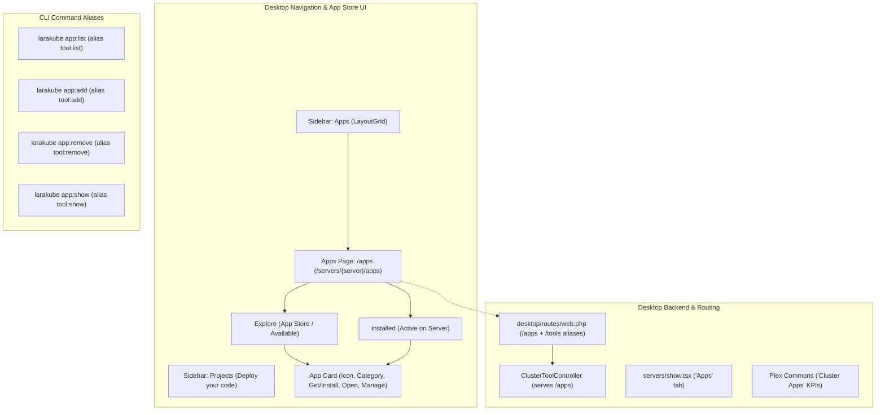

# Implementation Plan: Renaming "Tools" to "Apps" (App Store & Cluster Apps)

## Goal Description
Transform LaraKube's **"Tools"** catalog into **"Apps"** (modeled after modern App Stores like Apple App Store, Google Play Store, Cloudron, TrueNAS Apps, and Umbrel App Store).

Currently, "Tools" sounds like low-level developer utilities or CLI binaries (which creates confusion with system tools like `kubectl` or local companions like Adminer/RedisInsight). Renaming it to **"Apps"** establishes an intuitive mental model:
- **Projects**: Your custom application code repositories (Laravel, Next.js, Vite, Astro, etc.) that you build and deploy.
- **Apps**: Turnkey, production-ready server applications (Outline, Mattermost, MinIO, Vaultwarden, Mailpit, Grafana, Penpot, Nextcloud/OCIS, etc.) that install to your cluster with 1 click, automatic HTTPS, custom domains, and single sign-on.

---

## User Review Required

> [!IMPORTANT]
> **Key Decisions for User Alignment**:
> 1. **Sidebar Navigation & Icon**:
>    - Label: **Apps** (previously *Tools*)
>    - Description: **App store & services** (previously *Cluster Tools*)
>    - Icon: **`LayoutGrid`** (the universal App Store / App Launcher icon) or **`Boxes`** / **`AppWindow`**.
> 2. **Differentiating "Projects" vs "Apps"**:
>    - In `app-layout.tsx`, the `Projects` sidebar item currently has the description *"Deploy your apps"*. To eliminate ambiguity with "Apps", we will update it to *"Deploy your code"* (or *"Your code & repos"*).
> 3. **Desktop Routes & Compatibility**:
>    - Primary routes will be `/apps` and `/servers/{server}/apps`.
>    - Existing `/tools` and `/servers/{server}/tools` routes will be preserved as transparent aliases/redirects to maintain 100% backward compatibility and keep existing bookmarks working.
> 4. **CLI Command Aliases**:
>    - Register `app:list`, `app:add`, `app:remove`, `app:show`, `app:init` as first-class aliases on the existing `tool:*` CLI commands.
>    - Both `larakube app:list` and `larakube tool:list` will work seamlessly.

---

## Proposed Changes

---

### Component 1: Desktop Sidebar & Navigation (`desktop/resources/js/layouts/app-layout.tsx`)

#### [MODIFY] `desktop/resources/js/layouts/app-layout.tsx`
- Rename navigation item:
  - `label`: `'Apps'`
  - `description`: `'App store & services'`
  - `href`: `/apps` (or `apps().url`)
  - `icon`: `LayoutGrid` (from `lucide-react`)
  - `active`: Matches `/apps`, `/servers/{server}/apps`, `/tools`, and `/servers/{server}/tools`.
- Update `Projects` description from `'Deploy your apps'` to `'Deploy your code'` to prevent terminology overlap.

---

### Component 2: Desktop Routes & Controller (`desktop/routes/web.php` & `desktop/app/Http/Controllers/ClusterToolController.php`)

#### [MODIFY] `desktop/routes/web.php`
- Add modern `/apps` route group:
  - `Route::get('/apps', [ClusterToolController::class, 'entry'])->name('apps');`
  - `Route::get('/servers/{server}/apps', [ClusterToolController::class, 'index'])->name('servers.apps.index');`
  - `Route::get('/servers/{server}/apps/{tool}', [ClusterToolController::class, 'show'])->name('servers.apps.show');`
  - `Route::post('/servers/{server}/apps/refresh', [ClusterToolController::class, 'refresh'])->name('servers.apps.refresh');`
  - `Route::get('/servers/{server}/apps/{tool}/credentials', [ClusterToolController::class, 'credentials'])->name('servers.apps.credentials');`
  - `Route::post('/servers/{server}/apps/{tool}', [ClusterToolController::class, 'store'])->name('servers.apps.store');`
  - `Route::post('/servers/{server}/apps/{tool}/rebind', [ClusterToolController::class, 'rebind'])->name('servers.apps.rebind');`
  - `Route::delete('/servers/{server}/apps/{tool}', [ClusterToolController::class, 'destroy'])->name('servers.apps.destroy');`
- Preserve legacy `/tools` and `/servers/{server}/tools` routes as redirects/aliases so existing references continue working without disruption.

#### [MODIFY] `desktop/app/Http/Controllers/ClusterToolController.php`
- Update redirect targets in `entry()` to redirect to `servers.apps.index`.
- In `index()`, render `'tools/index'` (or `'apps/index'`), passing updated terminology props if needed.

---

### Component 3: App Store Visual Experience (`desktop/resources/js/pages/tools/index.tsx` & `show.tsx`)

#### [MODIFY] `desktop/resources/js/pages/tools/index.tsx`
- **Header**:
  - Title: **Apps**
  - Subtitle: *"Turnkey server applications ready to install with one click. Automatic HTTPS, custom domains, and single sign-on."*
- **Tabs (App Store Metaphor)**:
  - **Explore** (Available to install)
  - **Installed** (Active apps on this server)
  - **All Apps**
- **Search & Filters**:
  - Placeholder: *"Search 30+ apps (wiki, s3, chat, identity, analytics…)"*
  - Category Pills: Collaboration, Storage & Database, Security & Identity, Observability, DevOps, Productivity, Analytics.
- **Card Enhancements**:
  - **AvailableCard**:
    - Action button styled as App Store **"Install"** / **"Get"** with `Download` / `Plus` icon.
    - Badges for category, maturity, and multi-instance.
  - **InstalledCard**:
    - **"Open"** button with `ExternalLink` to open in browser.
    - **"Manage"** button with `Sliders` or `ArrowRight` to view credentials and settings.
    - Live running status indicator.

#### [MODIFY] `desktop/resources/js/pages/tools/show.tsx`
- Update breadcrumb: `← Apps on {server.name}`.
- Labels updated from "Tool Details" / "Uninstall Tool" to "App Details" / "Uninstall App".

---

### Component 4: Surrounding Desktop Views
- **`desktop/resources/js/pages/servers/show.tsx`**: Update the tab header from `Cluster Tools` to `Apps · {count}`.
- **`desktop/resources/js/pages/plex/...`**: Update tenant hub and topology canvas labels from "Tools" to "Cluster Apps" / "Apps".
- **`desktop/resources/js/pages/runs/show.tsx`**: Update breadcrumb links to `Apps on {server}`.
- **`desktop/resources/js/pages/tray/index.tsx`**: Update tray menu section to `Apps ({server})`.

---

### Component 5: CLI Command Aliases (`cli/app/Commands/Tool/`)

#### [MODIFY] `cli/app/Commands/Tool/ToolListCommand.php`
- Add `$aliases = ['app:list'];`
- Update description: `"List LaraKube shared cluster apps and which are installed"`.

#### [MODIFY] `cli/app/Commands/Tool/ToolAddCommand.php`
- Add `$aliases = ['app:add'];`

#### [MODIFY] `cli/app/Commands/Tool/ToolRemoveCommand.php`
- Add `$aliases = ['app:remove'];`

#### [MODIFY] `cli/app/Commands/Tool/ToolShowCommand.php`
- Add `$aliases = ['app:show'];`

#### [MODIFY] `cli/app/Commands/Tool/ToolInitCommand.php`
- Add `$aliases = ['app:init'];`

---

## Verification Plan

### Automated Tests
1. **Desktop Feature Tests**:
   - `cd desktop && ./vendor/bin/pest tests/Feature/ClusterToolsTest.php`
   - Test both `/apps` and legacy `/tools` route redirects.
2. **CLI Tests**:
   - `cd cli && ./vendor/bin/pest`
   - Test running both `larakube app:list` and `larakube tool:list`.
3. **TypeScript & Static Analysis**:
   - `npm --prefix desktop run types:check`
   - `cd desktop && ./vendor/bin/phpstan analyse --memory-limit=1G`
   - `cd desktop && ./vendor/bin/pint --test`

### Manual Verification
1. Open Desktop app:
   - Verify sidebar displays **Apps** with `LayoutGrid` icon and description *"App store & services"*.
   - Verify sidebar displays **Projects** with description *"Deploy your code"*.
2. Visit `/apps`:
   - Verify header says **Apps** with App Store description.
   - Verify tabs say **Explore** (Available) and **Installed**.
   - Verify search placeholder mentions apps.
   - Verify action buttons: **Install** (with `Download`/`Plus` icon), **Open** (`ExternalLink`), and **Manage** (`ArrowRight`).
3. Check Server Show page (`/servers/{name}`):
   - Verify the tab shows **Apps · {count}**.
4. Check CLI in terminal:
   - Run `php larakube app:list` and verify it outputs the app catalog identically to `tool:list`.
