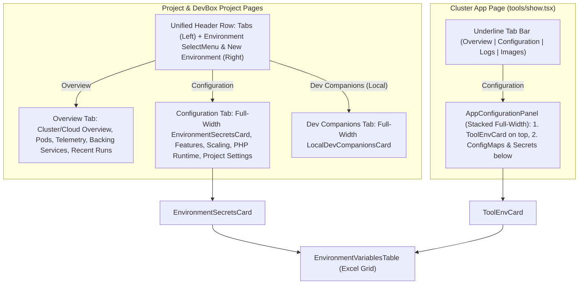

# Tabbed Project View, Environment Dropdown & Reusable Excel-Style Environment Variables Table

## Goal Description
1. **Unified Tab Bar with Environment Dropdown & "New Environment" Button**: Replace the stacked pill-style `EnvironmentSwitchBar` on both the main Project view ([show.tsx](file:///Users/jsluchavez/Codes/Ideas/laravel-k8s/desktop/resources/js/pages/projects/show.tsx)) and the DevBox Project view ([project.tsx](file:///Users/jsluchavez/Codes/Ideas/laravel-k8s/desktop/resources/js/pages/devboxes/project.tsx)) with a single underline tab bar:
   - **Left side**: Underline section tabs (`Overview` | `Configuration`, plus `Dev Companions` when `activeEnv === 'local'` on Projects), synced with `?tab=`.
   - **Right side**: Compact `SelectMenu` Environment dropdown (matching `ServerSwitcher`), `+ New Environment` button, active deployment status indicator, and a subtle remove action when viewing a cloud environment, synced with `?env=`.
2. **Dedicated `Dev Companions` Tab (Local Dev)**: Move `LocalDevCompanionsCard` out of `Overview` into its own `Dev Companions` tab on local projects (falling back to `Overview` when switching to a cloud environment).
3. **Reusable Excel-Style Environment Variables Table (`EnvironmentVariablesTable`)**: Unify the environment variables table UI across Projects ([environment-secrets-card.tsx](file:///Users/jsluchavez/Codes/Ideas/laravel-k8s/desktop/resources/js/components/environment-secrets-card.tsx)) and Cluster Apps ([tool-env-card.tsx](file:///Users/jsluchavez/Codes/Ideas/laravel-k8s/desktop/resources/js/components/tool-env-card.tsx)) into a shared spreadsheet-style grid component ([environment-variables-table.tsx](file:///Users/jsluchavez/Codes/Ideas/laravel-k8s/desktop/resources/js/components/environment-variables-table.tsx)) supporting direct inline cell editing, multi-row additions, keyboard navigation (`Enter` / `Tab`), and multi-line `.env` paste.
4. **Full-Width App Configuration Layout**: Stack `ToolEnvCard` full-width at the top of [app-configuration-panel.tsx](file:///Users/jsluchavez/Codes/Ideas/laravel-k8s/desktop/resources/js/components/app-configuration-panel.tsx) above the read-only `ConfigMaps & Secrets` inspection card.

---

## User Review Required
> [!IMPORTANT]
> **Unified Project Header & Environment Switcher**:
> Instead of stacking a rounded pill bar above the underline tabs ("tabs on top of tabs"), the section tabs and environment switcher now share one clean row directly below `<PageHeader />`:
> ```
> [ Overview ]  [ Configuration ]  [ Dev Companions ]          [ Environment: Local Dev ▾ ]  [ + New Environment ]
> ────────────────────────────────────────────────────────────────────────────────────────────────────────────────
> ```
> - Selecting an environment from the `SelectMenu` dropdown updates `?env=<name>` in the URL alongside `?tab=<tab>`.
> - Clicking **New Environment** (or `+ Create new environment…` in the dropdown footer) opens the existing `AddEnvironmentDialog`.
> - When a cloud environment is selected, a delete icon button (`Trash2`) next to the dropdown (and a danger footer action inside the dropdown) lets you remove that environment from the project blueprint.

---

## Architecture & Layout Overview



---

## Proposed Changes

### 1. Unified Tab Bar & Environment Dropdown on Project View

#### [MODIFY] [show.tsx](file:///Users/jsluchavez/Codes/Ideas/laravel-k8s/desktop/resources/js/pages/projects/show.tsx)
- **URL State Sync (`?env=` and `?tab=`)**:
  - Add `initialProjectEnv(project)` reading `?env=` from `window.location.search` (falling back to `'local'` if absent or unrecognized).
  - Update `handleSelectEnv(nextEnv)` to update `activeEnv`, write `?env=<nextEnv>` via `window.history.replaceState`, and fall back from `'companions'` to `'overview'` if `nextEnv !== 'local'`.
- **Replace `<EnvironmentSwitchBar />` + separate tablist with a single unified row**:
  - Outer container: `<div className="flex flex-wrap items-center justify-between gap-3 border-b border-line">`
  - **Left (`role="tablist"`)**:
    - Underline tabs (`Overview`, `Configuration`, and `Dev Companions` when `activeEnv === 'local'`), styled with `-mb-px cursor-pointer border-b-2 px-3 py-2.5 text-[13px] font-medium transition`.
  - **Right (`flex flex-wrap items-center gap-2 pb-1.5`)**:
    - Active deployment pill (`StatusPill tone="busy"`) when a `deploy-app` run is active for `activeEnv`.
    - **Environment Dropdown** (styled after `ServerSwitcher`):
      ```tsx
      <div className="flex h-8 items-center gap-2 rounded-lg bg-surface pl-2.5 ring-1 ring-line">
          <span className="text-xs text-soft">Environment</span>
          <SelectMenu
              value={activeEnv}
              onChange={handleSelectEnv}
              align="right"
              panelLabel="Project Environments"
              triggerClassName="h-8 rounded-lg bg-transparent px-2 text-xs font-semibold ring-0 hover:ring-0"
              aria-label="Select project environment"
              options={envOptions}
              footer={...}
          />
      </div>
      ```
      - **`local` option**: `Laptop` icon (`text-brand`), label `'Local Dev'`, pulsing indicator badge when running, description showing local `.webHost` (or `docs.test`).
      - **Cloud `cloudEnvs` options**: `ProviderLogo` (or `Cloud` icon), uppercase `env.name` label, `env.serverName` badge + running indicator, description showing `env.webHost ?? 'No domain configured'`.
      - **`footer` inside dropdown**: `+ Create new environment…` action button opening `AddEnvironmentDialog`, plus (when `activeEnv !== 'local'`) a `Remove ${activeEnv} environment…` action opening `RemoveEnvironmentDialog`.
    - **`New Environment` button**:
      ```tsx
      <Button
          variant="secondary"
          size="sm"
          onClick={() => setAddEnvModalOpen(true)}
          title="Create a cloud environment, such as staging or production"
      >
          <Plus className="size-3.5" />
          <span>New Environment</span>
      </Button>
      ```
    - **Remove Cloud Environment button** (when `activeEnv !== 'local'`):
      ```tsx
      <Button
          variant="ghost"
          size="sm"
          onClick={() => setRemoveEnvTarget(activeEnv)}
          title={`Remove ${activeEnv} from this project's blueprint`}
      >
          <Trash2 className="size-3.5 text-soft hover:text-accent" />
      </Button>
      ```

---

### 2. Unified Tab Bar & Environment Dropdown on DevBox Project View

#### [MODIFY] [project.tsx](file:///Users/jsluchavez/Codes/Ideas/laravel-k8s/desktop/resources/js/pages/devboxes/project.tsx)
- Replace the rounded multi-environment pill bar above the tabs with the exact same unified underline Tab Bar row:
  - **Left**: `Overview` and `Configuration` underline tabs (`role="tablist"`), synced with `?tab=`.
  - **Right**:
    - `SelectMenu` Environment dropdown (`DevBox Local` + cloud environments with `Laptop` / `Cloud` icons, running/deploying badges, and `+ Create new environment…` footer).
    - `<Button variant="secondary" size="sm" onClick={() => setAddEnvModalOpen(true)}><Plus className="size-3.5" /><span>New Environment</span></Button>`.
    - `<Button variant="primary" size="sm" ...><ArrowUpCircle className="size-3.5" /><span>Deploy to {activeEnv}</span></Button>` when `activeEnv !== 'local'` and `endpoints?.operate` is available.
- Sync `?env=` alongside `?tab=` via `window.history.replaceState`.

---

### 3. Already Completed & Retained Components
- [environment-variables-table.tsx](file:///Users/jsluchavez/Codes/Ideas/laravel-k8s/desktop/resources/js/components/environment-variables-table.tsx): Shared Excel-style grid (`EnvironmentVariablesTable`, `createDraftRow`, `normalizeEnvKey`, `inferIsSecretKey`, `parseDotenv`), with `Mounted (.env)` and `Build-Time (.env)` status/target labeling + hover `InfoTooltip` explanations.
- [environment-secrets-card.tsx](file:///Users/jsluchavez/Codes/Ideas/laravel-k8s/desktop/resources/js/components/environment-secrets-card.tsx): Uses `EnvironmentVariablesTable` full-width on `Configuration`; on static cloud environments (`Docusaurus`, `Vite`, `Astro`), replaces `Push to Cluster` / `Pull to Disk` / `Redeploy Pods` with `Push to {Forgejo|GitHub Actions|GitLab CI}` and `Save & Push to {CI Platform}` targeting `{ENV}_BUILD_ENV`.
- [tool-env-card.tsx](file:///Users/jsluchavez/Codes/Ideas/laravel-k8s/desktop/resources/js/components/tool-env-card.tsx): Uses `EnvironmentVariablesTable` with `canToggleSecret`.
- [app-configuration-panel.tsx](file:///Users/jsluchavez/Codes/Ideas/laravel-k8s/desktop/resources/js/components/app-configuration-panel.tsx): Stacks `ToolEnvCard` full-width above `ConfigMaps & Secrets`.
- `Dev Companions` tab on [projects/show.tsx](file:///Users/jsluchavez/Codes/Ideas/laravel-k8s/desktop/resources/js/pages/projects/show.tsx): Renders `LocalDevCompanionsCard` in its own dedicated tab when `activeEnv === 'local'`.

### 4. Static & Hybrid Build-Time CI Environment Sync (`{ENV}_BUILD_ENV`)
- **CLI (`PushesBuildEnvToCi` + `DotenvPushCommand` + `ConfiguresCloudEnvironment`)**:
  - Mount BuildKit secret `--mount=type=secret,id=dotenv,target=/app/.env` in `cli/resources/views/docker/static.blade.php` (`@else` branch for Docusaurus) and `docs/Dockerfile.static` without running `STRICT_HOSTS` prose checks.
  - Consume `{ENV}_BUILD_ENV` in `cloud-pilot-deploy-static.blade.php`, `cloud-pilot-deploy-server.blade.php`, `cloud-pilot-deploy.blade.php` (build job), `cloud-pilot-deploy-gitlab.blade.php`, and `docs/.github/workflows/larakube-deploy-production.yml`.
  - Push all `.env.{env}` variables for static cloud environments (and browser-bundle prefixes `VITE_*` / `PUBLIC_*` / `NEXT_PUBLIC_*` best-effort for hybrid apps with CI workflows) to Forgejo (`tea`), GitHub (`gh`), or GitLab (`glab`) as `{ENV}_BUILD_ENV`.
- **Desktop Backend (`ProjectDotenv.php` & `ProjectDotenvController.php`)**:
  - Surface CI push confirmation or warning messages in `ProjectDotenv::update()` and label static CI pushes cleanly in `ProjectDotenvController::push()`.

### 5. Multi-Remote Git Forge Detection, Instant Per-Environment Selector & Delivery Pipeline Overflow Fix
- **Per-Environment Blueprint Fields ([EnvironmentData.php](file:///Users/jsluchavez/Codes/Ideas/laravel-k8s/cli/app/Data/EnvironmentData.php))**:
  - Optional `gitRemote` and `ciPlatform` per environment in `.larakube.json` (used by both Desktop and CLI `detectCiPlatform()` / `resolveEnvironmentRemoteUrl()`).
- **All-Remote Parsing & Forge Inference ([ProjectInspector.php](file:///Users/jsluchavez/Codes/Ideas/laravel-k8s/desktop/app/Services/LaraKube/ProjectInspector.php))**:
  - Parses all `[remote "<name>"]` blocks in `.git/config` across `ssh://`, `https://`, `git@host:slug`, and SSH aliases (`github:slug`), matching `registry.host` / explicit overrides to resolve the right Forgejo / GitHub / GitLab platform per environment.
- **UI & Instant Save ([ProjectController.php](file:///Users/jsluchavez/Codes/Ideas/laravel-k8s/desktop/app/Http/Controllers/ProjectController.php), [environment-settings-drawer.tsx](file:///Users/jsluchavez/Codes/Ideas/laravel-k8s/desktop/resources/js/components/environment-settings-drawer.tsx), [environment-secrets-card.tsx](file:///Users/jsluchavez/Codes/Ideas/laravel-k8s/desktop/resources/js/components/environment-secrets-card.tsx), [show.tsx](file:///Users/jsluchavez/Codes/Ideas/laravel-k8s/desktop/resources/js/pages/projects/show.tsx))**:
  - Fixes `DELIVERY PIPELINE` text overflow via `min-w-0 flex-1` and `truncate`.
  - Adds **Git Forge Platform** & **Git Remote** dropdowns in the `Delivery Pipeline & CI/CD` drawer that persist immediately (`save_target_only`), plus a quick `Change` link next to the CI target on `Configuration`.

### In-App Forgejo (`tea`) Authentication via `larakube git:login`
- **CLI Non-Interactive & JSON Support ([GitLoginCommand.php](file:///Users/jsluchavez/Codes/Ideas/laravel-k8s/cli/app/Commands/Git/GitLoginCommand.php))**:
  - Adds `--token=` and `--json` using `EmitsJsonOutput`, `FailsWithJson`, `ReadsCommandOptions`, `GITEA_SERVER_TOKEN` env fallback, and `registerSecret($token)` while keeping existing interactive prompt compatibility.
- **Desktop Status Inspection & Subprocess Execution ([ProjectInspector.php](file:///Users/jsluchavez/Codes/Ideas/laravel-k8s/desktop/app/Services/LaraKube/ProjectInspector.php), [ProjectController.php](file:///Users/jsluchavez/Codes/Ideas/laravel-k8s/desktop/app/Http/Controllers/ProjectController.php))**:
  - Resolves per-environment `forgejoHost` and `teaLoggedIn` from native `tea` `config.yml` locations without touching legacy `~/.larakube/tea-config` paths.
  - Handles `git_login_token` + `forgejo_host` in `ProjectController::configureCi()` by running `larakube git:login <env> --domain=<host> --json --no-interaction` via `ToolLocator::run()` with `GITEA_SERVER_TOKEN` in the process environment (per Desktop ADR 0001).
- **Desktop UI ([environment-settings-drawer.tsx](file:///Users/jsluchavez/Codes/Ideas/laravel-k8s/desktop/resources/js/components/environment-settings-drawer.tsx), [environment-secrets-card.tsx](file:///Users/jsluchavez/Codes/Ideas/laravel-k8s/desktop/resources/js/components/environment-secrets-card.tsx))**:
  - Adds **Forgejo CLI (`tea`)** status (`Connected` / `Not logged in`), domain field, `<ExternalLinkButton>` shortcut to `/user/settings/applications` (`write:repository` scope), token input, and **Connect** / **Reconnect** controls inside `CiPipelineForm`.
  - Adds an inline **Connect Forgejo (`tea`)** callout on `EnvironmentSecretsCard` for static cloud projects targeting Forgejo when `tea` is not logged in yet.

---

## Verification Plan

### Automated Checks & Tests
1. **Frontend Format, Lint & Type Check**:
   ```bash
   cd desktop && npm run check:fix && npm run check && npm run types:check
   ```
2. **Full Desktop CI Suite (Pint, PHPStan & Parallel Pest Suite)**:
   ```bash
   cd desktop && composer ci:check
   ```

### Manual Verification
1. Open a Project in LaraKube Desktop and verify the single unified header row shows `Overview` | `Configuration` | `Dev Companions` on the left and the `Environment` `SelectMenu` dropdown + `New Environment` button on the right without any double-tab bar.
2. Switch between `Local Dev` and cloud environments using the dropdown, verify `?env=` updates, verify `Dev Companions` hides/falls back cleanly on cloud environments, and verify removing a cloud environment works from both the trash button and dropdown footer.
3. Open a DevBox Project and verify the unified tab bar + `Environment` dropdown + `New Environment` button matches the main Project view.
