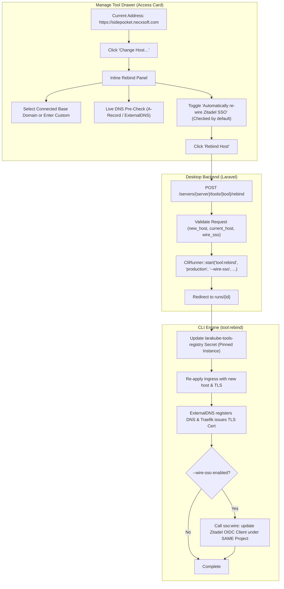

# Streamlined Tool Host Rebinding with Automatic SSO Re-wiring in Desktop UI (`tool:rebind`)

## Goal Description
When a domain or DNS provider is revoked or lost (e.g. losing Cloudflare access to `necxsoft.com`), an operator needs to move an existing, critical Cluster Tool (such as PocketBase, Outline, or Stalwart Mail) to a new host address.

Simply re-running an installer mints a brand-new, empty instance slug—leaving production databases and storage volumes stranded. The CLI command [`tool:rebind`](file:///Users/jsluchavez/Codes/Ideas/laravel-k8s/cli/app/Commands/Tool/ToolRebindCommand.php) solves this by safely updating the Ingress routing and tool registry entry while keeping Kubernetes resource names, Deployments, PVCs, and databases completely intact.

Furthermore, if the tool was previously wired to Zitadel SSO, changing domains changes the OAuth redirect callback URI. Without updating Zitadel, the tool becomes inaccessible because login attempts fail with `invalid_redirect_uri`. By equipping `tool:rebind` with `--wire-sso` and offering automatic SSO re-wiring in the Desktop UI, we seamlessly update Zitadel's OIDC client under the **exact same Zitadel project** right as part of the rebind flow, preserving all roles, users, and permissions without manual intervention.

---

## User Review Required

> [!IMPORTANT]
> **Zero Data Loss Guarantee**: Rebinding a tool updates only its Ingress hostname and tool registry mapping. It **never** recreates databases, persistent volumes (PVCs), secrets, or deployments.

> [!TIP]
> **Automated SSO Re-wiring**: By enabling `--wire-sso`, `tool:rebind` automatically updates Zitadel's OIDC client with the new redirect URI immediately after updating the Ingress. Because the instance slug is pinned in the registry, Zitadel updates the client under the **same project**, preserving all existing user role grants and permissions.

---

## Proposed Changes



---

### 1. CLI Engine (`cli/`)

#### [MODIFY] `cli/app/Commands/Tool/ToolRebindCommand.php`
- Add `--wire-sso` and `--no-wire-sso` options to the signature:
  ```php
  {--wire-sso : Automatically re-wire Zitadel SSO to the new domain if the tool is SSO-capable}
  {--no-wire-sso : Do not re-wire Zitadel SSO}
  ```
- In `handle()`:
  - After `reapplyToolIngress()` and `issueLocalCertForHost()`:
  - Check `shouldWireSso($tool, $kubectl)`:
    - If `--wire-sso` was passed, or if run interactively, tool has SSO, and user confirms:
      - Call `$this->call('sso:wire', array_filter(['environment' => $env, '--tool' => $tool->value, '--domain' => $newHost, '--context' => $this->option('context') ?: null]))`.
    - If unwired or `--no-wire-sso`, output the manual reminder line as before.

#### [MODIFY] `cli/tests/Feature/ToolRebindCommandTest.php`
- Add test verifying `--wire-sso` invokes `sso:wire` with `--domain={$newHost}` and preserves instance mapping.

---

### 2. Desktop Backend (`desktop/`)

#### [NEW] `desktop/app/Http/Requests/RebindClusterToolRequest.php`
- Form request validating:
  - `tool`: string, matches tool slug.
  - `current_host`: required string, matches currently registered host.
  - `new_host`: required string, valid domain format, different from `current_host`.
  - `wire_sso`: boolean, optional.

#### [MODIFY] `desktop/app/Enums/RunKind.php`
- Add `case RebindClusterTool = 'rebind-cluster-tool';` with label `"Rebind Cluster Tool Host"`.

#### [MODIFY] `desktop/app/Http/Controllers/ClusterToolController.php`
- Add `rebind(RebindClusterToolRequest $request, string $server, string $tool): RedirectResponse`:
  - Resolves target server and kube-context.
  - Reads `current_host`, `new_host`, and `wire_sso`.
  - Dispatches `CliRunner::start()` with:
    ```php
    arguments: [
        'tool:rebind',
        'production',
        "--tool={$tool}",
        "--to={$newHost}",
        "--context={$context}",
        "--domain={$currentHost}",
        $request->boolean('wire_sso') ? '--wire-sso' : '--no-wire-sso',
        '--force',
    ],
    kind: RunKind::RebindClusterTool,
    subject: $tool,
    label: "Rebind {$displayName} on {$server} to {$newHost}",
    ```
  - Redirects to `runs.show` to stream live CLI progress.

#### [MODIFY] `desktop/routes/web.php`
- Register `POST /servers/{server}/tools/{tool}/rebind` mapped to `ClusterToolController::rebind`.

---

### 3. Desktop Frontend (`desktop/resources/js/`)

#### [MODIFY] `desktop/resources/js/components/manage-tool-drawer.tsx`
- Add `domains?: ServerDomain[] | null;` and `serverIp?: string | null;` to `ManageToolDrawerProps`.
- In the **Access** card:
  - When `tool.host` is present, display a **`[Change Host…]`** button with an `ArrowRightLeft` icon next to the address.
  - Clicking **`Change Host…`** expands the inline **Rebind Host** panel:
    1. **Safety Explainer**: Reassuring notice that workloads and persistent databases are completely safe.
    2. **Current Host Display**: Read-only display of the old domain (`sidepocket.necxsoft.com`).
    3. **New Host Selector**:
       - Dropdown of connected server domains (`domains`) with `ExternalDNS` and `TLS` badges.
       - Subdomain input with live preview: `https://[subdomain].[selectedDomain]` (prefilled with tool slug or current subdomain).
       - Custom domain toggle for external or unmanaged domains.
       - Real-time DNS check indicator calling `/servers/{server}/check-dns`.
    4. **Automatic SSO Re-wiring Option**:
       - If `tool.sso === 'wired'`, displays a checkbox (checked by default):
         `[x] Automatically update Zitadel SSO with new callback URL`
         With descriptive text: *"Your Zitadel project, users, and permissions are preserved. The redirect URI will be updated so login continues to work seamlessly."*
    5. **Actions**:
       - `[Cancel]` button with `X` icon.
       - `[Rebind Host]` button with `ArrowRightLeft` icon (dispatches to `servers.tools.rebind`).

#### [MODIFY] `desktop/resources/js/pages/tools/index.tsx`
- Pass `domains={domains}` and `serverIp={server.ip}` into `<ManageToolDrawer />`.

---

## Verification Plan

### Automated Tests
1. **CLI Tests**:
   - Run: `composer test -- --filter=ToolRebindCommandTest` in `cli/`.
   - Run: `composer analyse` in `cli/`.
2. **Desktop PHP Feature Tests**:
   - Create test in `desktop/tests/Feature/ClusterToolsTest.php`:
     - Test that `POST /servers/{server}/tools/{tool}/rebind` validates inputs.
     - Test that it dispatches the `tool:rebind` CLI command with `--wire-sso`.
   - Run: `./vendor/bin/pest tests/Feature/ClusterToolsTest.php` in `desktop/`.
3. **Frontend Quality Checks**:
   - `npm run types:check`: Verify TypeScript types pass with zero errors.
   - `npm run check`: Verify Biome linting and formatting.
4. **Backend Static Analysis**:
   - `composer lint && composer types:check` (Pint + PHPStan).

### Manual Verification
1. Open LaraKube Desktop and navigate to **Tools**.
2. Click **Manage** on an installed tool with SSO (e.g. PocketBase).
3. In the sidebar's **Access** card, click **"Change Host…"**.
4. Select a new domain, check that the SSO auto-rewire checkbox is checked.
5. Click **"Rebind Host"** and observe the live run execution updating Ingress, certs, and Zitadel OIDC callback.
