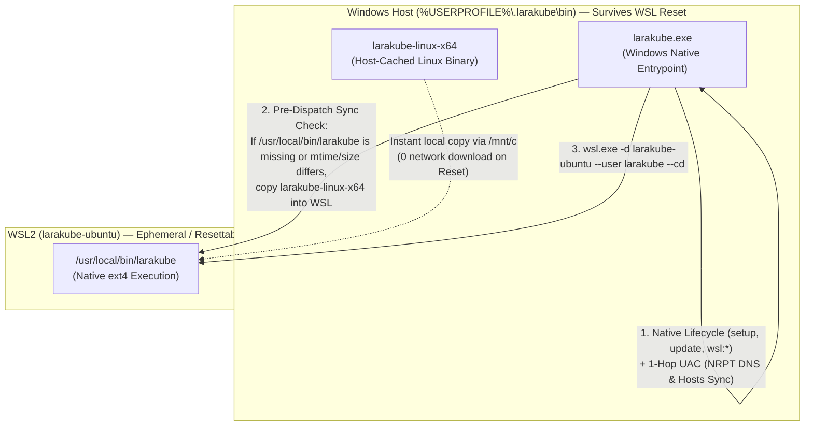

# Windows Dual-Binary Lockstep, Reset Resilience & Desktop Native Dispatch

**Status:** Proposed — Ready for Implementation  
**Related Plan:** [`cli/plans/active/desktop-native-cli-dispatch.md`](./desktop-native-cli-dispatch.md)  
**Related ADR:** `desktop/docs/decisions/0007-windows-via-a-bundled-wsl-distro.md`

---

## 1. Architectural Summary: Why Dual-Binary (Outside + Inside WSL) Wins

Running the CLI's full PHP command graph natively on Windows while only shelling out individual Linux tools (`kubectl`, `podman`, `openssl`, `ssh`, `tofu`) via `wsl.exe` was evaluated and ruled out due to fundamental OS boundary mismatches across the codebase:

1. **Shell Escaping Incompatibility (513 call sites)**: On Windows PHP (`PHP_OS_FAMILY === 'Windows'`), `escapeshellarg()` uses `cmd.exe` double-quoting (`"..."`) instead of POSIX single-quoting (`'...'`). Forwarding those command strings into WSL `bash -c` causes Bash to expand `$variables` inside `kubectl` JSONPath expressions, passwords, `awk`, and `sed` scripts.
2. **Temporary Bridge Files (270 call sites)**: `TemporaryDirectory` and `sys_get_temp_dir()` on Windows create files under `C:\Users\<user>\AppData\Local\Temp\...`. Passing Windows paths to Linux binaries (`kubectl apply -f`, `ssh -i`, `openssl`, `tofu`) fails, and `/mnt/c` DrvFs mounts carry `0777` permissions that cause OpenSSH (`ssh -i`) to reject private keys.
3. **POSIX Path & Home Assumptions (121+ call sites)**: `home_path()` (`~/.kube`, `~/.ssh`, `~/.larakube`) and direct PHP file checks (`is_file('/etc/rancher/k3s/k3s.yaml')`, `/usr/local/share/ca-certificates`) must inspect the WSL2 Linux filesystem, not the Windows host.
4. **Per-Subprocess Latency (~666 `Process::run()` sites)**: Orchestration commands execute 30–80 subprocesses per run. Wrapping each subprocess in `wsl.exe` adds 150–300ms of Win32→WSL VM transition overhead per call (8–25 seconds of overhead per command), whereas dispatching once at the CLI entry point (`larakube.exe` → `wsl.exe ... larakube`) runs all 80 calls inside native Linux ext4 in <100ms total.

### Solving Both Concerns Without Porting 160+ Commands to Windows PHP

Your two goals for wanting the CLI outside WSL were:
1. **Surviving "LaraKube Linux Reset"**: Unregistering and re-importing `larakube-ubuntu` (`wsl --unregister larakube-ubuntu`) should never leave the user without the CLI or downgrade them to an old binary baked into an older `.tar.gz` rootfs image.
2. **Zero Version Drift**: The Windows binary (`larakube.exe`) and the WSL Linux binary (`/usr/local/bin/larakube`) must never drift onto different versions or release channels (`canary` vs `stable`).

We solve **both** by treating the **Windows host directory (`%USERPROFILE%\.larakube\bin\`) as the Single Source of Truth** for both binaries:
- `%USERPROFILE%\.larakube\bin\larakube.exe` (Windows host entry point)
- `%USERPROFILE%\.larakube\bin\larakube-linux-x64` (Cached Linux ELF binary on the Windows host, safe from `wsl --unregister`)



---

## 2. Phase 1 — Lockstep Dual-Binary & Reset Resilience (`cli` + `docs`)

### 2.1 Host-Side Linux Binary Cache (`%USERPROFILE%\.larakube\bin\larakube-linux-x64`)
- Store the matching Linux binary right next to `larakube.exe` at `%USERPROFILE%\.larakube\bin\larakube-linux-x64` on Windows.
- Because `%USERPROFILE%\.larakube\bin\` lives on the Windows NTFS filesystem (`C:\Users\<user>\.larakube\bin`), **"LaraKube Linux Reset" (`wsl --unregister larakube-ubuntu`) never touches it**.
- Even if `larakube` is removed from the `larakube-ubuntu` Dockerfile in the future (or if the imported `larakube-ubuntu.tar.gz` image is months old), the Windows host already has the exact matching Linux binary ready to inject into WSL locally without downloading anything from GitHub.

### 2.2 Self-Healing Pre-Dispatch Sync in `WslBridge::dispatchToWsl()`
- **File**: [`cli/app/Services/WslBridge.php`](file:///Users/jsluchavez/Codes/Ideas/laravel-k8s/cli/app/Services/WslBridge.php)
- Add `ensureWslBinarySynced()`:
  - Called automatically inside `dispatchToWsl()` before invoking `larakube` inside WSL.
  - Checks the host cache file `%USERPROFILE%\.larakube\bin\larakube-linux-x64` against `\\wsl.localhost\<distro>\usr\local\bin\larakube` (comparing `filesize()` and `filemtime()`, or a lightweight `.version` / SHA-256 stamp at `\\wsl.localhost\<distro>\home\larakube\.larakube\cli.sha256`).
  - When `/usr/local/bin/larakube` inside WSL is missing (e.g. immediately after **LaraKube Linux Reset** or on a minimal distro) or out of sync with the Windows host's cached binary, runs:
    ```text
    wsl.exe -d <distro> --user root -- install -m 0755 /mnt/c/Users/<user>/.larakube/bin/larakube-linux-x64 /usr/local/bin/larakube
    ```
  - Fast-path cost when already in sync: two local stat calls (<1ms), zero extra `wsl.exe` spawns.

### 2.3 Lockstep Updates in `UpdateCommand` (`larakube.exe update`)
- **File**: [`cli/app/Commands/UpdateCommand.php`](file:///Users/jsluchavez/Codes/Ideas/laravel-k8s/cli/app/Commands/UpdateCommand.php)
- Currently, on Windows (`$os === 'windows'`), `UpdateCommand::downloadAndInstall()` downloads `larakube-windows-x64.exe` and then dispatches `larakube update` inside WSL (which performs a second independent GitHub API check + download inside WSL, and fails if `/usr/local/bin/larakube` isn't installed in WSL yet).
- **Change**:
  1. Download `larakube-windows-x64.exe` → `%USERPROFILE%\.larakube\bin\larakube.exe`.
  2. Download `larakube-linux-x64` from the **exact same release tag/channel (`$version`)** → `%USERPROFILE%\.larakube\bin\larakube-linux-x64`.
  3. If `$bridge->distroExists()`, call `$bridge->syncLinuxBinaryToWsl()` (`wsl.exe -d <distro> --user root -- install -m 0755 ... /usr/local/bin/larakube`) to atomically place the identical version inside WSL.
  - **Result**: Guaranteed 1:1 version lockstep, works even if WSL had no prior `larakube` binary installed, and requires zero `sudo` password prompts.

### 2.4 Lockstep One-Step Windows Installer (`docs/static/install.ps1`)
- **File**: [`docs/static/install.ps1`](file:///Users/jsluchavez/Codes/Ideas/laravel-k8s/docs/static/install.ps1)
- Update `install.ps1` so that installing `larakube.exe` on Windows also downloads `larakube-linux-x64` into `$env:USERPROFILE\.larakube\bin\larakube-linux-x64` from the same release tag (`canary` or `latest`).

---

## 3. Phase 2 — Live Hardware Verification of `larakube.exe up` (Gate for Desktop)

Before touching Desktop's `ToolLocator`, verify the CLI fix already pushed in commit `a22c6d86` (`fix(wsl): bootstrap kernel before WslBridge and avoid UNC cwd crashes`):

1. Download the latest `canary` build of `larakube.exe` on Windows (`larakube update --canary` or `irm https://docs.larakube.app/install.ps1 | iex`).
2. In PowerShell, `cd` to `\\wsl.localhost\larakube-ubuntu\home\larakube\projects\test-windows` and run:
   ```powershell
   larakube.exe up
   ```
3. Confirm:
   - No `Uncaught RuntimeException: A facade root has not been set` error.
   - `WslBridge` translates the UNC working directory into `--cd /home/larakube/projects/test-windows` and runs `up` inside WSL.
   - Near the end of `up`, `InteractsWithHosts` sees `LARAKUBE_NATIVE_DISPATCH=1` and writes `~/.larakube/pending-windows-hosts` instead of attempting a 2-hop UAC prompt from inside WSL.
   - After the WSL command exits, `larakube.exe` prints:
     `Windows hosts file needs a one-time update -- look for a Windows security prompt...`
     and triggers a single direct UAC prompt to update `C:\Windows\System32\drivers\etc\hosts`.

---

## 4. Phase 3 — Desktop Native CLI Dispatch (`desktop`)

Once Phase 2 is confirmed, execute [`cli/plans/active/desktop-native-cli-dispatch.md`](./desktop-native-cli-dispatch.md) plus the lockstep installer enhancement in `desktop`:

### 4.1 `CliInstaller::install()` Downloads Both Host `.exe` and Cached Linux Binary on Windows
- **File**: [`desktop/app/Services/LaraKube/CliInstaller.php`](file:///Users/jsluchavez/Codes/Ideas/laravel-k8s/desktop/app/Services/LaraKube/CliInstaller.php)
- When `$this->os() === 'windows'`, `install($channel)` downloads:
  1. `larakube-windows-x64.exe` → `{binDir}/larakube.exe`
  2. `larakube-linux-x64` → `{binDir}/larakube-linux-x64` (and if `larakube-ubuntu` is running/installed, installs it into `/usr/local/bin/larakube` inside WSL).
- Also wire `Wsl::import()` ([`desktop/app/Services/Wsl.php`](file:///Users/jsluchavez/Codes/Ideas/laravel-k8s/desktop/app/Services/Wsl.php)) so that right after `wsl.exe --import larakube-ubuntu` completes (both on first-time setup and after **"LaraKube Linux Reset"**), if `{binDir}/larakube-linux-x64` exists on the Windows host, it immediately copies it into `/usr/local/bin/larakube` inside the freshly imported distro.

### 4.2 `ToolLocator::find()` — Native `.exe` Resolution Scoped to `larakube` Only
- **File**: [`desktop/app/Services/LaraKube/ToolLocator.php`](file:///Users/jsluchavez/Codes/Ideas/laravel-k8s/desktop/app/Services/LaraKube/ToolLocator.php)
- Add `nativeWindowsLaraKubePath(): ?string`:
  - Checks `self::hostProfile(true).'/.larakube/bin/larakube.exe'` (or custom `$this->directories` in tests when `larakube.exe` is present).
  - Returns the path if `is_file($candidate)` is true, otherwise `null`.
- In `ToolLocator::find(string $binary)`:
  - When `$this->isWindows()` and `$binary === 'larakube'`:
    - First check `nativeWindowsLaraKubePath()`. If present, return it immediately (no `wsl.exe ... which larakube` subprocess needed!).
    - Fallback: if `larakube.exe` is not installed on the Windows host yet, fall back to `$this->findInDistro('larakube')` so existing installations never break.
  - All other binaries (`kubectl`, `ssh`, `code`, `cursor`, `git`, `docker`, `podman`, `k9s`, `tofu`, etc.) continue using `$this->findInDistro($binary)` unchanged.

### 4.3 `ToolLocator::isolate()` — Native Windows Environment Isolation (`isolateForNativeWindows()`)
- **File**: [`desktop/app/Services/LaraKube/ToolLocator.php`](file:///Users/jsluchavez/Codes/Ideas/laravel-k8s/desktop/app/Services/LaraKube/ToolLocator.php)
- **The Engineering Problem (§2 of `desktop-native-cli-dispatch.md`)**:
  - Desktop is an Electron + Laravel app. Both `Symfony\Component\Process\Process` (`Process.php:336`, which merges `$env` with `getDefaultEnv()`) and `Native\Desktop\Facades\ChildProcess::start()` (which merges `env` with Node's `process.env`) pass Desktop's environment variables down into the spawned child process (`larakube.exe`).
  - Looking at `cli/config/*.php` (`app.php`, `view.php`, `data.php`) and `Illuminate\Foundation\Application`, the CLI only reads a tiny set of framework env vars:
    - `APP_ENV` (`cli/config/app.php`)
    - `VIEW_COMPILED_PATH` (`cli/config/view.php`)
    - `CACHE_STORE` and `CACHE_DRIVER` (`cli/config/data.php` — Desktop sets `CACHE_STORE=database`, whereas the CLI has no database and requires `file`!)
    - `APP_CONFIG_CACHE`, `APP_SERVICES_CACHE`, `APP_PACKAGES_CACHE`, `APP_ROUTES_CACHE`, `APP_EVENTS_CACHE` (`Illuminate\Foundation\Application`)
  - **CRITICAL INVARIANT (Commit `68ae223` / ADR 0014)**: Never touch `config/nativephp.php`'s `cleanup_env_keys`, Desktop's `.env`, or `APP_KEY`! The child process environment map passed to `Process::env()` / `ChildProcess::start()` only affects the spawned `larakube.exe` child process (never Desktop itself), and `larakube` CLI does not even read `APP_KEY`.
- **The Solution (`isolateForNativeWindows()`)**:
  - Detect when `$this->isWindows()` and `$command[0]` is a native Windows `larakube.exe` binary (`str_ends_with(strtolower($command[0]), 'larakube.exe')`).
  - Build a child-process `environment` array (passed only to `Process::env()` / `ChildProcess::start()`) that:
    1. Sets `NO_COLOR=1`, `APP_ENV=development`, `CACHE_STORE=file`, `CACHE_DRIVER=file`, and clears `VIEW_COMPILED_PATH` and the `APP_*_CACHE` bootstrap paths in the child process so `larakube.exe` never tries to use Desktop's `database` cache store or Desktop's cached config files.
    2. Merges `$extraEnvironment` (such as cloud tokens).
    3. Sets `WSLENV` to `implode(':', array_keys($extraEnvironment))` whenever `$extraEnvironment !== []` so that when `larakube.exe` dispatches into WSL (`wsl.exe -d larakube-ubuntu ...`), `wsl.exe` automatically bridges those secret environment variables (`CLOUD_TOKEN`, etc.) into the Linux process without ever putting them in `argv`!
    4. Converts any Linux path in `$cwd` (e.g. `/home/larakube/projects/foo`) via `WslDistro::toWindows($cwd)` (`\\wsl.localhost\larakube-ubuntu\home\larakube\projects\foo`) — which `larakube.exe`'s bootstrap (`cli/larakube`) captures via `getcwd()`, steps off onto `sys_get_temp_dir()`, and translates back to `--cd /home/larakube/projects/foo` for `wsl.exe`!

### 4.4 Simplify `ToolInstallController::updateCli()` and `Wsl::update()`
- **Files**:
  - [`desktop/app/Http/Controllers/ToolInstallController.php`](file:///Users/jsluchavez/Codes/Ideas/laravel-k8s/desktop/app/Http/Controllers/ToolInstallController.php)
  - [`desktop/app/Services/Wsl.php`](file:///Users/jsluchavez/Codes/Ideas/laravel-k8s/desktop/app/Services/Wsl.php)
- Once `CliInstaller::install($channel)` updates both `larakube.exe` and `larakube-linux-x64` (and syncs `/usr/local/bin/larakube` in WSL) AND `UpdateCommand` (`larakube.exe update`) also updates both in lockstep:
  - `ToolInstallController::updateCli()` can simply use `$runner->start(... ['update', ...])` (which now invokes `larakube.exe update --yes`, updating both Windows and WSL in a single tracked `Run` with live streaming output) OR delegate to `store('larakube', ...)` like macOS/Linux. Running `$runner->start(arguments: ['update', ...])` via `larakube.exe` is ideal because it streams progress in the Runs UI and updates both Windows and WSL in one step.
  - `Wsl::update()` ("Distro & Toolchain Update" in Settings) also calls `CliInstaller::install($channel)` so clicking "Update" on the LaraKube Linux card never leaves the Windows `.exe` behind.

### 4.5 Amend ADR 0007
- **File**: [`desktop/docs/decisions/0007-windows-via-a-bundled-wsl-distro.md`](file:///Users/jsluchavez/Codes/Ideas/laravel-k8s/desktop/docs/decisions/0007-windows-via-a-bundled-wsl-distro.md)
- Add an **Amended (2026-10-18)** section documenting that:
  - `larakube` CLI invocations now target the native Windows binary (`%USERPROFILE%\.larakube\bin\larakube.exe`), which owns the per-command decision of running on the Windows host (`setup`, `update`, `wsl:*`, 1-hop UAC prompts for NRPT DNS and Windows hosts sync) vs dispatching into `larakube-ubuntu` via `WslBridge`.
  - A host-side cache of the Linux binary (`%USERPROFILE%\.larakube\bin\larakube-linux-x64`) keeps `/usr/local/bin/larakube` inside `larakube-ubuntu` in lockstep and self-heals automatically across distro resets.
  - Direct Linux tools invoked by Desktop (`kubectl`, `ssh`, editor CLIs, and `ReadinessCheck` probes) continue using `ToolLocator::isolateForWsl()`.

---

## 5. Verification Plan

1. **CLI Unit & Feature Tests (`cli`)**:
   - `WslBridgeTest`: test `ensureWslBinarySynced()` / `syncLinuxBinaryToWsl()` when WSL binary is missing (post-reset) or mismatched, and verify fast-path no-op when already in sync.
   - `UpdateCommandTest`: test that Windows `update` downloads both `larakube-windows-x64.exe` and `larakube-linux-x64` and syncs into WSL.
   - Run `composer format`, `composer analyse`, and `composer test` in `cli/`.
2. **Desktop Unit & Feature Tests (`desktop`)**:
   - `ToolLocatorTest`:
     - `find('larakube')` on Windows returns `{USERPROFILE}/.larakube/bin/larakube.exe` when present and falls back to `findInDistro('larakube')` when absent.
     - `find('kubectl')`, `find('ssh')`, etc. on Windows still use `findInDistro()`.
     - `isolate(['C:\...\larakube.exe', 'up'], ['CLOUD_TOKEN' => 'secret'], '/home/larakube/projects/app')` skips `wsl.exe` wrapping, sets `WSLENV=CLOUD_TOKEN`, scrubs Desktop's Laravel env vars, and translates `$cwd` to `\\wsl.localhost\larakube-ubuntu\home\larakube\projects\app`.
   - `CliInstallerTest` & `WslTest`: verify dual-binary download and post-import sync.
   - Run `composer format`, `composer analyse`, and `composer test` in `desktop/`.
3. **Live Windows Verification**:
   - Test `larakube.exe up` from PowerShell inside `\\wsl.localhost\larakube-ubuntu\home\larakube\projects\test-windows`.
   - Test "LaraKube Linux Reset" in Desktop Settings and verify `larakube` works immediately after re-import without redownloading or drifting versions.
