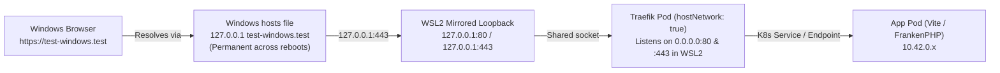

# Plan: Windows WSL2 Mirrored Networking, Traefik `hostNetwork`, Retiring WSL2 `dnsmasq`/NRPT, and Default `.test` TLD

## Architectural Q&A: `dnsmasq`, Mirrored Mode, and NRPT on Windows

### 1. Why can't `dnsmasq` on WSL2 + Windows NRPT be salvaged?
Your PowerShell diagnostic exposed the exact root cause:
```text
PS C:\Users\jsluc> Get-NetUDPEndpoint -LocalPort 53
LocalAddress   LocalPort
------------   ---------
0.0.0.0        53

PS C:\Users\jsluc> Get-Process -Id (Get-NetUDPEndpoint -LocalPort 53).OwningProcess
ProcessName: svchost (PID 5316)
```
On Windows machines with Hyper-V / WSL2 / ICS installed, Windows' own `svchost.exe` (`SharedAccess` / Hyper-V DNS proxy) binds **`UDP 0.0.0.0:53` on the Windows host**.

This creates an unresolvable catch-22 for running `dnsmasq` inside WSL2 for Windows browsers:
1. **Port 53 Collision on the Mirrored Loopback**: Because `svchost.exe` already owns `0.0.0.0:53` on the Windows host, WSL2's mirrored loopback relay (`wslrelay.exe`) **cannot forward UDP port 53** from Windows `127.0.0.1:53` to Linux `dnsmasq`, and `dnsmasq` inside WSL2 fails to bind `0.0.0.0:53` (`Address already in use`).
2. **`ignoredPorts=53` Doesn't Help Windows**: Even if `.wslconfig` sets `ignoredPorts=53` so `dnsmasq` can start inside WSL2 without colliding with Windows `svchost.exe`, `ignoredPorts=53` tells WSL2 **not** to mirror port 53 to Windows—so Windows browsers still cannot reach `dnsmasq` at `127.0.0.1:53`.
3. **NRPT Cannot Use a Custom Port**: Windows' Name Resolution Policy Table (`Add-DnsClientNrptRule -Namespace ".test" -NameServers "127.0.0.1"`) only accepts IP addresses and is hardcoded in the Windows OS to query **port 53**.
4. **Why Laravel Herd on Windows Uses the `hosts` File**: In your screenshot of `C:\Windows\System32\drivers\etc\hosts`, notice how **Laravel Herd** works on your exact machine:
   ```text
   127.0.0.1 database.herd.test # Herd generated Hosts
   ```
   Even Laravel Herd—a native Windows application—writes per-site `127.0.0.1 <site>.test` entries into `C:\Windows\System32\drivers\etc\hosts` rather than binding port 53 on Windows, specifically because Windows `svchost.exe` squats on `0.0.0.0:53`.

---

### 2. What is the point of WSL2 Mirrored Mode if we still update the Windows `hosts` file?
Even though `dnsmasq` pushed us toward Mirrored Mode originally, **Mirrored Mode (`networkingMode=mirrored`) is still essential for HTTP/HTTPS (`127.0.0.1:80` and `127.0.0.1:443`) and for making the Windows `hosts` file permanent!**

Compare **NAT Mode** vs. **Mirrored Mode** when using the Windows `hosts` file:

| Behavior | WSL2 NAT Mode (Default) | WSL2 Mirrored Mode (`networkingMode=mirrored`) |
| :--- | :--- | :--- |
| **IP in Windows `hosts` file** | Dynamic Hyper-V VM IP (e.g. `172.28.144.21 test-windows.test`) | **`127.0.0.1 test-windows.test`** |
| **What happens when you reboot Windows or run `wsl --shutdown`?** | The `172.x.x.x` IP changes! Every project breaks in the browser until you re-run `larakube up` and accept another UAC prompt. | **`127.0.0.1` never changes!** Once a project's domain is written to `hosts`, it works forever across reboots, sleep/wake, and Wi-Fi changes with zero UAC prompts. |
| **Windows Browser -> Traefik (`:80` / `:443`)** | Relies on NAT port-forwarding or `172.x.x.x` routing. | Direct shared loopback (`127.0.0.1:80` and `127.0.0.1:443`) once Traefik uses `hostNetwork: true`. |

---

### 3. Why did the browser show nothing even when `ping` worked (`no host socket on 80/443`)?
Your second diagnostic output revealed why the browser could not load `https://test-windows.kube`:
```text
service/traefik   LoadBalancer   10.43.223.85   192.168.254.153   80:32701/TCP,443:30268/TCP
---
no host socket on 80/443
```
- In WSL2 Mirrored Mode, Windows shares `127.0.0.1` with WSL2 **only for processes that open an actual listening socket (`LISTEN`) in the WSL2 root network namespace**.
- Previously, `Deployment/traefik` ran inside a Pod network namespace (`10.42.0.12`), and k3s's `klipper-lb` (`svclb-traefik`) only added `iptables` `DNAT` rules without opening a real host socket in the WSL2 root network namespace (`ss -tlnp` showed `no host socket on 80/443`).
- By running `Deployment/traefik` on WSL2 with **`hostNetwork: true`** and **`dnsPolicy: ClusterFirstWithHostNet`** (and `Service/traefik` as `ClusterIP` so `svclb-traefik` does not collide on ports 80/443), Traefik binds real `0.0.0.0:80` and `0.0.0.0:443` sockets in the WSL2 root network namespace—making `127.0.0.1:80` and `127.0.0.1:443` immediately reachable from your Windows browser!

---

## Implementation Plan



### Phase 1: Fix Traefik on WSL2 to Bind Real Host Sockets (`80` / `443`)
- **[`traefik-install.blade.php`](file:///Users/jsluchavez/Codes/Ideas/laravel-k8s/cli/resources/views/k8s/traefik-install.blade.php)**:
  - Support `$hostNetwork = true` on `Deployment/traefik`:
    - Set `strategy.type: Recreate` (so old pods release ports 80/443/8080 before new pods bind them).
    - Set `spec.template.spec.hostNetwork: true` and `dnsPolicy: ClusterFirstWithHostNet`.
    - Set `Service/traefik` `type: ClusterIP` when `$hostNetwork` is `true` so k3s `svclb-traefik` does not fight Traefik for host ports 80/443.
- **[`InteractsWithTraefik.php`](file:///Users/jsluchavez/Codes/Ideas/laravel-k8s/cli/app/Traits/InteractsWithTraefik.php)**:
  - Pass `'hostNetwork' => $this->isWsl()` when rendering `k8s.traefik-install`.
  - Add `localTraefikNeedsHostNetworkUpgrade(Kubectl $kubectl)` and call it automatically inside `reconcileSharedCluster()` (during `larakube up` / `larakube heal`) and `SetupCommand::isTraefikRunning()`:
    - If on WSL2 and `Deployment/traefik` does not yet have `hostNetwork: true`, automatically delete `svclb-traefik` / `Service/traefik` (if `LoadBalancer`) and re-apply `traefik-install.blade.php` with `hostNetwork: true`.

---

### Phase 2: Retire WSL2 `dnsmasq` + Windows NRPT & Auto-Clean Stale NRPT Rules
- **Keep `dnsmasq` for macOS (`/etc/resolver/<tld>`) and native Linux (`systemd-resolved`)**, where it works natively without Windows `svchost.exe` port 53 conflicts.
- **On WSL2 / Windows**:
  - **[`InteractsWithTrust.php`](file:///Users/jsluchavez/Codes/Ideas/laravel-k8s/cli/app/Traits/InteractsWithTrust.php)**:
    - Make `setupDnsmasq()`, `configureDnsmasq()`, and `isDnsmasqConfigured()` return early on `$this->isWsl()` so WSL2 never installs/starts `dnsmasq` or adds Windows NRPT rules.
    - Update `diagnoseTrustChain()` (`larakube trust:check` / `larakube doctor`) on WSL2 to check the Windows `hosts` file and report `Windows hosts file (managed automatically by larakube up)` instead of `dnsmasq`.
    - Add a helper to remove any stale LaraKube NRPT rules pointing to `127.0.0.1` (`Get-DnsClientNrptRule | Where-Object { $_.NameServers -contains '127.0.0.1' } | Remove-DnsClientNrptRule -Force; Clear-DnsClientCache`).
  - **[`SetupCommand.php`](file:///Users/jsluchavez/Codes/Ideas/laravel-k8s/cli/app/Commands/SetupCommand.php)**:
    - In `handleWindowsSetup()` and `handle()`: stop applying NRPT rules or installing `dnsmasq` on WSL2. Instead, explain clearly that WSL2 Mirrored Mode lets Windows reach the cluster at a permanent `127.0.0.1` address and `larakube up` keeps the Windows `hosts` file in sync.
    - If any stale `127.0.0.1` NRPT rule exists from previous runs (e.g. `.kube` or `.test`), automatically clean it up during `setup` / `hosts` sync so `Resolve-DnsName` and browsers stop hitting `10054` connection resets.
  - **[`InteractsWithHosts.php`](file:///Users/jsluchavez/Codes/Ideas/laravel-k8s/cli/app/Traits/InteractsWithHosts.php) & [`WslBridge.php`](file:///Users/jsluchavez/Codes/Ideas/laravel-k8s/cli/app/Services/WslBridge.php)**:
    - Remove the `dnsmasqFullyCoversKube()` early-return on WSL2 so `ensureWindowsHostsAreSet()` always ensures the project's domains and `larakube-shared` domains (`traefik.<tld>`, `mailpit.<tld>`) are mapped to `127.0.0.1` (when Mirrored Mode is active) in `C:\Windows\System32\drivers\etc\hosts`.
    - **Fix the `pending-windows-hosts` overwrite bug**: During `larakube up`, `ensureHostsAreSet()` is called twice—first for `<project>-local` (e.g. `test-windows.test`) and second inside `reconcileSharedCluster()` for `larakube-shared` (`mailpit.test`, `traefik.test`). Previously, `stagePendingWindowsHostsSync()` overwrote `pending-windows-hosts.json` on each call, which is why **only `mailpit` and `traefik` ended up in your Windows `hosts` file and `test-windows` was lost**!
    - Change `stagePendingWindowsHostsSync()` to **merge** namespaces into `pending-windows-hosts.json` (and merge in the elevated PowerShell script) so a single UAC prompt at the end of `larakube up` writes **both** `<project>-local` (`test-windows.test`) and `larakube-shared` (`traefik.test`, `mailpit.test`) AND flushes any stale `127.0.0.1` NRPT rules in one shot!

---

### Phase 3: Change Default Local TLD from `.kube` to `.test`
- **[`GlobalConfigData.php`](file:///Users/jsluchavez/Codes/Ideas/laravel-k8s/cli/app/Data/GlobalConfigData.php)**:
  - Change `public const string DEFAULT_TLD = 'test';` and default `$localTld = self::DEFAULT_TLD`.
- **[`ConfigTldCommand.php`](file:///Users/jsluchavez/Codes/Ideas/laravel-k8s/cli/app/Commands/Config/ConfigTldCommand.php)**:
  - Reorder interactive choices so `.test (default)` is first and `.kube` is second.
- **Fallback references (`?? 'test'`) across `cli/` and `desktop/`**:
  - Update hardcoded `'kube'` fallbacks in CLI commands/traits/views (`StatusCommand`, `UpCommand`, `PreviewUpCommand`, `DoctorCommand`, `TrustCheckCommand`, `InteractsWithCluster`, `ManagesLocalCa`, `BuildsProjectManifests`, `ManagesCompanions`, `ManagesPlatformTools`, `WslBridge`, etc.) and Desktop (`ClusterService.php`, `CreateProjectDialog.tsx`, `SettingsPage.tsx`) so `.test` is the universal default when unconfigured.
- **Note for existing machines/projects**:
  - If `~/.larakube/config.json` or a project's `.larakube.json` already saved `"localTld": "kube"` from an earlier run, running `larakube config:tld test` (and `larakube config:tld test --project` if pinned in `.larakube.json`) + `larakube trust` + `larakube up` will switch existing environments cleanly to `.test`.

---

### Phase 4: Fix `/.dockerenv` False-Positive on WSL2 (`larakube trust`)
- Because the `larakube-ubuntu` rootfs image was exported from a container build, `/.dockerenv` exists at the root of the WSL2 filesystem.
- Update `file_exists('/.dockerenv')` guards in:
  - [`TrustCommand.php`](file:///Users/jsluchavez/Codes/Ideas/laravel-k8s/cli/app/Commands/TrustCommand.php)
  - [`UntrustCommand.php`](file:///Users/jsluchavez/Codes/Ideas/laravel-k8s/cli/app/Commands/UntrustCommand.php)
  - [`UninstallCommand.php`](file:///Users/jsluchavez/Codes/Ideas/laravel-k8s/cli/app/Commands/UninstallCommand.php)
  - [`InteractsWithSslTrust.php`](file:///Users/jsluchavez/Codes/Ideas/laravel-k8s/cli/app/Traits/InteractsWithSslTrust.php)
  to `file_exists('/.dockerenv') && ! $this->isWsl()` so WSL2 is never mistaken for a Docker container.

---

### Phase 5: Verification & Testing
1. Run `composer format`, `composer analyse`, and `composer test` in `cli/` (updating unit/feature tests for `DEFAULT_TLD = 'test'`, Traefik `hostNetwork` on WSL2, and Windows `hosts` merging).
2. Hand off to you to run `./build` and verify on Windows (`larakube config:tld test`, `larakube trust`, `larakube up`).
