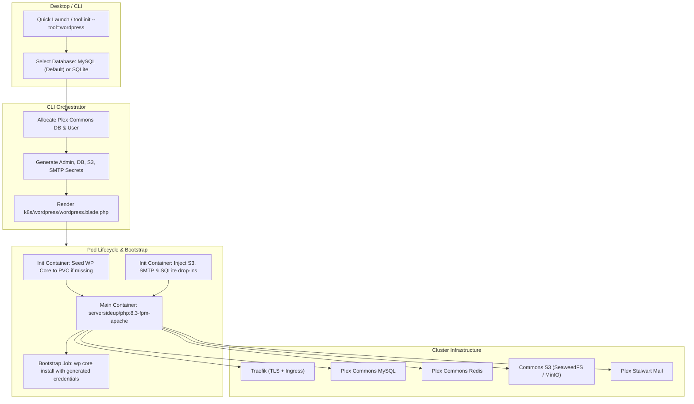

# Architectural Plan: Production-Grade WordPress Companion Tool

## Status: Active
**Date:** 2026-10-20  
**Context:** Evaluating WordPress as a 1-click companion tool in LaraKube based on ServerSideUp best practices (`serversideup/docker-wordpress` and official ServerSideUp Docker PHP documentation).

---

## 1. Executive Summary & Verdict

### How Far Are We?
Architecturally, **LaraKube is roughly 75–80% of the way there structurally**, but **the remaining 20–25% represents the difference between a proof-of-concept and a reliable production service**.

Currently, the orchestration machinery exists:
- `tool:init --tool=wordpress` works and handles ingress, TLS, host resolution, secrets generation, OpenBao synchronization, and Plex Commons MySQL allocation.
- In LaraKube Desktop, the Quick Launch modal offers WordPress with database engine selection.

However, **there are 5 critical production blockers** that prevent it from being production-ready:
1. **Ephemeral Core & Upgrades (Data Loss Risk):** Only `/var/www/html/wp-content` is mounted to the PVC. WordPress core, `wp-config.php`, `.htaccess`, and core auto-updates live in the container's ephemeral root. If an admin upgrades WordPress or a pod restarts, core updates vanish, leading to severe core/database version desync.
2. **Missing Automated Bootstrap (Credentials Mismatch):** LaraKube generates an admin password and prints `Bootstrap Admin Credentials`, but **never runs `wp core install`**. When the user opens the site, they are greeted by the "Famous 5-Minute Install" wizard, and the generated credentials do not exist in the database.
3. **Flaky Runtime SQLite Download:** When SQLite is selected, an init container uses `wget` from public internet (`downloads.wordpress.org/plugin/sqlite-database-integration...`) on every pod boot. This fails on egress-restricted clusters and is fragile.
4. **Unfulfilled Capability Tags (S3 & SMTP):** The Quick Launch UI advertises `S3 Storage` and `SMTP Relay`. While S3 and SMTP secrets are generated, no plugin or drop-in is injected into WordPress to actually use them.
5. **Architectural Contradiction (FrankenPHP vs Apache):** The Desktop UI advertises a "ServerSideUp FrankenPHP pod", but the CLI deploys Apache. As ServerSideUp's research demonstrates, **FrankenPHP and NGINX break a large portion of the WordPress plugin ecosystem** because WordPress fundamentally relies on Apache `.htaccess` rewrite rules.

---

## 2. Key Takeaways from ServerSideUp & `docker-wordpress`

ServerSideUp operates their own production WordPress infrastructure on Docker Swarm with Traefik, MariaDB, and `serversideup/php:8.x-fpm-apache`. Their core findings dictate the production roadmap:

### A. "The WordPress Way" vs Container Dogma
- Modern container practices (immutable containers, separating core from app code via Bedrock, using NGINX/FrankenPHP) frequently clash with the WordPress plugin ecosystem.
- Plugins like caching (WP Rocket), security (Wordfence), redirection, and SEO dynamically modify `.htaccess` and write directly to WordPress paths.
- On FrankenPHP (Caddy) or NGINX, `.htaccess` files are ignored. Unless rewrites are manually reverse-engineered, plugins silently fail.
- **Rule:** WordPress companion services must run on **Apache + PHP-FPM** (`serversideup/php:8.3-fpm-apache` or hardened Apache), never FrankenPHP.

### B. The Volume-Based Approach
- Keeping WordPress files on a persistent volume provides maximum compatibility with automatic core/plugin updates, media, and third-party themes.
- Custom code or persistent state belongs on the volume; the container serves purely as the runtime.

### C. ServerSideUp Hardening Defaults
- `serversideup/php:8.x-fpm-apache` includes:
  - XML-RPC disabled by default (prevents brute-force / DDoS amplification).
  - Protected access to sensitive files (`.git`, `.env`, CI configurations).
  - Proper unprivileged user execution (`www-data` UID 9999).
  - Cloudflare trusted proxy IP forwarding.

---

## 3. Detailed Gap Analysis: Current State vs Production

| Dimension | Current LaraKube State | ServerSideUp Standard | Production Target |
| :--- | :--- | :--- | :--- |
| **Web Server** | `wordpress:6.7-php8.3-apache` (Official) | `serversideup/php:8.3-fpm-apache` | Standardize on Apache + PHP-FPM with SSU hardening |
| **Desktop UI Copy** | Claims "ServerSideUp FrankenPHP" | N/A (SSU warns against FrankenPHP for WP) | Update UI to "ServerSideUp Apache + PHP-FPM" |
| **Filesystem Mount** | Only `/var/www/html/wp-content` on PVC | Entire `/var/www/html` or volume-seeded | Full persistent volume or seed script copying core to PVC |
| **Installation** | Manual 5-minute wizard on first visit | Manual or WP-CLI | Automated `wp core install` via WP-CLI on first rollout |
| **Admin Credentials** | Printed in CLI, but not injected in WP | Manual setup | Auto-provisioned in database matching CLI output |
| **Database: MySQL** | Supported via Plex Commons MySQL | Supported (MariaDB/MySQL) | Production default: Plex Commons MySQL |
| **Database: SQLite** | Downloads zip via `wget` at runtime | Not officially supported | Embed drop-in in ConfigMap/image (no runtime `wget`) |
| **Media / S3** | Credentials generated but unused | Local disk or S3 plugin | Auto-inject S3 uploads drop-in (`humanmade/s3-uploads`) |
| **Transactional Mail**| SMTP secret exists, unused by WP | External SMTP | Auto-inject lightweight `mu-plugin` hooking `phpmailer_init` to Plex Stalwart |
| **Redis Cache** | Config constants defined, drop-in missing | Redis cache plugin | Auto-inject `object-cache.php` drop-in for Plex Redis |
| **Maturity Status** | Listed in `untested-tools` in Pennant | N/A | Promoted to Production after end-to-end battle-testing |

---

## 4. Architectural Roadmap to Production



### Phase 1: Core Persistence & Image Alignment
1. **Update Base Image:** Switch from standard Docker library `wordpress:6.7-php8.3-apache` to `serversideup/php:8.3-fpm-apache` (or pre-package a `larakube/wordpress` image based on SSU with WP core and WP-CLI pre-installed).
2. **Persistent Volume Architecture:**
   - Mount the PVC to the complete `/var/www/html` directory (or use a volume initialization pattern where the container copies WordPress core into the PVC on initial run if `wp-config.php` or `wp-settings.php` is missing).
   - This ensures core upgrades performed in the WP admin dashboard persist across pod restarts without database version desync.
3. **Desktop UI Alignment:**
   - In `desktop/resources/js/components/quick-launch-modal.tsx`, update description:
     `Blazing fast ServerSideUp Apache + PHP-FPM pod with shared Plex MySQL or zero-RAM SQLite.`

### Phase 2: Automated Zero-Touch Bootstrap (`wp core install`)
1. **Bootstrap Execution:**
   - Introduce an automated one-shot bootstrap check:
     ```sh
     if ! wp core is-installed --path=/var/www/html; then
       wp core install \
         --path=/var/www/html \
         --url="https://${WP_HOST}" \
         --title="${WP_TITLE:-WordPress}" \
         --admin_user="admin" \
         --admin_password="${WP_ADMIN_PASSWORD}" \
         --admin_email="${WP_ADMIN_EMAIL}" \
         --skip-email
     fi
     ```
2. **Immediate Usability:**
   - When LaraKube finishes rollout and displays the admin username and password, the user can immediately log in to `/wp-admin/` with those credentials.

### Phase 3: Cluster Services Wiring (S3, SMTP, Redis)
1. **S3 Media Storage (`wp-content/mu-plugins/s3-uploads.php`):**
   - Provide an automated S3 uploads mu-plugin or pre-configured drop-in wired to the existing Commons S3 credentials (`S3_UPLOADS_BUCKET`, `S3_UPLOADS_KEY`, `S3_UPLOADS_SECRET`, `S3_UPLOADS_ENDPOINT`).
2. **SMTP Relay (`wp-content/mu-plugins/larakube-smtp.php`):**
   - Provide a lightweight mu-plugin hooking `phpmailer_init` to point to `mail.larakube-plex.svc.cluster.local:25`.
   - All WordPress emails (password resets, notifications) will immediately flow through Stalwart / Mailpit.
3. **Redis Object Cache (`wp-content/object-cache.php`):**
   - Place the standard Redis drop-in file into `wp-content/` so the existing `WP_REDIS_HOST` and `WP_REDIS_DATABASE` constants take effect immediately.

### Phase 4: Production Verification & Pennant Promotion
1. **Air-Gap / Offline SQLite:**
   - Replace the runtime `wget` of `sqlite-database-integration.zip` with a ConfigMap-mounted or image-bundled SQLite drop-in.
2. **Battle-Testing:**
   - Deploy on live cluster (`larakube tool:init --tool=wordpress`).
   - Verify login with generated credentials, verify media upload to S3, test email delivery, and test container restart survival.
3. **Remove from `untested-tools`:**
   - In `desktop/app/Providers/AppServiceProvider.php`, remove `'wordpress'` from `untested-tools` so the Experimental badge is removed.

---

## 5. Summary & Actionable Recommendations

1. **Keep Apache, Drop FrankenPHP Marketing Text:**
   ServerSideUp's own documentation proves why Apache is indispensable for WordPress in production. The Desktop UI text must be corrected to reflect Apache + PHP-FPM.
2. **Priority 1 is Volume Persistence and Auto-Install:**
   Without persisting all of `/var/www/html` and running `wp core install`, WordPress is not production-ready because core upgrades wipe on restart and credentials are unseeded.
3. **Estimated Effort:**
   Implementing Phases 1–3 requires **approximately 1 dedicated implementation cycle** (updating `WordpressInitCommand`, creating the bootstrap hook in `wordpress.blade.php`, adding the mu-plugins for S3/SMTP, and updating Desktop Quick Launch copy).

---

## 6. Research Verification: Recent WordPress Releases & Native SQLite Status

### A. Recent Core Releases
- **WordPress 6.7 ("Rollins", Nov 2024)**, **6.8 ("Cecil", Apr 2025)**, **6.9 ("Gene", Dec 2025)**, and **7.0 ("Louis Armstrong", May 2026)** focused heavily on:
  - Block bindings, Font Library, and Gutenberg Phase 3 (real-time collaboration).
  - Admin redesign using modern React DataViews.
  - Native WP AI Client infrastructure.
- **Docker / Containerization in Core:** Core itself has made **no architectural changes** to container friendliness. Core still assumes a mutable local filesystem where PHP processes have direct write privileges to `wp-content/` and `wp-config.php`.

### B. SQLite in Core: The Current Truth
- **Still Not in Core:** SQLite is **still NOT natively merged into WordPress Core**.
- **`sqlite-database-integration` v3.0 Evolution:** The WordPress Performance Team completed a massive v3.0 rewrite (custom pure-PHP MySQL grammar parser, CTEs, Window functions, WAL logging). However, it remains a **drop-in plugin (`db.php`)**, not a native out-of-the-box core installer option.
- **Official Docker Library Status:** The official image (`docker-library/wordpress`) **strictly refuses to bundle or support SQLite**. It only accepts `WORDPRESS_DB_HOST` pointing to MySQL/MariaDB.
- **Implication for LaraKube:** SQLite still requires injecting `db.php` into `wp-content/`. For production reliability, **Plex Commons MySQL / MariaDB remains the only zero-risk, fully compatible production database engine for WordPress**.

### C. Docker Automated Installation Status
- The official Docker image still **does not bundle WP-CLI** and still **does not perform automated non-interactive installs**.
- Without an external bootstrap job or companion `wordpress:cli` container executing `wp core install`, the official image always stops at the interactive 5-minute install wizard.

