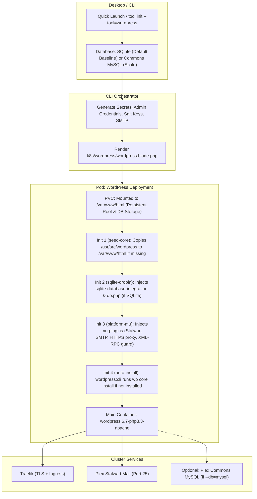

# Implementation Plan: Production-Ready WordPress with Default SQLite

Make WordPress as a 1-click companion tool (`tool:init --tool=wordpress`) fully production-ready, establishing **SQLite as the primary default baseline** (matching PocketBase and n8n) for zero-RAM, zero-dependency deployment, while retaining Plex Commons MySQL as an optional scale-up engine.

---

## User Review Required

> [!IMPORTANT]
> **Unified SQLite Baseline (PocketBase, n8n, WordPress):**
> Following your directive, all three Quick Launch companion apps (**PocketBase**, **n8n**, and **WordPress**) now share **embedded SQLite as the default engine**. A WordPress instance boots with zero external database dependencies, consuming less than 150MB RAM. Plex Commons MySQL remains available as an optional scale-up choice (`--db=mysql`).

> [!IMPORTANT]
> **Web Server Standard (Apache + PHP-FPM):**
> Per ServerSideUp's architecture ("The WordPress Way"), WordPress runs on **Apache + PHP-FPM** (`wordpress:6.7-php8.3-apache`), because community plugins rely heavily on `.htaccess` rewrite rules. Quick Launch copy in Desktop is updated from "FrankenPHP" to "ServerSideUp Apache + PHP-FPM".

---

## Proposed Changes



---

### Component 1: Kubernetes Manifests & Pod Architecture (`cli`)

#### [MODIFY] [`cli/resources/views/k8s/wordpress/wordpress.blade.php`](file:///Users/jsluchavez/Codes/Ideas/laravel-k8s/cli/resources/views/k8s/wordpress/wordpress.blade.php)

1. **Full Web Root & Database Persistence:**
   - Mount PVC at `/var/www/html`.
   - SQLite database resides at `/var/www/html/wp-content/database/.ht.sqlite` on the PVC, completely persistent and protected from HTTP access via Apache `.ht*` rules.
2. **Init Container 1 (`seed-core`):**
   - If `/var/www/html/wp-settings.php` is missing, copies `/usr/src/wordpress/.` into `/var/www/html/` (`cp -a -n`).
3. **Init Container 2 (`sqlite-setup` - active when `$dbEngine === 'sqlite'`):**
   - Ensures `wp-content/plugins/sqlite-database-integration` and `wp-content/db.php` exist.
   - If missing, extracts the drop-in safely and enables SQLite WAL mode (`PRAGMA journal_mode = WAL;`) for concurrent read/write throughput.
4. **Init Container 3 (`seed-mu-plugins`):**
   - Injects `wp-content/mu-plugins/larakube-platform.php`:
     - **HTTPS Reverse Proxy:** Sets `$_SERVER['HTTPS'] = 'on'` when `HTTP_X_FORWARDED_PROTO === 'https'`.
     - **Stalwart SMTP Relay:** Hooks `phpmailer_init` to point to `mail.larakube-plex.svc.cluster.local:25` for zero-setup transactional email.
     - **Security Hardening (ServerSideUp alignment):** Disables XML-RPC (`add_filter('xmlrpc_enabled', '__return_false')`) to eliminate pingback DDoS and brute-force vectors.
5. **Init Container 4 (`auto-install`):**
   - Runs `wordpress:cli-php8.3` to automate installation on first boot:
     ```bash
     if ! wp core is-installed --path=/var/www/html; then
       echo "Running automated WordPress install..."
       wp core install \
         --path=/var/www/html \
         --url="https://{{ $host }}" \
         --title="{{ $siteTitle ?? 'WordPress' }}" \
         --admin_user="admin" \
         --admin_password="{{ $adminPassword }}" \
         --admin_email="{{ $adminEmail }}" \
         --skip-email
     fi
     ```
   - When Apache starts, the site is 100% installed and the user can log in immediately.
6. **Main Container:**
   - Image: `wordpress:6.7-php8.3-apache`.
   - Security config: Apache rules blocking `.git`, `.env`, and `xmlrpc.php`.
   - Resource limits: 128Mi request / 512Mi limit memory.

---

### Component 2: CLI Command & Orchestration (`cli`)

#### [MODIFY] [`cli/app/Commands/Wordpress/WordpressInitCommand.php`](file:///Users/jsluchavez/Codes/Ideas/laravel-k8s/cli/app/Commands/Wordpress/WordpressInitCommand.php)

- Default `$dbEngine` to `'sqlite'`.
- Interactive prompt ordering:
  ```php
  'sqlite' => 'SQLite — Embedded zero-RAM file storage (Default, Recommended for blogs/sites)',
  'mysql' => 'MySQL / MariaDB — Shared Plex Commons (For heavy write concurrency)',
  ```
- Pass `$adminPassword`, `$adminEmail`, and SMTP hosts to the view.
- Strictly idempotent: retains existing passwords and PVCs on re-runs.

#### [MODIFY] [`cli/app/Services/Tools/ToolInitSpec.php`](file:///Users/jsluchavez/Codes/Ideas/laravel-k8s/cli/app/Services/Tools/ToolInitSpec.php)

- Set default database option for `ClusterTool::WORDPRESS` to `'sqlite'`.

---

### Component 3: Desktop UI & Maturity (`desktop`)

#### [MODIFY] [`desktop/resources/js/components/quick-launch-modal.tsx`](file:///Users/jsluchavez/Codes/Ideas/laravel-k8s/desktop/resources/js/components/quick-launch-modal.tsx)

- Update description and default subdomain:
  ```tsx
  name: 'WordPress',
  tagline: "World's #1 CMS",
  description: 'Lightweight ServerSideUp Apache + PHP-FPM pod with zero-RAM SQLite or shared Plex MySQL.',
  defaultSubdomain: 'blog',
  adminPath: '/wp-admin',
  ```
- Ensure database selection defaults to `sqlite`, unifying PocketBase, n8n, and WordPress.

#### [MODIFY] [`desktop/app/Providers/AppServiceProvider.php`](file:///Users/jsluchavez/Codes/Ideas/laravel-k8s/desktop/app/Providers/AppServiceProvider.php)

- Remove `'wordpress'` from `untested-tools` so the Experimental badge is removed.

---

## Verification Plan

### Automated Tests
1. **CLI Tests:**
   ```bash
   ./vendor/bin/pest tests/Feature/ToolInitWordPressTest.php
   composer test
   ```
   - Verify manifest generation: `/var/www/html` volume mount, `seed-core`, `sqlite-setup`, `seed-mu-plugins`, `auto-install` container rendering.
   - Verify default SQLite execution without Plex Commons dependency.
2. **Desktop Tests:**
   ```bash
   ./vendor/bin/pest tests/Feature/QuickActionControllerTest.php tests/Feature/ToolMaturityTest.php
   composer types:check && npm run types:check
   ```
   - Verify Quick Launch modal props and default SQLite selection.

### Manual Verification
1. Run `./build` (by the user).
2. Execute `larakube tool:init --tool=wordpress` (no flags needed, defaults to SQLite).
3. Verify rollout:
   - Init containers seed core, configure SQLite drop-in, and run `wp core install`.
   - Open `https://blog.example.com/wp-admin/` and log in immediately using `admin` and the printed password.
   - Verify no 5-minute install screen appears.
   - Create a post, upload an image, and restart the pod (`kubectl rollout restart deployment ...`).
   - Confirm all data and settings survive the restart.
