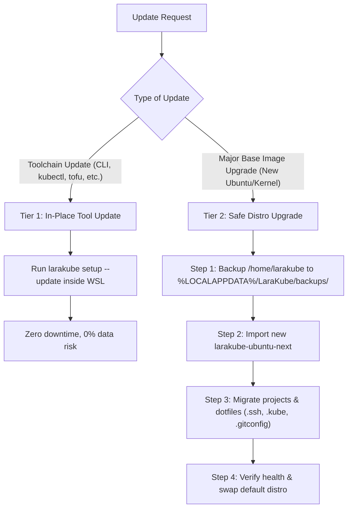
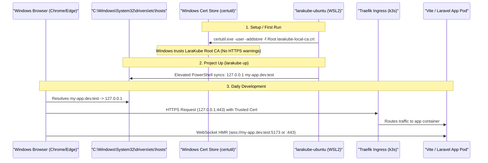

# Plan: WSL Distro Improvements, Project Folder Resolution & Local Dev Parity

**File:** `cli/plans/active/wsl-distro-improvements-and-local-dev.md`  
**Status:** In Progress / Design  
**Date:** 2026-10-14  

---

## 🎯 Executive Summary

LaraKube on Windows relies on the custom `larakube-ubuntu` WSL2 distribution to execute the CLI, containers, and orchestration tools without requiring host-level PHP, Docker Desktop, or Unix dependencies. 

This plan addresses three critical friction points identified for Windows students and developers:
1. **WSL Folder Picker Failure**: The project creation folder picker (`projects.choose-folder`) errors out on Windows because host paths (`C:\...` or `\\wsl.localhost\...`) fail the strict `insideHome()` check designed for native Unix paths.
2. **Destructive Reset vs. Non-Destructive Update**: The only current way to update `larakube-ubuntu` is `Wsl::reset()` (`wsl --unregister larakube-ubuntu`), which permanently wipes student code and local projects inside the WSL virtual disk.
3. **Local TLD & Development Resolution (`*.dev.test`)**: Ensuring Vite HMR, Traefik ingress, Windows `/etc/hosts`, and Windows Root CA trust work seamlessly out of the box for browser testing on Windows.

---

## 🔍 Issue 1: Project Folder Picker on Windows WSL

### Root Cause
1. `ProjectController::chooseFolder()` opens a native directory picker via NativePHP/Electron (`Dialog::new()->folders()->open()`).
2. On Windows, the dialog returns a Windows path (e.g. `C:\Users\Student\Projects` or `\\wsl.localhost\larakube-ubuntu\home\larakube\projects`).
3. `ProjectController::insideHome()` evaluates:
   ```php
   $home = ToolLocator::home(); // On Windows: '/home/larakube'
   $resolved = realpath($path) ?: $path;
   return $home !== '' && $path !== '' && (str_starts_with($resolved, $home.'/') || ($allowHome && $resolved === $home));
   ```
4. `C:\Users\...` and `\\wsl.localhost\...` NEVER start with `/home/larakube/`. As a result, every selected directory is rejected with:
   `"Choose a folder inside your home folder."`
5. On `projects.create`, line 171 initializes `$parent`:
   ```php
   $this->insideHome($parent, allowHome: true) && is_dir($parent) ? $parent : ToolLocator::home()
   ```
   On Windows host PHP, `is_dir('/home/larakube')` fails because the host filesystem has no `/home/larakube` root.

### Architectural Solution
1. **Normalize Path Representations**:
   - Use `WslDistro::toLinux($path)` and `WslDistro::toWindows($path)` to bridge Windows paths and WSL Linux paths.
   - For Windows host paths (e.g. `C:\Users\student\apps`), `toLinux()` maps to `/mnt/c/Users/student/apps`.
   - For WSL internal paths (e.g. `\\wsl.localhost\larakube-ubuntu\home\larakube\projects`), `toLinux()` maps to `/home/larakube/projects`.
2. **Windows-Aware `insideHome()`**:
   - On Windows, a folder is valid if:
     a) It is inside the WSL distro home: `/home/larakube` or `/home/larakube/*`.
     b) Or it is inside the Windows user profile (`%USERPROFILE%` / `C:\Users\<user>`), mapping to `/mnt/c/Users/<user>`.
     c) Or it is any valid directory on an accessible drive (`/mnt/c/...`, `/mnt/d/...`).
3. **Default Creation Path**:
   - On Windows, default to `/home/larakube/projects` (which is pre-created by `larakube-ubuntu/Dockerfile` with UID 1000 permissions).
   - Display a human-readable path in the UI:
     `\\wsl.localhost\larakube-ubuntu\home\larakube\projects\my-app`
     with an option to easily choose a Windows host folder or keep it in the fast WSL filesystem.
4. **Performance Callout**:
   - In `projects/create.tsx`, if the user selects a Windows mount (`/mnt/c/...`), display a subtle tip:
     > 💡 *Tip: Projects stored in LaraKube Linux (`/home/larakube/projects`) run file watchers and npm/composer 5x faster than Windows C:\ drive folders.*

---

## 🔄 Issue 2: Non-Destructive Update for `larakube-ubuntu`

### Current Problem
- `Wsl::reset()` calls `wsl.exe --unregister larakube-ubuntu`.
- This removes the WSL instance and permanently deletes `ext4.vhdx`. Any repositories, uncommitted work, local databases, or files in `/home/larakube` are irrevocably lost.

### Solution: Two-Tier Update Strategy



### 1. Tier 1: In-Place Tool Updates (`Wsl::updateTools()`)
- When new versions of `larakube`, `kubectl`, `tofu`, `gh`, `tea`, `aws`, `gcloud`, or `k9s` are released:
  - Do NOT touch the distro disk.
  - Run an in-place update process inside the running WSL distro:
    ```bash
    wsl.exe -d larakube-ubuntu --user larakube -- larakube setup --update
    ```
  - For the `larakube` CLI itself: download the latest release binary from GitHub and replace `/usr/local/bin/larakube` (or invoke self-updater).
  - This is completely non-destructive, finishes in seconds, and preserves all user workspaces.

### 2. Tier 2: Safe Rootfs Upgrade with Automatic Data Backup
- When an entirely new rootfs image is downloaded (`larakube-ubuntu.tar.gz` version bump):
  - **Pre-Upgrade Backup**:
    Before any unregister/re-import, create a compressed archive of student work:
    ```bash
    wsl.exe -d larakube-ubuntu --user larakube -- tar -czf /tmp/backup.tar.gz -C /home/larakube projects .ssh .gitconfig .kube
    ```
    Copy the backup safely to Windows host storage:
    `%LOCALAPPDATA%\LaraKube\backups\home-backup-<date>.tar.gz`
  - **Fresh Import with Restore**:
    Import the new image, then extract the backup back into `/home/larakube/`.
  - **Safety Guarantee**: Even if the import fails, the student's project files exist untouched on the Windows host.

### 3. Settings UI Redesign
- Replace the lone destructive "Reset LaraKube Linux" button with:
  1. **"Update LaraKube Linux"** (`primary` or `secondary` button):
     - Checks version against published rootfs / CLI version.
     - Performs non-destructive in-place updates.
  2. **"Reset LaraKube Linux"** (moved under collapsed **Danger Zone**):
     - Clearly labelled: *"Factory Reset: Deletes all projects and data inside LaraKube Linux"*.
     - Requires explicit confirmation.

---

## 🌐 Issue 3: Local Development & Local TLDs on Windows WSL (`*.dev.test`)

### Architectural Blueprint for Windows Dev Parity



### Key Components:
1. **Mirrored Networking Priority**:
   - Modern WSL2 (Windows 11 22H2+) supports `networkingMode=mirrored` in `~/.wslconfig`.
   - With mirrored networking:
     - WSL and Windows share `127.0.0.1`.
     - Ingress ports 80 and 443 opened in k3s are immediately accessible on Windows at `127.0.0.1`.
     - Windows `hosts` entries point to `127.0.0.1` permanently (never rots across reboots).
   - LaraKube's `InteractsWithHosts` already checks `wslNetworkingMode() === 'mirrored'` and writes `127.0.0.1`.
2. **Elevated Windows Hosts Sync**:
   - Staged safely in `%TEMP%` (`C:\Users\<user>\AppData\Local\Temp\win-hosts-sync.ps1`) rather than WSL `/tmp`, avoiding Administrator token 9P permission issues.
   - Executes via `Start-Process powershell -Verb RunAs -Wait`.
3. **Local CA Installation**:
   - `InteractsWithTrust` stages the generated CA certificate in Windows `%TEMP%` and executes:
     ```powershell
     certutil.exe -user -addstore -f "Root" <temp-ca-path>
     ```
   - Windows Chrome, Edge, and system webviews immediately trust `https://*.dev.test`.
4. **Vite Hot Module Replacement (HMR)**:
   - Vite configs generated by LaraKube specify:
     ```javascript
     server: {
       host: '0.0.0.0',
       hmr: {
         host: 'my-app.dev.test',
       }
     }
     ```
   - File watching uses native Linux inotify inside `/home/larakube/projects`, providing sub-second HMR updates to the Windows browser.

---

## 📋 Implementation Checklist

### Phase 1: Fix Folder Picker on Windows WSL
- [ ] In `desktop/app/Services/LaraKube/ToolLocator.php`:
  - Enhance `home()` to return `/home/larakube/projects` as default projects path on Windows.
  - Add helper `isInsideWindowsHome()` and `canonicalLinuxPath()`.
- [ ] In `desktop/app/Http/Controllers/ProjectController.php`:
  - Update `insideHome()` to normalize Windows host paths (`C:\...`) and WSL UNC paths (`\\wsl.localhost\...`) via `WslDistro::toLinux()`.
  - Allow directories within the Windows user profile (`/mnt/c/Users/<user>`) and WSL home (`/home/larakube`).
  - Fix `create()` so `parent` doesn't fail `is_dir()` on Windows host PHP.
- [ ] In `desktop/resources/js/pages/projects/create.tsx`:
  - Display appropriate path labels when running on Windows.
  - Add friendly advisory note when selecting `/mnt/c/` regarding WSL file I/O speed.

### Phase 2: Non-Destructive Update for `larakube-ubuntu`
- [ ] In `desktop/app/Services/Wsl.php`:
  - Add `updateTools()` method that runs in-place toolchain update inside the distro without touching `/home/larakube`.
  - Add `backupUserHome()` method to safely archive `/home/larakube/projects` to `%LOCALAPPDATA%\LaraKube\backups\`.
  - Add `upgradeRootfs()` with pre-upgrade backup verification.
- [ ] In `desktop/app/Http/Controllers/WslSetupController.php`:
  - Add `update` route and handler for non-destructive toolchain update.
- [ ] In `desktop/resources/js/pages/settings/index.tsx`:
  - Add **"Update LaraKube Linux"** action.
  - Move "Reset LaraKube Linux" to a Danger Zone section with explicit warnings.

### Phase 3: Local Dev Verification & Diagnostics
- [ ] In `desktop/app/Services/Diagnostics.php`:
  - Add checks for WSL networking mode (`mirrored` vs `nat`), Windows hosts sync status, and Root CA trust status in the diagnostic dump.
- [ ] Test Vite scaffolding and local HMR validation end-to-end on Windows test machine.

---

## 🛡️ Verification & Safety Constraints
- **Zero Data Loss Invariant**: No update action may unregister the WSL distro without first backing up user projects to the Windows host filesystem.
- **Convention**: All commits must follow ADR 0025 (`feat(desktop): ...`, `fix(desktop): ...`).
- **Forbidden Action**: Agents are strictly forbidden from executing `./build`. Linters (`composer lint`, `npm run check:fix`), typechecks (`composer types:check`, `npm run types:check`), and tests (`pest`) must pass.
